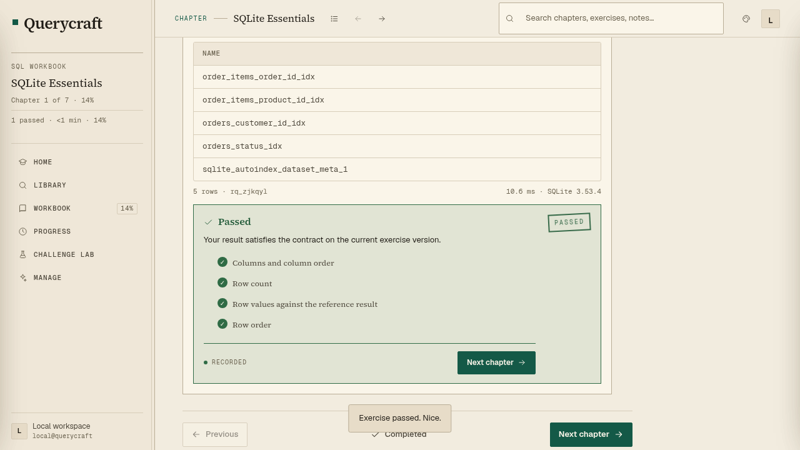
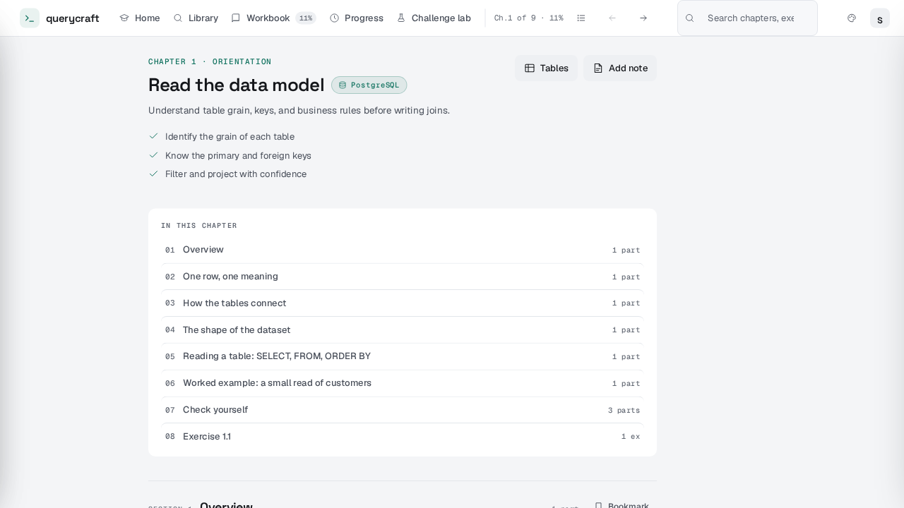
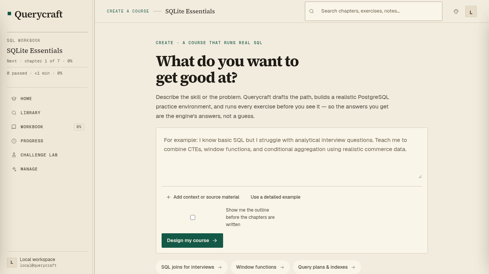

# Querycraft

**Learn SQL by writing it.**

**[Open the browser sample](https://theakhandpatel.github.io/querycraft/)** ·
[Documentation](docs/README.md)

You cannot learn SQL by watching someone else write it.

You can read the chapter, follow the diagram, and still freeze at the blank line where the query goes. The skill lives in the writing. The only way to build it is to write the query, run it, and see what comes back.

Querycraft is built around that moment.

You get a chapter, a real database, and a question. You write the SQL. The database runs it. Querycraft grades the result: the columns, the rows, the order, the values. If the rows are right, you pass. It never compares your SQL to a model answer, because there is more than one right answer.

No videos. No multiple choice. No "close enough."



## Start with a chapter. Or write your own.

The library starts with SQLite Essentials, then the PostgreSQL foundations. From there it covers `SELECT` and `FROM`, joins, subqueries, CTEs, and window functions. PostgreSQL is the deeper path, where analytics, query plans, and the job-oriented material live. The translation course covers the places where the two engines disagree, because the differences are where the learning lives.

When the course you need does not exist, describe it. Querycraft builds the outline, writes the chapters, and runs every exercise against the engine before you see it. Edit anything. The course you build is graded live, like every other chapter.

## Your database. Your workbook. Your look.

Sign in and you get a private copy of the data. Write to it. Change the schema. Break it. Reset puts it back.

Your notes, saved queries, bookmarks, and progress stay in the workbook, and search finds all of it. Pick one of the themes, or make one from a single color.

| | |
| --- | --- |
|  |  |
| A chapter is a page you can run. | Describe a course; every exercise is verified before you see it. |

## Try the browser sample

[Open the browser sample](https://theakhandpatel.github.io/querycraft/). It
carries the built-in library and runs SQLite and PostgreSQL in the page. There
is no account, and progress stays in your browser.

The hosted build adds accounts, AI course generation, the tutor, and stored
courses.

## Run it

You need Go 1.26 or later and Node 20.19 or later.

```sh
make install
make build
make serve
```

Open the address the gateway prints and choose **Start a lesson**.

The first start prepares the database and the sample data. Later starts are instant. To use your own PostgreSQL, read [Self-hosting](docs/self-hosting.md).

## Documentation

| Topic | Document |
| --- | --- |
| Build, test, and extend | [`docs/development.md`](docs/development.md) |
| Run on a server, configure, back up | [`docs/self-hosting.md`](docs/self-hosting.md) |
| Architecture and data layout | [`docs/architecture.md`](docs/architecture.md), [`docs/database-layout.md`](docs/database-layout.md) |
| API endpoints and configuration keys | [`backend/README.md`](backend/README.md) |
| Design decisions | [`docs/adr/`](docs/adr/) |
| All documentation | [`docs/README.md`](docs/README.md) |

## Contributing

Read [Development](docs/development.md) for the repository layout, the test suite, and the conventions. Before you open a pull request, run `make test` and `make verify`.

## License

Querycraft is available under the [MIT License](LICENSE).

---

**The database does not care how you wrote the query. It cares what comes back.**
