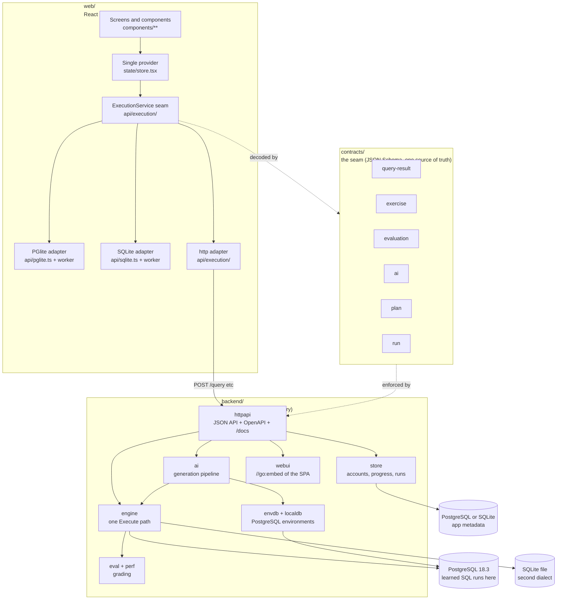
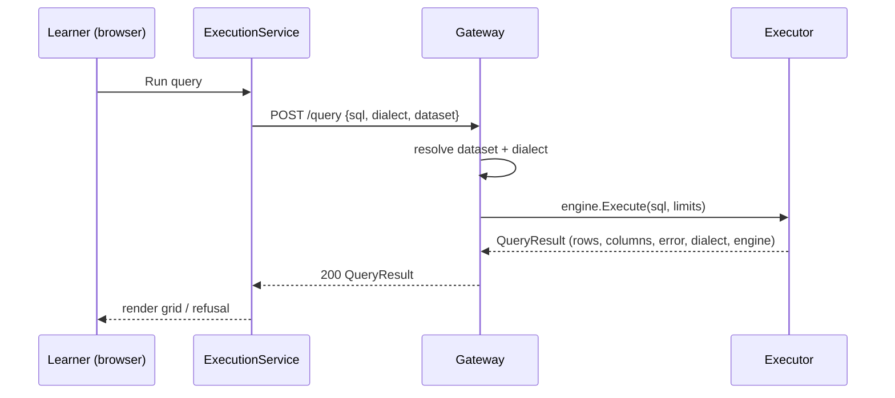
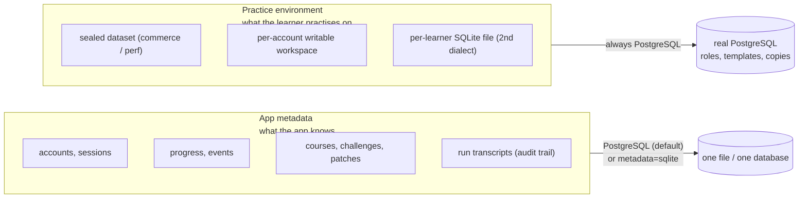
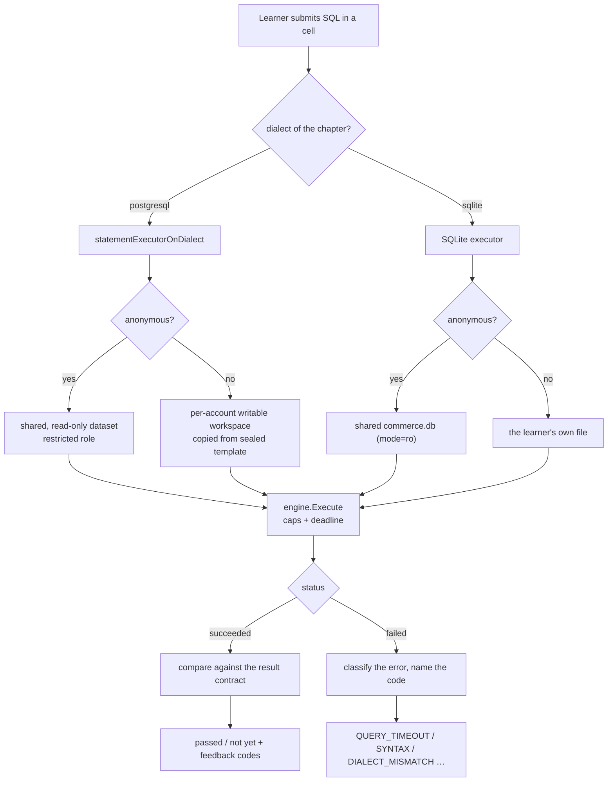
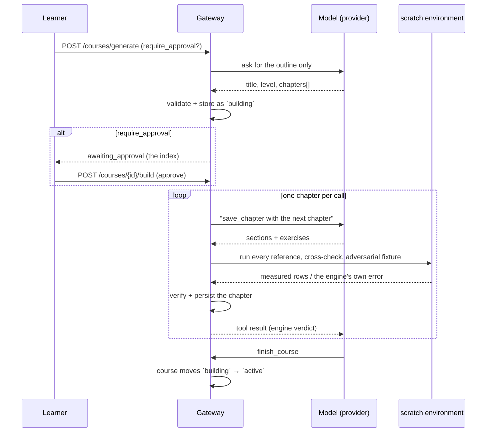
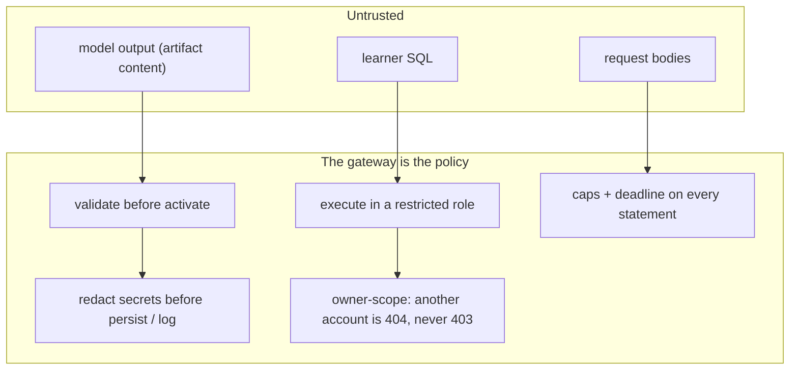

# Architecture

This document describes the released app, `v0.8.0`. The design source is
[`technical-design.md`](technical-design.md), and the decisions of record are in
[`adr/`](adr/).

The document says how the parts fit together and why. Each section points to the
code that proves the claim.

## 1. One repository, two parts, one contract

Querycraft is one Go binary that serves its own React app. The two parts never
import each other. They meet only at the JSON contracts in `contracts/`.

`make build` compiles the app, embeds it in the gateway, and writes one binary at
`backend/bin/querycraft`. That binary starts its own PostgreSQL and serves the
app, the API, and the documentation on one port. No flow needs Docker.

Client preferences are per account: the theme — one of 18 shipped presets or a
theme the learner derived from an accent — persists through `GET/PUT
/preferences` and follows the account across devices. The derivation tunes the
ink tokens to the 4.5:1 gate the shipped presets clear
(`web/src/lib/userThemes.ts`; `scripts/theme-contrast.mjs` audits all of
them).

## 2. The execution seam

Every statement the learner runs goes through one function, `engine.Execute` in
`backend/internal/engine/execute.go`. That function is the only place that
applies the row, byte, and deadline caps, and both dialects use it.

The adapters behind `ExecutionService` must agree. `VITE_API_MODE` selects
`pglite` or `http`. In a production build with no mode set, the app requests
`/health` on its own origin and uses the `http` adapter when the gateway answers.
That is how the single binary works with no configuration.

| Adapter | Engine | Where it runs | What it reports about itself |
| --- | --- | --- | --- |
| `pglite` | Real PostgreSQL, compiled to WebAssembly | A Web Worker in the tab | A runaway statement stops when the worker is terminated. |
| `sqlite` | Real SQLite, compiled to WebAssembly | A Web Worker in the tab | Declared types are affinities, not constraints. |
| `http` | PostgreSQL or SQLite | The gateway | The gateway owns the caps, the workspace, and the deadline. |

## 3. Where learner data lives

There are two stores, and they are separate by design (ADR 0003, ADR 0006). The
metadata of the app and the practice environment of the learner are different
things with different needs.

The boundary comes from the product. The app teaches PostgreSQL, and per-account
writable databases, template copies, and roles are PostgreSQL features. So the
metadata may live in a SQLite file, which is opt-in through the `metadata`
key set to `sqlite`,
but the practice environment never does.

## 4. One query, end to end

Grading compares results against an explicit contract. It never compares SQL
text (design sections 1.1 and 3.1).

## 5. Course generation

The model is reached through one two-method seam
(`internal/ai/provider`): `Descriptor()` and `Complete(ctx, req)`. Three
implementations ship: the deterministic **fake** provider (CI proves the whole
pipeline offline), an **OpenAI-compatible** HTTP client, and a **pi-ai**
adapter over `github.com/sky-valley/pi/ai` — pi's unified multi-provider LLM
API — which adds Anthropic, OpenAI responses and Gemini wire formats, SSE
parsing, Retry-After-aware retries, an embedded model catalog (1,529 chat
models across 41 providers, sourced from models.dev) and token accounting.
The pipeline stays the policy: the model is an untrusted generator, every
artifact is schema-checked, executed in a scratch environment, cross-checked
and adversarially probed before it is stored. Administrators swap the live
provider from the manage surface (`GET/PUT /admin/ai`) without a restart.

The model is an untrusted generator. The gateway is the policy. A run holds one
conversation, and the model hands in one chapter for each call. The gateway
verifies each chapter before it asks for the next one.

These properties each have a test:

- The gateway stores the outline before it stores any chapter. A reload during a
  run shows what has passed verification so far.
- A chapter that fails is repaired with the message from the engine. If it still
  fails, the gateway drops it.
- A run in which nothing passed verification is refused, and it stores nothing
  (ADR 0002, ADR 0005).

## 6. Layers and their contracts

Every layer obeys one rule. Data access goes through the seam. A screen never
calls `fetch`, and the gateway never invents a row. With no database, the gateway
answers `ENVIRONMENT_UNAVAILABLE` instead of making up a result.

## 7. Trust boundaries

Learner SQL never runs on an administrative connection. `httpapi/adminpath_test.go`
proves this by behaviour: `SELECT current_user` answers the learner role, and the
gateway refuses `CREATE ROLE`, `pg_read_file`, `COPY … TO PROGRAM`, and
`DROP DATABASE` with `QUERY_RUNTIME_ERROR`.

The gateway verifies generated content by execution before it stores the content.
A challenge or a chapter that does not run never reaches a learner.

The gateway redacts and bounds the `/runs` transcripts before it writes them.

## 8. Repository map

| Path | Contents |
| --- | --- |
| `web/` | The React app. `src/api/` is the only network seam. |
| `backend/` | The Go gateway. `internal/engine` is the one execution path. |
| `contracts/` | JSON Schemas shared by both languages, plus `fixtures/`. |
| `scripts/` | The audit suites the build targets run. |
| `docs/` | The design, the ADRs, and the notes for each area. |
| `Makefile` | Every build, check, and audit target. Run `make help`. |

Where to read next, by question:

| Question | File |
| --- | --- |
| Why Go, and not Bun? | `docs/adr/0001-backend-runtime-go-not-bun.md` |
| How are environments isolated? | `docs/adr/0002`, `0003`, `0006` |
| Why PostgreSQL first, and SQLite second? | `docs/adr/0004-postgresql-not-sqlite.md` |
| How does the model seam work? | `docs/adr/0005-ai-provider-and-sdk.md` |
| Where is the schema? | `docs/database-layout.md` |
| How does grading work? | `docs/technical-design.md` section 6, `contracts/fixtures/` |
| Where is the backend layout, and why? | `docs/backend-decomposition.md` |
| What has shipped, and what is open? | `progress.md` |
| How do I write a lesson? | `docs/content-authoring.md` |

## 9. How the gateway starts

The binary is a cobra CLI (`cmd/api/cli.go`). Serving is the root command's
own behavior, so a bare `querycraft` and `querycraft serve` take the same
path. Before anything binds a port, `internal/config` resolves one `Settings`
value, and `run()` in `cmd/api/main.go` wires the gateway from it.

Two honest paths matter. With no DSN and `no_local_db` unset, the gateway
starts its own PostgreSQL and the lab works with no setup. With `no_local_db`
set, or when the local server cannot start, execution answers
`ENVIRONMENT_UNAVAILABLE` and progress falls back to memory; the gateway still
serves, and never invents rows.

The two knobs that gate environment capacity, `max_environments` (default 8)
and `idle_ttl` (default 15m), reach `envdb.Options` here. Before the config
layer existed they had environment names but no reader.

| Command | What it does | Code |
| --- | --- | --- |
| `querycraft` / `querycraft serve` | Resolve settings and start the gateway | `cmd/api/cli.go` `serve`, `cmd/api/main.go` `run` |
| `querycraft db reset` | Delete the configured local cluster's data directory | `cmd/api/cli.go` `dbReset`; `make db-reset` calls it |
| `querycraft db status` | Print the resolved configuration and what exists on disk | `cmd/api/cli.go` `dbStatus` |
| `querycraft version` | Print the gateway version | `cmd/api/cli.go` `gatewayVersion` |

The precedence order (defaults, file, flags) is documented with
an example file in `backend/README.md`, section "Configuration", and proven by
`internal/config/config_test.go`.
