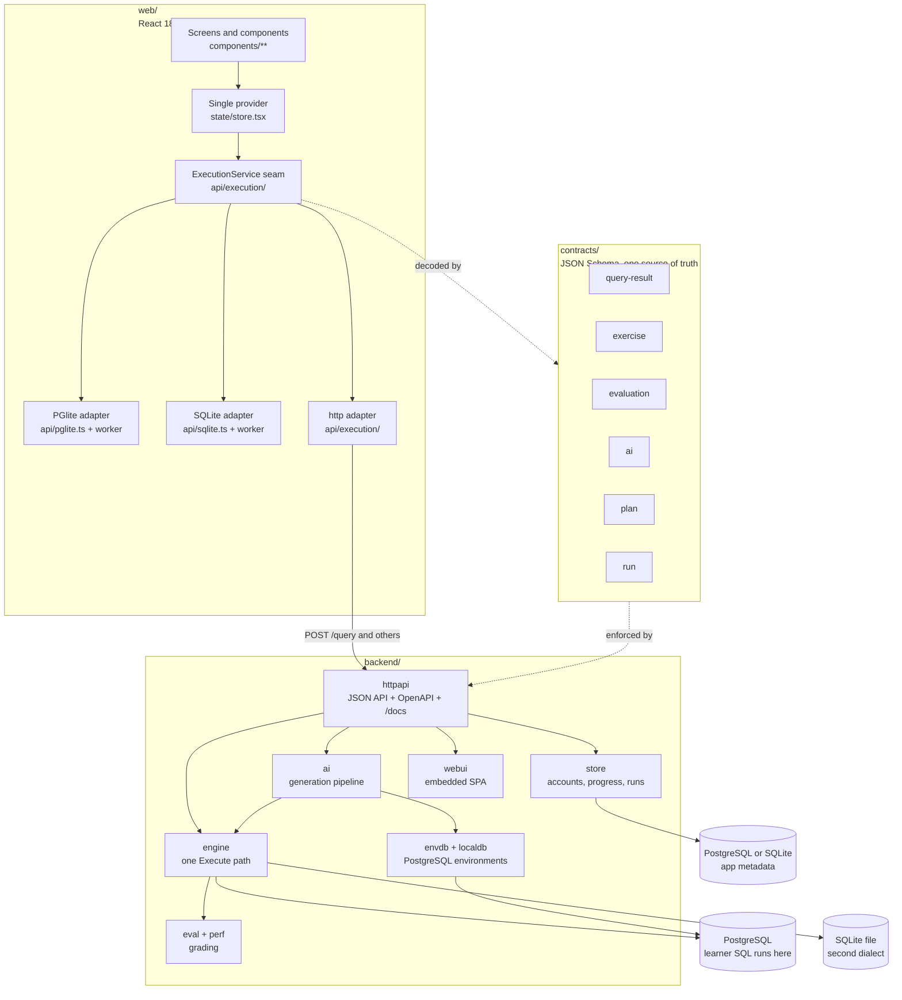
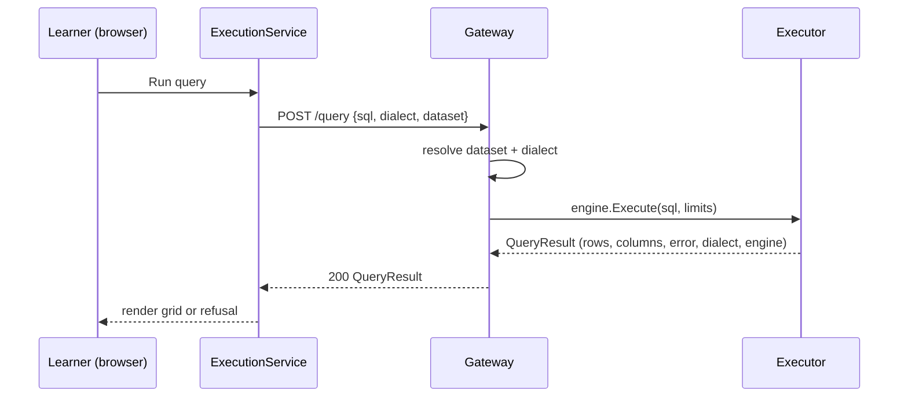
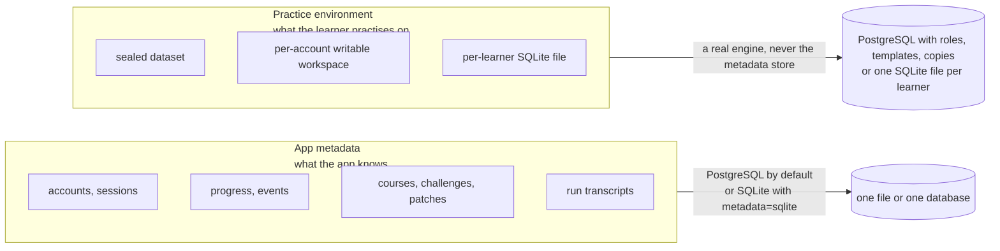
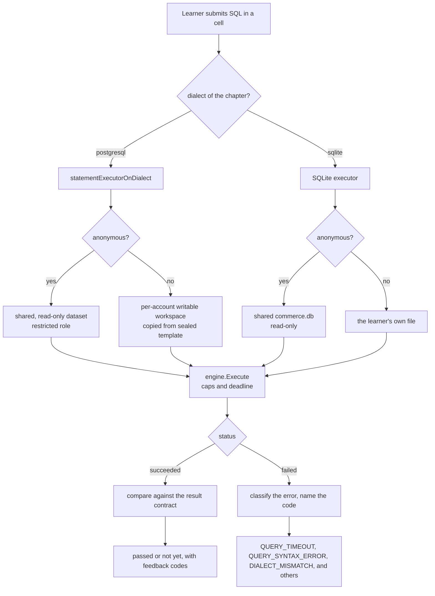
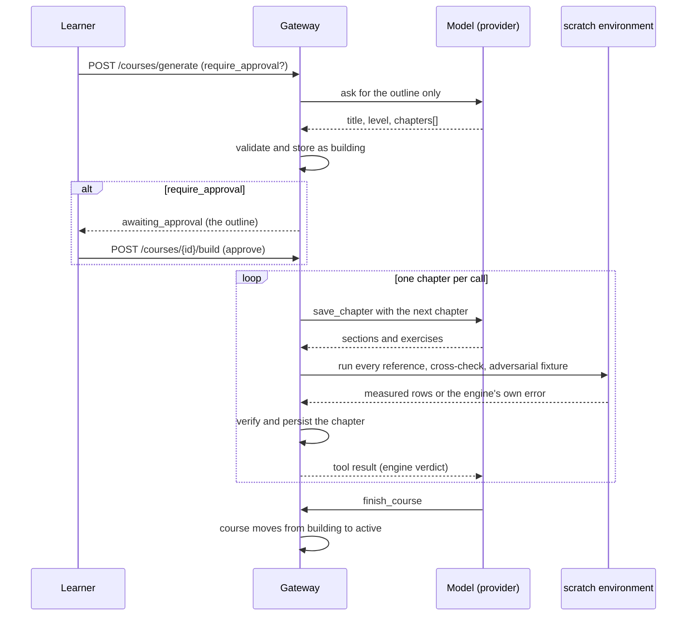
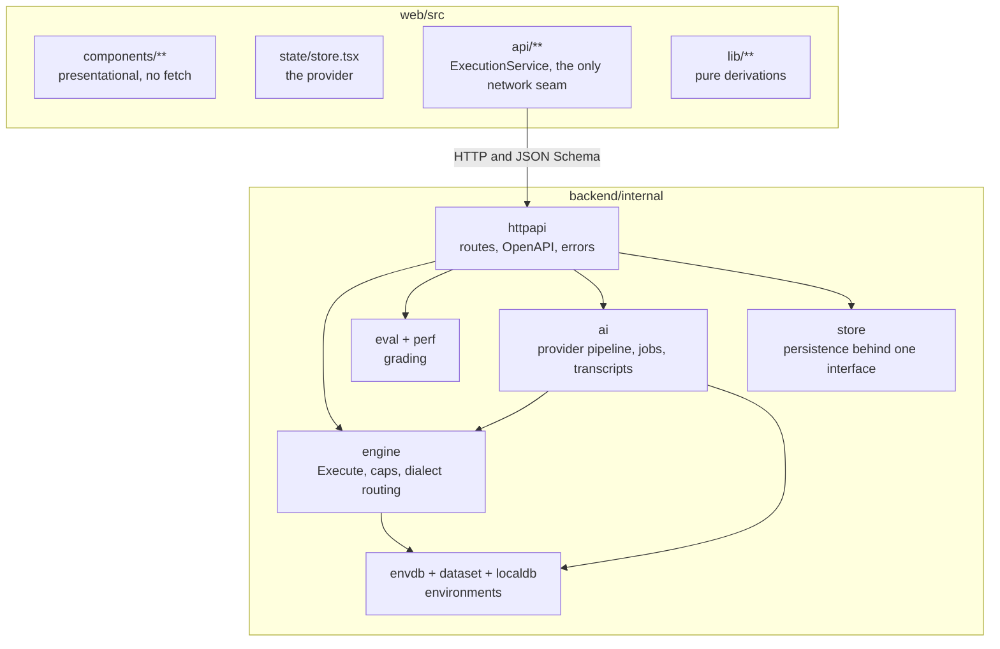
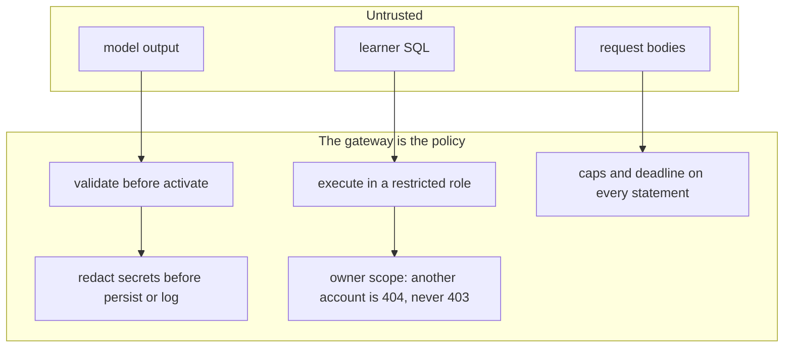
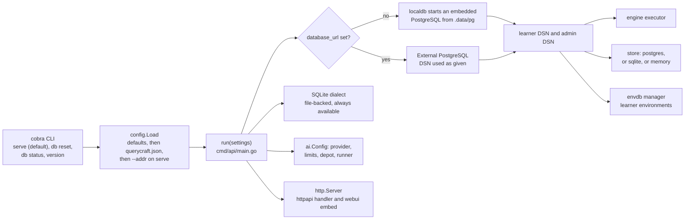

# Architecture

Querycraft is a React app and a Go gateway. The two parts meet at the JSON
Schemas in `contracts/` and never import each other. The gateway also embeds the
built app, so one process can serve the page, the API, and the API
documentation.

The decisions behind this layout are in [`adr/`](adr/).

## One repository, two parts, one contract

`make build` compiles the app, embeds it in the gateway, and writes
`backend/bin/querycraft`. That binary starts its own PostgreSQL when no database
is configured and serves the app, the API, and the documentation on one port.
No flow needs Docker.

Client preferences are per account. A theme is one of the shipped presets or a
theme derived from an accent color. It persists through `GET /preferences` and
`PUT /preferences` and follows the account across devices. The derivation tunes
the foreground tokens to the 4.5:1 contrast ratio the shipped presets clear.

## The execution seam

Every statement a learner runs goes through one function, `engine.Execute` in
`backend/internal/engine/execute.go`. That function is the only place that
applies the row, byte, and deadline caps. Both dialects use it.

The adapters behind `ExecutionService` must agree. `VITE_API_MODE` selects
`pglite` or `http`. In a production build with no mode set, the app requests
`/health` on its own origin and uses the `http` adapter when the gateway answers.
That is how the single binary works with no configuration.

| Adapter | Engine | Where it runs | What it reports about itself |
| --- | --- | --- | --- |
| `pglite` | PostgreSQL compiled to WebAssembly | A Web Worker in the tab | A runaway statement stops when the worker is terminated. |
| `sqlite` | SQLite compiled to WebAssembly | A Web Worker in the tab | Declared types are affinities, not constraints. |
| `http` | PostgreSQL or SQLite | The gateway | The gateway owns the caps, the workspace, and the deadline. |

## Where learner data lives

The app uses two stores. They are separate because the metadata of the app and
the practice environment of the learner have different needs.

The boundary comes from the product. The app teaches PostgreSQL, and per-account
writable databases, template copies, and roles are PostgreSQL features. The
metadata can live in a SQLite file when you set `metadata` to `sqlite`. The
practice environment stays on a real engine: PostgreSQL for the main courses and
a per-learner SQLite file for the SQLite courses.

## One query, end to end

Grading compares results against an explicit contract. It never compares SQL
text, so any query that returns the right rows passes.

## Course generation

The model is reached through one two-method seam in `backend/internal/ai/provider`:
`Descriptor()` and `Complete(ctx, req)`. Three implementations ship:

- A deterministic fake provider, which proves the whole pipeline offline and
  powers the audits.
- An OpenAI-compatible HTTP client.
- A pi-ai adapter over `github.com/sky-valley/pi/ai`. It adds the Anthropic, OpenAI
  responses, and Gemini wire formats, SSE parsing, retries that respect
  `Retry-After`, an embedded model catalog sourced from models.dev, and token
  accounting.

The pipeline stays the policy. The model is an untrusted generator. The gateway
schema-checks every artifact, runs it in a scratch environment, cross-checks it,
and probes it before storing it. An administrator can swap the live provider
from the manage surface through `GET /admin/ai` and `PUT /admin/ai` without a
restart.

A run holds one conversation, and the model hands in one chapter for each call.
The gateway verifies each chapter before it asks for the next one.

These properties each have a test:

- The gateway stores the outline before it stores any chapter. A reload during a
  run shows what has passed verification so far.
- A chapter that fails is repaired with the message from the engine. If it still
  fails, the gateway drops it.
- A run in which nothing passed verification is refused, and it stores nothing.

## Layers and their contracts

Every layer obeys one rule. Data access goes through the seam. A screen never
calls `fetch`, and the gateway never invents a row. With no database, the
gateway answers `ENVIRONMENT_UNAVAILABLE` instead of making up a result.

## Trust boundaries

Learner SQL never runs on an administrative connection. The gateway proves this
by behaviour: `SELECT current_user` answers the learner role, and the gateway
refuses `CREATE ROLE`, `pg_read_file`, `COPY ... TO PROGRAM`, and `DROP DATABASE`
with `QUERY_RUNTIME_ERROR`.

The gateway verifies generated content by execution before it stores it. A
challenge or a chapter that does not run never reaches a learner.

The gateway redacts and bounds the `/runs` transcripts before it writes them.

## Repository map

| Path | Contents |
| --- | --- |
| `web/` | The React app. `src/api/` is the only network seam. |
| `backend/` | The Go gateway. `internal/engine` is the one execution path. |
| `contracts/` | JSON Schemas shared by both languages, plus `fixtures/`. |
| `scripts/` | The audit suites the build targets run. |
| `docs/` | The architecture notes and the ADRs. |
| `Makefile` | Every build, check, and audit target. Run `make help`. |

Where to read next, by question:

| Question | Document |
| --- | --- |
| Why Go, and not Bun? | [`adr/0001-backend-runtime-go-not-bun.md`](adr/0001-backend-runtime-go-not-bun.md) |
| How are environments isolated? | [`adr/0002-challenge-environments.md`](adr/0002-challenge-environments.md), [`adr/0003-writable-learner-workspaces.md`](adr/0003-writable-learner-workspaces.md), [`adr/0006-sqlite-learner-isolation.md`](adr/0006-sqlite-learner-isolation.md) |
| Why PostgreSQL first, and SQLite second? | [`adr/0004-postgresql-not-sqlite.md`](adr/0004-postgresql-not-sqlite.md) |
| How does the model seam work? | [`adr/0005-ai-provider-and-sdk.md`](adr/0005-ai-provider-and-sdk.md) |
| Where is the schema? | [`database-layout.md`](database-layout.md) |
| How does grading work? | [`../contracts/fixtures/`](../contracts/fixtures/) and `backend/internal/eval/` |
| Where is the backend layout, and why? | [`../backend/README.md`](../backend/README.md) |
| How do I write a lesson? | [`content-authoring.md`](content-authoring.md) |

## How the gateway starts

The binary is a cobra CLI. Serving is the root command's own behavior, so a bare
`querycraft` and `querycraft serve` take the same path. Before anything binds a
port, `internal/config` resolves one `Settings` value. Then `run()` in
`cmd/api/main.go` wires the gateway from it.

Two paths matter:

- With no DSN and `no_local_db` unset, the gateway starts its own PostgreSQL and
  the lab works with no setup.
- With `no_local_db` set, or when the local server cannot start, execution
  answers `ENVIRONMENT_UNAVAILABLE` and progress falls back to memory. The
  gateway still serves, and it never invents rows.

Two settings gate environment capacity: `max_environments` (default 8) and
`idle_ttl` (default 15m). They reach `envdb.Options` through the config layer.

| Command | What it does |
| --- | --- |
| `querycraft` or `querycraft serve` | Resolve settings and start the gateway. |
| `querycraft db reset` | Delete the configured local cluster's data directory. `make db-reset` calls it. |
| `querycraft db status` | Print the resolved configuration and what exists on disk. |
| `querycraft version` | Print the gateway version. |

Settings resolve in this order: shipped defaults, then the config file, then the
`--addr` flag on `serve`. [`../backend/README.md`](../backend/README.md) lists
every key and shows an example file.
