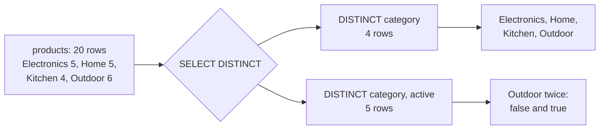

# Projection, aliases and DISTINCT

A query answers a question, and the answer arrives as a table. Two decisions shape that table before any filtering happens: which columns you ask for, and what you call them. Get those right and the result is readable at a glance; get them wrong and the reader has to reverse-engineer your report.

## A `SELECT` returns a table, not a printout

`SELECT *` is a convenience that quietly makes your output depend on the table's definition. Add a column upstream and every consumer of your result sees a new field; drop one and a downstream step breaks. Naming the columns turns "whatever is in the table" into a stated intention.

The column list is also the first place to check a result. If a join returns a column you did not ask for, the projection is telling you the grain is wrong before the numbers do.

```sql
SELECT id, name, category, price
FROM products
ORDER BY price, id;
```

Four columns, one row per product. That is the whole idea of projection: choose the columns that answer the question and leave the rest in the table.

## Renaming is not changing

`AS` gives an output column a new label. It does not rename the stored column and it does not touch a row. Use it to turn `qty` into `quantity` for the reader, or to name a value the query computed. Because an alias is only a label, it is the cheapest documentation in SQL.

```sql
SELECT name AS product, category AS department
FROM products
ORDER BY product
LIMIT 4;
```

The table still stores `name` and `category`; the reader sees `product` and `department`.

## `DISTINCT` applies to the whole row

The trap in `DISTINCT` is that it de-duplicates the row you selected, not the first column. Ask for one column and you get a clean list; ask for two and you get every distinct pair.



Four categories exist, but five `(category, active)` pairs do, because Outdoor holds one discontinued product. Both results are correct — only one matches the question you asked.

```sql
SELECT DISTINCT category
FROM products
ORDER BY category;
```

| category |
| --- |
| Electronics |
| Home |
| Kitchen |
| Outdoor |

## Counting is the check

The fastest way to confirm a `DISTINCT` result is to compare counts. `COUNT(*)` over `products` is 20; `COUNT(DISTINCT category)` is 4. If a reader expected four rows and the query returns five, the projection — not the data — is the first suspect.

```sql
SELECT COUNT(*) AS products,
       COUNT(DISTINCT category) AS categories
FROM products;
```

## Check yourself

**1. Why can `SELECT *` be a problem in a report that other queries read?**

<details>
<summary>Answer</summary>

Because the output then depends on the table's definition rather than the question. A column added or removed upstream silently changes every consumer's result. The column list is a contract; `*` leaves it implicit.

</details>

**2. How many rows does `SELECT DISTINCT category, active FROM products` return, and why is it more than the number of categories?**

<details>
<summary>Answer</summary>

Five. Outdoor is the only category with an inactive product, so it contributes two distinct pairs — `(Outdoor, false)` and `(Outdoor, true)` — while the other three categories contribute one each.

</details>

**3. Does `AS` change what is stored in the table?**

<details>
<summary>Answer</summary>

No. It changes only the column label in the result. The stored column keeps its name.

</details>
