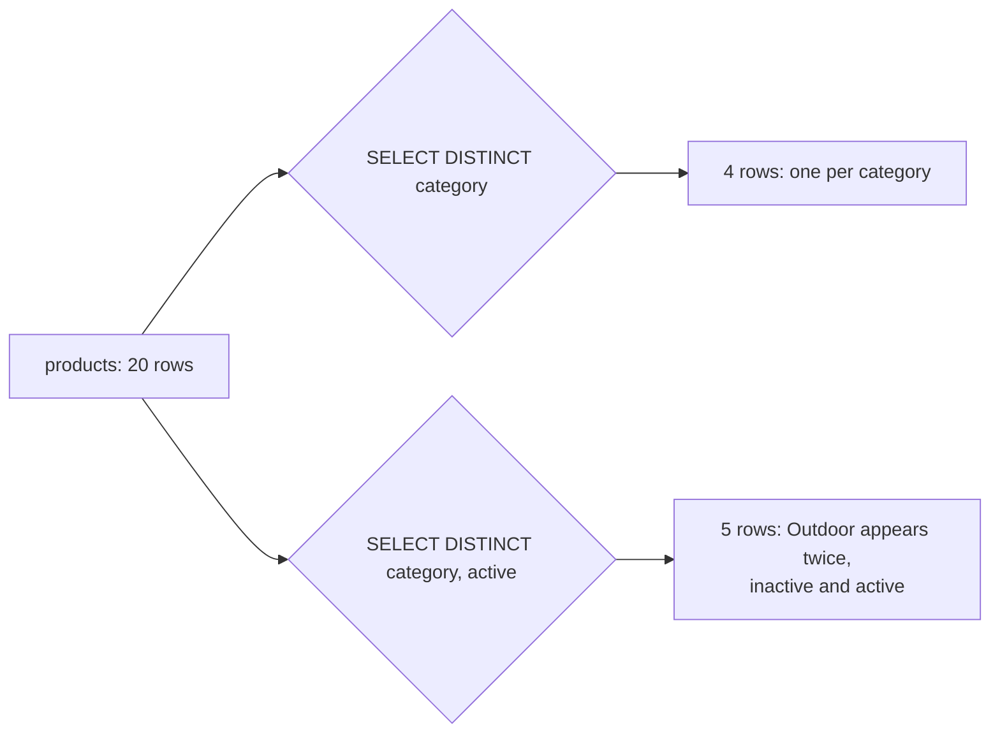

# Projection, aliases and DISTINCT

`SELECT DISTINCT city FROM customers` returns one null row in place of four customers. `COUNT(DISTINCT city)` says 19 of the 30. Neither query errors, so nothing tells the reader that the two answers come from different questions.

A query does not hand back a copy of the table you asked about. It builds a new table, shaped for one question. Three decisions decide that shape: which columns survive, what the result calls them, and whether duplicate rows are allowed through. Choosing those columns is called projection. Get them wrong and the next person has to reverse-engineer your report before they can trust it.

This chapter takes the three decisions in turn, then puts them in one query.

## The result is a table you designed

When you run `SELECT id, name, category, price FROM products`, PostgreSQL reads rows from `products`, keeps four values from each row, and returns them as a new table with four columns. The stored table still has six columns. The result has the four you asked for.

That difference matters because the result is what everything else sees: a report, a chart, an export, or another query that reads your output. The column list is the contract for that result.

```sql
SELECT id, name, category, price
FROM products
ORDER BY price, id;
```

| id | name | category | price |
| --- | --- | --- | --- |
| 20 | Discontinued Camp Stove | Outdoor | 0.00 |
| 19 | Rope Dog Leash | Outdoor | 15.50 |
| 15 | Espresso Tamper | Kitchen | 19.99 |
| 9 | Maple Cutting Board | Kitchen | 24.00 |

Four columns, one row per product. The ordering is part of the answer too. `ORDER BY price, id` puts the cheapest product first and uses `id` to break ties, so the output is stable when two products share a price.

`SELECT *` is the shortcut that skips this decision. It returns every column the table happens to have today. That feels convenient until someone adds a column upstream. The new column appears in your report, in your CSV export, and in any query that reads the report. Nothing broke, but the shape changed without you saying so.

The cost lands in the export, not in the query. Naming the columns turns "whatever the table contains" into a stated intention.

There is a second reason to name columns. PostgreSQL has to produce the values you ask for. If a query can be answered from an index alone, selecting fewer columns can keep it on that index. `SELECT *` forces the engine back to the table for columns the index does not carry. That is a performance detail, not the main reason to avoid `*`, but it is one more cost you accept by default.

## Clauses run in a logical order, and projection is late

You write a query starting with `SELECT`, but PostgreSQL evaluates it in a different order. The useful simplification is:

```text
FROM  ->  WHERE  ->  GROUP BY  ->  HAVING  ->  SELECT  ->  DISTINCT  ->  ORDER BY  ->  LIMIT
```

`FROM` finds the rows. `WHERE` removes rows. `GROUP BY` and `HAVING` collapse and filter groups. Only then does `SELECT` choose the columns and compute expressions. `DISTINCT` removes duplicate result rows after that. `ORDER BY` sorts what remains, and `LIMIT` cuts the list.

This order explains a rule that otherwise looks arbitrary: `WHERE` cannot see a column alias. The alias is created by `SELECT`, and `SELECT` runs after `WHERE`. When you write `WHERE with_tax > 100`, the name `with_tax` does not exist yet.

```sql
-- This fails: column "with_tax" does not exist.
SELECT price * 1.2 AS with_tax
FROM products
WHERE with_tax > 100;
```

You have two clean fixes. Repeat the expression in `WHERE`, or compute it in a subquery and filter outside. The first is fine for a short expression. The second is better when the expression is long or used more than once.

```sql
SELECT name, price, price * 1.2 AS with_tax
FROM products
WHERE price * 1.2 > 100
ORDER BY with_tax DESC;
```

`ORDER BY` is different. It runs after `SELECT`, so it can use the alias. That is why `ORDER BY with_tax DESC` works in the same query where `WHERE with_tax` did not.

## An alias is a label, not a rename

`AS` gives an output column a new name. It does not rename the stored column, and it does not change a row. The table still stores `name`; the reader sees `product`.

```sql
SELECT name AS product, category AS department
FROM products
ORDER BY product
LIMIT 4;
```

| product | department |
| --- | --- |
| Aurora Wireless Earbuds | Electronics |
| Bamboo Shelf | Home |
| Cedar Desk Lamp | Home |
| Ceramic Vase | Home |

Aliases are documentation for the person reading the result. `department` tells them what the column means in this report. `name` alone could mean a person, a file, or a product. A good alias removes that doubt without adding a comment.

Try this: change `ORDER BY product` to `ORDER BY name` and run the query again. The same four rows arrive in the same order, because the alias and the stored column are one value with two names.

Use aliases on computed values too. `price * 1.2` is a number. `price * 1.2 AS with_tax` is a number with a meaning. The alias also gives `ORDER BY` and outer queries a name to use.

One limit: an alias is not available to every clause. `WHERE` runs before the alias exists, as the previous section showed. `GROUP BY` and `ORDER BY` run later, so PostgreSQL accepts the alias there. `HAVING` sits in an awkward spot: it runs before `SELECT`, so it cannot see the alias either. When in doubt, repeat the expression.

## `DISTINCT` removes duplicate rows, not duplicate values

`DISTINCT` de-duplicates the row you selected. It does not de-duplicate the first column and ignore the rest. That distinction is the whole trap.

Ask for one column and you get a clean list:

```sql
SELECT DISTINCT category
FROM products
ORDER BY category;
```

| category |
| --- |
| Electronics |
| Home |
| Kitchen |
| Outdoor |

Ask for two columns and you get every distinct pair:

```sql
SELECT DISTINCT category, active
FROM products
ORDER BY category, active;
```

| category | active |
| --- | --- |
| Electronics | true |
| Home | true |
| Kitchen | true |
| Outdoor | false |
| Outdoor | true |

Four categories exist. Five pairs exist, because Outdoor contains one discontinued product.

Both queries are correct. Only one matches the question "which categories do we sell?" The other answers a different question: "which category and active-status combinations exist?" The database does not know which question you meant. It returns the pairs.



`DISTINCT` also treats nulls as equal for the purpose of removing duplicates. If you select `DISTINCT city` from `customers`, the four customers with no city produce one null row in the result, not four. `COUNT(DISTINCT city)` behaves differently: it ignores nulls. This query counts 19 distinct non-null cities across the 30 customers.

```sql
SELECT COUNT(*) AS customers,
       COUNT(DISTINCT city) AS distinct_cities,
       COUNT(*) FILTER (WHERE city IS NULL) AS unknown_cities
FROM customers;
```

| customers | distinct_cities | unknown_cities |
| --- | --- | --- |
| 30 | 19 | 4 |

The gap between 30 and 19 is not a bug. It is the null rows, plus customers who share a city. If you need to count "unknown" as its own group, `COALESCE` it to a label first. Chapter 4 covers that.

Inside the engine, PostgreSQL has to compare whole rows to find duplicates. It can sort the selected rows and walk the sorted list, or hash each row and keep one per hash bucket. Either way, the work grows with the number of rows and the width of the row. `DISTINCT` over many wide columns costs more than `DISTINCT` over one narrow column.

## `DISTINCT` and `GROUP BY` are not the same tool

`SELECT DISTINCT category FROM products` and `SELECT category FROM products GROUP BY category` return the same four rows. The difference is what you can do next.

`DISTINCT` says "remove duplicate rows." `GROUP BY` says "form groups, and let me summarise each one." If you want a count per category, you need `GROUP BY`:

```sql
SELECT category, COUNT(*) AS products
FROM products
GROUP BY category
ORDER BY products DESC, category;
```

Use `DISTINCT` for a unique list. Use `GROUP BY` when the group itself becomes a value you want to aggregate, filter, or join. The next chapters take `GROUP BY` apart.

## Counting is the check

The fastest way to test a result is to compare its row count with the count you expect. `COUNT(*)` over `products` is 20. `COUNT(DISTINCT category)` is 4. If you expected four rows and the query returns five, check the projection before you blame the data.

```sql
SELECT COUNT(*) AS products,
       COUNT(DISTINCT category) AS categories
FROM products;
```

| products | categories |
| --- | --- |
| 20 | 4 |

That check also works in reverse. If a report tells you there are five category-and-active pairs, run `SELECT category, active, COUNT(*) FROM products GROUP BY category, active` and see what the five rows are. The answer is usually a pair that looked like one thing.

## What the exercise asks

The exercise asks for the distinct active-and-category pairs, ordered by the active flag and then by category. It is the same two-column `DISTINCT` rule as the example, with the columns in the other order, so the sort starts on the flag. The pair that repeats is Outdoor: one row for the active products and one for the discontinued camp stove. Four categories become five pairs, and the order of the columns changes the order of the rows.

## What to remember

**What I would do:** name every column the report needs, and alias it to the word the report uses. Compare the row count with `COUNT(*)` before you trust the rows. When `DISTINCT` returns more rows than you asked for, read the second column before you blame the data.

- A query returns a new table. Name the columns you want instead of letting the schema decide for you.
- `AS` labels an output column. It does not rename the stored column.
- `WHERE` runs before `SELECT`, so it cannot see an output alias. `ORDER BY` runs after, so it can.
- `DISTINCT` removes duplicate result rows, not duplicate values in one column.
- `COUNT(DISTINCT column)` ignores nulls, while `SELECT DISTINCT column` keeps one null row.
- Compare `COUNT(*)` with `COUNT(DISTINCT ...)` when a result looks wrong. The gap usually names the mistake.

## Check yourself

**1. Why does `SELECT *` make a report harder to keep stable?**

<details>
<summary>Answer</summary>

Because the result follows the table definition, not the question. A column added or removed upstream changes the report without any change to the query. Naming the columns states what the report needs.

</details>

**2. Why can `WHERE` use `price` but not an alias defined in `SELECT`?**

<details>
<summary>Answer</summary>

`WHERE` runs before `SELECT` in the logical order. The alias is created when the projection runs, so the name does not exist yet. Repeat the expression in `WHERE`, or filter in an outer query.

</details>

**3. How many rows does `SELECT DISTINCT category, active FROM products` return, and why is it more than four?**

<details>
<summary>Answer</summary>

Five. Outdoor is the only category with an inactive product, so it contributes two distinct pairs, `(Outdoor, false)` and `(Outdoor, true)`. The other three categories contribute one pair each.

</details>

**4. Why does `SELECT DISTINCT city` return one null row while `COUNT(DISTINCT city)` leaves the nulls out?**

<details>
<summary>Answer</summary>

`DISTINCT` compares result rows and treats nulls as equal, so all null cities collapse into one row. `COUNT(DISTINCT city)` counts non-null values only, so the nulls are not counted at all.

</details>
