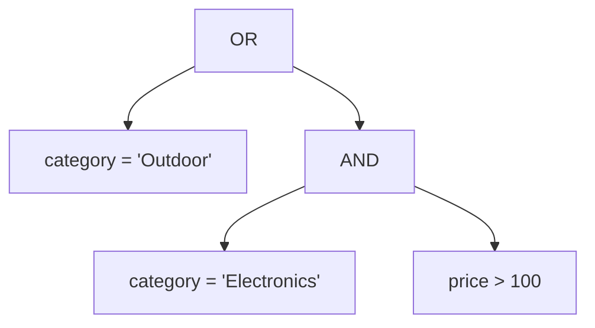

# WHERE, AND, OR and NOT

A `WHERE` clause is a filter with a memory problem: it evaluates one predicate per row and keeps the row only when the answer is true. The predicate itself is where bugs hide, because `AND`, `OR` and `NOT` do not read in the order you write them.

## `WHERE` runs before the projection

Filtering happens before `SELECT` names anything, so a `WHERE` clause can only see input columns. `WHERE price > 100` works because `price` is a column of `products`; `WHERE band = 'premium'` does not, because `band` is an alias the projection has not produced yet. If you need to filter on a computed value, either repeat the expression or wrap the query in a CTE.

## Precedence is not left to right

Boolean operators have a strict order: `NOT` binds tightest, then `AND`, then `OR`. Writing `a OR b AND c` is therefore `a OR (b AND c)`, not `(a OR b) AND c`. The parser builds a tree, and the tree is decided by precedence alone.



Read the tree as a sentence: "every Outdoor product, plus any Electronics product over 100." The cheap Outdoor rows are the proof. If the `OR` had grouped first, the tree would keep only products over 100, and `Rope Dog Leash` at 15.50 would vanish.

```sql
SELECT name, category, price
FROM products
WHERE category = 'Outdoor'
   OR category = 'Electronics' AND price > 100
ORDER BY price DESC, name;
```

| name | category | price |
| --- | --- | --- |
| Trail Runner Jacket | Outdoor | 139.00 |
| Nimbus Headphones | Electronics | 129.00 |
| Harbor Rain Shell | Outdoor | 118.00 |
| Summit Hiking Poles | Outdoor | 96.40 |
| Solar Camp Lantern | Outdoor | 47.00 |
| Rope Dog Leash | Outdoor | 15.50 |
| Discontinued Camp Stove | Outdoor | 0.00 |

## Parenthesise the moment you mix `AND` and `OR`

Precedence already gave the answer above, but a reader should not have to run the parser in their head. Parentheses cost nothing, remove the doubt, and make the intent survive a future edit:

```sql
SELECT name, category, price
FROM products
WHERE category = 'Outdoor'
   OR (category = 'Electronics' AND price > 100)
ORDER BY price DESC, name;
```

`NOT` inverts a predicate and binds tighter than the operators around it. `NOT category = 'Electronics'` is the same as `category <> 'Electronics'`; pick one form and stay with it. When the predicate is compound, wrap it: `NOT (category = 'Home' OR category = 'Outdoor')`, because `NOT` would otherwise attach to the nearest comparison.

## `NULL` is neither true nor false

A predicate over a `NULL` column evaluates to unknown, not to false, and `WHERE` keeps only the true rows. That means `WHERE city <> 'Leeds'` silently drops rows where the city is unknown. Boolean logic in SQL is three-valued, and a filter is the place where the third value bites.

## Check yourself

**1. How does the parser group `a OR b AND c`?**

<details>
<summary>Answer</summary>

As `a OR (b AND c)`, because `AND` binds tighter than `OR`. The result differs from `(a OR b) AND c` whenever the two readings disagree.

</details>

**2. Why can a filter on an output alias fail in `WHERE`?**

<details>
<summary>Answer</summary>

`WHERE` runs before `SELECT` assigns the alias, so the name does not exist yet. Repeat the expression, or filter in an outer query that selects from a CTE.

</details>

**3. What does `NOT (category = 'Home')` have to do with `category <> 'Home'`?**

<details>
<summary>Answer</summary>

They are equivalent, including their handling of `NULL`: both are unknown rather than true for a NULL category. The parenthesised `NOT` is clearer when the predicate is compound.

</details>
