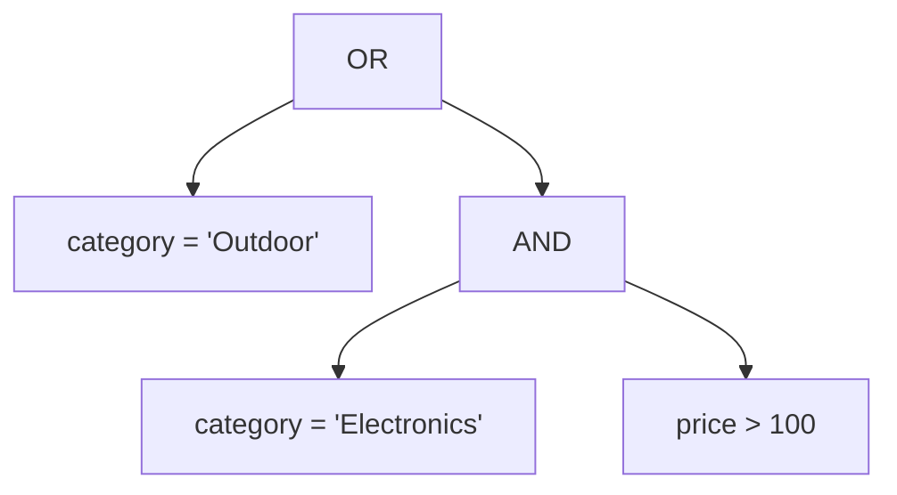

# WHERE, AND, OR and NOT

The stock team wants a sale list: every Outdoor product, plus any Electronics product over 100. The sentence has two readings. One returns 7 rows, the other returns 3, and the top of both lists looks correct. Nothing in the clause warns you which reading you get, and PostgreSQL picks one for you.

A `WHERE` clause is the part of a query that keeps some rows and drops the rest. The difficulty is rarely the filter itself. It is deciding which of two conditions owns the other, and PostgreSQL settles that with a precedence rule rather than with your punctuation.

This chapter shows what a filter does to a row, how `AND`, `OR` and `NOT` combine, and how to write the grouping you meant.

## A filter keeps rows and leaves them alone

`WHERE` works one row at a time. For each row, PostgreSQL evaluates the predicate and keeps the row when the answer is true. A predicate is a condition that comes out true or false for a row, such as `price >= 100`. Rows that fail the test are dropped. Rows that pass keep every column they arrived with, because filtering never edits a row.

```sql
SELECT name, category, price
FROM products
WHERE price >= 100
ORDER BY price DESC;
```

| name | category | price |
| --- | --- | --- |
| Granite Cookware Set | Kitchen | 210.00 |
| Trail Runner Jacket | Outdoor | 139.00 |
| Nimbus Headphones | Electronics | 129.00 |
| Harbor Rain Shell | Outdoor | 118.00 |

Here is the same filter as a step you can watch. The table on the left is the input, the middle column is the predicate evaluated for that row, and the last column says whether the row reaches the result.

| name | price | `price >= 100` | survives |
| --- | --- | --- | --- |
| Granite Cookware Set | 210.00 | true | yes |
| Trail Runner Jacket | 139.00 | true | yes |
| Nimbus Headphones | 129.00 | true | yes |
| Harbor Rain Shell | 118.00 | true | yes |
| Rope Dog Leash | 15.50 | false | no |
| Discontinued Camp Stove | 0.00 | false | no |

Twenty products enter the filter. Four leave it, and `SELECT` then keeps three of their six columns. Two clauses, two different jobs: `WHERE` chooses rows, `SELECT` chooses columns.

A filter that keeps the wrong rows still returns rows, so a mistake here reads as a plausible report rather than an error.

The comparison operators behave as you would expect. `=`, `<>` (not equal), `<`, `<=`, `>`, and `>=` work on numbers, text and dates. The boundary deserves a moment. `price >= 100` keeps a product priced at exactly 100, and `price > 100` drops it. That single character changes a report often enough to be worth checking twice.

Nothing in the table records that a row was tested. With no index to help, PostgreSQL reads `products` from the first row to the last and tests each one. Twenty checks here, and millions on a large table. An index on `price` gives the engine a sorted structure it can jump into, so it can find the rows in the range and ignore the rest. A later chapter on query plans takes that apart.

## Filtering happens before the columns are named

Chapter 1 gave the logical order of a query. The four steps are the ones that matter here:

```text
FROM  ->  WHERE  ->  SELECT  ->  ORDER BY
```

`FROM` produces the rows. `WHERE` removes rows. Only then does `SELECT` compute the output columns and attach their aliases. When you write `SELECT ... AS with_tax`, the name `with_tax` comes into existence after the filter has already run.

```sql
-- Fails with: column "with_tax" does not exist.
SELECT name, price, price * 1.2 AS with_tax
FROM products
WHERE with_tax > 100;
```

That error reads oddly the first time, because the alias is written a few characters above the filter that cannot see it. The rule is the explanation: a filter works on input columns, and `with_tax` is not one of them.

You have two clean fixes. Repeat the expression in `WHERE`, which is fine when it is short. Or filter in an outer query, which is better when the expression is long or used more than once. `ORDER BY` sits after `SELECT`, so an alias works there, and that asymmetry is the reason a query can order by a name it cannot filter by.

## Precedence groups the predicate for you

English gives you commas and rhythm to show which conditions belong together. SQL takes none of that, so the parser needs a default grouping that applies to every expression. That default is a strict order: `NOT` binds tightest, then `AND`, then `OR`. Because the order is fixed, every expression has exactly one tree, and the same text means the same thing on every server.

So `a OR b AND c` is not read left to right. It parses as `a OR (b AND c)`:



Read the tree as a sentence: every Outdoor product, plus any Electronics product over 100. The `OR` is the root, so it accepts a row when either branch is true. The `AND` is a narrow branch that only Electronics rows can satisfy.

```sql
SELECT name, category, price
FROM products
WHERE category = 'Outdoor'
   OR category = 'Electronics' AND price > 100
ORDER BY price DESC, name;
```

| name | category | price |
| --- | --- | --- |
| Trail Runner Jacket | Outdoor | 139.00 |
| Nimbus Headphones | Electronics | 129.00 |
| Harbor Rain Shell | Outdoor | 118.00 |
| Summit Hiking Poles | Outdoor | 96.40 |
| Solar Camp Lantern | Outdoor | 47.00 |
| Rope Dog Leash | Outdoor | 15.50 |
| Discontinued Camp Stove | Outdoor | 0.00 |

Seven rows. Four of them cost less than 100, which looks wrong until you read the tree.

`Rope Dog Leash` is 15.50 and it is in the result because the Outdoor branch is true for it, and a true branch is enough for an `OR`.

One caution about precedence: it decides the tree, not the running order. PostgreSQL may evaluate the Electronics condition first if that is cheaper, so you cannot rely on the left condition to protect the right one from an error. Write each condition so it stands on its own.

## The other grouping, and the rows it loses

Now suppose you read the same sentence and decide that the price limit applies to both categories. You add brackets to say so, in the place that looks natural.

```sql
SELECT name, category, price
FROM products
WHERE (category = 'Outdoor' OR category = 'Electronics') AND price > 100
ORDER BY price DESC, name;
```

| name | category | price |
| --- | --- | --- |
| Trail Runner Jacket | Outdoor | 139.00 |
| Nimbus Headphones | Electronics | 129.00 |
| Harbor Rain Shell | Outdoor | 118.00 |

Three rows, and every one of them is a product you wanted. The four missing rows are the giveaway. `Summit Hiking Poles` at 96.40, `Solar Camp Lantern` at 47.00, `Rope Dog Leash` at 15.50 and the `Discontinued Camp Stove` are all Outdoor, all under 100, and all gone.

This is the kind of mistake that survives review. The rows at the top of the list look right, so a glance at the first two lines says the query works.

The count is the check that catches it: seven rows were expected, three arrived. When a filtered count comes out low, test the predicate on its own before you blame the data.

The correction is to move the brackets, not to add more conditions:

```sql
SELECT name, category, price
FROM products
WHERE category = 'Outdoor'
   OR (category = 'Electronics' AND price > 100)
ORDER BY price DESC, name;
```

That returns the same seven rows. It is also the tree PostgreSQL built on its own. Writing it out costs two characters and stops the next reader from having to work out which branch owns the price limit.

## Parenthesise the moment you mix the operators

The unbracketed query already gave the right answer, and you should still add the brackets. They record the grouping for a human, and they keep that meaning when a later edit adds a third condition. They also let a reader check the intent without running the parser in their head. The rule to follow: if a predicate contains both `AND` and `OR`, bracket the smaller group.

`NOT` has the same hazard in a different place. It binds tighter than `AND`, so `NOT category = 'Home' AND price > 50` means `(NOT category = 'Home') AND price > 50`. If you read that sentence as "a product that is neither Home nor over 50", you meant the bracketed form, and the query will quietly disagree.

`NOT category = 'Electronics'` says the same thing as `category <> 'Electronics'`. Pick one form and stay with it inside a chapter, a query, or a codebase. When the predicate under `NOT` is compound, bracket it every time:

```sql
SELECT count(*) AS neither_home_nor_outdoor
FROM products
WHERE NOT (category = 'Home' OR category = 'Outdoor');
```

| neither_home_nor_outdoor |
| --- |
| 9 |

Nine rows, because the filter keeps Electronics and Kitchen and drops the rest. Drop the brackets and the predicate becomes `(NOT category = 'Home') OR category = 'Outdoor'`, which keeps 15 rows. The unbracketed version reads as "not Home, or Outdoor", and those two claims overlap: every Outdoor product passes the second half whatever its first half says.

## A row with no value fails every comparison

One value in the data breaks that simple picture. A missing value in PostgreSQL is `NULL`, and `NULL` means unknown rather than zero or empty. A comparison against an unknown answers unknown, not false. Since `WHERE` keeps only true rows, a customer with no city is dropped by `city = 'Leeds'` and by `city <> 'Leeds'` alike.

Four of the thirty customers have no city. Ask for the rows that are not in Leeds and you will not get them.

```sql
SELECT count(*) AS not_leeds
FROM customers
WHERE city <> 'Leeds';
```

| not_leeds |
| --- |
| 23 |

Three customers live in Leeds and four have no city, so a complete "not Leeds" answer is 27 rows. The filter returns 23 because it can only judge the 26 rows whose city is known, and it drops the four it cannot judge. Chapter 4 takes this apart, with `IS NULL`, `COALESCE` and the comparison that treats an unknown as a value. For now, remember that a filter has three possible answers per row, and only one of them keeps the row.

Try this: add `OR city IS NULL` to the `not_leeds` filter and run it again. The count goes from 23 to 27.

## What the exercise asks you to combine

The next exercise asks for the name, category and price of every active product that is not in Electronics and costs at least 90, cheapest first. Read the prompt as three claims that must all hold at once, which is what `AND` means, plus one claim that must fail, which is what `NOT` means. You will also need the boundary that keeps 90 exactly, and a sort with a tie-break.

Before you run it, build the `WHERE` clause one line at a time and check each line against the table. Then read your finished clause aloud as a sentence. If the sentence needs a comma to make sense, the SQL needs brackets in the same place.

## What to remember

**What I would do:** bracket every predicate that mixes `AND` and `OR`, even when precedence already agrees with you. Then count the rows you got against the rows you meant to get, because the wrong grouping returns a list that looks right.

- `WHERE` tests each row and keeps the ones that answer true. It never changes a surviving row.
- `WHERE` runs before `SELECT`, so it sees input columns and not output aliases. Repeat an expression, or filter in an outer query.
- Precedence is fixed: `NOT`, then `AND`, then `OR`. `a OR b AND c` means `a OR (b AND c)`.
- Add brackets whenever a predicate mixes `AND` and `OR`, and wrap any compound predicate under `NOT`.
- `NOT category = 'X'` and `category <> 'X'` are the same predicate. Choose one form and keep it.
- A comparison against `NULL` is unknown, and `WHERE` drops unknown rows. Chapter 4 covers the fix.

## Check yourself

**1. A colleague writes `WHERE a OR b AND c` and says it reads left to right. What does PostgreSQL actually group, and how would you prove it?**

<details>
<summary>Answer</summary>

It groups as `a OR (b AND c)`, because `AND` binds tighter than `OR`. Run the query with and without brackets and compare the row counts. If the counts differ, the two readings disagree on real rows.

</details>

**2. Why does `WHERE with_tax > 100` fail when `with_tax` is defined in the same `SELECT`?**

<details>
<summary>Answer</summary>

The filter runs before the projection. `with_tax` is an output label created by `SELECT`, so at filter time the name does not exist. Repeat the expression in `WHERE`, or filter in an outer query that reads the computed column.

</details>

**3. Both bracketings of the sale list return Trail Runner Jacket at 139.00. What does that tell you about spotting the bug from one row?**

<details>
<summary>Answer</summary>

That the top of the list cannot distinguish the two queries. The difference sits in the cheap Outdoor rows: 7 rows against 3. Check the count, or look at the bottom of the sorted result, before you trust the filter.

</details>

**4. A filter on `city` returns no row for a customer whose city is unknown, even with `city <> 'Leeds'`. Why is that not a bug?**

<details>
<summary>Answer</summary>

`NULL` means unknown, so the comparison answers unknown rather than true. `WHERE` keeps only true rows, so the row is dropped either way. Use `IS NULL` to find those rows; chapter 4 covers the comparison that keeps them.

</details>

**5. How does `NOT (category = 'Home' OR category = 'Outdoor')` differ from `NOT category = 'Home' OR category = 'Outdoor'`?**

<details>
<summary>Answer</summary>

The first negates the whole compound and keeps 9 rows. The second negates only the Home test, then ORs in every Outdoor product, so it keeps 15 rows. The brackets change which part of the predicate `NOT` covers.

</details>
