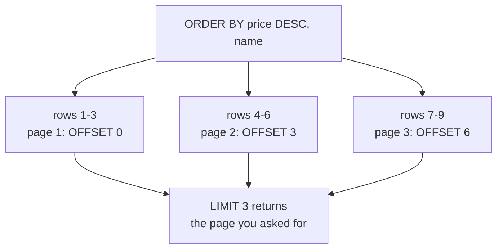

# ORDER BY, LIMIT and OFFSET

A table is an unordered set of rows; the order you happen to see is an implementation detail. `ORDER BY` is the only clause that makes a result reproducible, and reproducibility is what lets you page through a result without repeating a row or losing one between pages.

## Sorting is part of the answer

`ORDER BY` sorts the final result, after filtering and grouping. It takes one key or several: a second key is only consulted when the first ties. That tie-break is not decoration. Without it, rows that tie have no defined order, and a query that returns them in a different order each run cannot be compared to yesterday's output.

```sql
SELECT name, price
FROM products
ORDER BY price DESC, name;
```

`price DESC` sorts most expensive first; `name` settles the ties. Ascending is the default, so `ORDER BY name` is `ORDER BY name ASC`.

## Paging with `LIMIT` and `OFFSET`

`LIMIT n` keeps the next n rows and `OFFSET k` skips the first k. Page one is `LIMIT 3 OFFSET 0`, page two is `LIMIT 3 OFFSET 3`, page three is `LIMIT 3 OFFSET 6`. Offsetting is applied to the sorted result, so the sort, including its tie-break, has to be stable before the pages make sense.



```sql
SELECT name, price
FROM products
ORDER BY price DESC, name
LIMIT 3 OFFSET 3;
```

| name | price |
| --- | --- |
| Harbor Rain Shell | 118.00 |
| Summit Hiking Poles | 96.40 |
| Vertex Mechanical Keyboard | 89.50 |

Three rows, ranked fourth to sixth. Page three repeats the shape with `OFFSET 6`.

## The cost of a deep offset

`OFFSET` is not free. The engine still has to produce and sort the rows it is about to skip, so page 500 reads a great deal of data and throws it away. Keyset pagination avoids that: remember the last key on the previous page and ask for rows after it.

```sql
SELECT name, price
FROM products
WHERE price < 118
ORDER BY price DESC, name
LIMIT 3;
```

Same idea, cheaper: the filter does the skipping. `LIMIT` and `OFFSET` remain the shape you will read most in existing code, so learn them first and recognise keyset paging when you meet it.

## Check yourself

**1. Why is a tie-break needed before paging a sorted result?**

<details>
<summary>Answer</summary>

Rows that tie on the sort key have no defined order. Without a second key the engine may order them differently between runs, so a row can appear on two pages or on none. A unique tie-break pins the order.

</details>

**2. What does `LIMIT 3 OFFSET 6` return?**

<details>
<summary>Answer</summary>

Rows seven to nine of the sorted result: skip the first six, then take three.

</details>

**3. Why can a very large `OFFSET` be slow?**

<details>
<summary>Answer</summary>

The database still has to generate and sort the rows it discards. Keyset pagination filters on the last key seen instead, so the work scales with the page rather than with how far into the result you are.

</details>
