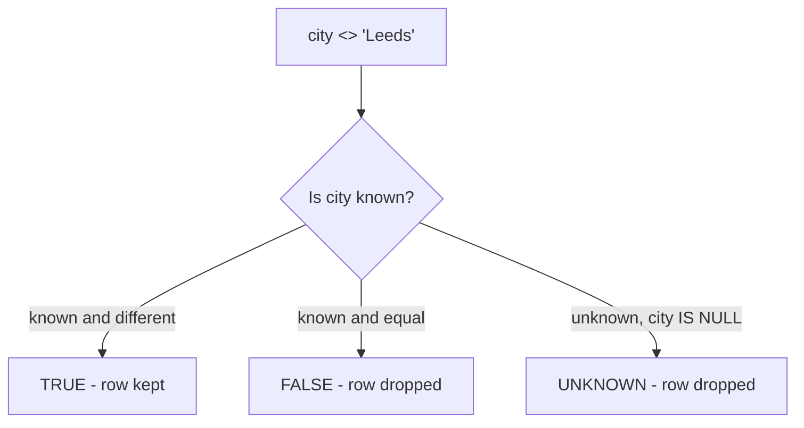

# NULL is unknown

`NULL` is not a value; it is the absence of one. A customer with a `NULL` city is a customer whose city we do not know, and that is a different statement from "the city is blank". Every surprise with `NULL` follows from that one distinction.

## Comparisons with `NULL` are unknown

`city = NULL` is never true, because you cannot test whether an unknown city equals an unknown city. The same goes for `city <> NULL`, `city > NULL` and `NULL = NULL`. To test for a missing value you use a dedicated operator:

```sql
SELECT name, city
FROM customers
WHERE city IS NULL;
```

`IS NULL` and `IS NOT NULL` are the correct tests. When you want `NULL` to behave like any other value, for example when comparing two columns that may each be unknown, reach for `IS DISTINCT FROM`, which treats `NULL` as equal to `NULL`.

## Three-valued logic

A predicate evaluates to true, false or unknown, and `WHERE` keeps only the true rows. That is why a filter as innocent as "not Leeds" quietly loses rows.



The unknown branch is the one that surprises people. `23` customers compare as not-Leeds; `27` are not-Leeds once the four unknown-city customers are counted, because `IS DISTINCT FROM` treats the unknown as a value you can compare.

```sql
SELECT COUNT(*) FILTER (WHERE city <> 'Leeds')            AS not_leeds,
       COUNT(*) FILTER (WHERE city IS DISTINCT FROM 'Leeds') AS truly_not_leeds
FROM customers;
```

| not_leeds | truly_not_leeds |
| --- | --- |
| 23 | 27 |

## `COALESCE` supplies a fallback

When a missing value should read as something concrete, `COALESCE(a, b, ...)` returns the first argument that is not `NULL`.

```sql
SELECT name, COALESCE(city, 'Unknown') AS city
FROM customers
WHERE city IS NULL
ORDER BY name;
```

| name | city |
| --- | --- |
| Bo Ivanov | Unknown |
| Dara Novak | Unknown |
| Luca Novak | Unknown |
| Tess Larsen | Unknown |

`COALESCE` is also a safer default for arithmetic and string building: `NULL + 1` is `NULL`, and `'Hi, ' || city` is `NULL` when the city is unknown.

## Sorting puts `NULL` somewhere

Postgres sorts `NULL` last for ascending order and first for descending order. When the placement matters, say it out loud with `NULLS FIRST` or `NULLS LAST`, so a reader does not have to recall the default.

```sql
SELECT name, city
FROM customers
WHERE city = 'Milan' OR city IS NULL
ORDER BY city NULLS LAST, name;
```

Known cities come first, unknowns at the end. `NULLS FIRST` is the mirror image, useful when the rows you have not classified should sit at the top of the report.

## Check yourself

**1. Why is `WHERE city = NULL` never true?**

<details>
<summary>Answer</summary>

Because `NULL` is unknown, and a comparison with an unknown is unknown rather than true. Use `IS NULL` to test for a missing value.

</details>

**2. How many rows does `WHERE city <> 'Leeds'` drop that `WHERE city IS DISTINCT FROM 'Leeds'` keeps?**

<details>
<summary>Answer</summary>

Every row whose city is `NULL`. They are neither equal to nor different from `'Leeds'`; the comparison is unknown, so the plain filter drops them and `IS DISTINCT FROM` keeps them.

</details>

**3. What does `COALESCE(city, 'Unknown')` do, and when is the fallback used?**

<details>
<summary>Answer</summary>

It returns the first argument that is not `NULL`. The fallback is used only when `city` is `NULL`; a known city passes through unchanged.

</details>
