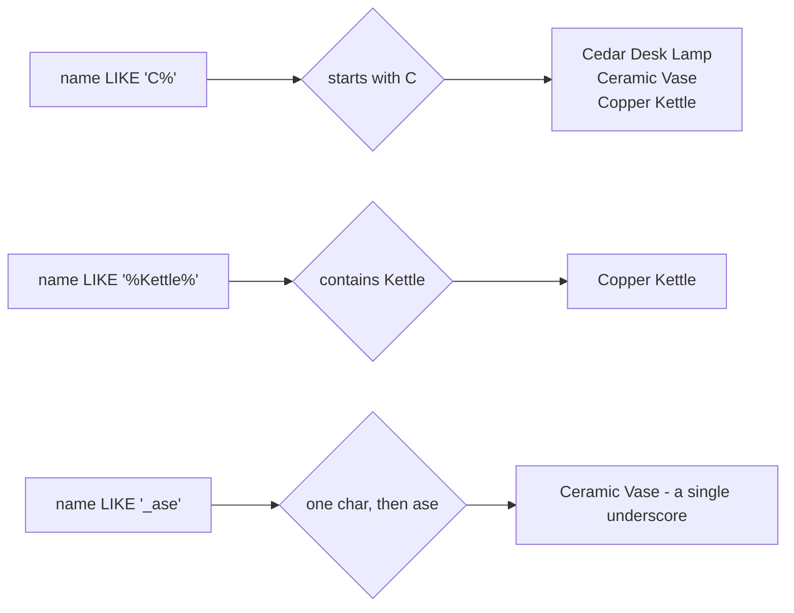

# IN, BETWEEN and LIKE

`IN`, `BETWEEN` and `LIKE` are shorthands for predicates you could spell out with `OR`. The shorthand is worth using because it names the shape of the test — membership in a list, membership in a range, or a textual pattern — instead of leaving the reader to infer it from a chain of comparisons.

## `IN` is a list of equals

`category IN ('Home', 'Kitchen')` is exactly `category = 'Home' OR category = 'Kitchen'`, in a form that scales to a long list without the parentheses pile-up.

```sql
SELECT name, category
FROM products
WHERE category IN ('Home', 'Kitchen')
ORDER BY name;
```

`IN` shares the three-valued logic that surrounds `NULL`: `x IN (1, NULL)` is true for `x = 1`, unknown for every other value, and never false. A `NULL` in a list is almost always a bug — remove it rather than reasoning about it.

## `BETWEEN` is inclusive at both ends

`price BETWEEN 20 AND 90` keeps 20 and 90; it is not a half-open interval. That surprises people who come from languages where a range usually excludes the upper bound, so read it as "at least 20 and at most 90".

```sql
SELECT name, price
FROM products
WHERE price BETWEEN 20 AND 90
ORDER BY price;
```

For timestamps, write the half-open form instead — `ordered_at >= '2026-01-01' AND ordered_at < '2026-02-01'` — because a day is a range itself and `BETWEEN` on a midnight boundary drops or double-counts the last instant.

## `LIKE` matches text patterns

`LIKE` compares text against a pattern with two wildcards: `%` stands for any run of characters (including none) and `_` stands for exactly one character. The comparison is case-sensitive; `ILIKE` is the case-insensitive version.



An anchored pattern is a prefix search; wrap the wildcard on both sides for a contains search. The cost scales with the shape too: a prefix such as `'C%'` can use an index, while `'%Kettle%'` has to test every row.

```sql
SELECT name, category
FROM products
WHERE name LIKE 'C%'
   OR name LIKE 'S%'
ORDER BY name;
```

| name | category |
| --- | --- |
| Cedar Desk Lamp | Home |
| Ceramic Vase | Home |
| Copper Kettle | Kitchen |
| Solar Camp Lantern | Outdoor |
| Summit Hiking Poles | Outdoor |

## Combining them

The three compose: a list plus a range is a common catalogue filter, and it reads like the sentence that produced it.

```sql
SELECT name, price
FROM products
WHERE category IN ('Home', 'Kitchen')
  AND price BETWEEN 20 AND 90
ORDER BY price, name;
```

## Check yourself

**1. Does `price BETWEEN 20 AND 90` include a product priced exactly 90?**

<details>
<summary>Answer</summary>

Yes. `BETWEEN` is inclusive at both ends, so it is the same as `price >= 20 AND price <= 90`.

</details>

**2. What is the difference between `LIKE 'C%'` and `LIKE '%C%'`?**

<details>
<summary>Answer</summary>

The first matches names that start with C; the second matches names that contain C anywhere. The leading `%` also prevents the use of a plain index for the search.

</details>

**3. Why is a `NULL` inside an `IN` list usually a mistake?**

<details>
<summary>Answer</summary>

Because `x IN (1, NULL)` is unknown for every `x` that is not 1, never false. The `NULL` adds a third truth value to a test that was meant to be a simple membership check.

</details>
