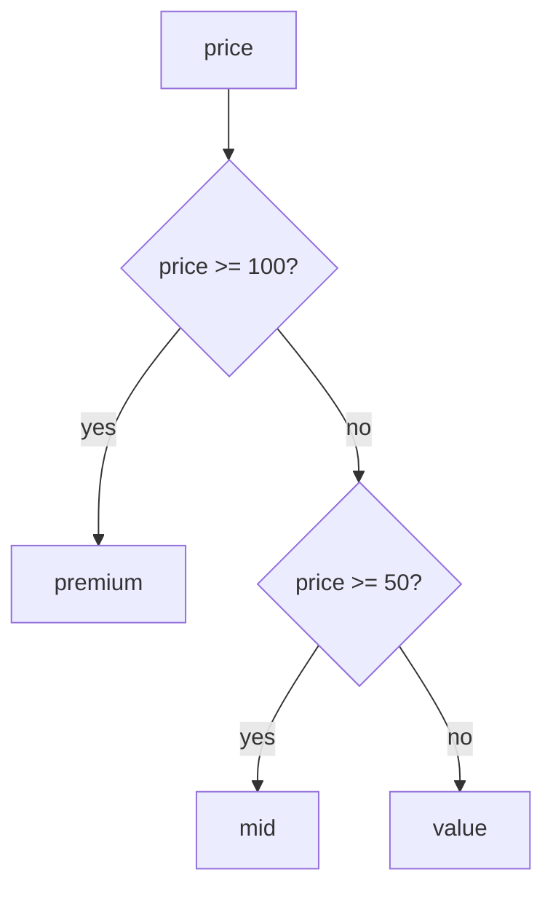

# CASE expressions

`CASE` is an expression, not a statement. It produces a value, so it can sit anywhere a column can — in the `SELECT` list, inside an `ORDER BY`, or as the thing you group by. That is what makes it the tool for turning a continuous number into a handful of labels.

## Two forms, one idea

A searched `CASE` tests conditions you supply; a simple `CASE` compares one expression against a list of values. Both return the value beside the first branch that matches.

```sql
SELECT CASE WHEN price >= 100 THEN 'premium'
            WHEN price >= 50  THEN 'mid'
            ELSE 'value' END AS band
FROM products;
```

A simple `CASE` compares the same expression to each candidate in turn, which reads well when the branches share one subject:

```sql
SELECT name,
       CASE status
            WHEN 'completed' THEN 'done'
            WHEN 'cancelled' THEN 'lost'
            ELSE 'open' END AS outcome
FROM orders;
```

The simple form is shorter when every branch compares the same expression to a constant; the searched form is the only option when the conditions differ. Reach for the searched form by default and switch when the repetition is obvious.

## The first match wins

`WHEN` branches are tested top to bottom and evaluation stops at the first true one. That is why the thresholds in the example are ordered from highest to lowest: tested the other way round, every price would match `>= 50` before ever reaching `>= 100`.



Order the branches from most specific to least and the diagram writes itself.

```sql
SELECT name, price,
       CASE WHEN price >= 100 THEN 'premium'
            WHEN price >= 50  THEN 'mid'
            ELSE 'value' END AS band
FROM products
ORDER BY price DESC, name
LIMIT 5;
```

| name | price | band |
| --- | --- | --- |
| Granite Cookware Set | 210.00 | premium |
| Trail Runner Jacket | 139.00 | premium |
| Nimbus Headphones | 129.00 | premium |
| Harbor Rain Shell | 118.00 | premium |
| Summit Hiking Poles | 96.40 | mid |

## Always say `ELSE`

Without a matching `WHEN` and no `ELSE`, the expression is `NULL`. That is occasionally what you want, but usually it hides a case you forgot. An explicit `ELSE 'other'` documents the catch-all and keeps `NULL` out of a column you are about to group or count.

## The alias is reusable

Because the result is a value, its alias can be used downstream: `ORDER BY band` sorts the labels you just produced, and `GROUP BY` can count how many products fall in each band without repeating the `CASE`.

```sql
SELECT CASE WHEN stock < 20 THEN 'low' ELSE 'ok' END AS stock_level,
       COUNT(*) AS products
FROM products
GROUP BY stock_level
ORDER BY products DESC, stock_level;
```

## Check yourself

**1. Why must `price >= 100` be tested before `price >= 50`?**

<details>
<summary>Answer</summary>

The first matching branch wins. If `>= 50` came first, every price above 100 would also satisfy it and be labelled `mid`; the `>= 100` branch would never be reached.

</details>

**2. What does a `CASE` expression produce when no branch matches and there is no `ELSE`?**

<details>
<summary>Answer</summary>

`NULL`. An explicit `ELSE` keeps that from happening by accident.

</details>

**3. Can a `CASE` alias be used in `GROUP BY`?**

<details>
<summary>Answer</summary>

Yes. `CASE` is an expression, so its alias can be grouped and ordered like any other output column, which is how you turn a number into buckets and count each bucket.

</details>
