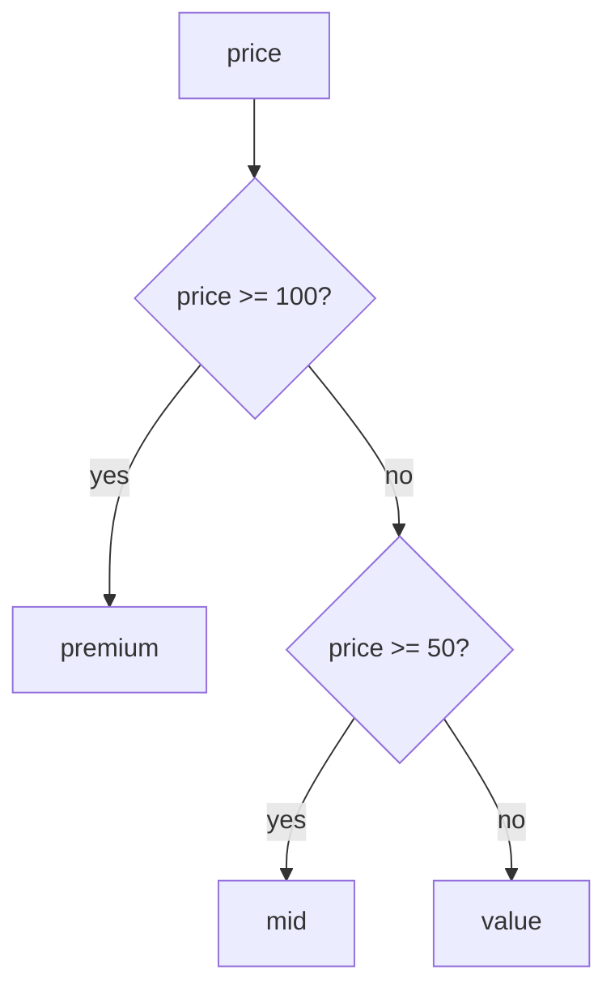

# CASE expressions

Marketing asks for the catalogue split three ways: premium at 100 and up, mid at 50 and up, and value for the rest. `products` stores a `price` and no band, so the query has to build one. Build it in the wrong order and the query still runs, still returns a full table, and files a 210.00 product under `mid` with no error.

You could answer with three queries and a `WHERE` on each one. You get three numbers, and you add them up by hand. The report you actually want puts all three bands in one table, one row per band, and needs a way to write the label into a column.

`CASE` is that way. It turns a list of conditions into a value, and PostgreSQL then treats that value like any other column.

## A result column can hold a decision

When a value is not stored, you compute it in `SELECT`. Chapter 1 showed `price * 1.2 AS with_tax`, which is arithmetic. `CASE` is the general form of the same idea: you supply conditions and the values beside them, and PostgreSQL returns one of those values.

Two terms decide where `CASE` may appear. An expression is anything that produces a value: `price`, `price * 1.2` and `CASE ... END` are all expressions. A statement is one complete command that the server runs, such as the whole `SELECT` you send.

`CASE` is an expression, so it fits anywhere a value fits, and the `SELECT` list is the position you will use most. The cost of getting it wrong is a table that looks finished. Every branch mistake in this chapter returns rows without an error, and the count per band is the only signal.

The keyword pair is `CASE` and a mandatory `END`. Between them sit the branches.

```sql
SELECT name, price,
       CASE WHEN price >= 100 THEN 'premium'
            WHEN price >= 50  THEN 'mid'
            ELSE 'value' END AS band
FROM products
ORDER BY price DESC, name
LIMIT 5;
```

| name | price | band |
| --- | --- | --- |
| Granite Cookware Set | 210.00 | premium |
| Trail Runner Jacket | 139.00 | premium |
| Nimbus Headphones | 129.00 | premium |
| Harbor Rain Shell | 118.00 | premium |
| Summit Hiking Poles | 96.40 | mid |

Read the first row through the branches. Granite Cookware Set costs 210.00, which is at least 100, so the first branch answers true and the column holds `premium`. Summit Hiking Poles costs 96.40, which fails 100 and passes 50, so it takes the second branch and the column holds `mid`.

Nothing in the table changed. `products` still stores six columns, and the band is computed per row at read time. Change a price and the label moves with it, which is the difference between a stored fact and a derived one.

## A searched CASE and a simple CASE

There are two forms, and they answer slightly different questions.

A searched `CASE` gives each `WHEN` a full predicate, meaning a condition that comes out true or false. Any operator works, and each branch can test a different column. The price bands above use the searched form.

A simple `CASE` names one subject after the keyword and compares it to each `WHEN` value with `=`. It reads well when every branch asks about the same thing:

```sql
SELECT id, status,
       CASE status
            WHEN 'completed' THEN 'done'
            WHEN 'cancelled' THEN 'lost'
            ELSE 'open' END AS outcome
FROM orders
ORDER BY id
LIMIT 6;
```

| id | status | outcome |
| --- | --- | --- |
| 1001 | completed | done |
| 1002 | completed | done |
| 1003 | cancelled | lost |
| 1004 | completed | done |
| 1005 | completed | done |
| 1006 | shipped | open |

The sample returns `id`, because `orders` stores a `customer_id` and no name. A later chapter joins `customers` when you want the customer's name beside the order.

Both forms stop at the first match. The simple form only tests equality against one subject, so it is shorter to read and narrower in what it can say. `WHEN 'refunded' THEN ...` is fine. `WHEN status <> 'completed'` is not, because the simple form reads every `WHEN` as a value to compare, not as a condition to evaluate.

Use the simple form when the branches compare one expression to constants. Use the searched form for ranges, `IS NULL`, arithmetic, or two columns in the same branch.

## The first match wins

The branches are tested from the top down. The first true one supplies the value, and PostgreSQL does not test the rest. That rule makes the branch order part of the answer, and it is the reason the thresholds in the example run from highest to lowest.



Here is the same query with the two price branches swapped, and nothing else changed:

```sql
SELECT name, price,
       CASE WHEN price >= 50  THEN 'mid'
            WHEN price >= 100 THEN 'premium'
            ELSE 'value' END AS band
FROM products
ORDER BY price DESC, name
LIMIT 3;
```

| name | price | band |
| --- | --- | --- |
| Granite Cookware Set | 210.00 | mid |
| Trail Runner Jacket | 139.00 | mid |
| Nimbus Headphones | 129.00 | mid |

Three rows come back and every one is labelled `mid`. Granite Cookware Set costs 210.00, which passes `>= 50`, so the first branch answers and the `>= 100` branch never runs. The query is valid SQL, the table is well formed, and PostgreSQL reports nothing.

The totals are where the mistake shows. Group the swapped expression and you get thirteen products in `mid`, seven in `value`, and no `premium` row at all. Four products cost 100 or more, so a band report with no premium row is the symptom to check for.

That is the same counting habit chapter 1 used for `DISTINCT`: compare the number of groups with the number you expect. Two more habits help. Put the narrowest condition first and the catch-all last. Then read the branch order aloud, because a `CASE` that is out of order still reads like a sentence.

## ELSE is the branch you forgot

Drop the `ELSE` and the expression has no answer for a price under 50. PostgreSQL returns `NULL` there, and chapter 4 defined `NULL` as unknown rather than empty.

```sql
SELECT name, price,
       CASE WHEN price >= 100 THEN 'premium' END AS band
FROM products
ORDER BY price DESC, name
LIMIT 6;
```

| name | price | band |
| --- | --- | --- |
| Granite Cookware Set | 210.00 | premium |
| Trail Runner Jacket | 139.00 | premium |
| Nimbus Headphones | 129.00 | premium |
| Harbor Rain Shell | 118.00 | premium |
| Summit Hiking Poles | 96.40 | NULL |
| Vertex Mechanical Keyboard | 89.50 | NULL |

Four rows carry a label and two carry nothing. Counted by group, the expression gives 4 rows the label `premium` and 16 rows an unknown:

```sql
SELECT CASE WHEN price >= 100 THEN 'premium' END AS band,
       COUNT(*) AS products
FROM products
GROUP BY band
ORDER BY products DESC;
```

| band | products |
| --- | --- |
| NULL | 16 |
| premium | 4 |

An unknown label is worse than a blank. Chapter 4 showed that a comparison against an unknown is unknown, and `WHERE` keeps only true rows. So `WHERE band <> 'premium'` on this expression returns nothing, because the sixteen products you meant to find cannot be compared at all.

The missing `ELSE` did not leave a cosmetic gap. It removed a category from every filter that names it.

`ELSE 'value'` adds two words and closes the hole. When a `NULL` genuinely means "not classified", keep it and say so in the alias, as in `AS band_or_null`.

## The name works in GROUP BY and ORDER BY

`AS` names the column. Because the column holds a computed value, the name is usable in the two clauses that run after `SELECT`: `GROUP BY` and `ORDER BY`. Chapter 1 gave the run order, and this is where it pays off.

```sql
SELECT CASE WHEN price >= 100 THEN 'premium'
            WHEN price >= 50  THEN 'mid'
            ELSE 'value' END AS band,
       COUNT(*) AS products
FROM products
GROUP BY band
ORDER BY products DESC, band;
```

| band | products |
| --- | --- |
| mid | 9 |
| value | 7 |
| premium | 4 |

That is the three-query report from the top of the chapter, written as one query. `GROUP BY band` makes one group per label, `COUNT(*)` counts the products in each group, and `ORDER BY products DESC` sorts the groups by their own count. Chapter 7 takes `GROUP BY` apart; here it is enough that the alias is a legal grouping key.

Sorting by the label directly also works, and the result may surprise you. `ORDER BY band` sorts text, so the order is `mid`, `premium`, `value`. That is alphabetical order, not price order. A report that needs the bands in business order sorts by the price that anchors each group instead.

```sql
SELECT CASE WHEN price >= 100 THEN 'premium'
            WHEN price >= 50  THEN 'mid'
            ELSE 'value' END AS band,
       COUNT(*) AS products
FROM products
GROUP BY band
ORDER BY MIN(price) DESC;
```

| band | products |
| --- | --- |
| premium | 4 |
| mid | 9 |
| value | 7 |

The sort key is an aggregate over the group, and `GROUP BY` has already built the groups by the time `ORDER BY` runs. So `MIN(price)` is a legal key even though no row in the table carries it.

Try this: put `ORDER BY band` back and run the query again. The four-product premium band lands between `mid` and `value`, because the sort reads the label as text. The counts did not move; only the order did.

The same pattern handles stock, which is the shape the exercise uses:

```sql
SELECT CASE WHEN stock < 20 THEN 'low' ELSE 'ok' END AS stock_level,
       COUNT(*) AS products
FROM products
GROUP BY stock_level
ORDER BY products DESC, stock_level;
```

| stock_level | products |
| --- | --- |
| low | 10 |
| ok | 10 |

The two counts tie at ten, so the second key decides the order and `low` comes first alphabetically. A tie is a reminder that stable paging needs a key with no duplicates in it, as chapter 3 showed.

`WHERE` is the exception, for the reason chapter 1 gave. It runs before `SELECT`, so the alias does not exist yet, and `WHERE band = 'premium'` fails with `column "band" does not exist`. Repeat the `CASE` in `WHERE`, or filter in an outer query that reads the labelled column.

## When the CASE belongs in the data

A `CASE` earns its place when one report needs the rule. The boundaries sit next to the query that uses them, and the schema does not change.

The copy stops paying when many reports need the same boundaries. One query gets edited and the others keep the old threshold, so two dashboards disagree and neither one raises an error.

At that point an experienced person stores the rule once, in a lookup table that maps a price range to a band, or in a view that wraps the `CASE`. Every reader then shares one definition of `premium`.

The commerce fixture has no such table, so this chapter keeps the `CASE` in the query. That is the right call for a rule that one report uses, and it keeps the boundary visible while you learn what it does.

## What the exercise asks you to label

The exercise labels stock for the Outdoor products. The mapping is `out` for zero stock, `low` below 20, and `ok` for the rest, and the result sorts by stock, then by name.

Three habits from this chapter apply. The narrowest condition goes first, so `stock = 0` must be tested before `stock < 20`: zero is also below 20, and the first match wins.

The `ELSE 'ok'` branch covers every product you did not name, so no row carries a `NULL` label. The two sort keys come from chapter 3, where `stock` puts the rows in order and `name` settles any product that shares a stock count.

One product in the fixture has zero stock, and it sits in Outdoor. If it comes back labelled `low`, the branch order is wrong. That single row is the fastest check you have.

## What to remember

**What I would do:** read the branches from the top and ask which condition is the narrowest, then write the `ELSE` before the first `WHEN`. Group the expression and count the bands before you send the report, because the query returns a full table either way. Move the rule into a view or a lookup table the moment a second report needs the same boundaries.

- `CASE` is an expression, so it produces a value and fits wherever a value fits. The `SELECT` list is the usual place.
- A searched `CASE` gives each `WHEN` a full condition. A simple `CASE` compares one expression to constants with `=`.
- Branches are tested top to bottom and the first true one wins. Order them from narrowest to widest.
- With no matching branch and no `ELSE`, the result is `NULL`, and a `NULL` label drops out of filters and comparisons.
- The `AS` name can be grouped and ordered, because `SELECT` runs before `GROUP BY` and `ORDER BY`. `WHERE` runs earlier and cannot see it.
- Count the groups and compare against the number you expect. A band that should exist and does not is a branch order bug.

## Check yourself

**1. Why must `price >= 100` be tested before `price >= 50`?**

<details>
<summary>Answer</summary>

Because the first matching branch wins. Test `>= 50` first and every price of 100 or more satisfies it, so the row is labelled `mid` and the `>= 100` branch never runs. The totals show it: thirteen `mid`, seven `value`, no `premium`.

</details>

**2. What does a `CASE` expression produce when no branch matches and there is no `ELSE`, and why does that matter after grouping?**

<details>
<summary>Answer</summary>

`NULL`. The unknown label becomes its own group in a `GROUP BY`, and it fails every comparison in a `WHERE`, so a filter such as `band <> 'premium'` drops those rows instead of returning them.

</details>

**3. Can the `AS` name be used in `GROUP BY` and `ORDER BY`, and what about `WHERE`?**

<details>
<summary>Answer</summary>

`GROUP BY` and `ORDER BY` both accept it, because they run after `SELECT` creates the name. `WHERE` runs before `SELECT`, so it cannot see the name. Repeat the expression there, or filter in an outer query.

</details>

**4. A band report comes back with 13 `mid` rows and 7 `value` rows, and no `premium` row. What went wrong, and how would you confirm it from the query text?**

<details>
<summary>Answer</summary>

The branches are out of order: `price >= 50` sits above `price >= 100`, so no price reaches the premium test. Read the `WHEN` lines from top to bottom and check that each threshold is the narrowest of the ones below it.

</details>

**5. When is the simple `CASE` the better choice?**

<details>
<summary>Answer</summary>

When every branch compares the same expression to a constant, as in `CASE status WHEN 'completed' THEN 'done' ...`. It is shorter and it names the subject once. A branch that needs a range or a second column forces the searched form.

</details>
