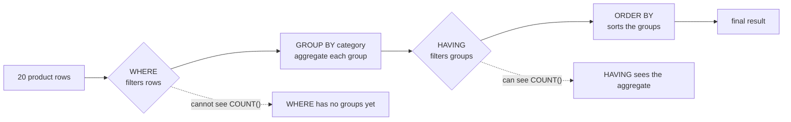

# Aggregation with HAVING

`GROUP BY` turns a set of rows into one row per group, and an aggregate turns each group into a single number. `HAVING` is the filter that runs on those groups — after the counting, not before it.

## Group, then summarise

`GROUP BY category` collapses the twenty product rows into one row per category, and `COUNT(*)` reports how many rows landed in each. The result has one row per group, so every column you select must either be the grouping key or be wrapped in an aggregate; anything else has no single value to report.

```sql
SELECT category, COUNT(*) AS products
FROM products
GROUP BY category
ORDER BY products DESC, category;
```

| category | products |
| --- | --- |
| Outdoor | 6 |
| Electronics | 5 |
| Home | 5 |
| Kitchen | 4 |

## `WHERE` filters rows, `HAVING` filters groups

This is the whole lesson in one sentence. `WHERE` runs before the grouping and keeps or drops individual rows. `HAVING` runs after and keeps or drops whole groups. An aggregate is not available to `WHERE` — the groups do not exist at that point — so `WHERE COUNT(*) > 4` is an error and `HAVING COUNT(*) > 4` is the fix.



Read the filters in order and the clause placement follows: a test on a raw column belongs in `WHERE`, a test on `COUNT`, `SUM` or `AVG` belongs in `HAVING`.

```sql
SELECT category, COUNT(*) AS products
FROM products
GROUP BY category
HAVING COUNT(*) > 4
ORDER BY products DESC, category;
```

| category | products |
| --- | --- |
| Outdoor | 6 |
| Electronics | 5 |
| Home | 5 |

Kitchen had four products, so it drops out. The `ORDER BY` sorts the surviving groups by their own aggregate, which is the natural reading order for a report.

## Put the cheap filter first

When a query has both filters, the one that removes rows should come first, because smaller input means less work for the aggregation. "Completed orders per month, only the busy months" wants the status filter in `WHERE` and the threshold in `HAVING`:

```sql
SELECT DATE_TRUNC('month', ordered_at)::date AS month,
       COUNT(*) AS completed
FROM orders
WHERE status = 'completed'
GROUP BY 1
HAVING COUNT(*) >= 10
ORDER BY month;
```

Moving `status = 'completed'` into `HAVING` would still be correct, but the aggregation would count every status and throw most of them away afterwards.

## Check yourself

**1. Why does `WHERE COUNT(*) > 4` fail?**

<details>
<summary>Answer</summary>

Because `WHERE` runs before the grouping, so the groups and their aggregates do not exist yet. A test on an aggregate belongs in `HAVING`.

</details>

**2. What is the difference between filtering on a column and filtering on an aggregate?**

<details>
<summary>Answer</summary>

A column filter selects which rows are counted and belongs in `WHERE`; an aggregate filter selects which groups you see and belongs in `HAVING`.

</details>

**3. Why put `status = 'completed'` in `WHERE` rather than `HAVING`?**

<details>
<summary>Answer</summary>

It is a property of each row, so filtering early shrinks the input to the aggregation. The same result through `HAVING` would count every status and discard most of them afterwards.

</details>
