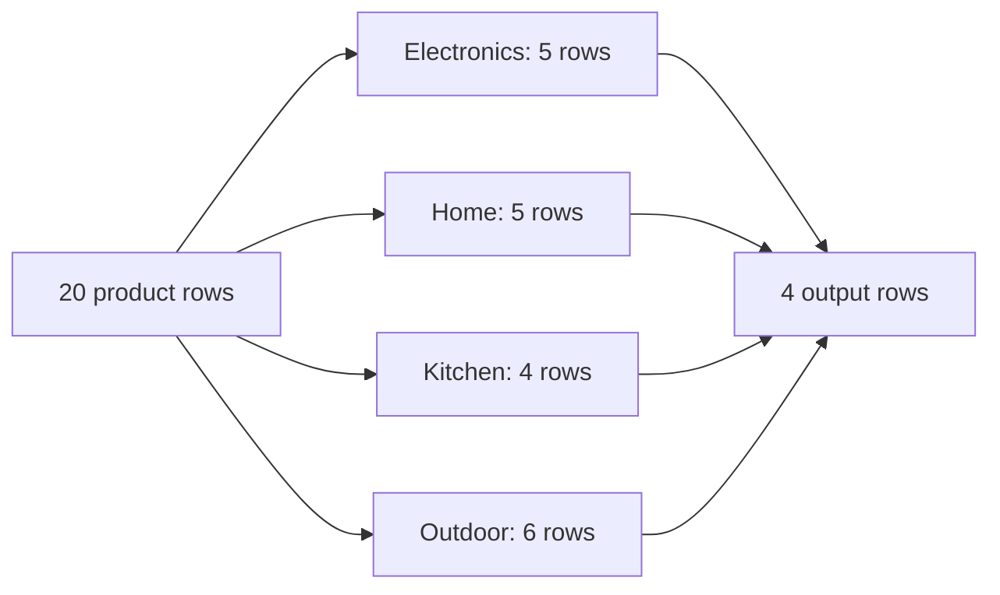
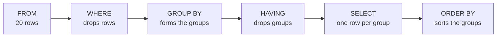

# Aggregation with HAVING

The stock meeting asked which categories carry more than four products, and `WHERE` could not answer it. The test counts rows, so no single row can settle it, and `products` holds twenty rows across four categories with no column that stores a count.

The other question was simpler: how many products sit in each category. That number has to be computed, one per category. PostgreSQL answers both with `GROUP BY` and `HAVING`, and this chapter builds them in that order.

## Twenty rows, four answers

An aggregate function reads many rows and returns one value. `COUNT(*)` counts them, `SUM(price)` totals a column, and `AVG(price)` averages it. Used alone, an aggregate answers a question about the whole table:

```sql
SELECT COUNT(*) AS products
FROM products;
```

| products |
| --- |
| 20 |

Twenty rows in, one row out. Nothing was filtered; the aggregate simply reduced the table to a single number.

A wrong grouping key is quiet. The query still returns rows, they answer a different question, and nothing on the screen says so.

A group is a subset of rows that share a value in a column you name. `GROUP BY` is the clause that builds those subsets and runs the rest of the query once per subset. Here is the input, sorted by category so the groups stand together:

```sql
SELECT id, name, category
FROM products
ORDER BY category, id;
```

| id | name | category |
| --- | --- | --- |
| 1 | Aurora Wireless Earbuds | Electronics |
| 2 | Nimbus Headphones | Electronics |
| 6 | Pulse Fitness Tracker | Electronics |
| 7 | Vertex Mechanical Keyboard | Electronics |
| 18 | Noise-Cancel Earmuffs | Electronics |
| 3 | Linen Duvet Cover | Home |
| 4 | Cedar Desk Lamp | Home |
| 11 | Wool Throw Blanket | Home |
| 14 | Ceramic Vase | Home |
| 17 | Bamboo Shelf | Home |
| 9 | Maple Cutting Board | Kitchen |
| 10 | Copper Kettle | Kitchen |
| 12 | Granite Cookware Set | Kitchen |
| 15 | Espresso Tamper | Kitchen |
| 5 | Trail Runner Jacket | Outdoor |
| 8 | Harbor Rain Shell | Outdoor |
| 13 | Summit Hiking Poles | Outdoor |
| 16 | Solar Camp Lantern | Outdoor |
| 19 | Rope Dog Leash | Outdoor |
| 20 | Discontinued Camp Stove | Outdoor |

Twenty rows enter the query below. `GROUP BY category` splits them into four groups, one per distinct `category` value, and `COUNT(*)` runs once per group:



```sql
SELECT category, COUNT(*) AS products
FROM products
GROUP BY category
ORDER BY products DESC, category;
```

| category | products |
| --- | --- |
| Outdoor | 6 |
| Electronics | 5 |
| Home | 5 |
| Kitchen | 4 |

The grain of a result is what one output row stands for. Here the grain is one category, so four rows answer the question four times. Say the grain before you write the `GROUP BY`, because the grouping column is what fixes it. `SUM`, `AVG`, `MIN` and `MAX` group the same way and only change which summary you get.

## A group reports its key and its aggregates

After grouping, each output row speaks for many input rows. That is why the `SELECT` list is restricted: the grouping column has one value per group, an aggregate produces one value per group, and a bare column has several.

```sql
-- Fails: column "products.name" must appear in the GROUP BY clause
-- or be used in an aggregate function.
SELECT category, name, COUNT(*) AS products
FROM products
GROUP BY category;
```

PostgreSQL refuses rather than pick one name from the group and pretend it speaks for the category. There are two fixes, and they answer different questions.

The first fix adds the column to the grouping, and the pair then becomes the key that identifies each group.

```sql
SELECT category, active, COUNT(*) AS products
FROM products
GROUP BY category, active
ORDER BY category, active;
```

| category | active | products |
| --- | --- | --- |
| Electronics | true | 5 |
| Home | true | 5 |
| Kitchen | true | 4 |
| Outdoor | false | 1 |
| Outdoor | true | 5 |

Five rows now, because the grain is a category and an active flag together, and Outdoor appears twice. That is the right shape for a report about discontinued products and the wrong shape for a report about categories. Changing the `GROUP BY` list changes the question.

The second fix wraps the column in an aggregate. `MAX(price)` gives the highest price in each category, which is a question with exactly one answer. Wrapping a name is usually a mistake, because `MAX(name)` returns the alphabetically last name in the group rather than the product you had in mind.

The same rule catches the query with no `GROUP BY` at all. `SELECT name, COUNT(*) FROM products` fails with the message above, since the aggregate makes the whole table one group and the bare `name` has twenty values to choose from. `SELECT COUNT(*) FROM products` is fine, because it selects nothing but the aggregate.

Try this: swap `COUNT(*) AS products` for `MAX(name) AS products` in the grouped query. It runs, and each row carries one name picked by alphabet in place of the count you asked for.

## WHERE filters rows, HAVING filters groups

The second request from the meeting needs a filter on a count. `WHERE` cannot do that job, because it runs before the grouping and there are no groups to test yet. `HAVING` runs after the groups exist, so it can test a count.

```sql
SELECT category, COUNT(*) AS products
FROM products
GROUP BY category
HAVING COUNT(*) > 4
ORDER BY products DESC, category;
```

| category | products |
| --- | --- |
| Outdoor | 6 |
| Electronics | 5 |
| Home | 5 |

Kitchen had four products, so its group fails the test and never reaches the result. The three survivors report their own counts, and `ORDER BY products DESC` sorts the groups by that count, the same way it would sort rows.

The two clauses are not interchangeable, and PostgreSQL says so. `WHERE COUNT(*) > 4` fails with `aggregate functions are not allowed in WHERE`, because `WHERE` looks at one row at a time and a count belongs to a set of rows.

Read each filter by what it tests. A test on a stored column, such as `price > 100` or `status = 'completed'`, is a test about rows, so it goes in `WHERE`. A test on `COUNT`, `SUM`, `AVG`, `MIN` or `MAX` is a test about groups, so it goes in `HAVING`.

## The pipeline runs in a fixed order

Chapter 1 gave the logical order of a query. The two clauses in this chapter sit in the middle of it:



Each step sees only what ran before it, and that one rule explains the errors in this chapter. `WHERE` cannot see an aggregate, because the groups do not exist yet.

Neither `WHERE` nor `HAVING` can see an output alias, because `SELECT` runs after both. An alias such as `n` is not visible in `HAVING`, so `HAVING n > 4` fails with `column "n" does not exist`. Repeat the aggregate inside `HAVING` instead.

`ORDER BY` is last, which is why it can use a name from `SELECT`. In the demo query, `ORDER BY products DESC` sorts by the alias, and `ORDER BY COUNT(*) DESC` would sort by the same aggregate.

## Put the row filter first

One report often needs both filters. Take completed orders per month, keeping only the months that clear eight. The status test is a property of a row, so it goes in `WHERE`. The count test is a property of a group, so it goes in `HAVING`.

```sql
SELECT DATE_TRUNC('month', ordered_at)::date AS month,
       COUNT(*) AS completed
FROM orders
WHERE status = 'completed'
GROUP BY 1
HAVING COUNT(*) >= 8
ORDER BY month;
```

| month | completed |
| --- | --- |
| 2026-01-01 | 8 |
| 2026-02-01 | 8 |
| 2026-03-01 | 9 |

`WHERE status = 'completed'` removes 43 of the 80 orders before any grouping happens, so `COUNT(*)` only ever counts completed ones. `GROUP BY 1` groups by the first column of the `SELECT` list, which saves repeating the `DATE_TRUNC` call. `HAVING` then keeps the three months whose completed count reaches eight: January and February with 8 each, March with 9.

April has 7 and May has 5, so both drop.

Two things go wrong here often. Raise the threshold to ten and the query returns no rows, because no month has ten completed orders. That is not an error: `HAVING` keeps every group it is given, and this time it kept none, so you get an empty table.

An empty result from a count filter usually means the threshold sits above every group. Run the query without `HAVING` and read the real numbers first.

The second mistake is moving the status test into `HAVING`. That fails with `column "orders.status" must appear in the GROUP BY clause or be used in an aggregate function`, because `status` is not the grouping key. You could add `status` to the `GROUP BY` list, but then each row counts one month of one status, and the report answers a different question.

Filtering rows early is also the cheaper choice: the aggregation then reads the 37 completed orders instead of all 80.

## What the exercise asks you to group

The next exercise counts orders per status and keeps the statuses with at least 11 orders, largest first, with ties settled alphabetically. The `status` column has five distinct values across 80 orders, so the answer starts at five groups.

Both habits from this chapter apply to it. The threshold tests a count, so it belongs in `HAVING COUNT(*) >= 11` and not in a `WHERE`, which has no counts to test. The sort needs a second key, because two statuses can end up with the same count and a tie has no defined order. Chapter 3 showed why that matters when a report is read twice.

## What to remember

**What I would do:** settle the grain first, then give each filter to the clause that can see it: row tests to `WHERE`, count tests to `HAVING`. When a count filter returns nothing, drop the clause and read the real counts before you touch the threshold.

- An aggregate reads many rows and returns one value. `COUNT`, `SUM`, `AVG`, `MIN` and `MAX` are all aggregates.
- `GROUP BY` builds one group per distinct key and runs the rest of the query once per group. The grain of the result is one group.
- A grouped query selects the grouping key and aggregates only. A bare column has no single value, so PostgreSQL rejects it.
- `WHERE` filters rows before the grouping. `HAVING` filters groups after it, so only `HAVING` can test an aggregate.
- `WHERE` and `HAVING` cannot see a `SELECT` alias. `ORDER BY` runs last and can.
- A count filter that matches no group returns an empty result rather than an error. Check the real counts before you raise a threshold.

## Check yourself

**1. Why does `WHERE COUNT(*) > 4` fail, and what is the fix?**

<details>
<summary>Answer</summary>

`WHERE` runs before the grouping, so no groups and no counts exist when it runs. The message is `aggregate functions are not allowed in WHERE`. Move the test into `HAVING COUNT(*) > 4`, which runs after the groups are built.

</details>

**2. `SELECT name, COUNT(*) FROM products` fails even though it has no `GROUP BY`. What is PostgreSQL objecting to?**

<details>
<summary>Answer</summary>

An aggregate with no `GROUP BY` makes the whole table one group, so the result is a single row. That row has no single `name` to show, and PostgreSQL refuses to pick one of the twenty. Select only the aggregate, or add `name` to a `GROUP BY`.

</details>

**3. In the completed-orders-per-month query, why does `status = 'completed'` belong in `WHERE` rather than in `HAVING`?**

<details>
<summary>Answer</summary>

Because it describes each order, not each month. `WHERE` removes the other 43 orders before the grouping, so the count only sees completed ones. `status` is not the grouping key, so the same test in `HAVING` fails with a `GROUP BY` error.

</details>

**4. `GROUP BY category` returns four rows. `GROUP BY category, active` returns five. What changed?**

<details>
<summary>Answer</summary>

The grain. The first query reports one row per category and the second reports one row per category and active flag. Outdoor contains one inactive product, so it produces two rows in the second result.

</details>

**5. A query with `HAVING COUNT(*) >= 10` returns an empty table. How do you tell whether the query is broken?**

<details>
<summary>Answer</summary>

Remove the `HAVING` clause and run it again. If the groups come back with counts below ten, the query is correct and the threshold is higher than every group. An empty result is a valid answer to a filter, not an error.

</details>
