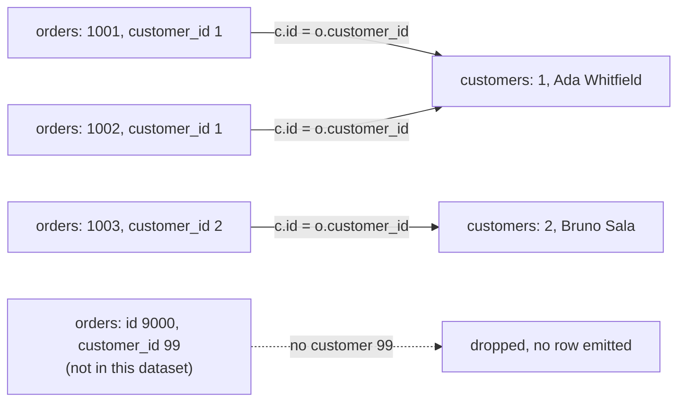

# What a join actually does

Order 1005 came in with a change of address, and `orders` had no name to confirm it. The table has four columns, none of them a customer name: there is a `customer_id` of 1, and that is all. The name lives in `customers`, so the answer took a second query for customer 1, and Ada Whitfield went onto the screen beside the order. Two statements, one answer, no harm.

That works until the support lead asks for all 80 orders with a customer name beside each one. Eighty round trips from your code is not a plan, and someone still has to stitch the answers together. The database can pair the rows itself, in one statement. That statement is a join, and this chapter is about the rule inside it.

## One row, two tables

Start with the order row on its own.

```sql
SELECT id, customer_id, status
FROM orders
WHERE id = 1005;
```

| id | customer_id | status |
| --- | --- | --- |
| 1005 | 1 | completed |

The row also carries `ordered_at`, which is 2026-02-11 11:55. Nothing here spells out a person.

The customer row holds the name.

```sql
SELECT id, name, city
FROM customers
WHERE id = 1;
```

| id | name | city |
| --- | --- | --- |
| 1 | Ada Whitfield | Leeds |

Two terms make the link official. `orders.id` is the primary key of `orders`: the column that identifies a row, so no two orders share a value there. `customers.id` is the primary key of `customers`. `orders.customer_id` is a foreign key: a column whose value must name a primary key in another table, and PostgreSQL refuses an order whose `customer_id` names nobody.

The order stores the number 1, not a copy of the name. That is the point of the reference. Ada can move from Leeds to Bristol and one row changes, while all five of her orders keep pointing at her. It also means a lone order row cannot answer "which customer", because the answer is in the other table.

Copy the name into each order row instead, and that move becomes five updates, with five chances to miss one.

## The `ON` clause is the pairing rule

A join reads both tables in one statement and combines rows. Here is the query, with the result you would see for the first four orders.

```sql
SELECT o.id AS order_id, c.name AS customer
FROM orders o
JOIN customers c ON c.id = o.customer_id
ORDER BY o.id
LIMIT 4;
```

| order_id | customer |
| --- | --- |
| 1001 | Ada Whitfield |
| 1002 | Ada Whitfield |
| 1003 | Bruno Sala |
| 1004 | Chidi Okafor |

Read it as a sentence: orders, each with the customer whose id matches the order's `customer_id`. The `ON` clause is that condition. It is checked against a pair of rows, one from each side, and only pairs that make it true produce output.

The engine works in this order. `FROM` names the two tables and gives each one a nickname. For a given order row, the engine looks for customer rows where `c.id = o.customer_id` holds. Each pair that passes becomes one combined row, carrying every column of both. `SELECT` then chooses which of those columns to keep, `ORDER BY` sorts what survived, and `LIMIT` cuts the list.

`ON` sits between the two tables because it is about them. It answers one question: which row on the right belongs with which row on the left. It never answers "which rows do I want", and it never changes a value. Two orders that point at the same customer each get their own copy of that customer's columns, because pairing happens per row.

The nicknames are not decoration either. Both tables have a column named `id`, so this fails.

```sql
-- Fails: both tables have a column named id.
SELECT o.id, c.name
FROM orders o
JOIN customers c ON id = id;
```

PostgreSQL answers `column reference "id" is ambiguous`, because it cannot tell which table's `id` you meant. `ON c.id = o.customer_id` removes the doubt by naming one column from each side. Once you have written the alias, use it on every column, even the ones that happen to be unique to one table. The next reader can then see which side each value came from.

A wrong link still executes. Compare the order's `customer_id` with the wrong column, or swap the sides, and the query returns rows for a question nobody asked. The join does not validate the relationship. It applies the rule you wrote.

## A walkthrough, row by row

Here are the inputs. Five orders, taken in id order:

| order id | customer_id |
| --- | --- |
| 1001 | 1 |
| 1002 | 1 |
| 1003 | 2 |
| 1004 | 3 |
| 1005 | 1 |

And the customer rows those keys point at:

| customer id | name |
| --- | --- |
| 1 | Ada Whitfield |
| 2 | Bruno Sala |
| 3 | Chidi Okafor |

Now apply the rule to each order in turn. Order 1001 has `customer_id` 1, so it pairs with customer 1, and the combined row carries `1001` and `Ada Whitfield`. Order 1002 also has `customer_id` 1, so it pairs with customer 1 as well and produces its own row. Customer 1 was read again, not used up.

Order 1003 points at customer 2 and picks up Bruno Sala. Order 1004 takes Chidi Okafor. Order 1005 returns to customer 1.

Five orders in, five rows out, three distinct names:

```sql
SELECT o.id, c.name
FROM orders o
JOIN customers c ON c.id = o.customer_id
ORDER BY o.id
LIMIT 5;
```

| id | name |
| --- | --- |
| 1001 | Ada Whitfield |
| 1002 | Ada Whitfield |
| 1003 | Bruno Sala |
| 1004 | Chidi Okafor |
| 1005 | Ada Whitfield |

The database does not have to scan `customers` five times to get this. It may read the customer rows once and hold them in a hash table keyed by `id`. It may also walk the primary key index for each order. The plan can change with the data. The pairing rule decides the rows in every plan.

## An inner join is also a filter

`JOIN` on its own means an inner join, and an inner join keeps only pairs. A row that finds no partner on the other side produces nothing: no padded row, no warning, and no count of what went missing.



In this dataset nothing is dropped from the left. `orders.customer_id` is `NOT NULL` and references `customers.id`, so all 80 orders find their customer and the join returns 80 rows. Seven customers never appear, because they placed no orders and the join keeps no customer without a pair.

The drop becomes real as soon as you filter the right side. Add `WHERE c.city = 'Leeds'` and the result falls to 13 rows, because only the orders of Leeds customers survive the pairing. That is the habit to carry: an inner join is a pairing rule and a filter at the same time. Before you trust its count, ask what could have failed to pair.

Also notice where the filter went. `WHERE` runs after `ON`, so it removes whole combined rows. In an inner join, a condition in `ON` and the same condition in `WHERE` remove the same rows, which is why the two spellings look interchangeable here. The next chapter shows the case where they differ, when a `LEFT JOIN` must keep the rows that `ON` could not pair.

Try this: move `c.city = 'Leeds'` into the pairing rule, as `ON c.id = o.customer_id AND c.city = 'Leeds'`. The same 13 rows come back, because an inner join drops a pair that fails either condition.

## Many-to-one keeps the grain

The grain of a result is the thing one row describes. This result has one row per order, and that is the grain the question asked for: each order, decorated with a name.

The grain survives because of the direction and the key. Many orders point at one customer, and each order points at exactly one. `customers.id` is a primary key, so a single order can match at most one customer row. One order in, one row out, whatever the customer count.

Measure it rather than assume it.

```sql
SELECT count(*) AS pairs,
       count(DISTINCT c.id) AS customers
FROM orders o
JOIN customers c ON c.id = o.customer_id;
```

| pairs | customers |
| --- | --- |
| 80 | 23 |

Eighty rows for eighty orders, and 23 different customers among them. Ada Whitfield accounts for five of the 80, which is why her name repeats. Repetition of a name is not duplication of a row: the five rows describe five different orders.

The opposite direction multiplies. Travel from `orders` down to `order_items` and one order meets several lines, so the row count grows past 80. Chapter 3 takes that shape apart. It is the same `JOIN` keyword with the same `ON` clause, and the row count behaves completely differently because the key on the right stops being unique per left row.

## Worked example: completed orders and their customers

One filter, one sort, and the pairing rule unchanged.

```sql
SELECT o.id AS order_id, c.name AS customer
FROM orders o
JOIN customers c ON c.id = o.customer_id
WHERE o.status = 'completed'
ORDER BY o.id
LIMIT 5;
```

| order_id | customer |
| --- | --- |
| 1001 | Ada Whitfield |
| 1002 | Ada Whitfield |
| 1004 | Chidi Okafor |
| 1005 | Ada Whitfield |
| 1008 | Bruno Sala |

Ada Whitfield appears three times because three of her five orders are completed. The other two are shipped and refunded, and the `WHERE` clause removed them after the join attached her name. Run the same query without the filter and you get 80 rows. With it, 37.

The difference is the filter's work, not the join's.

The exercise that follows asks for the order id, the customer name, and the status, newest first. You already have the join from this section, so the new work is the third column and the sort. Order by `o.ordered_at` in descending order, and qualify the column even though only one table has it. The alias tells the reader which table the sort reads.

## A wrong turn: joining with no rule

The mistake that costs the most time is leaving the pairing rule out. A comma between two tables in `FROM` is also a join, and without a rule it pairs every order with every customer.

```sql
-- Wrong: no pairing rule, so every order meets every customer.
SELECT count(*) AS pairs
FROM orders o, customers c;
```

| pairs |
| --- |
| 2400 |

Eighty orders times thirty customers is 2,400 pairs. The query is valid, the number is exact, and it answers nothing. Group that by status and the damage gets worse, because `count(*)` now counts pairs rather than orders.

```sql
SELECT o.status, count(*) AS pairs
FROM orders o, customers c
GROUP BY o.status
ORDER BY pairs DESC, o.status;
```

| status | pairs |
| --- | --- |
| completed | 1110 |
| cancelled | 330 |
| refunded | 330 |
| shipped | 330 |
| pending | 300 |

Every row is thirty times the truth, because each order repeats once per customer. Nobody gets an error. The report looks confident and is wrong by a factor equal to the size of the other table.

You can catch it by comparing the total with the table you started from. 2,400 appears nowhere in a store with 80 orders, and every status count divides by 30. A number bigger than the source table is the usual sign that a join had no rule.

The fix is to state the rule, either next to the join or in `WHERE` for the comma form.

```sql
SELECT count(*) AS pairs
FROM orders o, customers c
WHERE o.customer_id = c.id;
```

| pairs |
| --- |
| 80 |

That works, and you will meet the style in older SQL. Write `JOIN customers c ON c.id = o.customer_id` in new code, because the rule then sits beside the tables it joins, and a later `WHERE` cannot swallow it by accident.

## What to remember

**What I would do:** write the `ON` rule before the `SELECT` list, then compare the row count with the source table. A total larger than the table you started from means the rule is missing, or the key on the right is not unique.

- A join combines rows from two tables. `ON` is the rule that says which row pairs with which.
- `ON c.id = o.customer_id` names one column from each side. Unqualified `id` is ambiguous once both tables have one.
- An inner join keeps only pairs, so it filters as well as combines. Rows with no partner vanish without a warning.
- Many-to-one joins keep the grain: a unique key on the right means each left row matches at most one right row, so 80 orders stay 80 rows.
- `WHERE` runs after the pairing, so it removes complete rows. The next chapter uses `LEFT JOIN` to keep rows that `ON` could not pair.
- A join with no rule multiplies the two tables. Compare the count with the source table before you trust it.

## Check yourself

**1. In `JOIN customers c ON c.id = o.customer_id`, which clause decides how rows pair, and which clause decides the columns?**

<details>
<summary>Answer</summary>

`ON` decides the pairs. It is tested against a pair of rows, one from each table, and only passing pairs become output. `SELECT` decides which columns those pairs contribute to the result. It cannot add or remove a pair.

</details>

**2. Why does `SELECT o.id, c.name FROM orders o JOIN customers c ON id = id` fail?**

<details>
<summary>Answer</summary>

Both tables have a column named `id`, so the unqualified name could mean either one. PostgreSQL rejects it with `column reference "id" is ambiguous`. Naming one column from each side, `c.id` and `o.customer_id`, removes the doubt.

</details>

**3. The join of `orders` to `customers` returns 80 rows, one per order. What property of `customers` makes that hold?**

<details>
<summary>Answer</summary>

`customers.id` is a primary key, so it is unique. Each order can therefore match at most one customer row, and the row count cannot grow. If that column held duplicates, the same query would return more rows than orders with no change to the statement.

</details>

**4. A colleague joins `orders` and `customers` with no `ON` clause and reports 2,400 pairs. What does that number count?**

<details>
<summary>Answer</summary>

Every order combined with every customer. Without a pairing rule the join produces the product of the two tables, so 80 times 30. That product is not a count of anything in the store. Check the total against the source table, and check whether the join states which columns must match.

</details>
