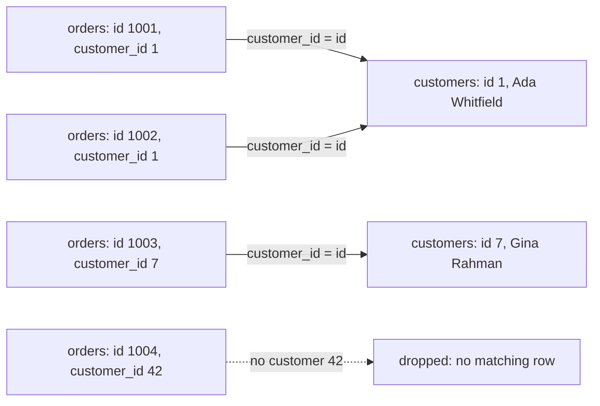

# What a join actually does

A join puts the rows of two tables side by side, pairing each row with the rows it relates to. The `ON` clause is the pairing rule, and only pairs that satisfy it survive. This module reads that rule out loud on `orders` and `customers`, and shows why the result still holds one row per order.

## A join is a sentence

A join is a sentence with a table on each side and a rule in the middle: "orders, with the customer who placed them, where the order's `customer_id` equals the customer's `id`". Read that way, `JOIN customers ON customers.id = orders.customer_id` stops being punctuation and becomes a claim about the data.

The database takes that claim literally. For each row on the left it finds every row on the right for which the `ON` condition is true, then emits one combined row per pair. `SELECT` decides which of those columns to keep; it never decides which rows pair up.

So the join keys carry more weight than the column list. `orders.customer_id` stores a number, `customers.id` identifies a person, and the `ON` clause is the assertion that the number refers to that person. A wrong link still executes — it just answers a question nobody asked.

## The `ON` condition is the whole trick

```sql
SELECT o.id, o.ordered_at, c.name
FROM orders o
JOIN customers c ON c.id = o.customer_id
ORDER BY o.id
LIMIT 5;
```

The aliases `o` and `c` keep the two sides distinct, and the `ON` clause states exactly which two columns must agree.

Qualifying every column is not politeness once both tables could supply the same name. `ON id = id` would be ambiguous and rejected; `ON c.id = o.customer_id` names one value from each side. The aliases exist so that comparison can be written without guesswork.

Notice what the `ON` clause does not contain: any statement about which rows you want back. `ON` fixes how rows pair. A `WHERE` clause added later fixes which pairs survive.

## Rows without a partner vanish

An inner join keeps only pairs, so a row that finds no partner on the other side is simply not in the result. The mechanism is silent: no padding row, no warning, no count of what was left behind. That is why an inner join is also a filter, and why it is the usual cause of numbers that are quietly too low.



In this dataset the drop is hypothetical: `orders.customer_id` is a `NOT NULL` foreign key, so every one of the 80 orders has a real customer to meet. The diagram shows the general rule anyway, because the same shape appears the moment a `WHERE` clause removes the customer on the right, or a key no longer resolves.

That is the habit to take from an inner join: before trusting a count, ask what could have failed to match. Here the answer is "nothing"; on a table with a nullable key, or after a filter, the answer changes and the row total changes with it.

## Many-to-one keeps the grain

Joining `orders` to `customers` is a many-to-one direction: many orders point at one customer, so each order row matches at most one customer row. The result therefore has one row per order — decorated with the customer's name rather than multiplied by it.

That is worth stating precisely because it contrasts with the opposite direction. Travel from `orders` down to `order_items` and one order meets many lines, so the row count grows; travel from `orders` up to `customers` and each order meets exactly one customer, so the row count holds.

The grain is preserved here only because of the direction and the key. `customers.id` is unique, so the `ON` clause can match at most one customer per order. If that column were duplicated, the same join would fan out, and 80 orders would become more than 80 rows without the query looking any different.

## Worked example: each order beside its customer

```sql
SELECT o.id AS order_id, c.name AS customer
FROM orders o
JOIN customers c ON c.id = o.customer_id
WHERE o.status = 'completed'
ORDER BY o.id
LIMIT 5;
```

The `WHERE` clause runs after pairing, so it filters whole orders while the join has already attached each one's customer.

| order_id | customer |
| --- | --- |
| 1001 | Ada Whitfield |
| 1002 | Ada Whitfield |
| 1004 | Chidi Okafor |
| 1005 | Ada Whitfield |
| 1008 | Bruno Sala |

Three rows name Ada Whitfield because she placed three of these completed orders, not because anything duplicated. One order, one customer: that is the many-to-one shape doing its job, and it is why the count of this result still equals the count of orders.

## Check yourself

**1. In `JOIN customers c ON c.id = o.customer_id`, which clause decides how rows pair?**

<details>
<summary>Answer</summary>

The `ON` clause. It states the condition that must hold for a left row and a right row to be emitted together; `SELECT` only chooses columns from the pairs that `ON` produced.

</details>

**2. Why can an inner join make a count smaller than expected?**

<details>
<summary>Answer</summary>

Because it keeps only rows that found a partner. Any row whose key has no match on the other side is dropped without a trace, so an inner join quietly filters as well as pairs.

</details>

**3. Why does joining `orders` to `customers` keep one row per order?**

<details>
<summary>Answer</summary>

Because it is many-to-one: many orders may point at the same customer, but `customers.id` is unique, so each order matches at most one customer row. Fan-out only happens when you join the other way, from a parent to its children.

</details>
