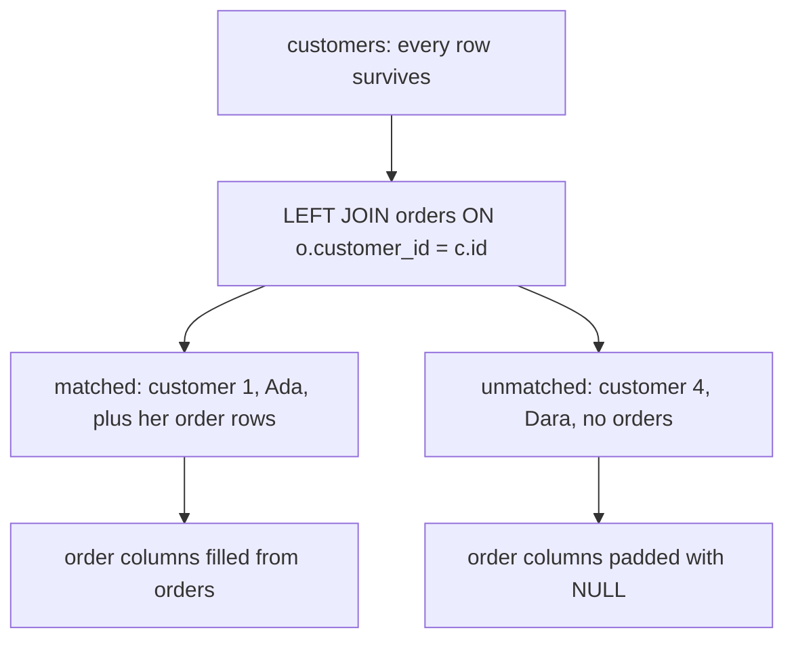

# Left joins and the rows that disappear

An inner join answers "these two tables, matched". A left join answers a different question: "the left table, accompanied where possible". Every left row survives whether or not a partner exists, and the right-hand columns are padded with `NULL` when it does not. This module shows how that padding works, how it changes what `COUNT` measures, and how a careless `WHERE` clause can quietly turn your left join back into an inner one.

## Keep the left side, pad the right

`LEFT JOIN` keeps every row from the table written before it and attaches matching right-hand columns where they exist. Where no partner exists, the right columns are `NULL`. Nothing is dropped from the left side, which is the whole point.

Compare the two joins on the same tables. `orders JOIN customers` returns one row per order, all 80 of them, because the foreign key guarantees a match. `customers LEFT JOIN orders` returns at least one row per customer, and a customer with no orders still appears, once, with `NULL` across the order columns.



The unmatched branch is the one that separates a left join from an inner join: delete it and the diagram describes an inner join instead.

## `COUNT(o.id)` counts matches, not rows

Once the right side can be `NULL`, `COUNT(*)` and `COUNT(o.id)` stop agreeing. `COUNT(*)` counts result rows, and an unmatched customer still produces one padded row, so that customer contributes a count of 1. `COUNT(o.id)` counts non-null values of the order's id, and a padded row has none, so that customer contributes 0.

The distinction matters because "customers with no orders" is usually exactly what a left join is for. `COUNT(*)` would report 1 for a customer who ordered nothing, which reads as one order — the opposite of the truth. `COUNT(o.id)` reports 0, which is correct and can be filtered on.

The rule generalises: count a column from the right table when you want matches, and count `*` when you want rows. After a left join those are different numbers, and only one of them answers the question you asked.

## The `WHERE` clause that undoes the left join

A predicate on a right-table column that excludes `NULL` removes every padded row, and with them the left rows you were trying to keep. The join is still written `LEFT`, but the result is an inner join in behaviour: the filter has silently deleted the branch the left join existed to preserve.

This is easy to do by accident. Adding `WHERE o.status = 'completed'` to a customer-to-orders left join looks like it is narrowing the orders; in fact it also deletes every customer who has no order, because their padded `status` is `NULL` and `NULL = 'completed'` is not true. The customers with zero orders vanish from a query whose purpose was to list them.

The tell is that the row count drops below the number of left rows: 30 customers arriving as 22 rows means a predicate has been applied to the padded side.

## Fix it in `ON`, or test `NULL` on purpose

There are two honest repairs. If the rule describes which orders may match, move it into the `ON` clause; the left rows stay, and the excluded orders drop out of the padded columns instead of removing the customer. If the rule describes left rows you want to keep, drop it and test for `NULL` deliberately instead.

```sql
SELECT c.id, c.name, COUNT(o.id) AS orders
FROM customers c
LEFT JOIN orders o ON o.customer_id = c.id
                  AND o.status = 'completed'
GROUP BY c.id, c.name;
```

The first repair is the common one: `LEFT JOIN orders o ON o.customer_id = c.id AND o.status = 'completed'`. Every customer is kept; completed orders attach where they exist. The second reads `WHERE o.id IS NULL`, which keeps exactly the customers who matched nothing — a legitimate "who has never ordered" query, used on purpose rather than by accident.

## Worked example: every customer and their order count

```sql
SELECT c.id AS customer_id,
       c.name,
       COUNT(o.id) AS orders
FROM customers c
LEFT JOIN orders o ON o.customer_id = c.id
GROUP BY c.id, c.name
ORDER BY orders, c.id
LIMIT 6;
```

Because the aggregate names `o.id`, a customer with no orders counts 0 rather than 1.

| customer_id | name | orders |
| --- | --- | --- |
| 4 | Dara Novak | 0 |
| 25 | Yara Park | 0 |
| 26 | Zane Lindqvist | 0 |
| 27 | Aya Rahman | 0 |
| 28 | Bo Ivanov | 0 |
| 29 | Cleo Haidar | 0 |

An inner join would drop the no-order rows entirely, and `COUNT(*)` would have given them a misleading 1. Sorting ascending puts the customers with no orders first, so the rows the left join protected are the first thing you see.

## Check yourself

**1. What does `LEFT JOIN` do with a left row that has no match on the right?**

<details>
<summary>Answer</summary>

It keeps the row and pads the right-hand columns with `NULL`. Nothing on the left side is ever dropped by a left join.

</details>

**2. Why does `COUNT(o.id)` return 0 for an unmatched customer while `COUNT(*)` returns 1?**

<details>
<summary>Answer</summary>

`COUNT(*)` counts result rows, and the padded row exists. `COUNT(o.id)` counts non-null values of the right table's key, and that key is `NULL` on the padded row, so it contributes nothing.

</details>

**3. Why does `WHERE o.status = 'completed'` spoil a left join to `orders`?**

<details>
<summary>Answer</summary>

Padded rows have `NULL` in `status`, so the comparison is never true for them; every unmatched customer is removed and the query behaves as an inner join. Moving the condition into the `ON` clause keeps the left rows while still restricting which orders match.

</details>
