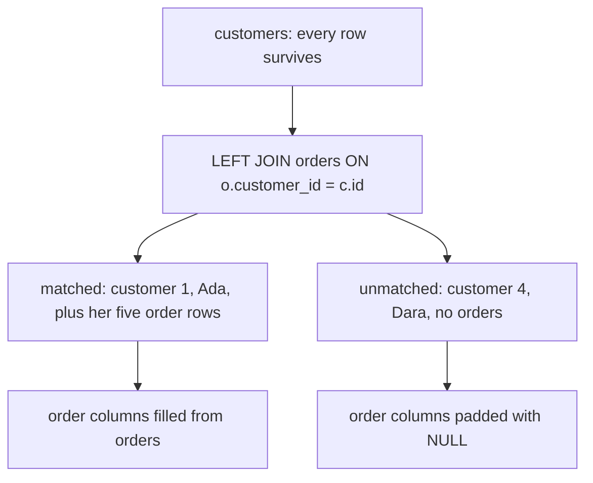

# Left joins and the rows that disappear

Ask for every customer beside the number of completed orders they placed, and the report names 19 of the 30. Gina Rahman is one of the eleven missing: she placed four orders, one shipped, one cancelled, one refunded, one pending, and none completed. Seven of those eleven have never ordered at all.

A join that keeps only matched pairs cannot report a customer it found nothing for. That silence is what this chapter fixes. `LEFT JOIN` keeps every row of one table and fills the other side with `NULL` when nothing matches. Once you have that padding, two habits follow: which column you count, and where you put a condition on the right-hand table.

## An inner join drops the left rows in silence

`customers` holds 30 rows. `orders` holds 80, and each order names its customer through the foreign key `customer_id`. Joining the two tables on that key returns 80 rows, and 80 rows look like a complete answer to most questions you could ask.

```sql
SELECT count(*) AS rows, count(DISTINCT c.id) AS customers
FROM customers c
JOIN orders o ON o.customer_id = c.id;
```

| rows | customers |
| --- | --- |
| 80 | 23 |

The second column is the one that matters. Thirty customers exist and 23 appear. Seven people have bought nothing, and the join removed each of them without a message. The first column hides the loss, because 80 rows for 23 customers reads like a busy shop rather than a list missing seven names.

Every report built on this join is short by seven customers, and nothing in it says so.

An inner join is a filter that also pairs rows. Chapter 1 showed rows without a partner vanishing. This chapter is about the questions where the missing rows are the answer.

## LEFT JOIN keeps the left row and pads the right

`LEFT JOIN` keeps every row of the table written to its left. Where the `ON` condition finds a partner, the two rows combine as usual. Where it finds none, the left row still comes through, with `NULL` in every right-hand column. `NULL` is SQL's "no value here", so the padded row says "this customer, and no order", which is true.

```sql
SELECT c.id AS customer_id, c.name, o.id AS order_id, o.status
FROM customers c
LEFT JOIN orders o ON o.customer_id = c.id
WHERE c.id IN (1, 4)
ORDER BY c.id, o.id;
```

| customer_id | name | order_id | status |
| --- | --- | --- | --- |
| 1 | Ada Whitfield | 1001 | completed |
| 1 | Ada Whitfield | 1002 | completed |
| 1 | Ada Whitfield | 1005 | completed |
| 1 | Ada Whitfield | 1006 | shipped |
| 1 | Ada Whitfield | 1007 | refunded |
| 4 | Dara Novak | NULL | NULL |

Ada has five orders, so she appears five times, exactly as an inner join would have shown her. Dara has none, so she appears once with the order columns empty. Nothing was dropped, and nothing was invented.

Across the whole table the same join returns 87 rows: the 80 order rows, plus one padded row for each of the 7 customers with no order. That total is the first check on an unfiltered left join, because the join alone can never fall below the row count of the left table.



## COUNT(*) and COUNT(o.id) no longer agree

`COUNT(*)` counts result rows. `COUNT(column)` counts the rows where that column is not `NULL`. After a left join both are useful, and they measure different things.

```sql
SELECT c.name, count(*) AS count_star, count(o.id) AS count_oid
FROM customers c
LEFT JOIN orders o ON o.customer_id = c.id
WHERE c.id IN (1, 2, 4)
GROUP BY c.id, c.name
ORDER BY c.id;
```

| name | count_star | count_oid |
| --- | --- | --- |
| Ada Whitfield | 5 | 5 |
| Bruno Sala | 2 | 2 |
| Dara Novak | 1 | 0 |

The two counts agree for Ada and Bruno, who have orders. They part company for Dara: her padded row is a row, so `count(*)` counts it as one, while `count(o.id)` finds `NULL` there and counts nothing. Added up over all 30 customers, `count(*)` totals 87 and `count(o.id)` totals 80.

The wrong version is easy to write, because `count(*)` is the habit from every earlier chapter:

```sql
SELECT c.name, count(*) AS orders
FROM customers c
LEFT JOIN orders o ON o.customer_id = c.id
GROUP BY c.id, c.name;
```

That report says seven customers placed exactly one order each. They placed none. A count that is wrong by one still reads like data, which is why the mistake survives review.

Count the right table's key, `count(o.id)`, whenever the question is "how many related rows".

## A filter on the right table removes the rows you kept

Now the mistake that costs more, because the query still returns plausible output. You want each customer's completed orders, so you write the left join and narrow it with a `WHERE` clause. Count the rows that come back and the loss becomes visible.

```sql
SELECT count(*) AS rows, count(DISTINCT c.id) AS customers
FROM customers c
LEFT JOIN orders o ON o.customer_id = c.id
WHERE o.status = 'completed';
```

| rows | customers |
| --- | --- |
| 37 | 19 |

The 37 rows name only 19 of the 30 customers, because `WHERE` runs after the join has padded the unmatched rows and keeps only rows where the condition is true. On a padded row `o.status` is `NULL`, and `NULL = 'completed'` is neither true nor false, so the row goes. Every customer who ordered nothing leaves with it.

Customers who ordered plenty can leave too. Gina Rahman has four orders and none is completed, so no row of hers can survive the filter. A report about customers and their completed orders now hides a customer you know buys from you.

The tell is the count. A left join that returns fewer rows than the table on its left has had a right-side filter applied somewhere, on purpose or not.

## Move the condition into ON

`ON` decides which rows may pair. `WHERE` decides which rows you keep. When the condition describes which orders are allowed to match, it belongs in `ON`.

```sql
SELECT c.name, count(o.id) AS completed_orders
FROM customers c
LEFT JOIN orders o ON o.customer_id = c.id
                  AND o.status = 'completed'
GROUP BY c.id, c.name
ORDER BY completed_orders DESC, c.id
LIMIT 5;
```

| name | completed_orders |
| --- | --- |
| Ada Whitfield | 3 |
| Chidi Okafor | 3 |
| Jonas Larsen | 3 |
| Kira Whitfield | 3 |
| Quinn Rahman | 3 |

Same tables and same intent, and now every customer stays. The join behind this query holds 48 rows covering all 30 customers, and 37 of those rows carry a real completed order. The other 11 are padded rows, and `count(o.id)` reports 0 for each of them.

The grouped result has 30 rows, one per customer.

The difference is the clause. A pair that fails the `ON` condition is never formed, so the left row arrives alone and padded. A row that fails `WHERE` is deleted after pairing, and a padded row fails any test on a right-table column. A condition on the left table is always safe, because it can only keep a whole customer or drop a whole customer.

Try this: delete `AND o.status = 'completed'` from the `ON` clause and run the query again, keeping the `LIMIT 5`. Ada's count moves from 3 to 5, because the join now pairs her with every order she placed, and all 30 customers still have a row.

## Ask for the padded rows on purpose

The padding is useful on its own. Point a filter at it and the same query answers "who never did this".

```sql
SELECT c.name
FROM customers c
LEFT JOIN orders o ON o.customer_id = c.id
WHERE o.id IS NULL
ORDER BY c.name;
```

| name |
| --- |
| Aya Rahman |
| Bo Ivanov |
| Cleo Haidar |
| Dara Novak |
| Dev Larsen |
| Yara Park |
| Zane Lindqvist |

Seven rows, seven customers who have never ordered. `WHERE o.id IS NULL` asks for the padded rows directly, so the filter and the padding agree on purpose instead of by accident. `NOT EXISTS` answers the same question in a later chapter. This join-and-test form is the one to reach for now.

## Worked example: every customer and their order count

```sql
SELECT c.id AS customer_id,
       c.name,
       COUNT(o.id) AS orders
FROM customers c
LEFT JOIN orders o ON o.customer_id = c.id
GROUP BY c.id, c.name
ORDER BY orders, c.id
LIMIT 6;
```

Because the aggregate names `o.id`, a customer with no orders counts 0 rather than 1.

| customer_id | name | orders |
| --- | --- | --- |
| 4 | Dara Novak | 0 |
| 25 | Yara Park | 0 |
| 26 | Zane Lindqvist | 0 |
| 27 | Aya Rahman | 0 |
| 28 | Bo Ivanov | 0 |
| 29 | Cleo Haidar | 0 |

An inner join would have dropped these rows entirely, and `count(*)` would have given each of them a misleading 1. Sorting ascending puts the customers with no orders first, so the rows the left join protected are the first thing you see. The seventh customer with no orders, Dev Larsen, sits just past the `LIMIT`.

The exercise asks for the same report sorted the other way, with the highest count first. The join and the aggregate stay the same. The exercise drops the `customer_id` column and the `LIMIT` that the worked example added to keep it short. The practice is in the sort and in watching where the zeroes land.

## What to remember

**What I would do:** keep `WHERE` for the left table and put the right table's condition in `ON`. Count the right table's key, `count(o.id)`, not `count(*)`, whenever the question is how many related rows exist. Then check the row count against the left table: a left join that returns fewer rows than `customers` has a right-side filter hiding in it.

- `LEFT JOIN` keeps every row of the left table and pads unmatched right-hand columns with `NULL`.
- `count(*)` counts result rows, so a padded row counts as one. `count(right.key)` counts matches and reports 0 for a padded row.
- A `WHERE` condition on a right-hand column deletes padded rows, and the left join then behaves like an inner join.
- A right-table condition belongs in `ON` when it describes which rows may match. In `WHERE`, it deletes the padded rows, and it also deletes a left row whose only matches fail the test.
- `WHERE right.key IS NULL` is the deliberate way to list left rows with no match.
- With no right-side filter, a left join never returns fewer rows than the left table has. A count below that number is the warning sign that a `WHERE` clause removed padded rows.

## Check yourself

**1. What does `LEFT JOIN` do with a left row that has no match on the right?**

<details>
<summary>Answer</summary>

It keeps the row and pads the right-hand columns with `NULL`. The join itself never drops a left row. A later `WHERE` on a right-table column can still remove the padded row.

</details>

**2. Why does `count(o.id)` return 0 for an unmatched customer while `count(*)` returns 1?**

<details>
<summary>Answer</summary>

`count(*)` counts result rows, and the padded row exists. `count(o.id)` counts non-null values of the right table's key, and that key is `NULL` on the padded row, so it contributes nothing.

</details>

**3. Why does `WHERE o.status = 'completed'` spoil a left join to `orders`?**

<details>
<summary>Answer</summary>

Padded rows have `NULL` in `status`, so the comparison is never true for them. The filter also removes customers whose orders all failed the test, which leaves 19 of the 30. Moving the condition into `ON` keeps all 30 and still restricts which orders match.

</details>

**4. You add `WHERE c.city = 'Milan'` to a customer-to-orders left join. Does that break the left join the way a condition on `o.status` does?**

<details>
<summary>Answer</summary>

No. `city` belongs to the left table, so the condition can only keep or drop a whole customer. It removes a customer's padded row together with any order rows that customer had, which is what you asked for. The join still keeps every remaining left row.

</details>
