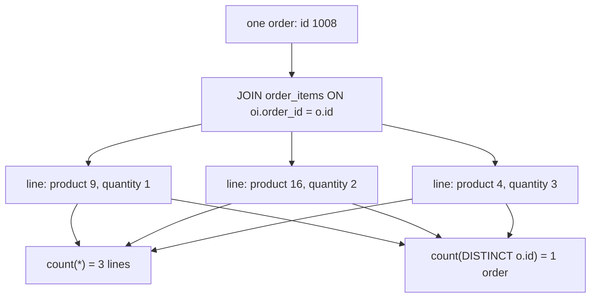

# The grain trap: one-to-many fan-out

The shop took 80 orders, and those orders hold 160 lines, where a line is one product on one order with a quantity and a price. Report the order count through the line table and the answer is 160. The query prints no error, the rows look like ordinary data, and the number is wrong by a factor of two.

The join did nothing wrong. Pairing each order with each of its lines is what a one-to-many join does, and the database has no way to know that you cared about orders. This chapter names the thing that changed, which is the grain. You get three tools to keep it straight: state the grain before you aggregate, count distinct keys after a fan-out, and question any sum that reads a parent-side column.

## One order becomes four rows

Take one order and look at what the join produces. Order 1006 is a shipped order with four lines.

```sql
SELECT o.id AS order_id, o.status,
       oi.id AS line_id, oi.product_id, oi.quantity, oi.unit_price
FROM orders o
JOIN order_items oi ON oi.order_id = o.id
WHERE o.id = 1006
ORDER BY oi.id;
```

| order_id | status | line_id | product_id | quantity | unit_price |
| --- | --- | --- | --- | --- | --- |
| 1006 | shipped | 6 | 5 | 1 | 139.00 |
| 1006 | shipped | 7 | 12 | 2 | 210.00 |
| 1006 | shipped | 8 | 19 | 3 | 15.50 |
| 1006 | shipped | 9 | 7 | 1 | 89.50 |

`orders` holds one row for order 1006. The result holds four. For each row on the left, the database found every row on the right whose `order_id` matched, and emitted one combined row per match. The order's own columns, `id` and `status`, repeat on all four.

Nothing was duplicated by accident. Four lines is the answer to "what is in order 1006", and four rows is the only shape that carries four products, four quantities and four prices. The order row is not repeated for decoration; it is repeated because the join has no way to attach four lines to one row.

The bill arrives with the aggregate. A count over these rows answers 160 to a question about 80 orders, and a sum of the order's own column adds that column once per line.

## Grain is what one row of the result means

Grain is a short word for one thing: what a single row of this result stands for.

Before the join, one row of `orders` means one checkout, and one row of `order_items` means one line. After the join, one row means one line, and the order has become a repeated attribute of that line.

The table sizes make the change visible. Each level down multiplies: 23 customers place the 80 orders, and those orders hold 160 lines.

| table | rows | one row means |
| --- | --- | --- |
| `customers` | 30 | one person |
| `orders` | 80 | one checkout |
| `order_items` | 160 | one product line inside a checkout |

Joined, the result takes the child's grain: 160 rows, one for each line. That is the fan-out, where a parent row fans out into one row per child. The order is the parent here, and its lines are the children.

The habit worth building is to write the grain into the query as a comment before you write the aggregate. `-- one row per line` and `-- one row per order` are different promises, and only one of them matches the query you are about to run. A count that looks wrong is usually a grain that was never stated.

## The fan-out, drawn



Three branches leave one order, and two different totals are read off the same three rows. Neither total is broken. `count(*)` answers "how many lines", and `count(DISTINCT o.id)` answers "how many orders". The trouble starts when the surrounding sentence names one grain and the query measures the other.

## COUNT(*) counts lines, COUNT(DISTINCT key) counts orders

`COUNT(DISTINCT x)` builds the set of different values of `x` and counts it, so repeated values count once and `NULL` counts not at all. Over a fanned-out join that makes it a repair for the order count.

```sql
SELECT count(*) AS lines,
       count(DISTINCT o.id) AS orders
FROM orders o
JOIN order_items oi ON oi.order_id = o.id;
```

| lines | orders |
| --- | --- |
| 160 | 79 |

The first column is the fan-out, and there are as many lines as `order_items` holds. The second column recovers something close to the order count, and the gap of one is worth understanding.

There are 80 orders in the table, not 79, and the missing one is order 1003. It is cancelled, it has no lines, and an inner join drops it, as Chapter 2 described. The left join from that chapter would bring it back with `NULL` line columns, and `count(DISTINCT o.id)` would then report 80.

Two cautions keep this tool honest. It repairs a count after the rows have already fanned out, which is later than you wanted. And it costs work: the database has to track a set of distinct values rather than increment a counter. When the question is only "how many orders", ask `orders` directly and skip the join.

Try this: change `count(DISTINCT o.id)` to `count(o.id)` in the query above and run it. The second column jumps from 79 to 160, because every line row carries a copy of its order's id. The distinct form was doing real work, and without it the two columns agree at 160.

## SUM repeats a parent value once per child

A `COUNT` after a fan-out is wrong in a way you can spot, because a count of lines looks larger than a count of orders. A `SUM` is worse. Summing money produces a number that looks like money, and nothing in the result tells you it was added too many times.

The mechanism is the same as the count. A column from the parent side holds one value per parent row. After the fan-out that value sits on every child row, so the sum adds it once per child.

```sql
SELECT p.name, p.price, count(oi.id) AS lines, sum(p.price) AS padded
FROM products p
JOIN order_items oi ON oi.product_id = p.id
GROUP BY p.id, p.name, p.price
ORDER BY padded DESC, p.id
LIMIT 4;
```

| name | price | lines | padded |
| --- | --- | --- | --- |
| Granite Cookware Set | 210.00 | 9 | 1890.00 |
| Trail Runner Jacket | 139.00 | 10 | 1390.00 |
| Nimbus Headphones | 129.00 | 9 | 1161.00 |
| Harbor Rain Shell | 118.00 | 8 | 944.00 |

Read the `padded` column against the `price` column. The Granite Cookware Set costs 210.00 once, and the sum reports 1890.00, which is 210.00 counted nine times. The column is a product price repeated on nine line rows, so `sum` adds nine copies.

Across all products the same query totals 12,348.82, while one of every catalogue product costs 1,439.29 at list price. Nineteen of the 20 products have sold, and the one that has not is the Discontinued Camp Stove at 0.00, so the sold products come to the same 1,439.29.

The rule that explains both columns: a sum is trustworthy when every value it reads appears exactly once at the grain being summed. `sum(oi.quantity * oi.unit_price)` follows the rule, because each line contributes its own amount once. `sum(p.price)` breaks it, because a product price belongs to the product, not to the line.

When you need a parent total in a query that also reads children, change the shape of the query. Sum the parent table on its own and join that result later. Aggregate the children to one row per parent first, then join the small result. Or sum the child's own columns and leave the parent values out of the arithmetic.

Do not reach for `sum(DISTINCT p.price)`: `DISTINCT` de-duplicates values, not products, so two products that share a price collapse into one.

## Grouping brings the fan-out back to order grain

`GROUP BY` collects the fanned-out rows into one row per group, and the aggregate then measures inside each group. It is the way to get one row back per order.

```sql
SELECT o.id AS order_id,
       count(*) AS lines,
       count(DISTINCT o.id) AS orders
FROM orders o
JOIN order_items oi ON oi.order_id = o.id
GROUP BY o.id
ORDER BY lines DESC, o.id
LIMIT 4;
```

| order_id | lines | orders |
| --- | --- | --- |
| 1006 | 4 | 1 |
| 1009 | 4 | 1 |
| 1008 | 3 | 1 |
| 1012 | 3 | 1 |

Grouped by order, `count(*)` reports the size of each order and `count(DISTINCT o.id)` reports 1 for every group, because a group is one order by construction. That second column is a useful check on your own query rather than a number a reader needs.

Add up the `lines` column across all groups and you get 160. Add up the `orders` column and you get 79, because the inner join dropped the cancelled order 1003 and `GROUP BY` never had a group for it. Two numbers, same query, and each one is correct for a different sentence: 160 lines, 79 orders with content.

## Counting orders per product

The exercise turns the fan-out in the other direction. A product appears on many lines, so joining `products` to `order_items` gives one row per line that contains that product. The prompt asks for products and how many distinct orders they appear in, which is an order count read off line rows.

You have both spellings to choose between, and the difference is small on this data. No product appears twice on the same order here, so `count(oi.id)` and `count(DISTINCT oi.order_id)` return the same number for every product. Write the distinct form anyway, and write it before you run the query. The data could change, and a future order could repeat a product on two lines. A query whose correctness depends on the data will not warn you when the data moves.

The rest of the query is the pattern from this chapter: join on the product key, group by the product, and sort by the count. Add a tiebreaker to that sort so the output is stable.

## What to remember

**What I would do:** name the grain before you write the aggregate, then check that every column it reads belongs to that grain. Count distinct parent keys when the question is about parents, and sum only child columns. When a total needs both, aggregate the children to one row per parent first and join that small result.

- A one-to-many join returns one row per child. The parent's columns repeat on every one of those rows.
- Grain is what one row of the result means. Name it before you write the aggregate.
- `count(*)` counts rows, so after a fan-out it counts lines. `count(DISTINCT key)` counts each parent once.
- A sum of a parent-side column repeats that value once per child. Sum the child's own columns instead.
- `GROUP BY` on the parent key collapses the fan-out back to parent grain.
- An inner join also drops parents with no children, so the parent count after a join can be lower than the table's own count.

## Check yourself

**1. Why does joining `orders` to `order_items` return 160 rows when there are only 80 orders?**

<details>
<summary>Answer</summary>

Because the relationship is one-to-many. Each order pairs with every line that references it, so the result holds one row per line, and the 160 line rows replace the 80 order rows.

</details>

**2. What does `count(*)` measure after that join, and how do you get the order count instead?**

<details>
<summary>Answer</summary>

`count(*)` counts result rows, which are lines.

`count(DISTINCT o.id)` counts each order once however many lines it produced, which gives 79: order 1003 is cancelled and has no lines, so the inner join drops it.

</details>

**3. Why is a careless `sum` over a fan-out worse than a careless `count`?**

<details>
<summary>Answer</summary>

Because the parent value is added once per child, so money inflates with no warning sign. The Granite Cookware Set is 210.00 and the sum over its nine lines reports 1890.00. A count of the wrong grain at least looks too big; a sum looks like an ordinary total.

</details>

**4. A query returns one row per order with a line count, and you want the average number of lines per order. Can you write `avg(count(*))`?**

<details>
<summary>Answer</summary>

Not directly. An aggregate cannot contain another aggregate, because both run at the same stage. Group the lines by order in a subquery first, then average the counts in the outer query. That keeps the inner result at order grain, which is what the average needs.

</details>
