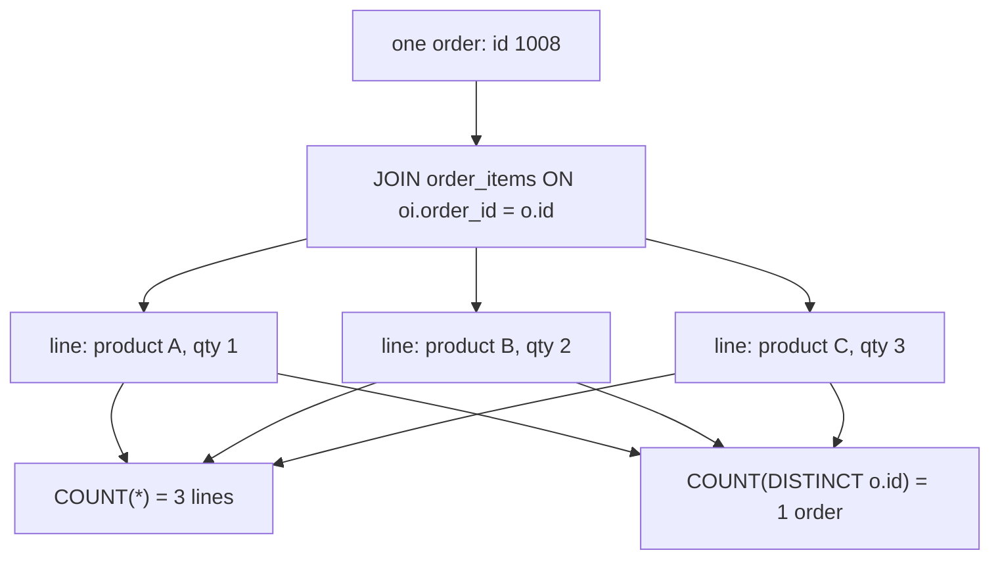

# The grain trap: one-to-many fan-out

Joining a parent table to its children multiplies rows. One order meets each of its lines and produces one combined row per line, so `orders` joined to `order_items` returns 160 rows rather than 80. This module shows where that multiplication comes from, why `COUNT(*)` then measures lines instead of orders, and how naming the grain before you aggregate keeps counts and sums honest.

## A parent meets its children

A one-to-many join travels from a parent down to its children, and the result contains one row per child. The parent row is repeated for each of them, not because the database duplicated anything, but because that is what "pair each order with each of its lines" produces.

The dataset makes the arithmetic plain: 80 orders and 160 lines, an average of two lines per order. Join the two tables and the 80 order rows give way to 160 combined rows, each carrying one order's columns beside one line's. The order grain is gone.

If you wanted one row per order with the lines attached, a plain join cannot express that. A join emits one row per pair, and collapsing the pairs back is the job of `GROUP BY`.

## Name the grain before you aggregate

Grain is what one row of the result means, and it has to be decided before any aggregate is written. "One row per order" and "one row per line" lead to different queries and different numbers, and the join itself does not tell you which one you have.

The habit is to say the grain out loud as you write the `FROM` clause. If the question is "how many orders did each customer place", the answer grain is one row per customer and the counting happens over orders. If the question is "which products are on each order", the grain is one row per line and the fan-out is the point.

Once the fan-out is present, every aggregate changes meaning. `COUNT(*)` counts lines, `AVG(unit_price)` averages lines, and `SUM` adds lines. None of them are wrong; they answer line-grain questions. They become bugs only when the surrounding sentence claims to be about orders.

## The fan-out, drawn



Three branches from one order, and two totals read off the same three rows. The multiplication is not a defect to remove; it is the fact to notice.

## `COUNT(DISTINCT o.id)` recovers the order count

If the rows have fanned out but the question is about orders, count the distinct key. `COUNT(DISTINCT o.id)` counts each order once no matter how many lines it produced, so the fanned-out rows still yield the order total you wanted.

```sql
SELECT COUNT(*)             AS lines,
       COUNT(DISTINCT o.id) AS orders
FROM orders o
JOIN order_items oi ON oi.order_id = o.id;
```

`COUNT(DISTINCT ...)` is a repair, not a substitute for thinking about grain. It is the right tool when you genuinely need line-level rows in the same query, and unnecessary when an earlier `GROUP BY` could have removed the fan-out. Aggregating before joining is usually cheaper and easier to read; counting distinct keys is the escape hatch when the rows have to stay wide.

## `SUM` double-counts across a fan-out

`SUM` is more dangerous than `COUNT` here, because double-counting money does not look wrong. Sum a column from the parent side after a fan-out and the parent's value is added once per child, so an order total of 100 with three lines contributes 300.

The dataset's line amounts live on `order_items`, where summing is safe because each line appears once. The trap is mixing grains inside one expression: `SUM(oi.quantity * oi.unit_price)` is a line-grain measure and behaves correctly, while summing a parent-level column after the same join counts it once per line. If a parent total must be summed after joining, aggregate the children to one row per parent first, then join the small result.

## Worked example: lines versus orders

```sql
SELECT o.id AS order_id,
       COUNT(*) AS lines,
       COUNT(DISTINCT o.id) AS orders
FROM orders o
JOIN order_items oi ON oi.order_id = o.id
GROUP BY o.id
ORDER BY lines DESC, o.id
LIMIT 4;
```

Grouped by order, `COUNT(*)` reports the size of each order and `COUNT(DISTINCT o.id)` reports 1 for every group.

| order_id | lines | orders |
| --- | --- | --- |
| 1006 | 4 | 1 |
| 1009 | 4 | 1 |
| 1008 | 3 | 1 |
| 1012 | 3 | 1 |

Across all groups the `lines` column sums to 160 while `orders` sums to 79: the inner join drops the cancelled order 1003, which has no lines, so only 79 of the 80 orders survive. The fan-out is fine as long as you know which column measures it and which one measures the parent.

## Check yourself

**1. Why does joining `orders` to `order_items` return 160 rows when there are only 80 orders?**

<details>
<summary>Answer</summary>

Because the relationship is one-to-many: each order pairs with every line that references it, so the result holds one row per line. The 160 line rows replace the 80 order rows.

</details>

**2. What does `COUNT(*)` measure after that join, and how do you get the order count instead?**

<details>
<summary>Answer</summary>

`COUNT(*)` counts result rows, which are lines. `COUNT(DISTINCT o.id)` counts each order once however many lines it produced, recovering 79 of the 80 orders: order 1003 is cancelled and has no lines, so the join drops it.

</details>

**3. Why is a careless `SUM` over a fan-out worse than a careless `COUNT`?**

<details>
<summary>Answer</summary>

Because the parent value is added once per child, so the total inflates silently: an order total of 100 with three lines contributes 300. A count error at least looks like a count of the wrong thing, while a summed total can pass unnoticed.

</details>
