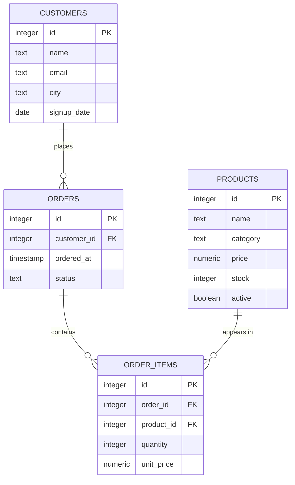

# Read the data model

Before you can ask a useful question of a database, you have to know what each table's rows mean and how the tables point at one another. This module maps the four tables in the Querycraft commerce dataset, their keys, and the relationships the rest of the course builds on.

## One row, one meaning

Every query answers a question about a table’s *grain* — what one row represents. In this dataset, a row in `customers` is one person, a row in `orders` is one checkout, and a row in `order_items` is one product line inside an order. Get the grain wrong and everything downstream is wrong, quietly.

Grain is the habit worth building first: before writing a query, say out loud what a single result row should mean. Here that gives four clean answers.

- `customers` — one row per person (30 rows).
- `products` — one row per catalogue product (20 rows), including discontinued items such as the inactive camp stove.
- `orders` — one row per checkout (80 rows).
- `order_items` — one row per product line inside an order (160 rows).

Counts are a quick grain check. `SELECT COUNT(*) FROM orders` counts checkouts; `SELECT COUNT(*) FROM order_items` counts lines. Because there are more line rows than orders, the two numbers can never be used interchangeably, and most join bugs in this course start by mixing them up.

## How the tables connect

Naming tells you how the tables connect: `orders.customer_id` points at `customers.id`, and `order_items.order_id` points at `orders.id`. Those are the join keys you will use all course.

The schema makes those links explicit. `orders.customer_id` is declared `NOT NULL REFERENCES customers(id)`, so every order belongs to a real customer. `order_items.order_id` references `orders(id)` and `order_items.product_id` references `products(id)`, so every line belongs to an order and to a product. There are no orphans to guard against: a plain `JOIN` on these keys will match every row. `customers.email` and `customers.city` are the nullable columns in the model, which is why some customer rows show `NULL`.

## The shape of the dataset

One customer can place many orders, one order can hold many lines, and one product can appear in many lines. That is the whole model.



Reading it in one direction: a customer `places` orders, an order `contains` lines, and a product `appears in` those lines. The crow's foot (`o{`, "many") is on the child side of each relationship; the near side (`||`, "exactly one") is the parent. Foreign keys are indexed in the schema, so lookups along these directions is cheap.

## Reading a table: `SELECT`, `FROM`, `ORDER BY`

```sql
-- one row per product
SELECT id, name, category, price
FROM products
ORDER BY price;
```

`SELECT` chooses the columns, `FROM` chooses the table, and `ORDER BY` sorts the result.

The comment is not decoration: it restates the grain you expect back. Reading a `SELECT` list left to right, `id`, `name`, `category` and `price` are all attributes of a product, so the row must mean "one product". When a `SELECT` list mixes columns from two tables, that is your cue that a join — and maybe a new grain — is coming.

## Worked example: a small read of customers

```sql
SELECT id, name, city
FROM customers
ORDER BY id
LIMIT 5;
```

`LIMIT` caps the output so you can eyeball the shape of a table before running the full query.

| id | name | city |
| --- | --- | --- |
| 1 | Ada Whitfield | Leeds |
| 2 | Bruno Sala | Milan |
| 3 | Chidi Okafor | NULL |
| 4 | Dara Novak | NULL |
| 5 | Emi Tanaka | Osaka |

Rows 3 and 4 show `NULL` because `city` is nullable: a missing value is not an empty string and not the text "NULL". Sorting by `id` makes the sample stable, so everyone who runs this query sees the same five rows.

## Check yourself

**1. What does one row in `order_items` represent?**

<details>
<summary>Answer</summary>

One product line inside an order — a product, a quantity, and the unit price charged for it. That is a different grain from `orders`, where one row is a whole checkout.

</details>

**2. Which column links an order back to its customer?**

<details>
<summary>Answer</summary>

`orders.customer_id`, a foreign key referencing `customers.id`. The reverse and product links are equally explicit: `order_items.order_id` references `orders`, and `order_items.product_id` references `products`.

</details>

**3. Why does `orders` have fewer rows than `order_items`?**

<details>
<summary>Answer</summary>

Because the relationship is one-to-many: a single order can contain several lines, and the seed data holds 160 line rows across 80 orders. The reference solution for the module's product exercise builds on exactly this parent/child distinction.

</details>
