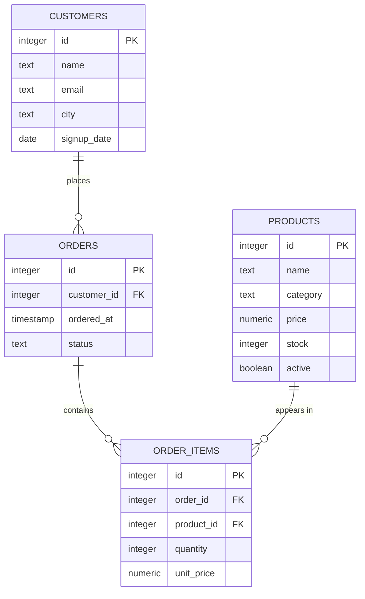

# Read the data model

A support message says order 1006 arrived with the wrong item. You open the database and find one row for order 1006. It gives you the customer, the date, and the status. It does not give you a single product name.

The names live in another table, reached by an integer that the order's lines carry. A database keeps each fact in one place and links the pieces with keys. Before you write a query against it, you need to know which table holds which fact and what one row of each table stands for. This chapter maps the four tables and the three links between them, using that support message as the guide.

## Order 1006 does not contain product names

```sql
SELECT id, customer_id, ordered_at, status
FROM orders
WHERE id = 1006;
```

| id | customer_id | ordered_at | status |
| --- | --- | --- | --- |
| 1006 | 1 | 2026-01-09 21:00 | shipped |

One row, four columns, no product. This row records that a checkout happened: which order, which customer, when, and where it sits in its lifecycle. The contents of that checkout are stored somewhere else.

```sql
SELECT id, product_id, quantity, unit_price
FROM order_items
WHERE order_id = 1006
ORDER BY id;
```

| id | product_id | quantity | unit_price |
| --- | --- | --- | --- |
| 6 | 5 | 1 | 139.00 |
| 7 | 12 | 2 | 210.00 |
| 8 | 19 | 3 | 15.50 |
| 9 | 7 | 1 | 89.50 |

Four rows, and still no product name. `product_id` holds 5, 12, 19 and 7. Those numbers name products, and the names sit in a third table. Product 12 is the Granite Cookware Set, bought twice at 210.00.

Two tables, two kinds of fact. `orders` describes the checkout; `order_items` describes each line inside it. The column `order_items.order_id` is the link back. A database splits facts this way on purpose: a fact is stored once, in the table that describes it, and everything else points at it.

Asking `orders` for the product is a natural next step, and it fails immediately.

```sql
-- This fails: column "product_id" does not exist.
SELECT product_id
FROM orders
WHERE id = 1006;
```

The error is the model talking. `orders` has no product column, because one row of `orders` stands for a checkout and a checkout can hold several products. The products are recorded one per line, in the table whose grain can hold them.

## A row means one thing

You can read the shape of the whole dataset from four counts.

```sql
SELECT (SELECT count(*) FROM customers)   AS customers,
       (SELECT count(*) FROM products)    AS products,
       (SELECT count(*) FROM orders)      AS orders,
       (SELECT count(*) FROM order_items) AS line_items;
```

| customers | products | orders | line_items |
| --- | --- | --- | --- |
| 30 | 20 | 80 | 160 |

Four numbers, four different meanings. That meaning is the grain: what one row of a table stands for.

| table | rows | one row means |
| --- | --- | --- |
| `customers` | 30 | one person |
| `products` | 20 | one catalogue product |
| `orders` | 80 | one checkout |
| `order_items` | 160 | one product line inside a checkout |

A query's grain is the promise its result makes. Every number in the result is read against that promise. `count(*)` over `orders` returns 80, which is 80 checkouts. The same expression over `order_items` returns 160, which is 160 lines. Neither number is wrong. They answer different questions, and the table name is the only thing that says which.

Build the habit now: before you write a query, say what one result row should mean. Four answers cover this dataset. Which one you need depends on the question, and stating the question is your job.

## The primary key names each row

A primary key is a column, or a set of columns, whose value identifies a row. All four tables declare `id` as theirs. The database then enforces two rules: no two rows share a value, and no row stores `NULL` in that column.

You can check the first rule from outside.

```sql
SELECT count(*) AS rows, count(DISTINCT id) AS ids
FROM orders;
```

| rows | ids |
| --- | --- |
| 80 | 80 |

The two columns match, which is what uniqueness looks like from the outside. If rows ever outnumber ids in a table you trust, stop and look again. You are probably reading a join, and Chapter 2 explains why that changes the count.

Try this: run `SELECT count(*) FROM orders WHERE id IS NULL;` and then `SELECT count(DISTINCT id) FROM orders;`. The first returns 0 and the second returns 80. A primary key cannot be unknown, so the distinct count is the check that carries the uniqueness promise.

A key earns its keep when you group or count. `GROUP BY id` groups by a real thing, because an id names exactly one row. Without that promise, an id is only a label that may repeat, and any total grouped on it quietly merges two things into one.

The id carries no meaning beyond identity. It is not a position, a date, or a ranking. Order 1006 is order 1006 because the seed inserted that value, not because 1005 orders came before it.

## The foreign key is a pointer that cannot dangle

A foreign key is a column whose values must already exist as a primary key in another table. `orders.customer_id` is a foreign key to `customers.id`. Three columns in this dataset point somewhere.

| column | points at | nullable |
| --- | --- | --- |
| `orders.customer_id` | `customers.id` | no |
| `order_items.order_id` | `orders.id` | no |
| `order_items.product_id` | `products.id` | no |
| `customers.email` | nothing | yes |
| `customers.city` | nothing | yes |

The declaration also says `NOT NULL`, so every order names a real customer and every line names a real order and a real product. The database refuses to store an order for customer 99, because customer 99 does not exist. A pointer that cannot dangle is why a plain join on these columns matches every row it should. Chapter 2 builds on that guarantee.

`email` and `city` are the two nullable columns, and four customers have no email while four have no city. `NULL` means unknown. A primary key cannot be unknown, which is why it rejects `NULL`, and a foreign key here rejects it too.

The schema also indexes each foreign key column, using names such as `orders_customer_id_idx` and `order_items_product_id_idx`. Following a pointer is cheap because of that: the engine finds a parent's children through the index instead of reading the whole child table.

## One parent, many children



Read each line from the near side to the crow's foot. One customer places zero or more orders, one order contains zero or more lines, and one product appears on zero or more lines. Those are one-to-many relationships, named from the parent.

The pointer always sits on the many side, and that is not a style choice. A column holds one value, so a customer row cannot store a list of order ids. Put the pointer on the child and a parent can have any number of children without the schema changing.

The data shows the zero case as well as the many case. Ada Whitfield (id 1) has five orders, and order 1006 holds four lines. The Granite Cookware Set (id 12) appears on nine lines. Seven of the 30 customers have no orders at all, and the discontinued camp stove appears on none. The relationship allows a child count of zero, and the seed uses that allowance.

Now you can close the support message. Follow the pointers twice.

```sql
SELECT oi.id AS line_id, p.name, oi.quantity, oi.unit_price
FROM order_items oi
JOIN products p ON p.id = oi.product_id
WHERE oi.order_id = 1006
ORDER BY oi.id;
```

| line_id | name | quantity | unit_price |
| --- | --- | --- | --- |
| 6 | Trail Runner Jacket | 1 | 139.00 |
| 7 | Granite Cookware Set | 2 | 210.00 |
| 8 | Rope Dog Leash | 3 | 15.50 |
| 9 | Vertex Mechanical Keyboard | 1 | 89.50 |

Four lines in, four rows out. Each `product_id` matches exactly one product, so the join adds columns without adding rows. Chapter 2 starts from this query and shows what the row count does when the parent has more than one child to match.

## Read the relationship before you count

Most "how many" questions are ambiguous until you name a table.

| question | table to count | answer |
| --- | --- | --- |
| how many people signed up | `customers` | 30 |
| how many catalogue products | `products` | 20 |
| how many checkouts | `orders` | 80 |
| how many lines | `order_items` | 160 |

The number on its own is not a fact. "80" means 80 checkouts and nothing else. 160 means 160 lines and nothing else. When a report mixes the two, the arithmetic still runs and the answer stops meaning anything.

The average order count shows why the denominator matters. The 80 orders belong to 23 customers, so the average among buyers is 3.48 orders each. Spread over all 30 signups it is 2.67. Both averages are correct, and they answer different questions: one describes a typical buyer, the other describes a typical signup.

## What the model gives the exercise

The exercise asks for the name, category and price of every Electronics product, cheapest first. All three columns sit in `products`, and `WHERE category = 'Electronics'` removes rows without changing what a row means. The result stays at product grain: one row per matching product. `ORDER BY price` sorts those rows.

You never touch a second table, so no key, no pointer, and no fan-out enters the query. That is the point of starting here. You can predict the shape of the result before you run it: one row per Electronics product, three columns, sorted by price.

## What to remember

What I would do: write down what one row means before you query. Name the key that identifies it, and follow the foreign key to the table that owns the next fact. If a count looks wrong, ask which table's grain it counted before you change the query.

- Grain is what one row of a result means. State it before you write the query.
- A primary key identifies a row: unique, never `NULL`. All four tables use `id`.
- A foreign key points at a primary key and cannot point at nothing. That is why plain joins here match every row.
- One-to-many relationships put the pointer on the many side: customers to orders, orders to lines, products to lines.
- A count is a fact only at a named grain. 80 checkouts and 160 lines are both true, about different things.

## Check yourself

**1. A colleague reports that the shop handled 160 orders. Which table did the number come from, and what does it count?**

<details>
<summary>Answer</summary>

It came from `order_items`, which holds 160 rows. Those rows are lines, not checkouts, and the shop has 80 checkouts. The count is correct; the noun attached to it is wrong.

</details>

**2. Why does `customers` have no column listing a customer's order ids?**

<details>
<summary>Answer</summary>

A column holds one value, and the number of orders per customer varies from zero to five. The link is stored the other way round: `orders.customer_id` points at the customer. That keeps the schema fixed however many orders a customer places.

</details>

**3. What does a primary key guarantee, and which query shows it holds for `orders`?**

<details>
<summary>Answer</summary>

No two rows share a key value and no row has a `NULL` key. `SELECT count(*), count(DISTINCT id) FROM orders` returns 80 and 80, so the rows and the ids match one to one.

</details>

**4. Seven customers have no orders, and one product has never sold. What does that say about the relationship between these tables?**

<details>
<summary>Answer</summary>

The child side is optional. A parent row can exist with no matching child rows, which is the "zero" in "zero or more". An inner join would drop those rows, and a left join keeps them, as Chapter 2 shows.

</details>
