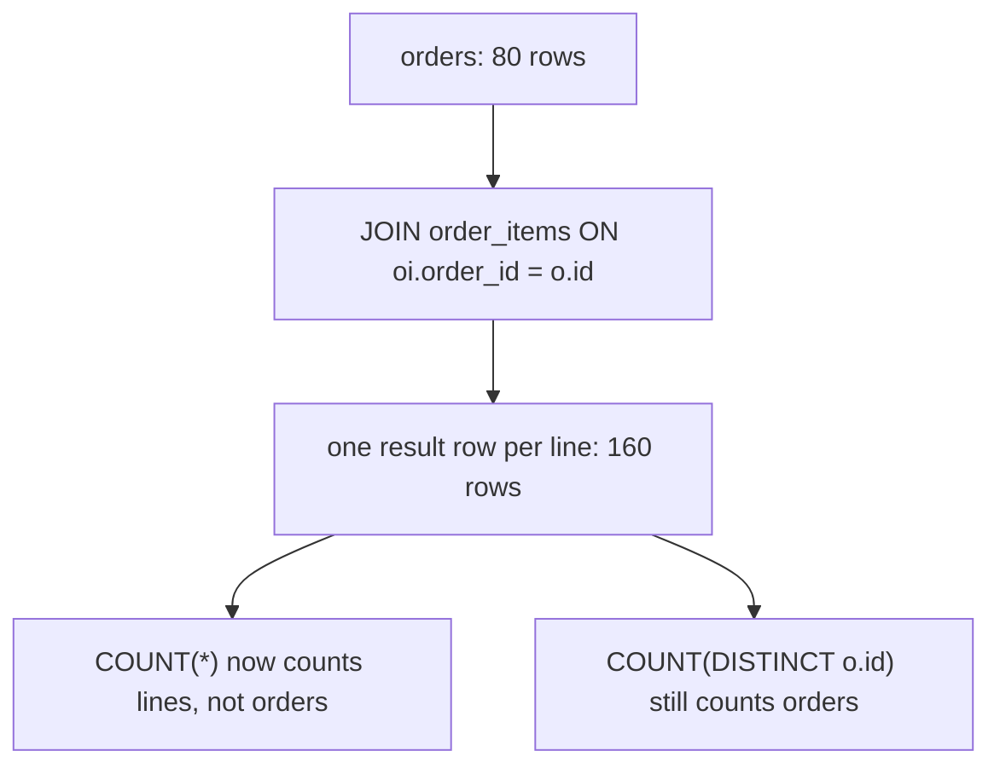
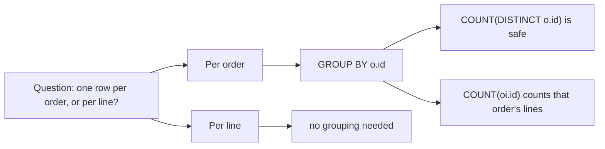

# Joins without row multiplication

A join combines rows from two tables on a shared key, but it does not preserve the row count of either input. When a parent meets its children, rows multiply. This module shows where that fan-out comes from, how to see it, and how to keep your totals honest.

## What a one-to-many join does

Joining `orders` to `order_items` is a one-to-many join: one order fans out into several line rows. That is correct when you want lines, and wrong when you want one value per order. The skill is knowing which grain the question wants.

The database does not guess. For each order row it finds every matching line and emits one combined row per match, so an order with three lines contributes three result rows. The join is doing exactly what you asked; the mistake is asking for orders and then counting the rows that come back.

## The fan-out, step by step



The right-hand branches are the two ways out: change the aggregate to count the distinct key you care about, or collapse the rows back with `GROUP BY` before you present them.

Because every `order_items.order_id` is a non-null foreign key, an inner join from `orders` to `order_items` returns exactly the 160 line rows in the dataset: no more, no fewer. The order count of 80 disappears from the result, which is precisely the trap.

## Counting the thing you actually care about

If you `COUNT(*)` after that fan-out you will count lines, not orders. Count the distinct key you actually care about, or aggregate before joining.

Both fixes are first-class SQL. `COUNT(DISTINCT o.id)` counts each order once no matter how many lines it produced, and it works even when you genuinely need the line-level rows in the same query. Aggregating in a sub-query or CTE first is the other route: shrink `order_items` to one row per order, then join that small result, so the fan-out never happens in the outer query.

The rule of thumb: after a join, ask what one row now represents. If the answer changed, your `COUNT`, `SUM` and `AVG` have to change with it.

## Bringing the fan-out back to order grain

```sql
-- one row per order, with a count of its lines
SELECT o.id,
       COUNT(oi.id) AS line_items
FROM orders o
JOIN order_items oi ON oi.order_id = o.id
GROUP BY o.id;
```

`GROUP BY o.id` collapses the fanned-out lines back to one row per order, and the aggregate counts within that group.

Note that `COUNT(oi.id)` counts joined line rows, whereas `COUNT(*)` would count every row in the group: same answer here, because the join is an inner join and `oi.id` is never null, but naming the column is the safer habit once outer joins enter the picture.

## Worked example: the customer beside each order

```sql
SELECT o.id AS order_id, c.name AS customer
FROM orders o
JOIN customers c ON c.id = o.customer_id
WHERE o.status = 'completed'
ORDER BY o.id
LIMIT 5;
```

Joining `customers` onto `orders` decorates each order with its customer while keeping the order grain, unlike the order-to-lines join.

| order_id | customer |
| --- | --- |
| 1001 | Ada Whitfield |
| 1002 | Ada Whitfield |
| 1004 | Chidi Okafor |
| 1005 | Ada Whitfield |
| 1008 | Bruno Sala |

This is a many-to-one direction: many orders point at one customer, so each order row still matches at most one customer row and the result stays at one row per order. Fan-out only happens when you travel the other way, from a parent down to its children.

## Choosing the grain before you write the join



Decide the answer to the question at the top of the diagram first; everything below it, such as grouping, counting and whether the join is safe, follows from that single decision.

## Check yourself

**1. Why does joining `orders` to `order_items` return more rows than `orders` has?**

<details>
<summary>Answer</summary>

Because it is a one-to-many join: each order matches every line that references it, so the result contains one row per line. The dataset's 160 line rows replace the 80 order rows.

</details>

**2. After that fan-out, what is the difference between `COUNT(*)` and `COUNT(DISTINCT o.id)`?**

<details>
<summary>Answer</summary>

`COUNT(*)` counts result rows, which are lines. `COUNT(DISTINCT o.id)` counts each order once, however many lines it produced.

</details>

**3. When is it fine to leave the fan-out in place?**

<details>
<summary>Answer</summary>

When the question itself is about lines, for example, listing the products on an order. The module's line-count exercise keeps the fan-out and simply groups it back to order grain; the reference solution shows the `GROUP BY` that does it.

</details>
