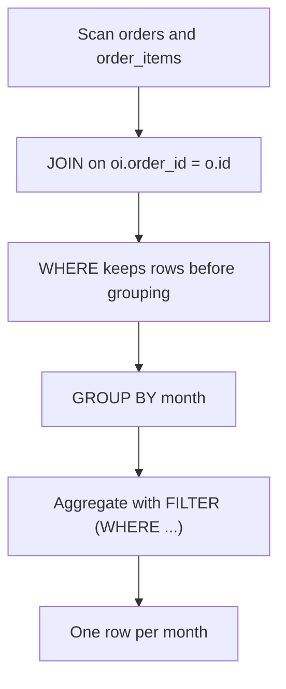
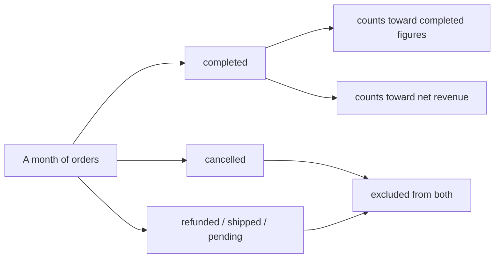

# Revenue reports with conditional aggregation

A revenue number is never a plain sum of everything — some rows count, some do not, and the rule differs from metric to metric. This module shows how to express those rules directly in the aggregate instead of cleaning them up later in a spreadsheet.

## Revenue is conditional

Real revenue is conditional. Cancelled orders do not count. Returns reduce the total. Writing this as one clean aggregate is the difference between a report people trust and one they quietly correct in a spreadsheet.

`orders.status` is a text column, and the seed uses lifecycles such as `completed`, `cancelled`, `shipped`, `refunded` and `pending`. Each one changes whether a line belongs in a given figure. The goal is a query whose business rule is visible on the page, so a reviewer can check it without reverse-engineering a chain of sub-queries.

## Attach the condition to the aggregate

Postgres lets you attach a condition directly to an aggregate with `FILTER (WHERE ...)`. It reads better than wrapping everything in `CASE` and it keeps the intent visible.

`FILTER` narrows the rows that feed one aggregate without removing them from the query. That matters when several metrics share a scan: completed counts, cancelled counts, and revenue filtered to completed orders can all be computed side by side, each with its own condition, over the same joined rows. The equivalent `SUM(CASE WHEN ... THEN ... END)` works too, but the condition is buried inside an expression and easy to get subtly wrong.

## The filter-then-aggregate pipeline



Read the pipeline top to bottom. `WHERE` decides which rows ever reach the grouping; `FILTER` decides which of those rows each individual aggregate includes. Two different levers, and mixing them up is the usual source of a revenue report that reconciles to nothing.

## The SQL shape: `FILTER (WHERE ...)`

```sql
SELECT DATE_TRUNC('month', o.ordered_at)::date AS month,
       SUM(oi.quantity * oi.unit_price)
         FILTER (WHERE o.status = 'completed') AS revenue
FROM orders o
JOIN order_items oi ON oi.order_id = o.id
GROUP BY 1
ORDER BY 1;
```

The line amount is `quantity * unit_price`, and the `FILTER` clause keeps only completed orders inside that sum.

`DATE_TRUNC('month', ...)::date` normalises the timestamp to the first of its month so the grouping is stable and the output is readable. Every line is joined to its order because the status you must filter on lives on `orders`, while the quantity and price you must sum live on `order_items`.

## Worked example: conditional counts side by side

```sql
SELECT DATE_TRUNC('month', o.ordered_at)::date AS month,
       COUNT(*) FILTER (WHERE o.status = 'completed') AS completed,
       COUNT(*) FILTER (WHERE o.status = 'cancelled') AS cancelled
FROM orders o
GROUP BY 1
ORDER BY 1;
```

Two conditions, two counts, one pass over the orders table.

| month | completed | cancelled |
| --- | --- | --- |
| 2026-01-01 | 8 | 2 |
| 2026-02-01 | 8 | 3 |
| 2026-03-01 | 9 | 2 |
| 2026-04-01 | 7 | 3 |
| 2026-05-01 | 5 | 1 |

Those are the months and counts the module's worked example returns; note that the `FILTER` conditions sit beside each other, so the shape of the month — busy in completed work, light in cancellations — is visible at a glance.

The exercise extends this idea from counts to money. Its reference solution returns net revenue per month for completed orders only:

| month | net_revenue |
| --- | --- |
| 2026-01-01 | 2132.55 |
| 2026-02-01 | 2311.07 |
| 2026-03-01 | 2456.40 |
| 2026-04-01 | 1803.62 |
| 2026-05-01 | 1537.95 |

Net revenue is `SUM(quantity * unit_price)`, so it inherits the same "only completed orders" rule, just applied to the summed amount rather than the row count.

## One filter per metric



Each metric gets its own condition, and a single scan can feed many of them. Keeping the rule next to the metric is what makes the report auditable: you can point at the `FILTER` clause and say why that row did or did not count.

## Check yourself

**1. What is the difference between `WHERE o.status = 'completed'` and `FILTER (WHERE o.status = 'completed')`?**

<details>
<summary>Answer</summary>

`WHERE` removes rows before grouping, so they affect every aggregate. `FILTER` restricts the rows feeding one specific aggregate while the others still see the full group.

</details>

**2. Why does the revenue query join `orders` to `order_items`?**

<details>
<summary>Answer</summary>

The status lives on `orders`, but the quantity and unit price needed for revenue live on `order_items`. The join brings the two together so a line can be filtered by its order's status and summed.

</details>

**3. What is net revenue, and how is it expressed?**

<details>
<summary>Answer</summary>

`SUM(oi.quantity * oi.unit_price)` over qualifying rows — the line amount summed only where the order counts. The module's exercise reference solution computes it per month with a `WHERE` on completed status.

</details>
