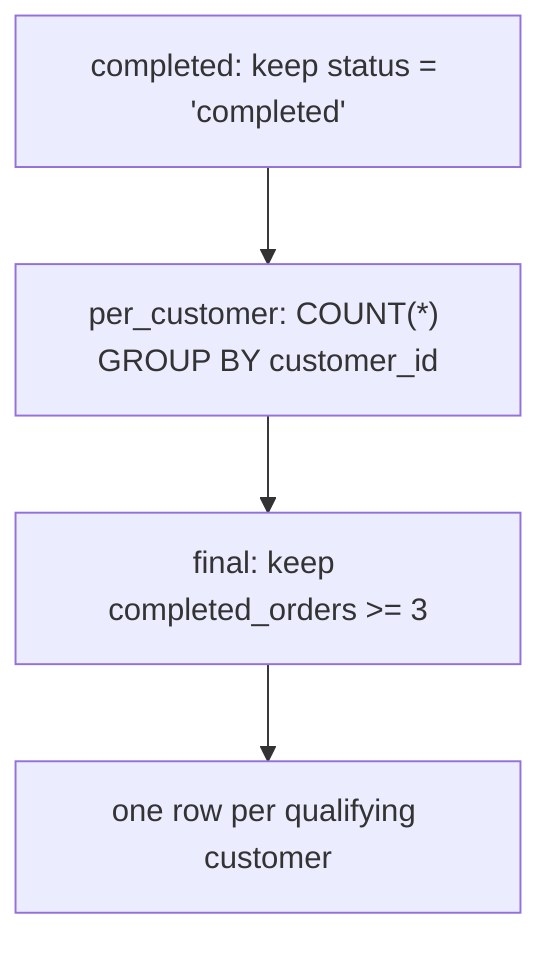

# CTEs and multi-stage analysis

Complex questions rarely need one clever query. They need two or three plain ones, run in order, each named so you can inspect it. This module introduces the `WITH` clause and the habit of breaking an answer into testable stages.

## A hard question is a row of easy ones

A hard question is usually several easy questions in a row. A CTE (a `WITH` block) gives each step a name so you can run it, read it, and fix it in isolation instead of staring at one giant nested query.

The first stage usually filters or projects to the rows you care about. The next aggregates them to the grain the question wants. The final stage selects, ranks or thresholds the result. Named stages let you stop after any one of them and check you got what you expected, which is much harder when everything is nested in parentheses.

## Name each stage

The rule of thumb: if you cannot say in one sentence what a stage produces, it deserves its own CTE. You also get to test stages independently, which is how you find where a wrong answer actually went wrong.

That one-sentence test is a good discipline: "completed orders" is a stage; "customers with three or more completed orders" is a stage. If a sentence contains an "and", it is probably two stages. Naming the grain of each stage also makes the final `SELECT` read like the question itself.

## The CTE stages



Three stages, each answering one small question. You can run the `completed` stage by itself, then the `per_customer` stage, then the filtered result, so a wrong number is easy to localise.

## The SQL shape: `WITH`

```sql
WITH per_customer AS (
    SELECT customer_id, COUNT(*) AS orders
    FROM orders
    GROUP BY customer_id
)
SELECT * FROM per_customer
WHERE orders >= 2;
```

The `WITH` block computes one named result, and the outer query reasons on top of it.

A CTE is not a temporary table. It is a named query the rest of the statement can reference, and later CTEs can build on earlier ones. Inside the parentheses you write an ordinary `SELECT`, and the outer query treats its name like any other table, including filtering aggregates it produces.

## Worked example: filter once, aggregate after

```sql
WITH completed AS (
    SELECT id, customer_id
    FROM orders
    WHERE status = 'completed'
)
SELECT customer_id, COUNT(*) AS completed_orders
FROM completed
GROUP BY customer_id
ORDER BY completed_orders DESC, customer_id
LIMIT 5;
```

The CTE applies the status rule once, and the outer query counts the surviving rows per customer.

| customer_id | completed_orders |
| --- | --- |
| 1 | 3 |
| 3 | 3 |
| 10 | 3 |
| 11 | 3 |
| 17 | 3 |

That is what the module's worked example returns. The filter is stated exactly once, so if the definition of "completed" ever changes there is a single line to edit rather than one clause hidden in each sub-query.

## Testing one stage at a time

Because every stage has a name, you can paste its body into the editor and run just that part. Run `SELECT * FROM completed` and confirm the status filter behaves; run the `per_customer` grouping and confirm the counts look plausible; only then add the outer threshold.

This is also how the module's exercise builds up. Its reference solution uses a first CTE for completed orders, a second to count per customer, and a final `SELECT` that keeps customers with three or more: the same three-stage shape as the diagram, with the middle stage given its own name.

## Check yourself

**1. What does a CTE give you that a nested sub-query does not?**

<details>
<summary>Answer</summary>

A name. The named result can be read, tested and reused in isolation, and later stages can refer to it, which makes a multi-step query far easier to debug.

</details>

**2. When should a step become its own CTE?**

<details>
<summary>Answer</summary>

When you can describe what it produces in one sentence. If the sentence needs an "and", the step is really two and should be split.

</details>

**3. In the worked example, why filter inside the CTE instead of at the end?**

<details>
<summary>Answer</summary>

Filtering early shrinks the rows the later `GROUP BY` has to process and keeps the business rule in one place. The final threshold (three or more, in the reference solution) is a different rule and belongs in a later stage.

</details>
