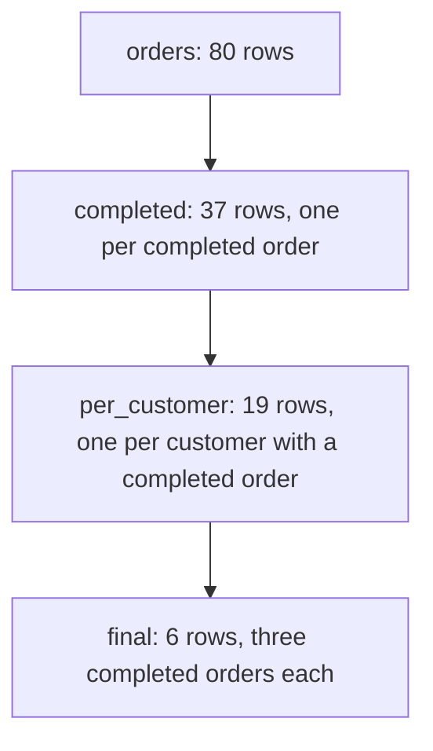

# CTEs and multi-stage analysis

The shop holds 80 orders. Thirty-seven are completed, and the rest are shipped, pending, cancelled or refunded. No table holds the customers who placed three or more completed orders, so you build the answer yourself. Skip the status filter and you get 22 rows, each with a count that looks plausible.

The question is three questions in a row. Which orders count as completed. How many completed orders each customer placed. Which customers reach three. Each step is easy on its own. The work is keeping the steps separate inside one statement.

A CTE is a `SELECT` with a name, written with `WITH`, that the rest of the statement can read. Naming each step turns one crowded query into a list of stages you can run and check on their own. This chapter builds that habit, then shows when to stop.

## A hard question is three easy ones

`orders` stores one row per checkout: 80 rows, each with an `id`, a `customer_id`, an `ordered_at` and a `status`. The count you want is per customer, so the first step narrows the rows to completed orders. The second step groups by `customer_id`. A count that skips the first step includes the other four statuses and answers a different question.

The cost is a report total that no longer matches the question, and nothing in the run flags it.

You can write the whole thing as one nested query:

```sql
SELECT customer_id, completed_orders
FROM (
    SELECT customer_id, COUNT(*) AS completed_orders
    FROM orders
    WHERE status = 'completed'
    GROUP BY customer_id
) per_customer
WHERE completed_orders >= 3
ORDER BY completed_orders DESC, customer_id;
```

That query is correct, and it returns six rows. Read it closely and notice the direction of travel: the `WHERE status` filter sits inside the parentheses, the count sits in the middle, and the threshold sits at the top.

Checking the number means reading inward. Explaining it means reading outward. A third stage would wrap the block in another pair of parentheses and indent every line again.

The nesting also hides the failure. If the answer is wrong, the mistake sits in one of three places, and the shape of the query does not tell you which one.

## Name each stage in one sentence

A CTE is a query with a name. Write it above the statement that uses it, and mark it with `WITH`:

```sql
WITH completed AS (
    SELECT id, customer_id
    FROM orders
    WHERE status = 'completed'
)
SELECT COUNT(*) AS completed_orders FROM completed;
```

`completed` is the name. It is not a table, and it does not survive the statement. Inside this statement it behaves like one: `FROM completed` reads it, and the count is 37.

Two named stages, plus the final `SELECT`, answer the full question. The first produces completed orders, one row per order. The second produces one row per customer, with a count.

That gives the naming rule. A stage earns its own name when one sentence states what it produces and which row it produces. "Completed orders, one row per order" passes. "Completed orders per customer above a threshold" fails, because it does two jobs.

The row a stage produces is worth stating too. Grain means what one row of a result stands for, and it decides which aggregate is honest. At order grain, `COUNT(*)` counts orders. At customer grain, the same expression counts customers.

## The shape of WITH

```sql
WITH per_customer AS (
    SELECT customer_id, COUNT(*) AS orders
    FROM orders
    GROUP BY customer_id
)
SELECT * FROM per_customer
WHERE orders >= 2;
```

Read the skeleton: `WITH`, a name, `AS`, a bracketed `SELECT`, then the main query. The main query treats `per_customer` like any other table, and it can filter the `orders` column the CTE invented.

That filter is the reason the CTE is here. `WHERE` runs before `GROUP BY`, so `WHERE COUNT(*) >= 2` cannot work: the count does not exist yet.

The CTE moves the boundary. It produces rows first, and the outer `WHERE` runs after, so it reads an ordinary column.

The result has 23 rows. Every customer who placed an order appears once, and the smallest count is 2.

## A worked example, and the filter that went missing

Here is the query a learner writes first. The column is named `completed_orders`, and the filter that makes the name true is missing:

```sql
-- Wrong: counts every order, not only completed ones.
WITH per_customer AS (
    SELECT customer_id, COUNT(*) AS completed_orders
    FROM orders
    GROUP BY customer_id
)
SELECT customer_id, completed_orders
FROM per_customer
WHERE completed_orders >= 3
ORDER BY completed_orders DESC, customer_id;
```

That returns 22 rows. The first three look like this:

| customer_id | completed_orders |
| --- | --- |
| 1 | 5 |
| 3 | 4 |
| 5 | 4 |

Nothing warns you. The column name promises completed orders, the arithmetic counts all of them, and 22 customers out of 30 is a believable answer. Customer 1 leads the list with 5, which is also believable, because customer 1 really did place 5 orders.

The correction is one line, and it goes inside the first stage:

```sql
WITH completed AS (
    SELECT id, customer_id
    FROM orders
    WHERE status = 'completed'
),
per_customer AS (
    SELECT customer_id, COUNT(*) AS completed_orders
    FROM completed
    GROUP BY customer_id
)
SELECT customer_id, completed_orders
FROM per_customer
WHERE completed_orders >= 3
ORDER BY completed_orders DESC, customer_id;
```

| customer_id | completed_orders |
| --- | --- |
| 1 | 3 |
| 3 | 3 |
| 10 | 3 |
| 11 | 3 |
| 17 | 3 |
| 24 | 3 |

Six rows, and every one of them holds three completed orders. Three is also the highest completed count in the table, so a threshold of 4 returns no rows at all.

Follow one customer through the stages. Customer 1 placed five orders. Orders 1001, 1002 and 1005 are completed. Order 1006 is shipped and order 1007 is refunded, so the first stage drops both, and the second stage counts three.

The stage sizes tell the same story:



Nineteen customers have at least one completed order, and the 37 completed orders are spread across them. Six of the nineteen hold three. The other thirteen hold two or one, so the threshold keeps a third of the rows.

The difference between 22 rows and 6 rows is one `WHERE` clause in a five-line block. That is what a named stage buys: the business rule appears once, in a place you can point at.

## Run one stage on its own

A named stage is also a stage you can run. Copy its body out of the `WITH` wrapper and execute it by itself.

```sql
SELECT id, customer_id
FROM orders
WHERE status = 'completed'
ORDER BY id
LIMIT 4;
```

| id | customer_id |
| --- | --- |
| 1001 | 1 |
| 1002 | 1 |
| 1004 | 3 |
| 1005 | 1 |

Four rows, all completed, ids in order. That is the filter behaving. `SELECT COUNT(*) FROM orders WHERE status = 'completed'` reports 37, which matches the diagram.

Try this: run `SELECT COUNT(*) FROM orders;` beside it. The unfiltered count is 80, and the difference is exactly the rows the first stage removes.

The second stage needs a different check: confirm the count per customer looks reasonable before the threshold throws rows away. Keep the stages and change the final `SELECT`:

```sql
WITH completed AS (
    SELECT id, customer_id
    FROM orders
    WHERE status = 'completed'
),
per_customer AS (
    SELECT customer_id, COUNT(*) AS completed_orders
    FROM completed
    GROUP BY customer_id
)
SELECT completed_orders, COUNT(*) AS customers
FROM per_customer
GROUP BY completed_orders
ORDER BY completed_orders;
```

| completed_orders | customers |
| --- | --- |
| 1 | 7 |
| 2 | 6 |
| 3 | 6 |

Seven customers have one completed order, six have two, and six have three. The threshold of 3 keeps the last group. A threshold of 2 would keep twelve, and that number comes from adding two rows of the table, not from running another query.

Running one stage at a time is how you find where a wrong answer went wrong. If stage one returns 37 rows and stage two returns 20, the bug is in the grouping, not the filter.

## A CTE is not a temp table

A temporary table is a real table. `CREATE TEMP TABLE completed AS SELECT ...` writes rows for the session, and you can index those rows, analyse them and query them from later statements. A CTE does none of that. It is a name attached to query text, and it lasts as long as one statement.

| | CTE | temp table |
| --- | --- | --- |
| lifetime | one statement | the session, until dropped |
| storage | none of its own | real rows |
| index | no | yes |
| statistics | none of its own | collected when analysed |
| visible to later statements | no | yes |

The engine side matters here. PostgreSQL 12 and later usually folds a CTE into the query that reads it, so the planner optimises the combined statement. The filter inside `completed` and the grouping in `per_customer` become one query plan, and PostgreSQL can reorder the work.

Two options change that. `WITH completed AS MATERIALIZED (...)` forces one evaluation and keeps the rows for the rest of the statement, which helps when the CTE is expensive and read more than once. A recursive CTE always keeps its intermediate result.

The practical consequence: naming a stage does not make the query slower, and it does not make it faster. The name is for you. It also means you cannot index a CTE, because there is nothing to index. When a stage is slow, the index belongs on the table it reads.

## When a subquery is enough

The opening nested query is the same answer with no names.

```sql
SELECT customer_id, completed_orders
FROM (
    SELECT customer_id, COUNT(*) AS completed_orders
    FROM orders
    WHERE status = 'completed'
    GROUP BY customer_id
) per_customer
WHERE completed_orders >= 3
ORDER BY completed_orders DESC, customer_id;
```

That returns the same six rows. PostgreSQL builds the same plan for both spellings in the ordinary case.

Choose by what you need next. A subquery is enough for one nested step you will read once and never test.

A CTE earns its place when the query has two or more stages. It also earns it when a name makes the final query read like the question, and when you plan to run a stage alone while you work out the answer.

The exercise after this chapter asks for the same three-stage shape with a lower threshold: two or more completed orders. Its answer uses a first CTE for completed orders and a second for the per-customer count, then filters in the final `SELECT`. Add `customer_id` to that last `ORDER BY` as well as the count, because the six customers with three orders share the top count.

## What to remember

**What I would do:** name the stage after the rule it applies and apply that rule inside it, so a stage called `completed` cannot count a shipped order. Build the query one stage at a time, and run each stage alone before you add the next. Stop at a subquery while the query has one nested step, and start naming stages at the second.

- A CTE is a `SELECT` with a name. The rest of one statement can read it, and it is gone afterwards.
- Name a stage when one sentence states what it produces and which row it produces.
- State the grain of each stage. Stages at different grains are the normal shape.
- Put a business rule in the earliest stage, so it appears once and a mistake stays local.
- Run a stage by copying its body, then compare its row count with a number you trust.
- A CTE has no storage and no index. For one nested step, a subquery is enough.

## Check yourself

**1. The corrected query returns six rows, and the version without the status filter returns 22. Which stage owns the difference, and how do you prove it in one query?**

<details>
<summary>Answer</summary>

The first stage owns it. Run `SELECT COUNT(*) FROM orders WHERE status = 'completed'` and you get 37 of the 80 orders. Run `SELECT COUNT(DISTINCT customer_id) FROM orders` and you get 23 customers who ordered at all. The status filter is the only difference between the two versions, and it lives in a five-line block.

</details>

**2. Why can the outer query filter on `completed_orders` when `WHERE COUNT(*) >= 3` fails inside the first stage?**

<details>
<summary>Answer</summary>

`WHERE` runs before `GROUP BY`, so the count does not exist when the filter is evaluated. The CTE produces rows first, and the outer `WHERE` runs after that, so it reads an ordinary column of the CTE's result.

</details>

**3. A colleague replaces the `completed` CTE with `CREATE TEMP TABLE completed AS SELECT ...`. Name one thing that gets easier and one that gets harder.**

<details>
<summary>Answer</summary>

Easier: later statements can query the table, and you can index it. Harder: the table must be dropped when you finish, it goes stale when `orders` changes, and the report is no longer one statement you can read from top to bottom.

</details>

**4. A later stage reads `completed` twice, once to count its rows and once to list them. Does the first stage run twice?**

<details>
<summary>Answer</summary>

No. PostgreSQL evaluates a CTE that is referenced more than once, keeps the rows for the rest of the statement, and reads the stored copy on the second reference. That is also when `MATERIALIZED` costs nothing extra.

</details>
