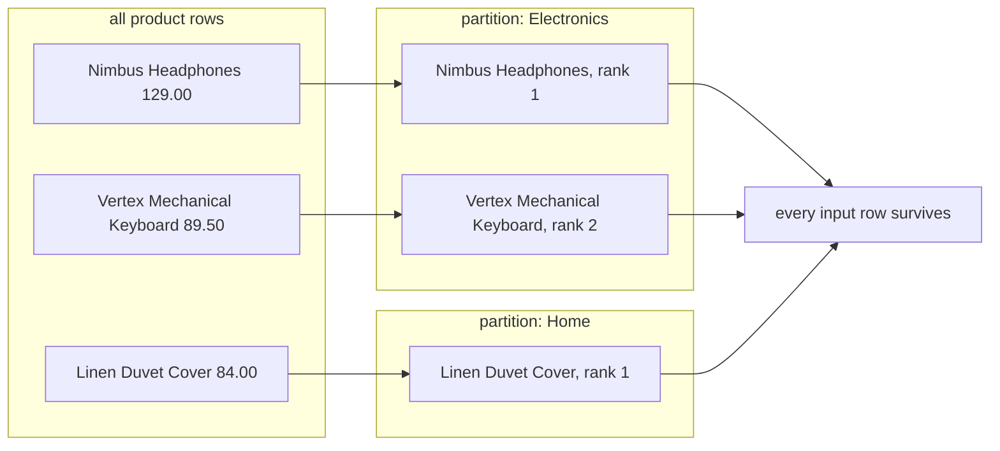

# Window functions and ranking

The catalogue holds 20 products in four categories. Ask which product costs the most inside each category and `GROUP BY category` gives you four rows, one per category, with none of the 20 products in them. The winner is in the data and has no row to appear in. A window function puts all 20 products back and ranks each one.

A window function answers the question you asked: it computes across a group of rows and keeps every row, so each product carries its rank beside it. The two clauses inside the window decide which rows the function sees and in what order.

## Aggregation collapses rows, a window keeps them

```sql
SELECT category, ROUND(AVG(price), 2) AS avg_price, COUNT(*) AS products
FROM products
GROUP BY category
ORDER BY category;
```

| category | avg_price | products |
| --- | --- | --- |
| Electronics | 83.33 | 5 |
| Home | 57.40 | 5 |
| Kitchen | 79.94 | 4 |
| Outdoor | 69.32 | 6 |

Four rows. The five Electronics products became one average, and their names, ids and prices went with them. That is what an aggregate does: it folds a group into one row.

The cost is a report that answers a narrower question than you asked and looks finished.

A window is the set of rows a function can see while it computes the value for one row. A window function reads across that set and returns one value per row, so no row is folded away. Replace the aggregate with `AVG(price) OVER (PARTITION BY category)` and all 20 products come back, each carrying its category's average. Now you can see which product sits below the average in its own category.

`SELECT category, AVG(price) FROM products GROUP BY category` returns 4 rows. `AVG(price) OVER (PARTITION BY category)` returns 20. Same arithmetic, different contract about what a row means.



One result set is split into partitions, each partition is ranked, and every input row is emitted again with its rank attached.

## The OVER shape

Every window function is a function followed by `OVER (...)`. The function does the work, and the parentheses describe the rows it may read.

An empty `OVER ()` means the whole result set is the window. `SUM(price) OVER ()` adds all 20 prices and puts 1439.29 beside every product row. `COUNT(*) OVER ()` over `orders` puts 80 beside every order.

The same value repeats down the column because the window never changes.

The summary aggregates (`SUM`, `COUNT`, `AVG`) and the ranking functions (`ROW_NUMBER`, `RANK`, `DENSE_RANK`) share the syntax. A ranking function needs a sequence, and `ORDER BY` inside the window supplies one. A summary aggregate reads that clause when you want a running total instead of one total for the whole group. With no `ORDER BY` at all, `ROW_NUMBER() OVER ()` still numbers the rows, in whatever order the engine reaches them.

Placement in the query matters. Window functions run after `WHERE` and `GROUP BY`, and before `ORDER BY` and `LIMIT`. That is why a window result cannot be filtered in `WHERE`: the filter has already run by the time the window exists.

## PARTITION BY splits, ORDER BY sequences

`PARTITION BY` splits the rows into independent groups. The function starts fresh in each group. Leave it out and the whole result is one group, which is what the empty `OVER ()` did.

`ORDER BY` inside the window sets the sequence the function reads. It is not the same as the outer `ORDER BY`, which sorts the finished output and changes nothing about the arithmetic.

Both clauses appear in a running count:

```sql
SELECT customer_id, id AS order_id, ordered_at,
       COUNT(*) OVER (
         PARTITION BY customer_id
         ORDER BY ordered_at, id
       ) AS orders_so_far
FROM orders
WHERE status = 'completed'
ORDER BY customer_id, ordered_at
LIMIT 6;
```

| customer_id | order_id | ordered_at | orders_so_far |
| --- | --- | --- | --- |
| 1 | 1001 | 2026-01-04 10:12 | 1 |
| 1 | 1002 | 2026-01-19 16:40 | 2 |
| 1 | 1005 | 2026-02-11 11:55 | 3 |
| 2 | 1008 | 2026-01-13 07:00 | 1 |
| 3 | 1009 | 2026-01-15 00:00 | 1 |
| 3 | 1010 | 2026-01-16 17:00 | 2 |

Read the three clauses as one sentence. `COUNT(*)` counts rows. `PARTITION BY customer_id` gives each customer a separate window, so the count restarts at 1 for a new customer. `ORDER BY ordered_at, id` makes the window end at the current row, so the count grows as the customer's orders go by.

Customer 1 shows the growth: order 1001 on 4 January reads 1, order 1002 on 19 January reads 2, and order 1005 on 11 February reads 3. Customer 2 appears once here, because order 1008 is their only completed order, so the count is 1. Customer 3 reads 1 for order 1009 on 15 January and 2 for order 1010 the next day.

The dates jump backwards between customer 1's last order and customer 2's first, and the counts still restart. The partition is doing that work, not the chronology of the result. Note also that order 1004 does not appear: it is customer 3's third completed order, dated 2 February, and it sits just past the sixth row that `LIMIT 6` returns.

The `, id` in the window's `ORDER BY` is a tie-break. All 80 timestamps in `orders` are distinct, so it never decides an order in this data. Write it anyway: two orders in the same second would otherwise have no defined sequence, and a running count over unordered peers is a number nobody can reproduce.

The running count costs one sort. The engine sorts the surviving rows by `customer_id` and then by `ordered_at, id`, walks them once, and keeps a counter for each partition.

An index on `(customer_id, ordered_at)` may supply that order without a separate sort. When a window result gets large, check whether an existing index already provides the order the window asks for.

Checking a running count takes one query. Drop the `LIMIT` and wrap the window in a CTE, then group by `customer_id` and take `MAX(orders_so_far)`. Each value should equal that customer's completed order count from a plain `GROUP BY`, which is how you prove the window partitions the rows the way you meant.

## A wrong turn: filter after the window

The `WHERE` clause sits before the window, so it decides which rows are counted. Move the filter to the outside and the count changes meaning:

```sql
-- Wrong: the numbers include orders this query then throws away.
WITH numbered AS (
    SELECT customer_id, id, ordered_at, status,
           COUNT(*) OVER (
             PARTITION BY customer_id
             ORDER BY ordered_at, id
           ) AS seq
    FROM orders
)
SELECT customer_id, id, ordered_at, seq
FROM numbered
WHERE status = 'completed'
ORDER BY customer_id, ordered_at
LIMIT 6;
```

| customer_id | id | ordered_at | seq |
| --- | --- | --- | --- |
| 1 | 1001 | 2026-01-04 10:12 | 1 |
| 1 | 1002 | 2026-01-19 16:40 | 4 |
| 1 | 1005 | 2026-02-11 11:55 | 5 |
| 2 | 1008 | 2026-01-13 07:00 | 1 |
| 3 | 1009 | 2026-01-15 00:00 | 1 |
| 3 | 1010 | 2026-01-16 17:00 | 2 |

Customer 1's three completed orders read 1, 4 and 5. The query is not broken. The window counted five orders for customer 1, shipped order 1006 and refunded order 1007 included, and the outer filter removed two of them afterwards. The numbers that survived kept the sequence they earned, gaps included.

Both answers are honest about different questions. "Which position does this order hold among all my orders" gives 1, 4 and 5. "How many completed orders have I placed so far" gives 1, 2 and 3. The demo query asks the second question, so it filters first.

Try this: add `WHERE status = 'completed'` inside the `numbered` CTE and leave the outer filter alone. Customer 1's rows read 1, 2 and 3 again, so the only change is where the filter sits.

The rule follows from the evaluation order. Filter with `WHERE` before the window. If you must filter on a window result, wrap the window in a CTE and filter outside, as the monthly example below does.

## Three ways to rank a tie

A tie is two rows with the same value in the window's `ORDER BY` column. The engine has no reason to put one of them first, so the ranking function decides what happens to the position.

This catalogue has a real tie. Outdoor holds 6 products, Electronics 5, Home 5 and Kitchen 4, so Electronics and Home tie at five:

```sql
SELECT category,
       COUNT(*) AS products,
       ROW_NUMBER() OVER (ORDER BY COUNT(*) DESC) AS row_number,
       RANK()       OVER (ORDER BY COUNT(*) DESC) AS rank,
       DENSE_RANK() OVER (ORDER BY COUNT(*) DESC) AS dense_rank
FROM products
GROUP BY category
ORDER BY products DESC, category;
```

| category | products | row_number | rank | dense_rank |
| --- | --- | --- | --- | --- |
| Outdoor | 6 | 1 | 1 | 1 |
| Electronics | 5 | 2 | 2 | 2 |
| Home | 5 | 3 | 2 | 2 |
| Kitchen | 4 | 4 | 4 | 3 |

The three functions agree until the tie and then part company.

`ROW_NUMBER()` numbers rows 1, 2, 3, 4 with no shared values. It gives Electronics 2 and Home 3, or the other way round, depending on the order the engine reads them. If the output must be repeatable, add a tie-break to the window's `ORDER BY`.

`RANK()` gives tied rows the same rank and then skips the positions they used. Both categories sit at 2, and Kitchen lands at 4, because three rows are ahead of it.

`DENSE_RANK()` gives tied rows the same rank and does not skip. Both categories sit at 2, and Kitchen lands at 3, so the places run 1, 2, 2, 3 with no gap.

The choice is a business question, so let the report decide. Exactly two rows per group needs `ROW_NUMBER()`, because it always returns distinct numbers. "Everyone who shares a price shares a place" needs `RANK()`, because the gap is the point. "Second place should mean the second distinct value" needs `DENSE_RANK()`.

The exercise after this section ranks prices within each category with `RANK()`, and no two products in a category share a price, so `RANK()` and `ROW_NUMBER()` return the same numbers there. That agreement is a property of this data, not of the functions, and the category counts above show how quickly a tie changes the answer.

## Aggregate first, then rank

Ranking raw rows usually ranks the wrong thing. `order_items` holds one row per product line, so a rank over those rows ranks lines. A line with quantity 10 outranks a line with quantity 1 at the same price, and neither number says anything about revenue.

Aggregate to the grain the question wants first, then rank that result. Here the grain is one row per month and category:

```sql
WITH monthly AS (
    SELECT DATE_TRUNC('month', o.ordered_at)::date AS month,
           p.category,
           SUM(oi.quantity * oi.unit_price) AS net_revenue
    FROM orders o
    JOIN order_items oi ON oi.order_id = o.id
    JOIN products p ON p.id = oi.product_id
    WHERE o.status = 'completed'
    GROUP BY 1, 2
),
ranked AS (
    SELECT month, category, net_revenue,
           RANK() OVER (
             PARTITION BY month
             ORDER BY net_revenue DESC
           ) AS rank
    FROM monthly
)
SELECT month, category, net_revenue, rank
FROM ranked
WHERE rank <= 2
ORDER BY month, rank, category;
```

| month | category | net_revenue | rank |
| --- | --- | --- | --- |
| 2026-01-01 | Outdoor | 824.40 | 1 |
| 2026-01-01 | Electronics | 717.55 | 2 |
| 2026-02-01 | Electronics | 891.50 | 1 |
| 2026-02-01 | Outdoor | 684.00 | 2 |
| 2026-03-01 | Electronics | 868.05 | 1 |
| 2026-03-01 | Outdoor | 685.40 | 2 |
| 2026-04-01 | Electronics | 708.55 | 1 |
| 2026-04-01 | Outdoor | 637.10 | 2 |
| 2026-05-01 | Outdoor | 589.00 | 1 |
| 2026-05-01 | Home | 496.20 | 2 |

Three stages, and each one has a job. `monthly` builds the aggregate with the 160 lines folded down to one row per month and category. `ranked` adds a rank inside each month, comparing revenue values that already exist. The final `SELECT` keeps rank 1 and 2.

Ranking a group without a window means a correlated subquery that re-runs for every row, or a self-join that pairs each row with its group. Both are harder to read and usually slower. `OVER` states the comparison once, and the engine sorts the rows a single time.

The aggregate runs first, so the window ranks 20 rows rather than 160 lines. `GROUP BY` cannot do this job, because it collapses each group into one row and drops the rows the ranking has to attach a number to.

`WHERE rank <= 2` sits outside the CTE for the same reason as before: the filter runs before the window, and `rank` does not exist at that point.

A month with no completed revenue never reaches `monthly`, so it has no row to rank. All five months above appear because each one holds completed orders, and that is a property of the aggregate, not of the window.

`RANK()` can return three rows for a month when two categories tie at second place. No month in this data has that tie, so the query returns two rows per month and ten rows in total. If your contract says exactly two rows whatever the data, use `ROW_NUMBER()` and accept that it breaks the tie without telling you.

The `orders_so_far` column from the demo query is the same tool at a smaller grain. The next chapter uses it to mark a customer as a repeat buyer at a given month, which is a running count tested against 2.

## Frames, briefly

A frame is the slice of the partition a function reads for the current row. With no `ORDER BY`, the frame is the whole partition. With one, the frame ends at the current row, and a frame clause can widen it or narrow it.

With an `ORDER BY` and no frame clause, the default is `RANGE BETWEEN UNBOUNDED PRECEDING AND CURRENT ROW`: from the partition's first row to the current row, including every row that ties with it. `ROWS BETWEEN UNBOUNDED PRECEDING AND CURRENT ROW` looks similar and counts physical rows instead.

The difference shows up on a tie. Under `RANGE`, two rows with the same value in the window's `ORDER BY` share a frame, so a running `SUM` adds both amounts at once and both rows report the same total. Under `ROWS`, the frame grows one row at a time and the two rows report different totals.

In this data the window's `ORDER BY ordered_at, id` includes a unique column, so the two frames agree. Give the window's `ORDER BY` a unique column and they agree in general, which is cheaper than reasoning about ties every time.

## What to remember

**What I would do:** write the grain down before you write the window, because a rank over lines ranks lines. Aggregate to that grain, then rank the aggregate, and keep the filter in `WHERE` so the running number counts exactly the rows that survive. Give the window's `ORDER BY` a unique column, and no frame has a tie left to argue about.

- `GROUP BY` folds a group into one row. A window function adds a value beside every row and folds nothing.
- Every window function is a function plus `OVER (...)`. An empty `OVER ()` covers the whole result.
- `PARTITION BY` restarts the computation for each group. `ORDER BY` inside the window sets the sequence the function reads.
- Window functions run after `WHERE`. Filter the rows before the window, not after it.
- `ROW_NUMBER` breaks a tie, `RANK` skips the positions the tie used, `DENSE_RANK` does not.
- Aggregate to the grain you want to rank, then rank the aggregate.

## Check yourself

**1. `RANK() OVER (PARTITION BY category ORDER BY price DESC)` returns 20 rows, while `GROUP BY category` with `AVG(price)` returns 4. Why?**

<details>
<summary>Answer</summary>

A window function returns one value per input row, so every product keeps its place and gains a rank. `GROUP BY` merges each group of rows into a single output row, so the products behind the average have no row left to appear in.

</details>

**2. The demo query filters `status = 'completed'` before the window. What changes if you number every order instead, then filter afterwards?**

<details>
<summary>Answer</summary>

The count includes orders that the later filter removes, so customer 1's completed orders read 1, 4 and 5 rather than 1, 2 and 3. Shipped order 1006 and refunded order 1007 were counted, then dropped, and the gaps stay.

</details>

**3. Two categories tie at second place, and the report must show exactly two rows per month. Which function do you use, and what does `RANK()` return instead?**

<details>
<summary>Answer</summary>

`ROW_NUMBER()`, because it gives the two tied rows 2 and 3 and the filter `rank <= 2` keeps exactly two. `RANK()` gives both tied rows the rank 2, so the same filter keeps three rows for that month.

</details>

**4. Why does `WHERE rank <= 2` need its own stage in the monthly query?**

<details>
<summary>Answer</summary>

Because `WHERE` runs before the window. When the outer filter is evaluated, the rank has not been computed, so the name does not exist. The `ranked` CTE computes the rank first, and the filter then reads an ordinary column.

</details>
