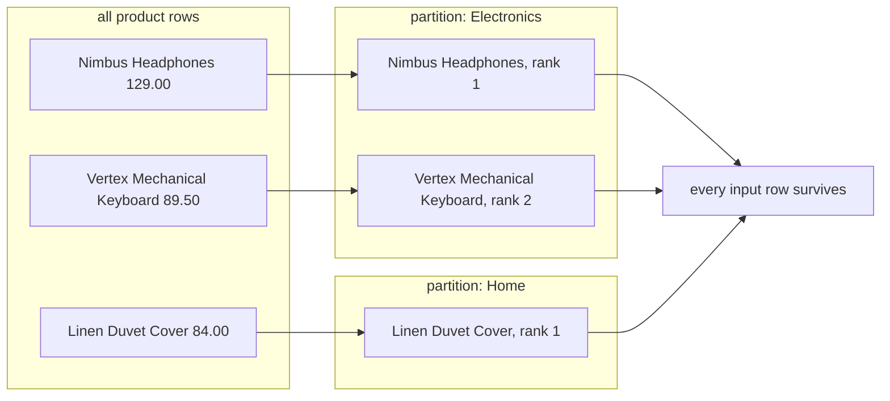

# Window functions and ranking

An aggregate folds a group of rows into one result row. A window function computes across a group while keeping every row, adding the value beside each one, which is how you rank a product within its category without losing the product.

## Aggregation collapses rows, a window keeps them

`SELECT category, AVG(price) FROM products GROUP BY category` returns four rows; the twenty products behind those averages are gone.

A window function computes across related rows without folding them away: `RANK() OVER (PARTITION BY category ORDER BY price DESC)` returns all twenty products, each carrying a rank from its category peers. Window functions run after `WHERE` and `GROUP BY`, so a window result is filtered in an outer query.

## The `OVER` shape

Every window function is written the same way: the function, then `OVER (...)`. `OVER ()` with nothing inside means the whole result set is the window, so `SUM(price) OVER ()` puts the catalogue-wide total beside every product row. The same syntax carries the ranking functions, the aggregates (`SUM`, `COUNT`, `AVG`) and the offset functions (`LAG`, `LEAD`).



One result set is split into partitions, a rank is computed inside each, and every row is emitted again with that rank attached; nothing is merged away.

## PARTITION BY splits, ORDER BY sequences

`PARTITION BY` splits rows into independent groups and the function restarts in each: Electronics ranks 1, 2 and Home ranks 1. Leave it out and the whole result is one partition.

`ORDER BY` inside the window controls the sequence the function sees, unlike the outer `ORDER BY`, which only sorts the output:

```sql
SELECT customer_id, id AS order_id, ordered_at,
       COUNT(*) OVER (
         PARTITION BY customer_id
         ORDER BY ordered_at, id
       ) AS orders_so_far
FROM orders
WHERE status = 'completed';
```

`COUNT(*)` counts the partition's rows up to and including the current row, so each customer's orders read 1, 2, 3. The tie-break `, id` matters: two orders in the same second have no defined order, and the count is deterministic only with a unique key in the window's `ORDER BY`.

## Three ways to break a tie

`ROW_NUMBER()` numbers rows 1, 2, 3 with no gaps or shared values. `RANK()` gives tied rows the same rank then skips: 1, 1, 3. `DENSE_RANK()` shares the rank without skipping: 1, 1, 2.

```sql
ROW_NUMBER() OVER (PARTITION BY category ORDER BY price DESC)
RANK()       OVER (PARTITION BY category ORDER BY price DESC)
DENSE_RANK() OVER (PARTITION BY category ORDER BY price DESC)
```

Three products tied at the top price, a fourth lower, and the functions return 1, 2, 3, 4; 1, 1, 1, 4; and 1, 1, 1, 2. The choice is a business decision: an exact two rows per category needs `ROW_NUMBER()`; `DENSE_RANK()` keeps the next distinct value in second place; `RANK()` keeps the position the tie created.

## Aggregate first, then rank the aggregate

Ranking raw rows often ranks the wrong thing: `order_items` holds one row per product line, so a rank over those rows ranks lines, and quantity 10 outranks quantity 1 at the same price.

Aggregate to the grain the question wants first, then rank that: group to one row per month and category, compute net revenue, then apply the window. `GROUP BY` is no substitute, because it collapses the very rows the window was meant to keep.

## Frames, briefly

With an `ORDER BY`, the default frame is `RANGE BETWEEN UNBOUNDED PRECEDING AND CURRENT ROW`: from the partition's start to the current row, tied peers included. `ROWS` counts physical rows where `RANGE` includes every tied row, so a running `SUM` can jump several rows at once when keys are equal; a unique tie-break or an explicit `ROWS` frame gives one row per step.

## Worked examples

Rank products within each category by price:

```sql
SELECT name, category, price,
       RANK() OVER (
         PARTITION BY category
         ORDER BY price DESC
       ) AS price_rank
FROM products
ORDER BY category, price_rank, name;
```

| name | category | price | price_rank |
| --- | --- | --- | --- |
| Nimbus Headphones | Electronics | 129.00 | 1 |
| Vertex Mechanical Keyboard | Electronics | 89.50 | 2 |
| Pulse Fitness Tracker | Electronics | 74.25 | 3 |
| Linen Duvet Cover | Home | 84.00 | 1 |

All twenty products come back and `price_rank` restarts at 1 for Home.

Top two categories per month by net revenue from completed orders:

```sql
WITH monthly AS (
    SELECT DATE_TRUNC('month', o.ordered_at)::date AS month,
           p.category,
           SUM(oi.quantity * oi.unit_price) AS net_revenue
    FROM orders o
    JOIN order_items oi ON oi.order_id = o.id
    JOIN products p ON p.id = oi.product_id
    WHERE o.status = 'completed'
    GROUP BY 1, 2
),
ranked AS (
    SELECT month, category, net_revenue,
           RANK() OVER (
             PARTITION BY month
             ORDER BY net_revenue DESC
           ) AS rank
    FROM monthly
)
SELECT month, category, net_revenue, rank
FROM ranked
WHERE rank <= 2
ORDER BY month, rank, category;
```

| month | category | net_revenue | rank |
| --- | --- | --- | --- |
| 2026-01-01 | Outdoor | 824.40 | 1 |
| 2026-01-01 | Electronics | 717.55 | 2 |
| 2026-02-01 | Electronics | 891.50 | 1 |
| 2026-02-01 | Outdoor | 684.00 | 2 |
| 2026-03-01 | Electronics | 868.05 | 1 |
| 2026-03-01 | Outdoor | 685.40 | 2 |

The aggregate runs first, so the window ranks one row per month and category, not one row per line. With `RANK()`, a tie at second place returns three rows; `ROW_NUMBER()` keeps exactly two.

## Check yourself

**1. Why can a window function keep every row when `GROUP BY` cannot?**

<details>
<summary>Answer</summary>

A window function emits its value beside each row instead of merging those rows into a group, whereas `GROUP BY` returns one row per group.

</details>

**2. Three products tie for first place. What does each ranking function return?**

<details>
<summary>Answer</summary>

`ROW_NUMBER()` returns 1, 2, 3, 4 and picks an arbitrary winner among equals, `RANK()` returns 1, 1, 1, 4 and `DENSE_RANK()` returns 1, 1, 1, 2; the choice turns on whether the next value should skip a position.

</details>

**3. Why write `ORDER BY ordered_at, id` rather than `ORDER BY ordered_at` in a running count?**

<details>
<summary>Answer</summary>

Two orders sharing a timestamp have no defined order, so the count would not be deterministic. The unique `id` is the tie-break that makes the sequence, and therefore the count, reproducible.

</details>
