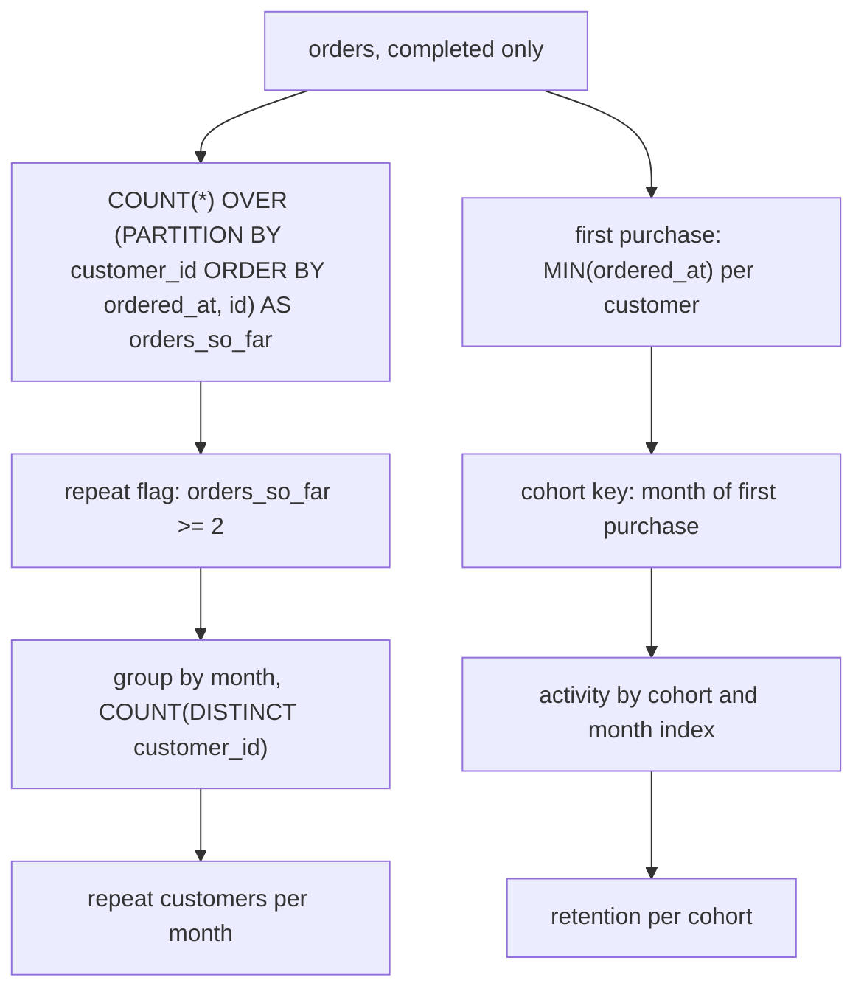

# Repeat purchase and cohort retention

Retention asks whether the people who bought once come back. The trap is grain: "repeat" is a status that changes month by month, while a cohort is a fixed group defined by a first purchase. This module builds both from the same running count and keeps the two ideas apart.

## Retention questions are grain traps

"How many repeat customers do we have?" sounds like one number about people. But a customer is not permanently repeat; they become repeat the moment their second completed order lands. Store one boolean per customer and you must pick a date to evaluate it, and the question never said which date.

The honest grain is per customer per month. Compute the status as of each month, and every month gets its own count, so the trend is visible instead of frozen at one arbitrary moment. Deciding that grain before writing the query is what keeps the number defensible when someone asks what it means.

The orders table makes the trap concrete: one row per order is not one row per customer, and a customer with three orders in a month is a single person appearing three times. Every count in this module has to say whether it is counting orders or people.

## Repeat is a status as of a month

A customer is repeat as of a month if they had at least two completed orders on or before the last day of that month. A running count produces exactly that. Order each customer's rows by `ordered_at, id` and count them up to the current row; `orders_so_far >= 2` is the repeat flag from the row where the second order arrives onward.

```sql
-- repeat, as of each order
COUNT(*) OVER (
  PARTITION BY customer_id
  ORDER BY ordered_at, id
) AS orders_so_far
```

Because the window order ends with the unique `id`, the row where the count steps from 1 to 2 is deterministic. As in module 5, the flag cannot be filtered in the `WHERE` clause that produced it: wrap the windowed query in a CTE or subquery, then keep `orders_so_far >= 2` outside.

## Cohorts come from a first event

A cohort is a group defined by a shared first event, here the month of a customer's first completed purchase. Everything afterwards is measured relative to that month, so the cohort key is fixed the moment the customer first appears and never changes as later data arrives.

There are two clean ways to derive it. Aggregating `MIN(DATE_TRUNC('month', ordered_at))` per customer gives the cohort month directly. When you also need a column from that first order, `DISTINCT ON (customer_id)` with `ORDER BY customer_id, ordered_at` returns the whole first row per customer, and `ROW_NUMBER() = 1` over the same ordering does the same job inside a CTE.

```sql
-- first purchase month, two ways
SELECT customer_id, MIN(DATE_TRUNC('month', ordered_at))::date AS cohort_month
FROM orders WHERE status = 'completed' GROUP BY customer_id;

SELECT DISTINCT ON (customer_id) customer_id, ordered_at, id
FROM orders WHERE status = 'completed' ORDER BY customer_id, ordered_at, id;
```

Either way the result is one row per customer, which is the grain that lets the cohort be joined back onto monthly activity without duplicating anything.

## Month index places activity relative to the cohort

Comparing cohorts needs months since first purchase, not calendar months. Truncate both the activity month and the cohort month to the first of their month, then difference the year and month parts: `(EXTRACT(YEAR FROM activity) - EXTRACT(YEAR FROM cohort)) * 12 + (EXTRACT(MONTH FROM activity) - EXTRACT(MONTH FROM cohort))`. Index 0 is the cohort month itself, index 1 the next calendar month, and so on.

Do the subtraction this way rather than dividing a number of days by 30. Subtracting two `date` values in PostgreSQL yields an integer count of days, and calendar months are not a fixed length, so the day-based shortcut drifts. Because both ends are already truncated to the first of the month, the year-and-month arithmetic is exact.



Both branches start from the same completed orders. The left side answers "how many repeat customers were there in this month"; the right side answers "how did one starting month behave over time".

## Counting distinct customers after a fan-out

Joining activity to orders, and orders to items, multiplies a customer across rows. `COUNT(*)` then counts orders or lines, not people, and the number inflates with basket size rather than customer count. The fix is `COUNT(DISTINCT customer_id)`, which counts the person once no matter how many rows they occupy.

The usual shape filters `status = 'completed'`, groups by month, and counts distinct customers. Distinction matters because a customer with three completed orders in a month is one active customer; without `DISTINCT` the monthly figure would count their activity instead of their presence, and the same mistake makes a cohort look healthier than it is.

## New, repeat and retained are different words

New means a first purchase landed in this month. Repeat means the customer has at least two completed orders by this month, and it can be measured over the whole customer base without any cohort at all. Retained is stricter: the customer belongs to a specified cohort month and is active in month index *n* relative to it, so retention always implies a cohort and a month index.

That distinction is why "repeat" and "retention" are not interchangeable on a chart. A repeat count mixes every customer ever acquired and rises as the base grows; a retention figure holds the starting cohort fixed and falls as people fail to return. Reaching for the wrong one produces a line that looks plausible and answers a different question.

## Worked example: repeat customers per month

```sql
WITH history AS (
    SELECT customer_id,
           DATE_TRUNC('month', ordered_at)::date AS month,
           COUNT(*) OVER (
             PARTITION BY customer_id
             ORDER BY ordered_at, id
           ) AS orders_so_far
    FROM orders
    WHERE status = 'completed'
)
SELECT month,
       COUNT(DISTINCT customer_id) AS repeat_customers
FROM history
WHERE orders_so_far >= 2
GROUP BY month
ORDER BY month;
```

The CTE attaches a running count to every completed order; the outer query keeps only rows where that customer already had two orders and counts distinct people per month.

| month | repeat_customers |
| --- | --- |
| 2026-01-01 | 2 |
| 2026-02-01 | 2 |
| 2026-03-01 | 6 |
| 2026-04-01 | 5 |
| 2026-05-01 | 3 |

January is 2 because two customers had already reached two completed orders by the end of that month, and `DISTINCT` keeps a customer counted once even with several orders that month.

## Worked example: a cohort grid

```sql
WITH first_order AS (
    SELECT customer_id,
           MIN(DATE_TRUNC('month', ordered_at))::date AS cohort_month
    FROM orders
    WHERE status = 'completed'
    GROUP BY customer_id
),
activity AS (
    SELECT customer_id,
           DATE_TRUNC('month', ordered_at)::date AS month
    FROM orders
    WHERE status = 'completed'
    GROUP BY 1, 2
)
SELECT f.cohort_month,
       ( (EXTRACT(YEAR FROM a.month) - EXTRACT(YEAR FROM f.cohort_month)) * 12
       + (EXTRACT(MONTH FROM a.month) - EXTRACT(MONTH FROM f.cohort_month)) )::int AS month_index,
       COUNT(DISTINCT a.customer_id) AS active_customers
FROM first_order f
JOIN activity a ON a.customer_id = f.customer_id
GROUP BY 1, 2
ORDER BY 1, 2;
```

| cohort_month | month_index | active_customers |
| --- | --- | --- |
| 2026-01-01 | 0 | 6 |
| 2026-01-01 | 1 | 2 |
| 2026-01-01 | 2 | 2 |
| 2026-01-01 | 3 | 1 |
| 2026-02-01 | 0 | 6 |
| 2026-02-01 | 1 | 4 |

Each row counts distinct customers of one cohort active at one month index, so reading across a cohort shows how many came back. A month with no activity is absent from the result rather than present as a zero: the February cohort simply has no `month_index = 3` row here, so a chart drawn straight from this output would skip a column. Generate the missing months with `generate_series` or a small `VALUES` list and `LEFT JOIN` to it when the grid must be dense.

## Check yourself

**1. Why is "repeat" a per-customer-month fact rather than one fixed fact about a customer?**

<details>
<summary>Answer</summary>

Because it depends on what had happened by a given month. A customer becomes repeat when their second completed order lands, so as of January they may not be repeat while as of March they are. Storing it per customer forces a date to be chosen; computing it per month keeps the status honest.

</details>

**2. Why does the monthly repeat report use `COUNT(DISTINCT customer_id)` instead of `COUNT(*)`?**

<details>
<summary>Answer</summary>

Because a customer can have several completed orders, and joins can fan those rows out further, so `COUNT(*)` counts rows rather than people. `DISTINCT` counts each customer once per month, which is what "how many customers" asks for.

</details>

**3. What does a retention grid need that a plain repeat count does not?**

<details>
<summary>Answer</summary>

A cohort and a month index. Retention measures a fixed starting group at month index *n* relative to its first purchase, whereas repeat status can be computed for the whole customer base with no cohort at all. That is why retained is the stricter word.

</details>
