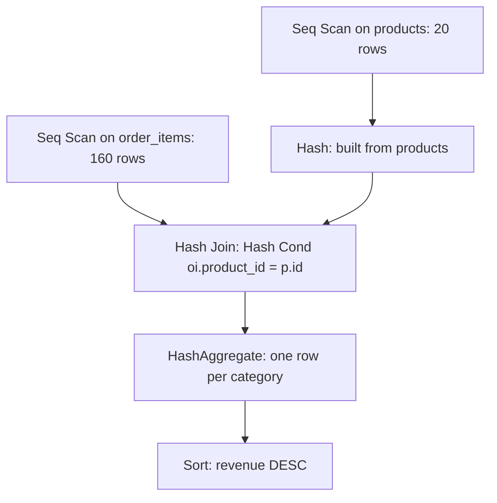

# Read and improve a query plan

The report from this module's exercise returns five rows, one per month: 8 completed orders in January, 9 in March, 5 in May. Those numbers are right, no error prints, and the dashboard built on it feels slow. Nothing in the SQL says which step costs the time.

The plan does: it lists the steps the database takes to answer the query, in order, with a price on each. It says whether the engine reads a whole table or one index entry, which side of a join it hashes, and how far its estimates sit from reality. This chapter teaches you to read that list, judge it, and tell when the fix is an index from when the plan is already right.

## The plan is the engine's account of your query

PostgreSQL does not run the SQL text you type. It parses the SQL, hands the result to the planner, and the planner builds a plan: a tree of steps that produce the rows. Then the executor runs that tree.

The planner compares access paths, which are ways of getting rows out of one table. It can read a table front to back, walk an index, or combine the two. It prices each path from its statistics and runs the cheapest. `EXPLAIN` prints the chosen plan, with a cost and an estimated row count at every node.

Two consequences follow. The plan describes this data, with these statistics, on this engine version, so it is evidence rather than truth. And because the planner works from estimates, a plan can be cheap to compute and still choose badly.

Guess wrong and you pay twice: you add an index the page never needed, and the page stays slow. The plan is how you see which of the two you are about to do.

## You read a plan inside out

Each node produces rows and hands them to its parent, so a parent cannot start until its children have produced something. Execution starts at the leaves, and the first printed line is the last thing to happen.

Indentation is the grammar. A line nested under another is its child. A line at the same indent is a sibling. Read the tree by its indentation, not as a list of statements.



Rows travel up that diagram. The products scan runs first and fills the hash table, and the order_items scan runs beside it. The join pairs the two, the aggregate folds 160 rows into 4, and the sort orders those 4 for the output. Reading from the top down would tell you the sort happens first, which is backwards.

## EXPLAIN estimates, EXPLAIN ANALYZE executes

Plain `EXPLAIN` plans the statement and runs none of it. `EXPLAIN ANALYZE` runs the statement and reports actual rows and timing beside every estimate. Plan output also carries buffer counts and timing summaries, which are trimmed from the blocks below.

That difference is a safety feature until it is not. On a `SELECT`, `ANALYZE` costs you the query time and nothing else. On a writing statement, the write happens for real.

```sql
EXPLAIN ANALYZE
DELETE FROM order_items WHERE order_id = 1050;
```

```text
Delete on order_items  (cost=0.00..4.00 rows=0 width=0) (actual rows=0.00 loops=1)
  Buffers: shared hit=4
  ->  Seq Scan on order_items  (cost=0.00..4.00 rows=2 width=6) (actual rows=2.00 loops=1)
        Filter: (order_id = 1050)
        Rows Removed by Filter: 158
```

Order 1050 had two lines. After that statement `order_items` holds 158 rows, not 160, because the delete ran. The `rows=0` on the `Delete` node is not a contradiction. The node returns no rows to its parent, so its actual count is 0, while the scan beneath it reports the two rows it removed.

Wrap a statement like that in `BEGIN` and `ROLLBACK` when you only want the plan. The plan prints, the write is undone, and the table is unchanged.

Try this: wrap the `DELETE FROM order_items WHERE order_id = 1050;` statement in `BEGIN` and `ROLLBACK`, then run it under `EXPLAIN ANALYZE`. The plan prints, the scan reports the 2 rows it removed, and `order_items` still holds 160 rows when the transaction ends. That is the safe way to read a writing plan.

`EXPLAIN (ANALYZE, BUFFERS)` adds page counts to each node, split into hits from cache and reads from disk. A slow plan with small row counts usually reads many pages, and buffers are how you see it.

## Seq Scan and Index Scan

`Seq Scan` reads the table front to back and tests each row against the filter. The plan prints the test as `Filter:` and the failures as `Rows Removed by Filter:`.

`Index Scan` walks a B-tree to the matching entries, then fetches each matching row from the table. `Bitmap Index Scan` and `Bitmap Heap Scan` split that in two: the index is read first into a bitmap of matching pages, then those pages are visited in physical order. `Index Only Scan` answers from the index alone when every column the query needs is stored in it.

Which one the planner picks depends on how much work each does. Take a query for one customer's orders.

```sql
EXPLAIN SELECT * FROM orders WHERE customer_id = 1;
```

Run it before the statistics are collected, and the plan uses the index.

```text
Bitmap Heap Scan on orders  (cost=4.19..12.66 rows=5 width=48)
  Recheck Cond: (customer_id = 1)
  ->  Bitmap Index Scan on orders_customer_id_idx  (cost=0.00..4.19 rows=5 width=0)
        Index Cond: (customer_id = 1)
```

Run `ANALYZE orders;` and the same query plans differently.

```text
Seq Scan on orders  (cost=0.00..2.00 rows=5 width=25)
  Filter: (customer_id = 1)
```

The index did not get worse and the query did not change. The planner learned that all 80 orders fit on one page, where a single read returns every row.

An index still earns its place when it supplies something a table scan cannot, namely order.

```sql
EXPLAIN ANALYZE
SELECT id, customer_id, ordered_at FROM orders ORDER BY id LIMIT 5;
```

```text
Limit  (cost=0.14..0.97 rows=5 width=16) (actual rows=5.00 loops=1)
  ->  Index Scan using orders_pkey on orders  (cost=0.14..13.34 rows=80 width=16) (actual rows=5.00 loops=1)
```

The index is already sorted by `id`, so the executor reads five entries and stops. A table scan would read all 80 rows, sort them, and keep five. That is the case where an index wins: the query asks for a little, in an order the index already provides.

## Hash Join, Sort and Aggregate

The module's example query groups revenue by category.

```sql
SELECT p.category,
       SUM(oi.quantity * oi.unit_price) AS revenue
FROM order_items oi
JOIN products p ON p.id = oi.product_id
GROUP BY p.category
ORDER BY revenue DESC;
```

With statistics in place, it plans like this.

```text
Sort  (cost=7.25..7.26 rows=4 width=40) (actual rows=4.00 loops=1)
  Sort Key: (sum(((oi.quantity)::numeric * oi.unit_price))) DESC
  Sort Method: quicksort  Memory: 17kB
  ->  HashAggregate  (cost=7.16..7.21 rows=4 width=40) (actual rows=4.00 loops=1)
        Group Key: p.category
        ->  Hash Join  (cost=1.45..5.56 rows=160 width=18) (actual rows=160.00 loops=1)
              Hash Cond: (oi.product_id = p.id)
              ->  Seq Scan on order_items oi  (cost=0.00..3.60 rows=160 width=14) (actual rows=160.00 loops=1)
              ->  Hash  (cost=1.20..1.20 rows=20 width=12) (actual rows=20.00 loops=1)
                    ->  Seq Scan on products p  (cost=0.00..1.20 rows=20 width=12) (actual rows=20.00 loops=1)
```

Walk it from the bottom. `Seq Scan on products` reads 20 rows. `Hash` turns them into a hash table keyed on `id`, which takes 5kB. `Seq Scan on order_items` reads 160 rows. `Hash Join` takes each of those rows, looks up its `product_id` in the hash table, and emits a joined row when it finds one. `HashAggregate` groups the 160 rows by `p.category` and sums the revenue, giving 4 rows. `Sort` orders those 4 by revenue, descending.

Each node's job fits in one line. `Hash Cond: (oi.product_id = p.id)` is the join condition, and the input under `Hash` is the side the engine chose to build. On other data the planner may build from `order_items` instead, or pick a `Merge Join` when both inputs already arrive sorted on the key. A third method, `Nested Loop`, suits a small input paired with an index lookup on the other side.

## Estimated rows, actual rows and stale statistics

Every node prints `rows=`, the planner's estimate. Under `ANALYZE` it also prints `actual rows=`. Put the two beside each other and you have a test of the statistics behind the plan.

Run the category-revenue query before the statistics exist and the estimates are guesses.

| node | estimate, no statistics | estimate, after `ANALYZE` | actual rows |
| --- | --- | --- | --- |
| Sort | 200 | 4 | 4 |
| HashAggregate | 200 | 4 | 4 |
| Hash Join | 1360 | 160 | 160 |
| Seq Scan on order_items | 1360 | 160 | 160 |
| Seq Scan on products | 690 | 20 | 20 |

The table holds 160 lines and 20 products. Without statistics the planner guessed 1360 and 690. Those estimates do not change the answer. They change the choices: how to join, which side to hash, how much memory to reserve, and which access path wins.

The estimates come from statistics the engine keeps per column: a row count, a histogram of how values are spread, and a list of the most common values. `ANALYZE` refreshes them, and autovacuum does the same on a schedule. After a bulk load or a large backfill the table changes shape while the statistics still describe the old one. That is when a plan gets worse for no visible reason.

`ANALYZE orders;` is the cheap first check. When estimates sit an order of magnitude away from actual rows, ask when the statistics were last collected.

## Cost is not time, and selectivity decides

Costs like `cost=0.00..1.20` are abstract units, not milliseconds. They come from settings that price work relative to other work. `seq_page_cost` is 1.0, `random_page_cost` is 4.0, `cpu_tuple_cost` is 0.01, and the rest are smaller still. A random page counts four times a sequential one, and one tuple counts a hundredth of a page.

The arithmetic is worth seeing once. `Seq Scan on products` costs 1.20: one page at 1.0 plus 20 tuples at 0.01 each. `Seq Scan on order_items` costs 3.60: two pages at 1.0 plus 160 tuples at 0.01 each. Both match the printed plan, and neither number is a duration.

Costs therefore compare only within one plan. Two queries have different row counts, so their totals measure different amounts of work. The same plan on a laptop and a server costs the same units and takes different time.

What the planner weighs with those units is selectivity: the fraction of rows a predicate keeps. `status = 'completed'` keeps 37 of the 80 orders, close to half. A filter that keeps half a table is a poor match for an index, because the index still sends the engine to most of the pages the table has.

Here is the plan the app prints for the exercise query, before any statistics exist.

```text
GroupAggregate  (cost=12.75..12.86 rows=5 width=12) (actual rows=5.00 loops=1)
  Group Key: ((date_trunc('month'::text, ordered_at))::date)
  ->  Sort  (cost=12.75..12.76 rows=5 width=4) (actual rows=37.00 loops=1)
        Sort Key: ((date_trunc('month'::text, ordered_at))::date)
        Sort Method: quicksort  Memory: 17kB
        ->  Bitmap Heap Scan on orders  (cost=4.19..12.69 rows=5 width=4) (actual rows=37.00 loops=1)
              Recheck Cond: (status = 'completed'::text)
              Heap Blocks: exact=1
              ->  Bitmap Index Scan on orders_status_idx  (cost=0.00..4.19 rows=5 width=0) (actual rows=37.00 loops=1)
                    Index Cond: (status = 'completed'::text)
```

The index is used here, and the reason is what the planner does not know. Both index nodes expect `rows=5`, and with no row or page counts for the table, an index walk looks cheap beside a full read. The actual rows are 37. `Recheck Cond` shows what the bitmap does: the index entries are collected first, then `Bitmap Heap Scan` visits the heap pages that hold them.

`Heap Blocks: exact=1` says all 37 rows share one page.

The `Sort` sits under the aggregate because of how grouping works. `GROUP BY` needs its input ordered by the group key, and a bitmap heap scan returns rows in page order, not month order. PostgreSQL can group two ways. `GroupAggregate` sorts the input on the group key and walks it, emitting one row each time the key changes. `HashAggregate`, which the category plan used, builds a hash table of groups and needs no sort. The aggregate above the sort returns five rows, one per month.

The two estimate misses have one cause: nothing has measured this table. The index nodes expect 5 rows and find 37. The planner also has no page count, so it prices a full read from a guess.

A cheap-looking index path and an expensive-looking table scan are enough to choose the index.

Run `ANALYZE orders;` and the same query plans differently.

```text
GroupAggregate  (cost=3.15..3.98 rows=37 width=12) (actual rows=5.00 loops=1)
  Group Key: ((date_trunc('month'::text, ordered_at))::date)
  ->  Sort  (cost=3.15..3.24 rows=37 width=4) (actual rows=37.00 loops=1)
        Sort Key: ((date_trunc('month'::text, ordered_at))::date)
        Sort Method: quicksort  Memory: 17kB
        ->  Seq Scan on orders  (cost=0.00..2.19 rows=37 width=4) (actual rows=37.00 loops=1)
              Filter: (status = 'completed'::text)
              Rows Removed by Filter: 43
```

Same query, same data, one `ANALYZE` apart. The estimate is now 37, and the planner also learns that the 80 rows sit on one page. The index path prices above a single page read, so the planner drops it. The table scan reports `Rows Removed by Filter: 43`, which is the 80 rows read minus the 37 kept. The aggregate still estimates 37 output rows where 5 appear, because no statistic says how many distinct months the filter leaves.

The index is not useless, and it is not ignored. It loses because 80 rows sit on one page, so an index walk adds work on top of the page the query needs anyway. On a table large enough to span thousands of pages, the arithmetic flips and the index earns its detour.

Two index shapes matter when a filter is not selective enough on its own. A partial index stores only the rows you query, so it stays small: `CREATE INDEX ON orders (ordered_at) WHERE status = 'completed'`. A covering index carries the extra columns an index-only scan needs: `CREATE INDEX ON orders (customer_id) INCLUDE (ordered_at)`.

Every number in a plan depends on the data and the settings, so your run will differ from this one in the digits. Read the shape.

The exercise asks you to run the monthly completed count, name the access method in a comment, and say why a plain index on `status` may not help. Name the one you see. That is `Bitmap Heap Scan` on `orders_status_idx` while the statistics are missing, and `Seq Scan` once `ANALYZE` has run. The 37-of-80 share is the reason the index saves little either way.

## What to remember

**What I would do**: run `EXPLAIN` before you add an index, and `EXPLAIN ANALYZE` before you trust a plan. Read the tree from the bottom up and read the shape rather than the digits. When an estimate sits an order of magnitude from the actual rows, run `ANALYZE` on the table before you touch a schema. If the plan still prefers a table scan because 80 rows share a page, believe it and leave the index alone.

- A plan is a tree of row producers. The deepest node runs first, so read the indentation from the bottom up.
- `EXPLAIN` plans a statement, `EXPLAIN ANALYZE` runs it. On a writing statement the write happens, so wrap it in a transaction you roll back.
- `Seq Scan` reads a table and filters. An index scan pays a detour that only a selective query or a needed ordering justifies.
- A hash join builds one side into a table and probes it with the other. `Hash Cond` names the key, and the input under `Hash` is the side built.
- `rows=` is an estimate and `actual rows=` is a measurement. A gap of an order of magnitude usually means stale statistics, and `ANALYZE` is the first fix.
- Cost is relative work, never a duration. Selectivity is the input the planner is pricing.

## Check yourself

**1. Why does the deepest node in a plan run first?**

<details>
<summary>Answer</summary>

Because the plan is a tree of row producers. A parent cannot emit a row until a child supplies one, so reading by indentation from the bottom up gives the execution order. Reading from the top down gives the reverse.

</details>

**2. What does `EXPLAIN ANALYZE` do to a `DELETE` that plain `EXPLAIN` does not?**

<details>
<summary>Answer</summary>

It executes the delete. The rows are gone unless the statement sits inside a transaction you roll back, while plain `EXPLAIN` only prints the planned steps.

</details>

**3. After `ANALYZE`, a query filtering on `status = 'completed'` still uses a sequential scan. Why is that reasonable?**

<details>
<summary>Answer</summary>

Because the filter keeps about half the table, so an index saves little, and on 80 rows the whole table fits on one page. Reading the page once and filtering costs less than walking an index to rows on that same page.

</details>

**4. A plan estimates 1360 rows for a node whose actual rows are 160. Is the query wrong?**

<details>
<summary>Answer</summary>

No. The estimate shapes choices such as the join method and memory, not the rows returned. Missing or stale statistics are the likely cause, so run `ANALYZE` on the tables and compare the new plan.

</details>
