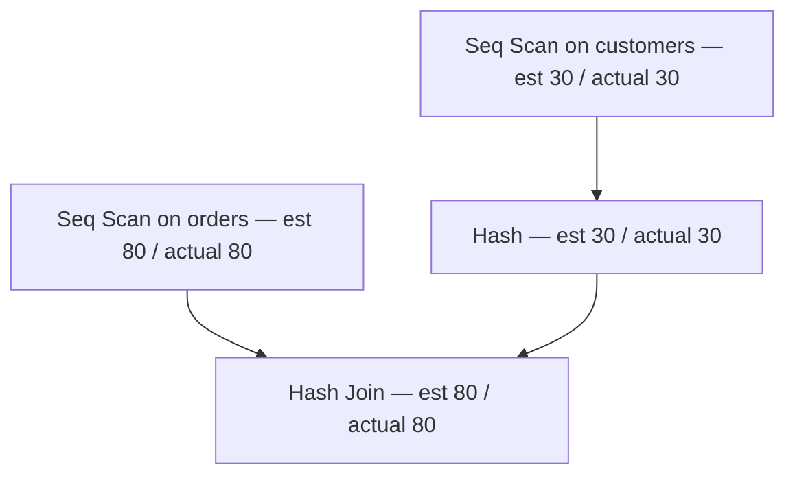

# Read and improve a query plan

A query plan is the engine's account of how it will answer your query: which tables it reads in full, which it reaches through an index, and how the joins run. Reading one turns "this query feels slow" into a claim about a specific node, and shows when the honest verdict is that the plan is already good.

## A plan is the engine's account of your query

PostgreSQL does not run the SQL you wrote; it runs a plan it derived from it. The planner prices the available access paths — a sequential scan, an index scan, the join orders and join methods — and executes the cheapest. `EXPLAIN` prints that plan, with a cost and an estimated row count for every node.

The plan is a tree, not a script: each node produces rows and feeds them to its parent. It is a claim about the data and its statistics as they are now, so a plan is evidence about this dataset and this engine version, not a universal truth. Ten million rows would plan differently.

## You read it inside-out

Execution starts at the leaves and rows flow upward. A node cannot emit a row until its children have produced theirs, so find the innermost indentation first: those nodes run first and supply everything above them.

Indentation is the grammar. A line nested under another is its child, and a line at the same indent is a sibling. Read the tree, not the text.



Rows travel upward, so execution starts at the bottom: `customers` is read into the `Hash` first, then `orders` is scanned and each row probes it.

## EXPLAIN estimates, EXPLAIN ANALYZE executes

Plain `EXPLAIN` prints the plan and reads no rows, so it is safe on any statement. `EXPLAIN ANALYZE` actually executes the statement and reports `actual rows` and timing beside each estimate.

That makes `ANALYZE` the better tool for a read-only `SELECT` and a hazardous one anywhere else, because the write really happens; on a writing statement use a rollback transaction. `EXPLAIN (ANALYZE, BUFFERS)` adds cache-versus-disk page counts, which explain a slow plan whose row counts look small.

## The nodes that matter

`Seq Scan` reads every row and discards the ones that fail the filter. It is the last resort on a large table, and often right on a small one.

`Index Scan` walks a B-tree to matching entries and fetches the heap rows; `Index Only Scan` answers from the index alone when every needed column is in it; `Bitmap Heap Scan` builds a bitmap of matching pages and visits them in physical order, suiting many scattered matches.

For joins, `Nested Loop` suits a tiny input with an index on the other key; `Hash Join` hashes one side and probes it with the other, winning for larger unordered inputs; `Merge Join` streams two inputs already sorted on the join key.

## Estimated rows and stale statistics

Every node prints `rows=`, the planner's estimate, and under `ANALYZE` an `actual rows=` beside it. A divergence of an order of magnitude means stale or insufficient statistics, and a bad estimate is the usual reason a plan picks the wrong join method.

Those estimates come from per-column histograms and most-common-value lists, refreshed by `ANALYZE` and autovacuum. After a bulk change, running `ANALYZE` is often the whole fix.

## Cost is not time, and selectivity decides

The `cost=0.00..29.00` numbers are arbitrary units tied to page fetches — `seq_page_cost` is 1.0, `random_page_cost` is 4.0, the rest is CPU. They are not milliseconds, and they are comparable only within one plan, never between two queries or two machines.

What the planner weighs is selectivity: the fraction of the table a predicate keeps. `status` has five distinct values and `completed` keeps a good share of them, so a plain B-tree index on `status` is not selective and the planner may reasonably ignore it.

A partial index fits such a column: `CREATE INDEX ON orders (ordered_at) WHERE status = 'completed'` indexes only the wanted rows and stays small as the table grows. A covering index, `... INCLUDE (customer_id)`, lets an `Index Only Scan` answer without visiting the heap.

## Worked example: two plans

The pocket reference is the pair of forms you will type most often.

```sql
-- estimate only: safe on any statement
EXPLAIN SELECT * FROM orders WHERE customer_id = 1;

-- executes for real: actual rows, buffers, timing
EXPLAIN (ANALYZE, BUFFERS)
SELECT * FROM orders WHERE customer_id = 1;
```

Now the plan tree for a join.

```sql
EXPLAIN (ANALYZE)
SELECT c.name, COUNT(*) AS orders
FROM orders o
JOIN customers c ON c.id = o.customer_id
WHERE o.status = 'completed'
GROUP BY c.name;
```

| node | est. rows | actual rows | what it does |
| --- | --- | --- | --- |
| Hash Join | 37 | 37 | pairs each completed order with its customer |
| Seq Scan on orders | 37 | 37 | reads all 80 orders, keeping the 37 completed |
| Hash | 37 | 37 | builds a hash of the completed orders |
| Seq Scan on customers | 30 | 30 | reads all 30 customers |

Both scans are sequential and the join is a hash join, and that is correct: with 80 and 30 rows, reading everything beats an index detour. A table a thousand times larger would want the index — indexes matter at scale.

The module's exercise groups completed orders per month: a filter and an aggregate, not a join.

```sql
SELECT DATE_TRUNC('month', ordered_at)::date AS month,
       COUNT(*) AS completed
FROM orders
WHERE status = 'completed'
GROUP BY 1
ORDER BY 1;
```

| month | completed |
| --- | --- |
| 2026-01-01 | 8 |
| 2026-02-01 | 8 |
| 2026-03-01 | 9 |
| 2026-04-01 | 7 |
| 2026-05-01 | 5 |

`status` is the low-cardinality trap: the plan scans the whole table rather than use `orders_status_idx`, and on 80 rows that is right. The index that would help here is partial.

## Check yourself

**1. Why does the deepest node in a plan run first?**

<details>
<summary>Answer</summary>

Because the plan is a tree of row producers: a parent cannot emit a row until its children have. Reading by indentation, not top to bottom, is what makes the order visible.

</details>

**2. What is the difference between `EXPLAIN` and `EXPLAIN ANALYZE`, and when does it bite?**

<details>
<summary>Answer</summary>

`EXPLAIN` only estimates and runs nothing; `EXPLAIN ANALYZE` executes and reports actual rows and timing. On a writing statement the write really happens, so wrap it in a rollback transaction.

</details>

**3. A query filters on `status = 'completed'` and the plan still uses a sequential scan. Why might that be correct?**

<details>
<summary>Answer</summary>

`status` has few distinct values, so an index on it is poorly selective, and on a small table reading everything is cheaper anyway. A partial index on the completed rows is what helps at scale.

</details>
