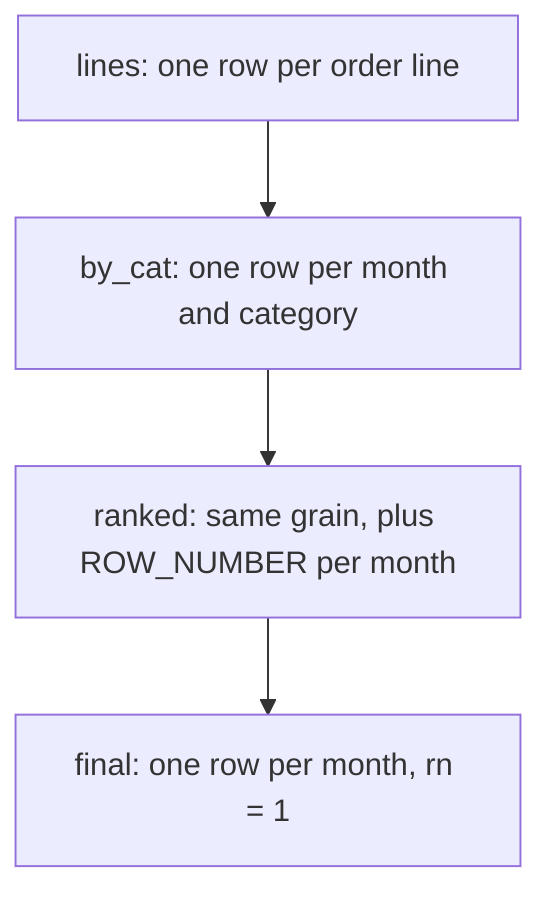

# Capstone: marketplace performance review

The head of the marketplace wants one sentence answered: which category brought in the most revenue each month this year, and how many customers bought from it. There is no table name in the message and no starter query in the editor. You have the toolkit from the last seven modules, and this module asks you to assemble it. Answer it carelessly and January credits Outdoor with five buyers instead of four, because a customer with two lines that month counts twice.

The answer is a sentence about a table. Before you write SQL, turn that sentence into a grain: one result row per month, holding a category, a revenue figure, and a buyer count. Every later decision follows from that one choice, including which tables you join and whether a join is safe. The capstone adds no new function. It tests the order you put the pieces in.

## The question arrives as a sentence

Restate the question in your own words, and mark each phrase that hides a decision.

"Net revenue" is not a product's list price. It is the money the line earned: `quantity` times `unit_price`, summed. "Bought in it" counts customers, so a customer who buys twice in one month counts once. "Each month" means the calendar month of `ordered_at`. "Completed orders only" is a filter on the order, and it applies before the first sum.

The grain is the level of detail one result row describes. Here one row describes one month, so a correct answer has one row per month and no more. That predicts the row count before you write anything: completed orders in this dataset fall in five months, January to May 2026, so the result holds five rows.

The question also asks for three quantities that live at different grains. Revenue lives at line grain, one row per product per order. The buyer count lives at order grain, one row per order. The month and category sit above both. Your query travels from the finest grain up to the month, and the path you take decides whether the totals stay honest.

A wrong decision here is quiet. No error fires, the query returns rows, and those rows answer a different question than the one asked.

## One CTE, one fact

A CTE is a named step in a query, written in a `WITH` block. The discipline of a CTE chain is that each stage computes one fact and can be described in one sentence. If the sentence needs an "and", the stage is really two stages.

Read the CTE names in order and you should reconstruct the plan before you read a line of SQL. This chain has four links.

- `lines` holds one row per order line, with revenue already multiplied out.
- `by_cat` collapses that to one row per month and category, with summed revenue and distinct buyers.
- `ranked` keeps that grain and adds a row number within each month.
- the final `SELECT` keeps `rn = 1`, which restores one row per month.



The status filter goes in `lines`, the earliest stage. That keeps "completed only" in one place and stops cancelled rows from travelling through every later stage. A filter placed late can still give the right answer here, but only because nothing downstream reads the status again.

## Walk the query: joins down to line grain

The first stage turns orders into their lines and computes the money on each one.

```sql
WITH lines AS (
    SELECT DATE_TRUNC('month', o.ordered_at)::date AS month,
           p.category,
           o.customer_id,
           oi.quantity * oi.unit_price AS revenue
    FROM orders o
    JOIN order_items oi ON oi.order_id = o.id
    JOIN products p ON p.id = oi.product_id
    WHERE o.status = 'completed'
)
SELECT * FROM lines
ORDER BY month, customer_id, category, revenue
LIMIT 6;
```

Read it one clause at a time.

`DATE_TRUNC('month', o.ordered_at)` drops the day and the time, so every order in January shares one value. The `::date` cast stores it as a date rather than a timestamp, which keeps the printed result short.

The first join reaches the order's lines. One order becomes several rows, which is the fan-out from module 2: the result takes the child's grain, so 80 orders become 160 lines. The second join reaches each line's product, which is where `category` lives.

`oi.quantity * oi.unit_price` is the line's revenue. The line stores `unit_price` rather than reading it from `products`, because the price charged at the time of the order is the one that counts.

The `WHERE` clause keeps completed orders only. It runs while the rows are read, before any grouping.

The first six rows for January:

| month | category | customer_id | revenue |
| --- | --- | --- | --- |
| 2026-01-01 | Electronics | 1 | 118.00 |
| 2026-01-01 | Home | 1 | 84.00 |
| 2026-01-01 | Outdoor | 1 | 139.00 |
| 2026-01-01 | Home | 2 | 127.50 |
| 2026-01-01 | Kitchen | 2 | 24.00 |
| 2026-01-01 | Outdoor | 2 | 94.00 |

Customer 1 appears three times and customer 2 three times. That repetition is the problem the next stage solves.

## One row per month and category

The second stage collapses the lines to the grain the question asks about.

```sql
WITH lines AS (
    SELECT DATE_TRUNC('month', o.ordered_at)::date AS month,
           p.category,
           o.customer_id,
           oi.quantity * oi.unit_price AS revenue
    FROM orders o
    JOIN order_items oi ON oi.order_id = o.id
    JOIN products p ON p.id = oi.product_id
    WHERE o.status = 'completed'
)
SELECT month, category,
       SUM(revenue) AS net_revenue,
       COUNT(DISTINCT customer_id) AS buyers
FROM lines
GROUP BY month, category;
```

`GROUP BY month, category` puts each line into one bucket per month and category. `SUM(revenue)` adds the lines in a bucket, which is what "net revenue" asked for. `COUNT(DISTINCT customer_id)` counts the customers in the bucket once each, which is what "bought in it" asked for.

The `DISTINCT` is doing real work. Without it, customer 1's three January lines would count three times, and the buyer column would report lines instead of people.

For the first month, this stage returns four rows:

| month | category | net_revenue | buyers |
| --- | --- | --- | --- |
| 2026-01-01 | Outdoor | 824.40 | 4 |
| 2026-01-01 | Electronics | 717.55 | 3 |
| 2026-01-01 | Home | 518.60 | 5 |
| 2026-01-01 | Kitchen | 72.00 | 2 |

Outdoor leads January at 824.40 with four buyers. Note that Home has more buyers than Outdoor and less revenue. Ranking by buyers would crown a different category, so the metric you rank by is part of the question, not an afterthought.

Checking one month by hand before you build the ranking on top of it is the habit this module rewards. If January is wrong, everything above it is wrong too.

## Rank with a tie-break

The third stage adds a rank without changing the grain.

```sql
WITH ranked AS (
    SELECT month, category, net_revenue,
           ROW_NUMBER() OVER (
               PARTITION BY month
               ORDER BY net_revenue DESC, category
           ) AS rn
    FROM by_cat
)
SELECT month, category, net_revenue
FROM ranked
WHERE rn = 1;
```

`PARTITION BY month` restarts the numbering at each month. `ORDER BY net_revenue DESC` gives position 1 to the largest revenue in that month. `ROW_NUMBER()` then numbers the four rows of January 1, 2, 3, 4, so the outer `WHERE rn = 1` keeps one row per month.

The second sort key, `category`, settles ties. Two categories with equal revenue would otherwise be ordered arbitrarily, and two runs of the same query could disagree. This dataset has no tie at the top of any month, but you cannot know that from the query text alone, and the next data load can change it.

A deterministic tie-break costs one clause.

`ROW_NUMBER()` is the right function here because you want exactly one survivor. `RANK()` would give tied rows the same number, so `rn = 1` could return two rows for one month. `DENSE_RANK()` shares a number the same way. Only `ROW_NUMBER()` guarantees one row per month.

Try this: swap `ROW_NUMBER()` for `RANK()` and rerun. You get the same five rows, because no month in this dataset has a tie at the top. The two functions part company in the month that does have one, and that month is the one you cannot spot by reading this data.

The window cannot be filtered in the `SELECT` that defines it, so `ranked` is a separate stage. That is the reason for the fourth link in the chain, not a style preference.

## The full query and its result

Assembled, the four stages read in the order the question was asked.

```sql
WITH lines AS (
    SELECT DATE_TRUNC('month', o.ordered_at)::date AS month,
           p.category,
           o.customer_id,
           oi.quantity * oi.unit_price AS revenue
    FROM orders o
    JOIN order_items oi ON oi.order_id = o.id
    JOIN products p ON p.id = oi.product_id
    WHERE o.status = 'completed'
),
by_cat AS (
    SELECT month, category,
           SUM(revenue) AS net_revenue,
           COUNT(DISTINCT customer_id) AS buyers
    FROM lines
    GROUP BY month, category
),
ranked AS (
    SELECT month, category, net_revenue, buyers,
           ROW_NUMBER() OVER (
               PARTITION BY month
               ORDER BY net_revenue DESC, category
           ) AS rn
    FROM by_cat
)
SELECT month, category, net_revenue, buyers
FROM ranked
WHERE rn = 1
ORDER BY month;
```

| month | category | net_revenue | buyers |
| --- | --- | --- | --- |
| 2026-01-01 | Outdoor | 824.40 | 4 |
| 2026-02-01 | Electronics | 891.50 | 4 |
| 2026-03-01 | Electronics | 868.05 | 5 |
| 2026-04-01 | Electronics | 708.55 | 4 |
| 2026-05-01 | Outdoor | 589.00 | 3 |

Five rows, one per month, exactly as the grain predicted. Electronics carries February through April, and Outdoor takes January and May.

Three checks catch almost every capstone error. Check that the row count equals the number of months the question expects, which is five here, with each month appearing once. Check that the revenue magnitudes sit plausibly next to the buyer counts. Check that the winning category moves between months in a way the data supports.

Then reread the query for grain errors, the most common capstone mistake. A join placed after an aggregation multiplies rows. A count taken before the status filter includes cancelled buyers. A missing tie-break makes the answer irreproducible.

Each is cheap to catch once you inspect the row count of every CTE.

## A wrong answer you will recognise

Suppose you write `COUNT(customer_id)` instead of `COUNT(DISTINCT customer_id)` in `by_cat`. The revenue stays right, and the buyer column looks wrong in a quiet way.

| month | category | net_revenue | buyers |
| --- | --- | --- | --- |
| 2026-01-01 | Outdoor | 824.40 | 5 |
| 2026-01-01 | Electronics | 717.55 | 5 |
| 2026-01-01 | Home | 518.60 | 6 |
| 2026-01-01 | Kitchen | 72.00 | 2 |

January Outdoor now claims five buyers, and Electronics claims five as well. The true answers are four and three.

The count is taken at line grain, so a customer with two Outdoor lines is counted twice. This is the fan-out mistake from module 2 wearing a new name, and the fix is the same: count distinct keys, not rows, after a one-to-many join.

The mistake is easy to miss because the revenue column is untouched. A wrong count looks like an ordinary count. Comparing the buyer total against the number of orders in the month is the cheap test that catches it.

## Recap

**What I would do:** write the grain in one sentence before any SQL, then build the chain outward from it: filter, aggregate, rank, project. Count distinct keys after every one-to-many join, never rows. Check the row count against the months the question expects before you read a single revenue figure.

- The grain of the final row decides the joins, the grouping, and the row count, so name it before you write SQL.
- One CTE, one fact. A stage whose purpose needs an "and" is two stages.
- Filter completed orders in the first stage, where the status is still one value per order.
- Aggregate to the month and category grain before you rank, because a window over lines ranks lines.
- Rank with `ROW_NUMBER()` and a tie-break when you want exactly one survivor per group.
- Check the row count against the number of months the question implies, then check one month by hand.

## Check yourself

**1. Why name the grain before writing the query?**

<details>
<summary>Answer</summary>

The grain of the final row decides the joins, the grouping, and the row count. Here it also predicts the number of result rows, five months, which is the first check on the answer.

</details>

**2. Why put the `status = 'completed'` filter in the first CTE?**

<details>
<summary>Answer</summary>

Because it is a property of the order, and the order still has one row per line there. Stating it once keeps the business rule in one place, and filtering early shrinks every later stage instead of carrying cancelled rows through them.

</details>

**3. Why `ROW_NUMBER()` rather than `RANK()`?**

<details>
<summary>Answer</summary>

Because you want exactly one row per month. `ROW_NUMBER()` numbers tied rows 1, 2, 3, so `rn = 1` keeps one. `RANK()` gives tied rows the same number, so a tie at the top returns two rows for that month.

</details>

**4. Why does `COUNT(customer_id)` overstate the buyer count?**

<details>
<summary>Answer</summary>

The count runs at line grain, so a customer with several lines counts several times. `COUNT(DISTINCT customer_id)` counts each person once, which is what "how many customers bought" asks for.

</details>
