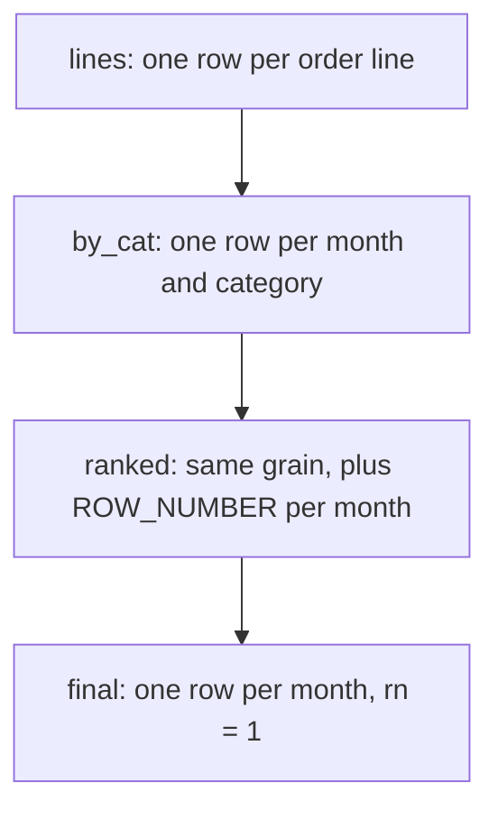

# Capstone: marketplace performance review

This is the module that looks like the job: a question with no scaffold, several valid structures, and a result that must be correct at a specific grain. There is no new syntax to learn: the capstone composes joins, CTEs, window functions and business judgement into one answer. The aim is not the shortest query but the one whose every stage you can defend.

## Start from the question, not the SQL

Open-ended questions arrive as sentences, not schemas. The first move is to restate the question in your own words and write down the grain of the final row: what does one result row mean? Which tables to join and which filter to apply first all follow from that single decision.

The capstone question is: for each month, the top category by net revenue from completed orders, and the number of distinct customers who bought in it. The grain is one row per month, so the final result should have exactly as many rows as there are months with qualifying sales: five, January to May 2026.

Restating also exposes the decisions hidden in plain words. "Net revenue" means `quantity * unit_price` summed, not a product's list price. "Bought in it" means distinct customers, not order lines. "Completed orders" is a filter that must apply before any aggregation.

## One CTE, one fact

The discipline of a CTE chain is that each stage computes one fact and can be described in a sentence. If the sentence needs an "and", it is two stages. A reader should be able to read the CTE names in order and reconstruct the plan before reading a line of SQL.

The chain has four natural links. `lines` holds one row per order line, with revenue already multiplied out. `by_cat` collapses that to one row per month and category, with summed revenue and distinct buyers. `ranked` adds a row number within each month. The final `SELECT` keeps `rn = 1`, restoring one row per month.



Putting the status filter in `lines`, the earliest stage, keeps "completed only" in one place and shrinks every later stage. Filtering late would be correct here only by luck; a later change could silently reintroduce cancelled rows.

## The shapes you reuse

Each link is a pattern from an earlier module. Joins walk from `orders` to its `order_items` and then to each line's product, so the category is available at line grain. Aggregates collapse that grain: `SUM(quantity * unit_price)` for revenue and `COUNT(DISTINCT customer_id)` for buyers.

A window function then ranks the aggregate without changing its grain: `ROW_NUMBER() OVER (PARTITION BY month ORDER BY net_revenue DESC, category)`. The final filter keeps one row per month. Every piece is familiar; the capstone is the act of composing them in an order that never breaks the grain.

## Ranking deterministically

`ROW_NUMBER()` needs a total order to be reproducible. Ordering by revenue alone leaves ties broken arbitrarily, so two runs could disagree. Adding the category as a second sort key makes it deterministic: `net_revenue DESC, category` puts the larger revenue first and settles ties alphabetically.

Use `ROW_NUMBER()` rather than `RANK()` or `DENSE_RANK()` precisely because you want exactly one survivor per month. Keep the window in a CTE and filter `rn = 1` outside it: you cannot filter on a window function in the same `SELECT` that defines it, so the extra stage is not optional.

```sql
WITH ranked AS (
    SELECT month, category, net_revenue,
           ROW_NUMBER() OVER (
               PARTITION BY month
               ORDER BY net_revenue DESC, category
           ) AS rn
    FROM by_cat
)
SELECT month, category, net_revenue
FROM ranked
WHERE rn = 1;
```

## Worked example: the aggregation stage

The interesting stage is `by_cat`, the one row per month and category that everything downstream depends on.

```sql
WITH lines AS (
    SELECT DATE_TRUNC('month', o.ordered_at)::date AS month,
           p.category,
           o.customer_id,
           oi.quantity * oi.unit_price AS revenue
    FROM orders o
    JOIN order_items oi ON oi.order_id = o.id
    JOIN products p ON p.id = oi.product_id
    WHERE o.status = 'completed'
)
SELECT month, category,
       SUM(revenue) AS net_revenue,
       COUNT(DISTINCT customer_id) AS buyers
FROM lines
GROUP BY month, category;
```

For the first month, this stage returns four rows:

| month | category | net_revenue | buyers |
| --- | --- | --- | --- |
| 2026-01-01 | Outdoor | 824.40 | 4 |
| 2026-01-01 | Electronics | 717.55 | 3 |
| 2026-01-01 | Home | 518.60 | 5 |
| 2026-01-01 | Kitchen | 72.00 | 2 |

Ranked within January, Outdoor wins at 824.40 with four distinct buyers. Checking one month by hand before trusting the ranking on top of it is the habit the capstone rewards.

## Reviewing your own query

Three checks catch almost every capstone error. Does the row count equal the number of months the question expects, which is five here, with each month appearing once? Do the revenue magnitudes look plausible next to the number of buyers? Does the top category move between months in a way the data supports? In this dataset it does: Outdoor leads in January and May, Electronics from February to April.

Then reread the query for grain errors, the most common capstone mistake. A join placed after an aggregation multiplies rows; a distinct count taken before the status filter includes cancelled buyers; a missing tie-break makes the answer non-reproducible. Each is cheap to catch once you inspect the row count of every CTE.

## Check yourself

**1. Why is the grain named before the query is written?**

<details>
<summary>Answer</summary>

Because the grain of the final row determines every earlier decision: which tables to join, what to group by, and whether a later join is safe. Here it also predicts the row count, five months, which is the first check on the answer.

</details>

**2. Why put the `status = 'completed'` filter in the first CTE?**

<details>
<summary>Answer</summary>

Because it is a property of the order, which exists at line grain, and stating it once keeps the business rule in one place. Filtering early also shrinks every later stage instead of carrying cancelled rows through them.

</details>

**3. What breaks without the `category` tie-break in the window order?**

<details>
<summary>Answer</summary>

Reproducibility. Two categories tied on revenue would have their order decided arbitrarily, so `rn = 1` could return different rows on different runs. The tie-break commits to one of them.

</details>
