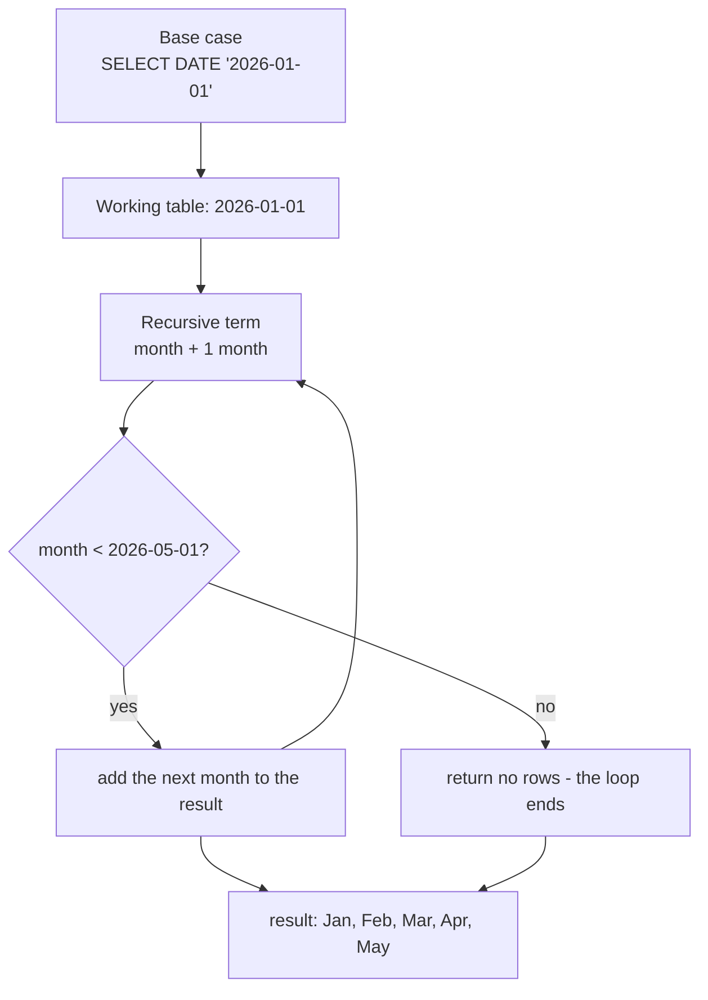

# Recursive CTEs: build the rows you are missing

You chart completed orders per month and the line stops at May. June has no completed orders, so `GROUP BY` reports nothing and the chart has a hole where a zero belongs. A month with no orders and a month that was never reported look different to a reader, even when they mean the same thing. A recursive CTE builds the missing month, and one wrong clause puts the hole back.

Most SQL reads rows that already exist. A recursive CTE builds rows that do not exist yet: you give it one starting row, and a rule that produces the next row from the last. That rule is enough to fill the missing month, and it is the same rule that walks a hierarchy.

## The working table: base case and recursive term

A recursive CTE is written like any other CTE, with the keyword `RECURSIVE` and two `SELECT`s joined by `UNION ALL`.

The first `SELECT` is the base case. It runs once and produces the starting rows. The second is the recursive term. It reads the working table, which holds the rows the previous pass produced, and emits the next rows. The engine repeats that step until the recursive term returns nothing.

```sql
WITH RECURSIVE series(month) AS (
    SELECT DATE '2026-01-01'
    UNION ALL
    SELECT (month + INTERVAL '1 month')::date
    FROM series
    WHERE month < DATE '2026-05-01'
)
SELECT TO_CHAR(month, 'YYYY-MM') AS month
FROM series
ORDER BY month;
```

| month |
| --- |
| 2026-01 |
| 2026-02 |
| 2026-03 |
| 2026-04 |
| 2026-05 |

The name `series(month)` declares the CTE and the single column it carries. The base case seeds that column with one date. The recursive term reads `series`, adds one month, and casts back to a date.

The engine never runs the recursive term against the whole accumulated result. It runs it against the working table, the rows added by the last pass. That is why the term can refer to `series` and still terminate: each pass sees only the newest row, not the growing pile.

The shape is small, and its quietest failure is a series that stops one month early: a tidy table that is missing the month you needed.

## The stop condition is a `WHERE` you write

The `WHERE` inside the recursive term is the stop condition. On each pass the term filters the working table, and when the filter keeps nothing, the term produces no rows and the loop ends.



Leave that `WHERE` out and the loop never stops on its own. PostgreSQL keeps running the recursive term until it returns nothing, so a missing stop condition leaves a query that runs until you cancel it. A recursive CTE that hangs is almost always missing a bound, not short of one.

Use `UNION ALL`, not `UNION`. The stop condition already ends the loop, so asking the engine to de-duplicate every pass is wasted work. `UNION` would also silently drop a step that legitimately revisits a value, which is how a recursive query over a graph loses rows without an error.

## Walk the query: the month spine

Take the series query one pass at a time. The base case runs first, and the working table starts as that one row.

| pass | working table | recursive term produces | result so far |
| --- | --- | --- | --- |
| base | none | 2026-01-01 | 2026-01 |
| 1 | 2026-01-01 | 2026-02-01 | Jan, Feb |
| 2 | 2026-02-01 | 2026-03-01 | Jan to Mar |
| 3 | 2026-03-01 | 2026-04-01 | Jan to Apr |
| 4 | 2026-04-01 | 2026-05-01 | Jan to May |
| 5 | 2026-05-01 | none | Jan to May |

Pass 5 is the interesting one. The working table holds 2026-05-01, and the term tests `2026-05-01 < 2026-05-01`. That is false, so the pass produces no rows and the recursion stops.

The result keeps every row added so far, which is the five months you saw.

Change the stop date and the spine grows. The exercise that follows uses `WHERE month < DATE '2026-06-01'`, which adds June and gives six months.

`TO_CHAR(month, 'YYYY-MM')` is a formatting step, not part of the recursion. It turns each date into the short string a report wants.

## Join the spine back to the orders

A spine on its own is a list of months. The value comes from joining it to the data, so a month with no orders still appears.

```sql
WITH RECURSIVE months(month) AS (
    SELECT DATE '2026-01-01'
    UNION ALL
    SELECT (month + INTERVAL '1 month')::date
    FROM months
    WHERE month < DATE '2026-06-01'
)
SELECT TO_CHAR(m.month, 'YYYY-MM') AS month,
       COUNT(o.id) AS completed
FROM months m
LEFT JOIN orders o
       ON DATE_TRUNC('month', o.ordered_at)::date = m.month
      AND o.status = 'completed'
GROUP BY m.month
ORDER BY m.month;
```

| month | completed |
| --- | --- |
| 2026-01 | 8 |
| 2026-02 | 8 |
| 2026-03 | 9 |
| 2026-04 | 7 |
| 2026-05 | 5 |
| 2026-06 | 0 |

The `LEFT JOIN` keeps every row of `months`, the left table, whether or not a matching order exists. A month with matches repeats one row per order. A month with none keeps one row with `NULL` in every `orders` column.

The `ON` clause holds two conditions. The first matches the order's month to the spine's month. The second keeps completed orders only, and it sits in `ON` rather than `WHERE` for a specific reason: June has no matching order, so the join pads its columns with `NULL`, and `NULL = 'completed'` is never true.

In `WHERE` that predicate would delete the padded June row and turn the left join back into an inner join.

`COUNT(o.id)` counts a non-null value, so June's single padded row counts zero. Counting `*` would count the row itself and report one.

Try this: change `LEFT JOIN orders o` to `JOIN orders o` and rerun. June disappears and the other five rows do not move, because the spine only survives where a matching order exists. The left join is what makes the spine earn its keep.

## The two mistakes that break the join

The status filter is the first mistake. Move it from `ON` to `WHERE` in the same query, keeping the `months` CTE, and June disappears.

```sql
SELECT TO_CHAR(m.month, 'YYYY-MM') AS month,
       COUNT(o.id) AS completed
FROM months m
LEFT JOIN orders o
       ON DATE_TRUNC('month', o.ordered_at)::date = m.month
WHERE o.status = 'completed'
GROUP BY m.month
ORDER BY m.month;
```

| month | completed |
| --- | --- |
| 2026-01 | 8 |
| 2026-02 | 8 |
| 2026-03 | 9 |
| 2026-04 | 7 |
| 2026-05 | 5 |

Five rows, and the missing month is the one the spine existed for. The predicate tested `NULL = 'completed'` on the padded row, which is neither true nor false, so the row was dropped. This is the same `NULL` rule that makes `WHERE city = 'Leeds'` skip customers with no city.

The count is the second mistake. Put the filter back in `ON` and count `*` instead of `o.id`, with the `months` CTE unchanged.

```sql
SELECT TO_CHAR(m.month, 'YYYY-MM') AS month,
       COUNT(*) AS completed
FROM months m
LEFT JOIN orders o
       ON DATE_TRUNC('month', o.ordered_at)::date = m.month
      AND o.status = 'completed'
GROUP BY m.month
ORDER BY m.month;
```

| month | completed |
| --- | --- |
| 2026-01 | 8 |
| 2026-02 | 8 |
| 2026-03 | 9 |
| 2026-04 | 7 |
| 2026-05 | 5 |
| 2026-06 | 1 |

June now claims one completed order. There is no such order. `COUNT(*)` counts rows, and the left join invented a row to hold the missing month. `COUNT(o.id)` ignores it because `o.id` is `NULL` there.

An aggregate ignores `NULL`, which is what turns a gap into a zero.

## The same shape walks a tree

Generating a series is one use of recursion. The other is a hierarchy, where a table points at itself through a parent column and each pass climbs one level.

The commerce fixture has no such table, so this example builds a two-level tree from `products`: a category is the root, and its products hang below it.

```sql
WITH RECURSIVE tree(id, name, parent_id, depth) AS (
    SELECT 0 AS id, 'Electronics' AS name, NULL::integer AS parent_id, 0 AS depth
    UNION ALL
    SELECT p.id, p.name, 0, t.depth + 1
    FROM tree t
    JOIN products p ON p.category = t.name
)
SELECT depth, name FROM tree ORDER BY depth, name;
```

| depth | name |
| --- | --- |
| 0 | Electronics |
| 1 | Aurora Wireless Earbuds |
| 1 | Nimbus Headphones |
| 1 | Noise-Cancel Earmuffs |
| 1 | Pulse Fitness Tracker |
| 1 | Vertex Mechanical Keyboard |

The base case seeds one root. The recursive term joins the working rows to their children, using the parent's name as the match.

The first pass produces the five Electronics products. The second pass tests each of those product names as a category, finds no match, and returns nothing, so the loop ends.

The stop condition here is implicit in the join: when a node has no children, no row is produced. Seed the base case with `SELECT DISTINCT category FROM products` instead of the literal, and the same query walks all four categories and returns 24 rows.

A real hierarchy works the same way, with the parent column in the join. An `employees` table with a `manager_id` seeds the rows whose manager is `NULL` and joins each pass on `e.manager_id = o.id`. Swap the join direction and the recursion walks up from a leaf instead.

## Recap

**What I would do:** build the spine first, join the data to it with `LEFT JOIN`, and put every filter on the data inside `ON`. Count a column from the joined table, not rows, so a padded month reads zero. Check that the result holds one row per month of the spine before you read any number in it.

- A recursive CTE has a base case and a recursive term, joined by `UNION ALL`.
- The recursive term reads the working table, the rows from the previous pass, not the whole result.
- The stop condition is the `WHERE` inside the recursive term. Without it the term keeps producing rows and the query does not stop.
- A month spine joined to the data with `LEFT JOIN` turns a missing month into a row of zero.
- The status filter belongs in `ON`, because the padded row's `NULL` fails a `WHERE` comparison and deletes the month.
- `COUNT(o.id)` counts non-null values, so an empty month counts zero where `COUNT(*)` counts one.

## Check yourself

**1. What are the two parts of a recursive CTE, and how are they joined?**

<details>
<summary>Answer</summary>

A base case and a recursive term, joined by `UNION ALL`. The base case runs once and seeds the working table; the recursive term runs repeatedly until it produces no rows.

</details>

**2. Why does the recursive term need a stop condition?**

<details>
<summary>Answer</summary>

The loop continues while the recursive term returns rows. A condition such as `WHERE month < DATE '2026-06-01'` eventually filters the working table down to nothing and ends the loop. Without one, the term keeps producing rows and the query never finishes.

</details>

**3. Why must the completed-order filter sit in the `ON` clause of the left join?**

<details>
<summary>Answer</summary>

Because a month with no match is padded with `NULL`, and `NULL = 'completed'` is never true. In `WHERE` that predicate deletes the padded rows, June among them, and turns the left join back into an inner join. In `ON` it only restricts which orders count as matches.

</details>

**4. Why does `COUNT(o.id)` report 0 for June when `COUNT(*)` reports 1?**

<details>
<summary>Answer</summary>

The left join gives June one padded row with `NULL` in every `orders` column. `COUNT(o.id)` ignores that `NULL`, so the count is zero. `COUNT(*)` counts rows, and the padded row is a row, so it reports one.

</details>
