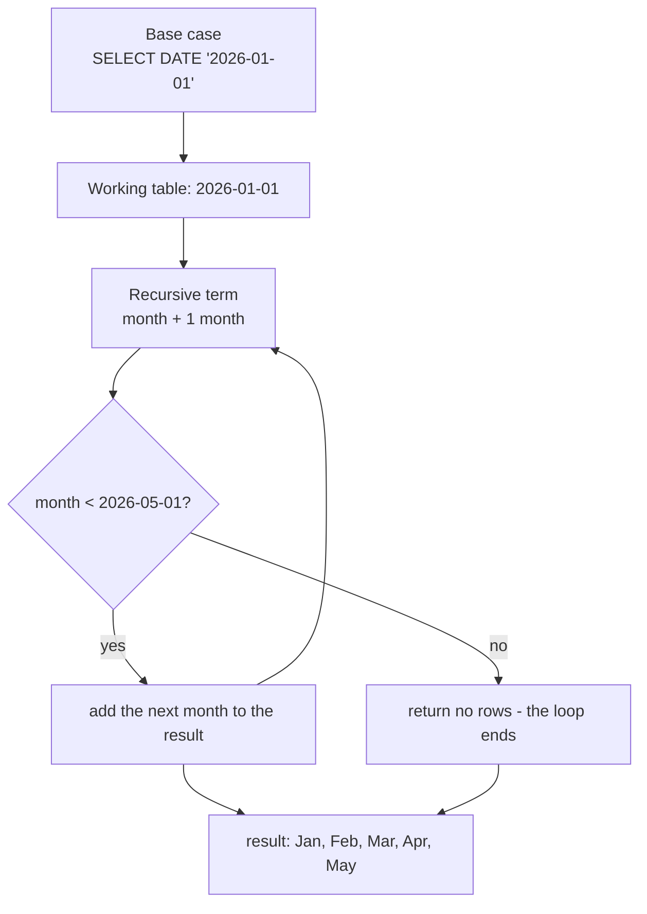

# Recursive CTEs: build the rows you are missing

Most SQL starts from rows that exist. A recursive CTE starts from a single row and builds the rest. That is exactly what a gap-fill needs: the report wants a line for every month, but the data only has rows for the months in which something happened.

## The two halves of `WITH RECURSIVE`

A recursive CTE is written like any other CTE, with the keyword `RECURSIVE` and two `SELECT`s joined by `UNION ALL`. The first selects the starting row — the base case. The second is the recursive term: it reads the rows the previous pass added, produces the next ones, and is re-run until it returns nothing.

```sql
WITH RECURSIVE series(month) AS (
    SELECT DATE '2026-01-01'
    UNION ALL
    SELECT (month + INTERVAL '1 month')::date
    FROM series
    WHERE month < DATE '2026-05-01'
)
SELECT TO_CHAR(month, 'YYYY-MM') AS month
FROM series
ORDER BY month;
```

## Termination is a condition you write

The `WHERE` inside the recursive term is the stop condition. Without it the loop never ends, so a recursive CTE that will not stop almost always has a missing or wrong-bound `WHERE`. The engine also caps the number of iterations, which protects you from a runaway query but is a symptom, not the fix.



Use `UNION ALL`, not `UNION`. The stop condition ends the loop; asking the engine to de-duplicate every pass as well is wasted work, and a recursive step that legitimately revisits a value would be silently dropped.

## The payoff: a complete timeline

`GROUP BY` can only report months that exist in the data. If a month has no orders, no row comes back, and a chart drawn from the result has a hole in it. A series supplies every month, and a `LEFT JOIN` carries the missing ones through with a count of zero.

```sql
WITH RECURSIVE months(month) AS (
    SELECT DATE '2026-01-01'
    UNION ALL
    SELECT (month + INTERVAL '1 month')::date
    FROM months
    WHERE month < DATE '2026-06-01'
)
SELECT TO_CHAR(m.month, 'YYYY-MM') AS month,
       COUNT(o.id) AS completed
FROM months m
LEFT JOIN orders o
       ON DATE_TRUNC('month', o.ordered_at)::date = m.month
      AND o.status = 'completed'
GROUP BY m.month
ORDER BY m.month;
```

| month | completed |
| --- | --- |
| 2026-01 | 8 |
| 2026-02 | 8 |
| 2026-03 | 9 |
| 2026-04 | 7 |
| 2026-05 | 5 |
| 2026-06 | 0 |

Two details carry the whole pattern. The status filter lives in the `ON` clause: in `WHERE` it would compare against a padded `NULL` for June and delete the very row the left join was kept for. And the count names `o.id`, not `*`, so an empty month counts zero rather than one.

## The same shape walks a tree

Series generation is one use; the other is a hierarchy, where a table points at itself through a parent column. Each pass climbs one level. The recursive term joins the working rows to their children and stops when a node has none.

```sql
WITH RECURSIVE org(id, name, manager_id, depth) AS (
    SELECT id, name, manager_id, 0
    FROM employees
    WHERE manager_id IS NULL
    UNION ALL
    SELECT e.id, e.name, e.manager_id, o.depth + 1
    FROM employees e
    JOIN org o ON e.manager_id = o.id
)
SELECT name, depth FROM org ORDER BY depth, name;
```

The base case asks for the roots; the recursive term attaches each child to the parent already found. Swap the join direction and the recursion walks up from a leaf instead. Either way, the stop condition is implicit in the join: when no child matches, no row is produced and the loop ends.

## Check yourself

**1. What are the two parts of a recursive CTE, and how are they joined?**

<details>
<summary>Answer</summary>

A base case and a recursive term, joined by `UNION ALL`. The base case runs once; the recursive term runs repeatedly until it produces no more rows.

</details>

**2. Why does the recursive term need a stop condition?**

<details>
<summary>Answer</summary>

The loop continues as long as the recursive term returns rows. A condition such as `WHERE month < DATE '2026-06-01'` eventually filters everything out and ends it; without one the query does not terminate on its own.

</details>

**3. Why must the completed-order filter sit in the `ON` clause of the left join?**

<details>
<summary>Answer</summary>

Because months with no match are padded with `NULL`, and `NULL = 'completed'` is never true. In `WHERE` that predicate would delete the padded rows — including June — and turn the left join back into an inner join. In `ON` it only restricts which orders match.

</details>
