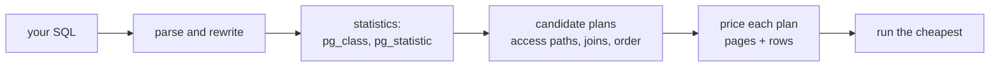

# The planner's job

Your support console needs two numbers: how many orders shipped, and how many were refunded. The two statements behind them differ by one string, and PostgreSQL runs them by different routes. One reads all 10 000 rows of `orders`. The other reads a thin slice of one index. Both statements look the same on screen.

```sql
SELECT count(*) FROM orders WHERE status = 'shipped';   -- 9 000
SELECT count(*) FROM orders WHERE status = 'refunded';  -- 50
```

The second statement answers with 50 rows and the first with 9 000, so the second should be the cheap one. It is. What surprises people is the route: a `Seq Scan` for one count, an index for the other. You gave neither instruction. PostgreSQL's planner chose both, and this module is about the arithmetic behind that choice.

## One column, two plans

`EXPLAIN` prints the procedure instead of running it. Put it in front of each count:

```sql
EXPLAIN SELECT count(*) FROM orders WHERE status = 'shipped';
EXPLAIN SELECT count(*) FROM orders WHERE status = 'refunded';
```

The first plan reads a table:

```text
Aggregate  (cost=2647.50..2647.51 rows=1 width=8)
  ->  Seq Scan on orders  (cost=0.00..2625.00 rows=9000 width=0)
        Filter: (status = 'shipped'::text)
```

The second plan reads an index:

```text
Aggregate  (cost=166.44..166.45 rows=1 width=8)
  ->  Index Only Scan using orders_status_idx on orders  (cost=0.29..166.31 rows=50 width=0)
        Index Cond: (status = 'refunded'::text)
```

Read the middle line of each. `Seq Scan` walks the relation page by page. The `Filter` line says where the status test happened: after each row came off a page. It ran on 10 000 rows, and 1 000 of them failed.

`Index Only Scan` descends `orders_status_idx` for the value, and `Index Cond` says the test happened inside the index itself. Module 2 takes those two words apart.

Nine thousand matching rows sit on nearly every page, which leaves an index route visiting most of the pages anyway, many of them out of order. Fifty matching rows need a few index pages and little else. Guess wrong in either direction and the console pays for it. A scan of 2 500 pages to find 50 rows, or an index walk that touches nearly every page to find 9 000.

## SQL says what, the planner says how

A `SELECT` is a declaration. It names the rows you want and the shape of the answer. It does not name a route.

For each statement the planner settles four questions:

- the order the relations are read in.
- the access path for each one: whole relation, index, or bitmap.
- the join algorithm, when it joins.
- whether a sort has to happen.

None of that appears in your SQL, and none of it is fixed. Take a report from the next module, the orders belonging to customer 7:

```sql
EXPLAIN
SELECT o.id, o.ordered_at, oi.product_id, oi.quantity
FROM orders o
JOIN order_items oi ON oi.order_id = o.id
WHERE o.customer_id = 7;
```

The plan opens with a `Hash Join`. One side hashes the 184 orders that belong to customer 7. The other reads all 20 000 order lines and probes that hash.

You might have guessed a nested loop that looks up each order's lines in turn, and the planner can build that too. It prices both and keeps the cheaper one. Run the same statement against a smaller `orders` and the plan changes, with no edit to the SQL: below a certain size every route costs about the same.

## The cost model is pages plus rows

The planner does not run anything to choose a plan. It prices candidate plans with a small set of unit costs and keeps the cheapest. The units are not seconds; they are page reads and row touches:

| Setting | Default | What it charges for |
| --- | --- | --- |
| `seq_page_cost` | 1.0 | one page read in physical order |
| `random_page_cost` | 4.0 | one page read out of order |
| `cpu_tuple_cost` | 0.01 | each row a node passes upward |
| `cpu_index_tuple_cost` | 0.005 | each index entry it examines |
| `cpu_operator_cost` | 0.0025 | each test a filter applies to a row |

Now price the sequential scan above by hand. `pg_class` records 2 500 pages and 10 000 rows for `orders`, so the three charges are:

- 2 500 pages at 1.0 each, which is 2 500.
- 10 000 rows at 0.01 each, which is 100.
- 10 000 tests at 0.0025 each, which is 25.

Together that is 2 625, and the plan line reads `cost=0.00..2625.00`. The arithmetic and the plan agree. The index path totals 166.31, roughly a sixteenth of that, and the planner keeps the cheaper total.

The two numbers in `cost=start..total` are startup cost and total cost. Startup is the price of the first row out of the node.

A `Sort` reads everything before it emits anything, so its startup is nearly its total. An `Index Scan` starts almost immediately, so its startup is small.

A total of 2 625 is not 2 625 milliseconds. Costs compare only inside one plan, on one server, under one set of settings. Within that scope, cheaper really does mean less work.

That is also why this course never grades a duration. A duration moves with the machine and the cache, while the shape of a plan is reproducible on a pinned fixture.

## Where the estimates come from

`rows=` in a plan is a belief, computed from statistics that `ANALYZE` maintains:

- `pg_class` knows how many pages a relation occupies and about how many rows it holds.
- `pg_statistic`, readable through `pg_stats`, knows per column how many distinct values exist (`n_distinct`). It also holds the most common values with their frequencies (the MCV list) and the spread of the rest (a histogram).
- The planner applies the predicate to those numbers. `status = 'refunded'` costs rows times the recorded frequency of `refunded`, and a range predicate walks the histogram.

Nothing about that is hidden. Ask what the planner believes about `status`:

```sql
SELECT most_common_vals::text, most_common_freqs::text
FROM pg_stats
WHERE tablename = 'orders' AND attname = 'status';
```

| most_common_vals | most_common_freqs |
| --- | --- |
| `{shipped,completed,cancelled,pending,refunded}` | `{0.9,0.04,0.03,0.025,0.005}` |

Ten thousand rows times 0.9 gives 9 000. Ten thousand times 0.005 gives 50. Those are exactly the `rows=` figures in the two plans you just read. A column with ten thousand distinct values gets no such treatment: rare values collapse into a histogram bucket and the estimate becomes a guess.

Try this: drop the `::text` casts from that query and run it again. The values are the same five names and the same five frequencies, printed as arrays rather than text. The estimate does not care how you print it.



## Why 80 rows teaches nothing about plans

The small lesson fixture holds 30 customers, 20 products, 80 orders and 160 order items. At that size every plan is correct and every plan is boring:

| Relation | Small fixture | Perf fixture | Pages at perf size |
| --- | --- | --- | --- |
| `customers` | 30 | 2 000 | 20 |
| `products` | 20 | 500 | 5 |
| `orders` | 80 | 10 000 | 2 500 |
| `order_items` | 160 | 20 000 | 128 |

Eighty rows of `orders` fit on one data page. An index scan pays a descent plus a heap fetch to reach the same page a sequential scan already holds. The planner ignores the index, and it is right to.

The perf `orders` carries the columns a real order carries: a carrier, a tracking code, two addresses and a handling note. Those columns push it to 2 500 pages, the number in the arithmetic above. At that size the same query forks: read 2 500 pages in order, or descend an index and fetch only the pages holding matching rows. Now the answer depends on how many rows match, and you can influence that.

## The fixture you are tuning against

This course runs on the perf fixture. The first plan lesson is knowing its size:

```sql
SELECT (SELECT COUNT(*) FROM customers)   AS customers,
       (SELECT COUNT(*) FROM products)    AS products,
       (SELECT COUNT(*) FROM orders)      AS orders,
       (SELECT COUNT(*) FROM order_items) AS order_items;
```

| customers | products | orders | order_items |
| --- | --- | --- | --- |
| 2000 | 500 | 10000 | 20000 |

Two properties are there on purpose:

- `status` is skewed. One value covers about 90% of the 10 000 orders and another about 0.5%. The same index is right for one value and a waste of time for the other.
- `customer_id` is skewed too. A few customers place hundreds of orders each and most place a few, so "orders for one customer" ranges from one index lookup to a real slice of the table.

The fixture is generated from fixed arithmetic rather than random values, so those totals come back on every machine. A plan that only works on your machine would not be an answer. The exercise turns the same four numbers into a result you design: one row per relation, largest table first.

## What the planner cannot see

The planner has never seen your table. It believes a histogram sampled from it, and a histogram loses information. It flattens correlation between columns, rounds away rare values, and cannot know that `status` and `ordered_at` move together in your data. It has no idea how much of the table is cached, or what else is running.

The next few modules take those blind spots apart: how to read the belief, when it is wrong, and how to help the planner compute a better answer.

## Check yourself

**1. The shipped count and the refunded count share a table, a column and an operator. Why do they get different access paths?**

<details>
<summary>Answer</summary>

The predicate matches a different fraction of the table. Nine thousand of 10 000 rows sit on nearly every page, so an index route visits most pages anyway, as random reads. Fifty rows need a few index pages.

</details>

**2. A `Seq Scan` line reads `cost=0.00..2625.00`. Where does 2 625 come from?**

<details>
<summary>Answer</summary>

2 500 pages at `seq_page_cost` 1.0, plus 10 000 rows at `cpu_tuple_cost` 0.01, plus 10 000 filter tests at `cpu_operator_cost` 0.0025. The units are page reads and row touches, so the total is not milliseconds. It compares only with another plan for the same statement on the same server.

</details>

**3. The plan estimates 9 000 rows for `status = 'shipped'` and returns 9 000. How did it know?**

<details>
<summary>Answer</summary>

The most-common-value list in `pg_stats` records `shipped` at a frequency of 0.9, and `pg_class` records 10 000 rows for `orders`. Nine thousand is that product. All five status values fit in the list, so the figure is recorded rather than extrapolated.

</details>

**4. You add a thousand rows to `orders` between two runs and the plan changes shape. Which input to the planner changed?**

<details>
<summary>Answer</summary>

The statistics, not the SQL. Row counts, page counts, the most-common-value list and the histogram are the planner's whole view of the data. Enough new rows move those numbers and a different candidate plan becomes the cheapest. That is why `ANALYZE` follows a bulk load.

</details>

## What to remember

**What I would do:** price the node that does the work before you add an index. Check `rows=` first, because the access path follows from it and stale statistics make it wrong. When the estimate and the result disagree, run `ANALYZE` before you touch the SQL.

- `SELECT` declares the result; the planner chooses access paths, join order, join algorithms and sorting.
- Cost is measured in page reads and row touches, not milliseconds, so compare costs inside one plan and never across machines.
- A node's price follows from its page count and row count: 2 500 pages plus 10 000 rows explains a total of 2 625.
- `rows=` is an estimate drawn from `pg_statistic`, and `pg_stats` shows the same numbers the planner used.
- At 80 rows every plan is trivially correct; the perf fixture exists so that reading plans teaches something.
- The perf fixture is pinned: 2 000 customers, 500 products, 10 000 orders, 20 000 order items, with a 90% / 0.5% split in `status`.
- The planner's visibility is exactly its statistics, so coarse or stale statistics produce confident wrong plans.
