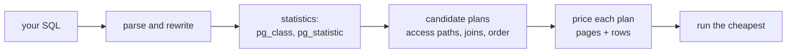

# The planner's job

You write what you want; PostgreSQL decides how to get it. That decision is what `EXPLAIN` prints, and it is not magic — it is arithmetic over statistics the database keeps about its own tables. This module is about the arithmetic, because every later lesson in this course is a consequence of it.

## SQL says what, the planner says how

A `SELECT` is a declaration. It names the rows you want back and the shape of the answer. It says nothing about which relation to read first, whether to walk an index or the whole table, which algorithm joins two relations, or whether a sort happens at all.

Those are the planner's decisions, made per statement, per dataset, per statistics snapshot. `EXPLAIN` is how you get them out of the server:

```sql
EXPLAIN (ANALYZE, BUFFERS)
SELECT o.id, o.ordered_at, oi.product_id, oi.quantity
FROM orders o
JOIN order_items oi ON oi.order_id = o.id
WHERE o.customer_id = 7;
```

The same statement, run against a different-sized `orders`, produces a different plan — with no change to the SQL. That is the whole reason this course uses a larger dataset.

## The cost model is pages plus rows

The planner does not run anything to choose a plan. It prices candidate plans with a small set of unit costs and keeps the cheapest. The units are not seconds; they are page reads and row touches:

| Setting | Default | What it charges for |
| --- | --- | --- |
| `seq_page_cost` | 1.0 | one page read in physical order |
| `random_page_cost` | 4.0 | one page read out of order |
| `cpu_tuple_cost` | 0.01 | each row a node passes upward |
| `cpu_index_tuple_cost` | 0.005 | each index entry it examines |

So `cost=0.29..186.11` on a node reads as *startup..total* cost, in units of "roughly this many page reads plus row touches". A total of 186 is not 186 ms. Costs are only comparable inside one plan, on one server, under one set of settings — but within that scope, cheaper really does mean less work, and that is what makes them useful.

That is also why this course never grades a duration. A duration moves with the machine, the cache and the time of day; the plan's structure — which relation was read, by which path, in which order — is reproducible on a pinned fixture.

## Where the estimates come from

`rows=` in a plan is a belief, computed from statistics that `ANALYZE` maintains:

- `pg_class` knows how many pages a relation occupies and roughly how many rows it holds.
- `pg_statistic` (readable through `pg_stats`) knows, per column, how many distinct values there are (`n_distinct`), the most common values and their frequencies (the MCV list), and the spread of the rest (a histogram).
- The planner combines those with the predicate it was handed. `status = 'refunded'` costs "rows × the frequency of `refunded`"; a range predicate walks the histogram.

Nothing about that is hidden. `SELECT * FROM pg_stats WHERE tablename = 'orders' AND attname = 'status'` shows exactly what the planner believes, most-common-value list and all.



## Why 80 rows teaches nothing about plans

The small lesson fixture holds 30 customers, 20 products, 80 orders and 160 order items. At that size every plan is correct and every plan is boring:

| Relation | Small fixture | Perf fixture | Pages at perf size |
| --- | --- | --- | --- |
| `customers` | 30 | 2 000 | ~15 |
| `products` | 20 | 500 | ~6 |
| `orders` | 80 | 10 000 | ~90 |
| `order_items` | 160 | 20 000 | ~180 |

The whole of `orders` at 80 rows is one or two pages. An index scan there would pay a descent plus a random page read to fetch the same single page a sequential scan already holds, so the planner correctly ignores the index, and the choice teaches nothing. At 10 000 rows the same query has a genuine fork: about 90 pages read sequentially, or a handful of index pages plus only the heap pages that hold matching rows. Now the answer depends on how many rows match — and that is a decision you can influence.

## The fixture you are tuning against

This course runs on the perf fixture, and the first plan lesson is knowing its size:

```sql
SELECT (SELECT COUNT(*) FROM customers)   AS customers,
       (SELECT COUNT(*) FROM products)    AS products,
       (SELECT COUNT(*) FROM orders)      AS orders,
       (SELECT COUNT(*) FROM order_items) AS order_items;
```

| customers | products | orders | order_items |
| --- | --- | --- | --- |
| 2000 | 500 | 10000 | 20000 |

Two properties of that fixture are there on purpose, and every access-path lesson leans on them:

- `status` is skewed. One value covers about 90% of the 10 000 orders and another about 0.5%, so the same index is right for one value and a waste of time for the other.
- `customer_id` is skewed too. A handful of customers place hundreds of orders each, and most place a few, so "orders for one customer" ranges from a single index lookup to a meaningful slice of the table.

The fixture is generated deterministically from a fixed seed, so the numbers above are the same on every machine. A plan that only works on your machine would not be an answer.

## What the planner cannot see

The planner has never seen your table. It believes a histogram sampled from it, and a histogram loses information: it flattens correlation between columns, rounds away rare values, and cannot know that `status` and `ordered_at` move together in your data. It also has no idea how much of the table is cached, what else is running, or that your application only ever asks about one customer.

Those blind spots are the subject of the next few modules: how to read the belief, when the belief is wrong, and what to change so the planner can compute a better answer.

## What to remember

- `SELECT` declares the result; the planner chooses access paths, join order, join algorithms and sorting.
- Cost is measured in page reads and row touches, not milliseconds; compare costs inside one plan, never across machines.
- `rows=` is an estimate drawn from `pg_statistic`, and `pg_stats` shows the same numbers the planner used.
- At 80 rows every plan is trivially correct; the perf fixture exists so that reading plans teaches something.
- The perf fixture is pinned: 2 000 customers, 500 products, 10 000 orders, 20 000 order items, with a 90% / 0.5% split in `status`.
- The planner's visibility is exactly its statistics — coarse or stale statistics produce confident wrong plans.
