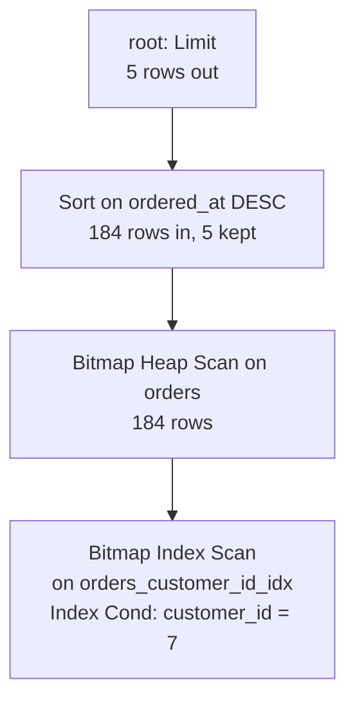

# Reading EXPLAIN

A plan reads 231 rows to return five. Nothing is broken: `orders_pkey` supplied the order the `LIMIT` wanted, and the filter threw the other 226 rows away. A plan is the engine's account of that work, printed as arrows, costs, row counts and two-word labels. This module turns that text into a sentence, such as "this node walked 231 rows to return five".

## A plan is a tree, not a list

Start with a statement you can hold in your head, the five newest orders for customer 7:

```sql
EXPLAIN
SELECT id, ordered_at, status
FROM orders
WHERE customer_id = 7
ORDER BY ordered_at DESC
LIMIT 5;
```

```text
Limit  (cost=580.58..580.59 rows=5 width=20)
  ->  Sort  (cost=580.58..581.04 rows=184 width=20)
        Sort Key: ordered_at DESC
        ->  Bitmap Heap Scan on orders  (cost=5.71..577.52 rows=184 width=20)
              Recheck Cond: (customer_id = 7)
              ->  Bitmap Index Scan on orders_customer_id_idx  (cost=0.00..5.67 rows=184 width=0)
                    Index Cond: (customer_id = 7)
```

Read it from the bottom up. The deepest node, `Bitmap Index Scan`, walks `orders_customer_id_idx` and records where the matching rows live.

`Bitmap Heap Scan` reads those pages and tests `customer_id = 7` again on every row, because a bitmap of locations can be lossy. `Sort` puts the rows in `ordered_at` order, newest first. `Limit` takes five and stops asking.

The indentation is depth, not execution order. Each `->` marks a child of the node above it. A node starts when its parent asks it for the next row. That is why a node deep in the tree can run a hundred times while its parent runs once.

The cost of reading it as a list is a fix aimed at the wrong node. The money in this plan is at the bottom, in the 577.52 that the `Bitmap Heap Scan` spends on heap pages.



The exercise asks for the same report for customer 1. That customer has 490 orders instead of 184, so the estimates change and the tree keeps its shape: `Limit`, `Sort`, `Bitmap Heap Scan`, `Bitmap Index Scan`.

## Every node says what it did

The node name is the operator: `Seq Scan`, `Index Scan`, `Bitmap Heap Scan`, `Nested Loop`, `Hash Join`, `Sort`, `Aggregate`. Around it are the facts that explain the choice:

| Line | Meaning |
| --- | --- |
| `on orders o` | the relation and alias this node reads |
| `using orders_customer_id_idx` | the index it walked |
| `Index Cond:` | the predicate the index applied itself, so failing rows are never fetched |
| `Filter:` | a predicate applied after the row was fetched, which is work you paid for |
| `Join Filter:` | the join predicate when the algorithm could not drive the loop with it |
| `Sort Key:`, `Hash Cond:` | the keys a sort or hash used |

`Index Cond` and `Filter` are the distinction worth keeping. The first means the index did the work. The second means the engine fetched a row and then threw it away.

Some filters are healthy. The shipped count below reads every row of the table, and 9 000 of its 10 000 rows pass the test.

```sql
SELECT count(*) FROM orders WHERE status = 'shipped';
```

```text
Aggregate  (cost=2647.50..2647.51 rows=1 width=8)
  ->  Seq Scan on orders  (cost=0.00..2625.00 rows=9000 width=0)
        Filter: (status = 'shipped'::text)
```

The scan had to read all 10 000 rows anyway, so the filter costs one test per row and nothing more.

Here is the other kind, from the same table. Ask for customer 7's five oldest orders by id:

```sql
EXPLAIN SELECT id, status FROM orders WHERE customer_id = 7 ORDER BY id LIMIT 5;
```

```text
Limit  (cost=0.29..281.02 rows=5 width=12)
  ->  Index Scan using orders_pkey on orders  (cost=0.29..10331.28 rows=184 width=12)
        Filter: (customer_id = 7)
```

The scan walks the primary key in id order and tests `customer_id` on each row it fetches. With `ANALYZE` it reports `Rows Removed by Filter: 226`, so it read 231 rows to return five. That sounds like a mistake, and it is not: the index supplied the order the query asked for, so the plan needs no sort at all. Read the node and its `Sort Key` lines before you judge a `Filter`.

A `Filter` that removes most rows usually means the query is shaped wrong, because the predicate is not sargable. Sargable means an index can seek with the predicate instead of testing rows after the fact; module 7 is about that.

## Estimated versus actual rows

`EXPLAIN` prints a plan and throws it away. `EXPLAIN ANALYZE` runs the statement and adds a second set of numbers to every node. The two sets answer different questions. Take one node from the first plan:

```text
Bitmap Heap Scan on orders  (cost=5.71..577.52 rows=184 width=20)
```

That `rows=184` is a belief, computed before a single page was read. With `ANALYZE` the same node also reports `rows=184`, so the belief was right. It is right because `customer_id = 7` sits in the most-common-value list with a recorded frequency of 0.0184, which is 184 rows out of 10 000 (module 1).

Now break the estimate on purpose. Compare the value with a cast around the column:

```sql
EXPLAIN SELECT id FROM orders WHERE customer_id::text = '7';
```

```text
Seq Scan on orders  (cost=0.00..2675.00 rows=50 width=4)
  Filter: ((customer_id)::text = '7'::text)
```

The planner expects 50 rows. The truth is 184, reported by `ANALYZE`, and the scan discards 9 816 rows with its filter on the way. Two errors arrive together: the wrapped column has no statistic, and the wrapped column cannot seek the index. Module 4 explains the estimate and module 7 rewrites the predicate.

There is a practical consequence for this course. Analyzing a statement needs a writable environment and a real dataset, so a plan that was never executed reports `timing_precision: estimate` and carries no actual numbers. When the numbers are real the plan bundle says `analyze`, and the viewer labels the timings as measured. On a shared machine those timings hint at where the time went, and they do not compare with someone else's laptop.

## Loops: the multiplier you must not forget

One node can run many times inside its parent. The `Nested Loop` below answers a different question: which customers' orders have lines at all. Its inner side is called once per outer row.

```sql
EXPLAIN
SELECT o.id
FROM orders o
WHERE o.customer_id = 7
  AND EXISTS (SELECT 1 FROM order_items oi WHERE oi.order_id = o.id);
```

```text
Nested Loop Semi Join  (cost=6.00..1167.84 rows=184 width=4)
  ->  Bitmap Heap Scan on orders o  (cost=5.71..577.52 rows=184 width=4)
        Recheck Cond: (customer_id = 7)
        ->  Bitmap Index Scan on orders_customer_id_idx  (cost=0.00..5.67 rows=184 width=0)
              Index Cond: (customer_id = 7)
  ->  Index Only Scan using order_items_order_id_idx on order_items oi  (cost=0.29..4.65 rows=2 width=4)
        Index Cond: (order_id = o.id)
```

The `Index Only Scan` claims `rows=2`, which looks like a two-row node. With `ANALYZE` it prints `rows=1.00 loops=184`: it ran 184 times, once for each order, and handed up one row each time, so the join received 184 rows. The planner expected two lines per order. The semi join only asks whether a line exists, so it takes the first and stops.

The rule follows: `rows=` is per call. Multiply it by `loops=` before you compare it with anything. A node reporting `rows=2 loops=184` is a 368-row node to its parent. Reading the 2 as the work done is the most common misreading of a plan.

Try this: run that `EXISTS` query with `EXPLAIN`, then with `EXPLAIN ANALYZE`. The `Index Only Scan` reports `rows=2` the first time, and `rows=1.00 loops=184` the second. Nothing changed in the table between the two runs. One number is a guess per call, and the other is a measurement over 184 calls.

## Cost, and the two numbers in it

`cost=580.58..581.04` is startup cost, then total cost. Startup is what it costs to produce the first row. Total is the whole price if the node runs to completion.

The `Sort` in the first plan shows why the gap matters. It cannot emit one row until it has read all 184, so its startup is 580.58 and its total is 581.04, nearly the same number. The `Limit` above it reads `cost=580.58..580.59`: it never runs the sort to completion, so its total is barely above its startup, and you see the saving in the plan.

Both numbers are in the planner's own units, and they mean something only next to another plan for the same statement on the same server (module 1). When you compare two versions of one query, quote the root node's total cost.

## What to ignore

A plan prints more than you need. Learn to skim past:

- `width=`, the average output row size in bytes. It matters to the planner's memory arithmetic, not to your reading.
- The exact cost digits. `581.04` against `580.58` is noise, while `580` against `2 675` is the story.
- Per-node timings when you compare across machines or runs. Use them to find which node holds the time, never to grade a query.
- `Planning Time` on a statement you ran once. It is real work, and caching changes it completely.
- Buffer counts as anything but an order of magnitude. `shared hit=186` against `shared hit=2 500` is worth noticing, while 186 against 233 is not.

## The four-pass habit

Read a plan in four passes, in this order:

1. Read what the root node estimates, and what shape the tree has.
2. Name each relation and the access path that reads it.
3. Find where the predicate is applied, in an `Index Cond` or in a `Filter`.
4. Check where `loops=` multiplies the rows.

Almost every slow query is explained by one of those four answers, and every later module hands you vocabulary for one of them.

## Check yourself

**1. In the first plan, which node turns 184 rows into 5, and how?**

<details>
<summary>Answer</summary>

`Limit`. It asks the `Sort` for rows until it has five and then stops. The sort keeps five rows instead of all 184, and reports `top-N heapsort` with `ANALYZE`. The rows themselves come from the bitmap pair below it.

</details>

**2. A node prints `rows=2 loops=184`. How many rows did it hand to its parent?**

<details>
<summary>Answer</summary>

368, if the estimate held: 2 rows per call times 184 calls. In the semi-join plan above, `ANALYZE` shows 1 row per call, so the true total is 184. Compare `rows=` with actual rows only after multiplying by `loops=`.

</details>

**3. The `Sort` costs `580.58..581.04` and the `Limit` above it costs `580.58..580.59`. Why is the second range so narrow?**

<details>
<summary>Answer</summary>

Startup is the price of the first row and total is the price of all of them. A sort reads everything before it emits anything, so its startup is nearly its total. The `Limit` stops after five rows, so it never pays the rest of the sort's total.

</details>

**4. A plan shows `Index Scan using orders_pkey` with `Filter: (customer_id = 7)`. Did the index do nothing?**

<details>
<summary>Answer</summary>

The index supplied order, not filtering. The scan walks the primary key in id order, which removes the sort the `ORDER BY` would otherwise need, and tests `customer_id` on each fetched row. It read 231 rows to return five, and it is still the cheapest plan for that query.

</details>

## What to remember

**What I would do:** read the plan in four passes before you change the query. Name the root, the access path on each relation, where the predicate is applied, then where `loops=` multiplies. When you compare two versions of one query, quote the root's total cost and ignore the digits after the decimal point.

- A plan is a tree: leaves read relations, parents combine, the root is the answer; indentation is nesting, not time.
- `Index Cond` runs inside the index; `Filter` runs after the row was fetched and paid for.
- `rows=` is per loop, so multiply by `loops=` before you compare it with anything.
- `cost=` is startup..total in planner units, comparable only within one plan on one server.
- `EXPLAIN` plans; `EXPLAIN ANALYZE` executes, and reports what it measured with the precision stated.
- `width=`, exact costs and cross-machine timings are noise; node types, relations, paths, estimates and loops are the signal.
