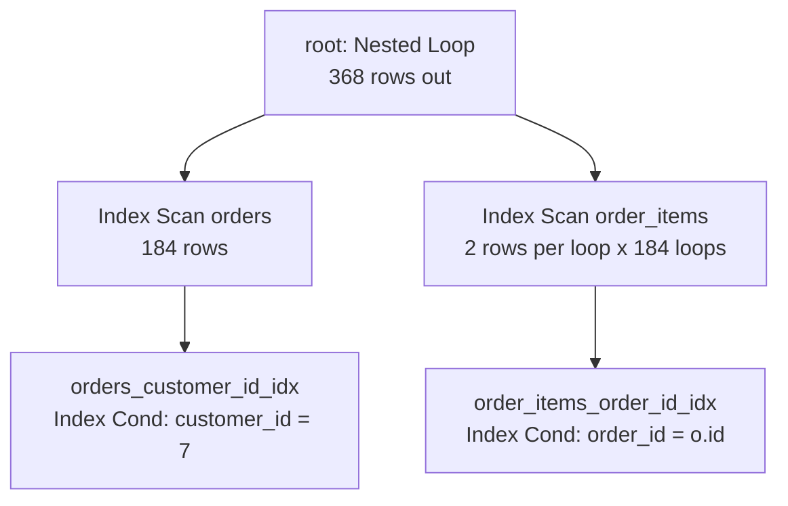

# Reading EXPLAIN

A plan is a tree of operators, printed inside out: the leaves read relations, the parents consume what the leaves produce, and the root is the result you asked for. Reading it well is a small skill with a large payoff — it turns "the query is slow" into "this node touched nine thousand rows they did not need".

## A plan is a tree, not a list

Text `EXPLAIN` draws the tree with indentation, one node per line, parents above children:

```text
Nested Loop  (cost=0.57..742.31 rows=368 width=20)
  ->  Index Scan using orders_customer_id_idx on orders o
        Index Cond: (customer_id = 7)
  ->  Index Scan using order_items_order_id_idx on order_items oi
        Index Cond: (order_id = o.id)
```

Read it from the bottom up. The two `Index Scan` nodes are leaves; they read a relation and hand rows upward. The `Nested Loop` is the parent: for every row the first leaf produces, it runs the second leaf once. The root — the `Nested Loop` here — produces the result.

The indentation is depth, not execution sequence. A node starts when its parent asks it for the next row, which is why a node deep in the tree can run thousands of times while its parent runs once.



## Every node says what it did

The node name is the operator: `Seq Scan`, `Index Scan`, `Bitmap Heap Scan`, `Nested Loop`, `Hash Join`, `Sort`, `Aggregate`. Around it are the facts that explain the choice:

| Line | Meaning |
| --- | --- |
| `on orders o` | the relation and alias this node reads |
| `using orders_customer_id_idx` | the index it walked |
| `Index Cond:` | the predicate the index itself applied — rows that fail it are never fetched |
| `Filter:` | a predicate applied *after* the rows were fetched, which is a thing to notice, not to ignore |
| `Join Filter:` | the join predicate when the algorithm could not use it to drive the loop |
| `Sort Key:`, `Hash Cond:` | the keys a sort or hash used |

`Index Cond` and `Filter` are the distinction worth memorising. The first means the index did the work; the second means the engine paid for rows it then discarded. A `Filter` that removes most rows is the fingerprint of a query that is shaped wrong — usually because the predicate is not sargable, which is module 7.

## Estimated versus actual rows

With `ANALYZE`, every node carries both:

```text
Nested Loop  (cost=0.57..742.31 rows=368 width=20) (actual time=0.05..1.42 rows=384 loops=1)
  ->  Index Scan using orders_customer_id_idx on orders o
        (cost=0.29..180.55 rows=184 width=12) (actual time=0.03..0.34 rows=184 loops=1)
  ->  Index Scan using order_items_order_id_idx on order_items oi
        (cost=0.29..3.02 rows=2 width=12) (actual time=0.004..0.005 rows=2 loops=184)
```

`rows=` before the `actual` block is the estimate; `rows=` inside it is what the node really produced. The `loops=` on the right is the multiplier you must not forget: the inner `Index Scan` reports 2 rows because it was called 184 times, so it produced 368 rows in total. Reading "2" as the work done is the single most common misreading of a plan.

Two checks follow from that:

- Estimate versus actual on the same node: 184 versus 184 is a planner that understood the predicate; 12 versus 3 400 is a planner that did not, and module 4 is about the second case.
- Rows produced versus rows returned: a node deep in the tree handing up millions of rows to a parent that discards them is where the work went.

## Cost, and the two numbers in it

`cost=0.57..742.31` is *startup cost* then *total cost*. Startup is what it costs to produce the first row — a `Sort` cannot emit anything until it has read everything, so its startup cost is nearly its total; an `Index Scan` can start almost immediately. Total is the full price if the node runs to completion.

Both are in the planner's own units (module 1), and they are only meaningful relative to other plans for the same statement on the same server. `total_cost` is the root node's total, and the number to quote when you compare two versions of one query.

## EXPLAIN and EXPLAIN ANALYZE are different promises

`EXPLAIN` asks for the plan and throws it away. `EXPLAIN ANALYZE` runs the statement, so it can do anything the statement can do: read rows, lock them, write them if the statement writes.

That has a practical consequence for this course. Analyzing a statement requires a writable environment and a real dataset; a plan that was never executed reports `timing_precision: estimate` and has no `actual` numbers. When the numbers are real, the plan bundle says `analyze`, and the viewer labels the timings as measured — because on a shared machine they are a hint about where the time went, not a measurement you can compare with someone else's laptop.

## What to ignore

A plan prints more than you need. Learn to skim past:

- `width=` — the average output row size in bytes. It matters to the planner's memory arithmetic, not to your reading.
- The exact cost digits. `742.31` versus `741.90` is noise; `742` versus `18 000` is the story.
- Per-node timings when comparing across machines or runs. Use them to find *which* node holds the time, never to grade a query.
- `Planning Time` on a statement you ran once. It is real work, but caching and prepared statements change it completely.
- Buffer counts as anything but an order of magnitude. `shared hit=4` versus `read=2 000` is worth noticing; 4 versus 7 is not.

## The habit worth building

Read a plan in four passes, in this order: what does the root estimate, which relations are read and by which path, where is the predicate applied (`Index Cond` or `Filter`), and where do loops multiply the rows. Almost every slow query is answered by one of those four questions, and every later module is a vocabulary for the answers.

## What to remember

- A plan is a tree: leaves read relations, parents combine, the root is the answer; indentation is nesting, not time.
- `Index Cond` runs inside the index; `Filter` runs after the rows were fetched and paid for.
- `rows=` is per loop: multiply by `loops=` before you compare it with anything.
- `cost=` is startup..total in planner units, comparable only within one plan on one server.
- `EXPLAIN` plans; `EXPLAIN ANALYZE` executes — and reports what it measured, with the precision stated.
- `width=`, exact costs and cross-machine timings are noise; node types, relations, paths, estimates and loops are the signal.
