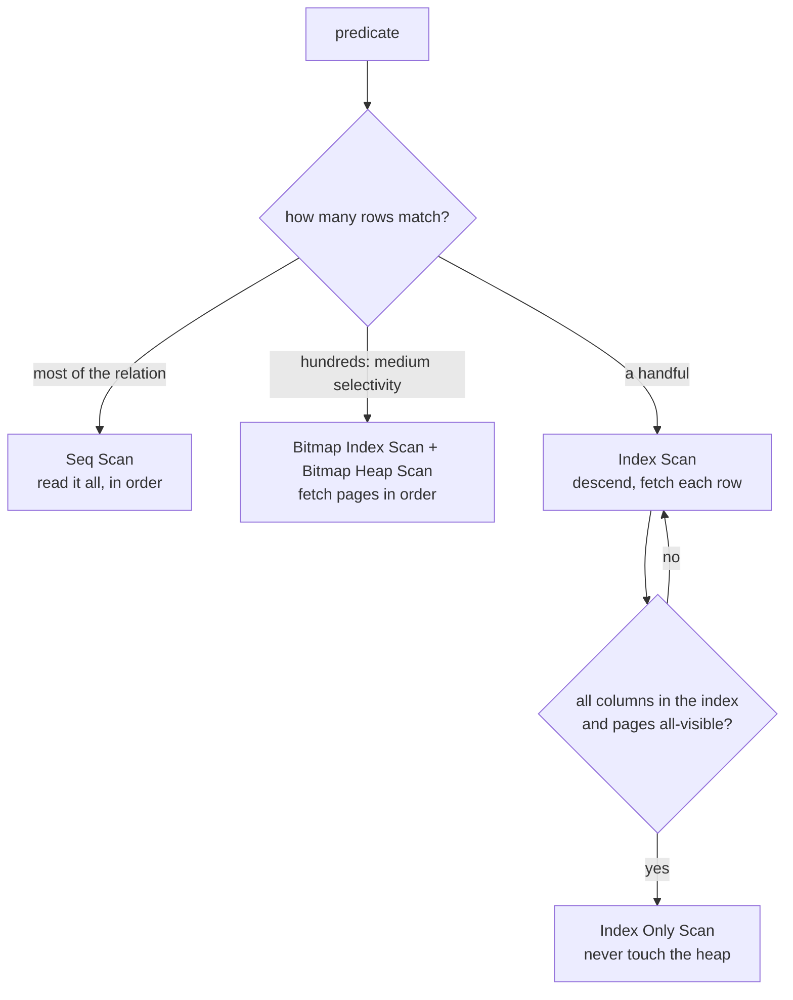

# Access paths, and when a Seq Scan is the right answer

Two reports run against `orders` on the same morning, and both filter it on a column that has an index. The shipping report reads the whole table, 2 500 pages, and that is the fast answer. `orders_status_idx` would add 9 000 random reads to reach rows the scan already had in front of it.

The customer report matches 184 rows out of 10 000 and goes through an index. PostgreSQL picks the route from the row count, and it is right both times.

The route from a relation and a predicate to rows is the access path. This chapter covers the four paths PostgreSQL has, what each one costs, and the rule that picks between them.

## Two queries, two plans

```sql
SELECT id, status FROM orders WHERE customer_id = 7;

SELECT id, ordered_at, status FROM orders WHERE status = 'shipped';
```

The two statements look alike: same table, same `WHERE`, an equality on an indexed column. Plan them and the node types differ.

- The first reports a `Bitmap Heap Scan` over `orders_customer_id_idx`.
- The second reports a `Seq Scan on orders`, with the predicate as a `Filter`.

One query matches 1.8% of the table and the other matches 90%. That difference explains the two plans.

Ignore it and you will add an index to the 90% report, which makes it slower, because the pages still have to be read. The index is a detour on top. The rest of the chapter shows how, starting with the vocabulary.

## The four access paths

| Path | What it does | Needs | Right when |
| --- | --- | --- | --- |
| `Seq Scan` | reads every page of the relation, top to bottom | nothing | the predicate matches a large fraction of the rows |
| `Index Scan` | descends the B-tree to the matching keys, fetches each heap row | an index whose leading column the predicate can bound | a small number of rows, or index order that avoids a sort |
| `Index Only Scan` | answers from the index without touching the heap | every needed column in the index, plus all-visible pages | the index is a superset of what the query reads |
| `Bitmap Index Scan` + `Bitmap Heap Scan` | builds a bitmap of matching locations, sorts it by page, then reads the heap once per page | an index, and `work_mem` for the bitmap | medium selectivity on a large, poorly correlated relation |

A heap is where a table's rows live: 8 KB pages, written in whatever order the rows arrived. An index holds keys and pointers into that pile, so `Heap` in a plan name means the scan went back to the table.

The names in a plan map straight onto the rows above, so a node type already tells you most of the story.



## A bitmap scan, one step at a time

Take the small query first, without the ordering:

```sql
SELECT id, status
FROM orders
WHERE customer_id = 7;
```

`EXPLAIN` prints this:

```text
Bitmap Heap Scan on orders  (cost=5.71..577.52 rows=184 width=12)
  Recheck Cond: (customer_id = 7)
  ->  Bitmap Index Scan on orders_customer_id_idx  (cost=0.00..5.67 rows=184 width=0)
        Index Cond: (customer_id = 7)
```

Read it from the inside out, in the order the engine works.

1. The planner estimates 184 matching rows. That number is a fraction of the relation times its row count, and module 4 covers where the fraction comes from.
2. `Bitmap Index Scan` walks `orders_customer_id_idx` and writes each matching heap location into a bitmap. It never opens the table. The whole step costs 5.67, which is index pages.
3. The bitmap is sorted by page number, so every page the query needs is visited once, in physical order.
4. `Bitmap Heap Scan` reads those pages, re-checks the predicate (`Recheck Cond`), and returns the 184 rows.

Step 4 is where the cost lives: 577.52 in total, almost all of it heap pages. `pg_stats` records a correlation of 0.015 for `orders.customer_id`, which means the rows of one customer sit wherever they were written, not side by side.

The plan's own `Heap Blocks: exact=184` reports the work: 184 pages visited for 184 rows. A sequential read of `orders` costs 2 500 pages, so the bitmap still skips about 93% of the table. That is why it wins.

Correlation decides between the two index paths. `pg_stats.correlation` is 1 when a column sits in index order and 0 when it is scattered. Fetching 500 rows from a correlated column reads a few sequential pages; from a scattered one it touches up to 500 pages at random.

## Index Scan: a descent, then a row at a time

An `Index Scan` walks the B-tree to the first matching entry. It then follows the leaf chain while keys still match, fetching each heap row for the columns the index does not carry. The perf fixture's `orders_customer_id_idx` carries only `customer_id`, so every other column comes from the heap.

The cost has two parts: index pages, which are almost always cached, and heap fetches. A heap fetch is a random page read priced at `random_page_cost`, 4.0 by default against 1.0 for a sequential page. A predicate matching a handful of rows makes the heap part trivial. One matching thousands makes it dominate, because the scan pays a random read for nearly every row.

The demo query asks for one customer's orders in id order:

```sql
SELECT id, status
FROM orders
WHERE customer_id = 7
ORDER BY id
LIMIT 5;
```

```text
Limit  (cost=0.29..281.02 rows=5 width=12)
  ->  Index Scan using orders_pkey on orders  (cost=0.29..10331.28 rows=184 width=12)
        Filter: (customer_id = 7)
```

The plan reads `orders_pkey`, not `orders_customer_id_idx`, and the predicate appears as a `Filter`. The primary key supplied the order the `LIMIT` needs: rows arrive already sorted by `id`, and the scan stops after five matches. Nothing was sought by the index on `customer_id`. It was checked one row at a time, after the fetch.

That is the first trap in reading plans. A node name tells you which algorithm ran, and only the condition lines tell you what it found.

Try this: drop `ORDER BY id` and `LIMIT 5` from that query and plan it again. The `Index Scan using orders_pkey` becomes the bitmap pair on `orders_customer_id_idx`. The index order was the only thing the first plan bought, and the `LIMIT` was the only reason to want it.

## Index Only Scan needs the visibility map

An `Index Only Scan` needs the index to carry every column the query touches, and it needs the page to be marked all-visible. The visibility map holds one bit per heap page, set by `VACUUM` once every row on that page is visible to every transaction. Without the bit, the scan still opens the page to confirm the row exists for its snapshot, so the saving is gone even though the index covered the columns.

The plan line `Heap Fetches: 0` is the proof that the heap was left alone. A number near the row count means the index covered the columns but not the visibility, and the scan paid for the heap anyway. After a bulk load without `VACUUM`, that is the normal state. Run `VACUUM orders;` and the same query shows zero.

## Why 90% of the table wants a Seq Scan

Reading a relation sequentially is not a failure. It is the correct answer whenever the predicate matches most of it. Take the perf fixture's 90% `status` value on `orders`: 10 000 rows on 2 500 pages.

The sequential cost is arithmetic you can repeat from the settings:

- 2 500 pages at `seq_page_cost` 1.0 is 2 500.
- 10 000 rows at `cpu_tuple_cost` 0.01 is 100.
- 10 000 predicate checks at `cpu_operator_cost` 0.0025 is 25.

Add them and you get 2 625. The plan prints `Seq Scan on orders (cost=0.00..2625.00 rows=9000 width=20)`, so the estimate is the same arithmetic, and you can check it.

The index route has no such ceiling. `orders_status_idx` holds 9 000 entries for the shipped value, and each one leads to a heap row.

Those rows sit on nearly every page of the relation, in an order worse than the physical one. That is 9 000 random reads at 4.0 to reach rows the sequential scan already had in front of it. The index cannot skip pages here, because the answer lives on most of the pages. It only adds a detour.

The other legitimate sequential scans are smaller versions of the same argument:

- A relation that fits in a page or two. `products` at 500 rows is 5 pages, so any index descent is overhead on top of reading 5 pages.
- A predicate no index can bound: a `NOT`, a leading-wildcard `LIKE`, or a function wrapped around the column (module 7).
- A broad `OR` where one branch has no index, which forces the engine to read the relation anyway.

The intuition to keep: an index pays off when it helps you skip pages. If the answer needs most of the pages regardless, the index is a detour.

The exercise after this chapter asks for the five newest shipped orders and checks the plan. Nine thousand rows match, so it must be a `Seq Scan on orders`, with no `Index Scan` and no `Bitmap Heap Scan` on the relation. Filter on the bare `status` column, sort by `ordered_at`, and the planner gets there without help.

## The perf fixture's index set

These are the indexes the perf fixture ships with, and the only ones your plan can use for free:

| Index | Relation | Column |
| --- | --- | --- |
| `customers_pkey` | `customers` | `id` |
| `products_pkey` | `products` | `id` |
| `orders_pkey` | `orders` | `id` |
| `orders_customer_id_idx` | `orders` | `customer_id` |
| `orders_status_idx` | `orders` | `status` |
| `order_items_pkey` | `order_items` | `id` |
| `order_items_order_id_idx` | `order_items` | `order_id` |
| `order_items_product_id_idx` | `order_items` | `product_id` |

Read the list as a statement of intent. The foreign keys are indexed because joins run through them; primary keys are indexed because they identify rows. Nothing indexes `ordered_at`, `category`, `price` or `name`, so predicates on those columns are sequential scans until you add an index.

Your own environment is writable, so "add an index and watch the plan change" is an experiment rather than a claim. Run `CREATE INDEX orders_ordered_at_idx ON orders (ordered_at);`, look at the plan, then `DROP INDEX` to put the fixture back the way you found it.

## What to remember

**What I would do:** estimate the fraction the predicate matches before you read the node name. Most of the relation means leave the sequential scan alone, because an index that skips no pages is a detour. A small fraction means check `pg_stats.correlation` before you choose: a scattered column wants the bitmap pair, and a correlated one wants the `Index Scan`. Run `VACUUM` before you trust `Heap Fetches`.

- Four paths: `Seq Scan`, `Index Scan`, `Index Only Scan`, `Bitmap Index Scan` + `Bitmap Heap Scan`.
- An `Index Scan` is a cheap descent plus one random heap fetch per row; it wins when few rows match.
- A bitmap scan trades memory for page-ordered heap reads and is the usual answer for medium selectivity.
- `Index Only Scan` needs the columns in the index and all-visible pages; `Heap Fetches: 0` is the proof.
- A `Seq Scan` is correct when the predicate matches most of the relation, when the relation is a handful of pages, or when no index can bound the predicate.
- Correlation (near 1 or near 0) decides between `Index Scan` and `Bitmap Heap Scan` for a medium match.

## Check yourself

**1. `WHERE customer_id = 7` matches 184 rows, and the plan for it with no ordering is a `Bitmap Heap Scan` rather than an `Index Scan`. Why the extra step?**

<details>
<summary>Answer</summary>

The rows are scattered. Correlation for that column is 0.015, so the 184 matches sit on 184 different pages, and an `Index Scan` would fetch them in index order, page by page at random. The bitmap sorts the 184 locations by page number first, so each page is read once. The price is `work_mem` and the loss of index order.

</details>

**2. You want `SELECT id, status FROM orders WHERE customer_id = 7` to be an `Index Only Scan` and build `CREATE INDEX orders_customer_cover_idx ON orders (customer_id, status)`. Why does the plan still touch the heap?**

<details>
<summary>Answer</summary>

The index covers `customer_id` and `status` but not `id`, so one needed column is missing and the heap visit stays. Coverage is the first condition. The second is the visibility map: without all-visible pages the scan opens the heap anyway, and `Heap Fetches` counts how often. Indexing `(customer_id, status, id)` and running `VACUUM orders;` would give `Heap Fetches: 0`.

</details>

**3. The shipping report matches 9 000 rows. Would forcing `orders_status_idx` make it faster than the `Seq Scan`?**

<details>
<summary>Answer</summary>

No. The 9 000 matching rows sit on nearly all 2 500 pages, so the index route reads almost the whole relation and pays a random read for most pages. The sequential scan reads the same 2 500 pages once, in order, at 1.0 each. An index only pays when it helps the query skip pages, and there are almost no pages left to skip.

</details>

**4. The plan for the demo query reads `Index Scan using orders_pkey` with `Filter: (customer_id = 7)`. Which index found the matching rows?**

<details>
<summary>Answer</summary>

`orders_pkey` found nothing here. It supplied rows in `id` order, which is what `ORDER BY id LIMIT 5` wanted, and each fetched row was tested against the `Filter`. The index on `customer_id` was never consulted for this plan. To see which access did the finding, read `Index Cond` and `Filter`, not the node type.

</details>
