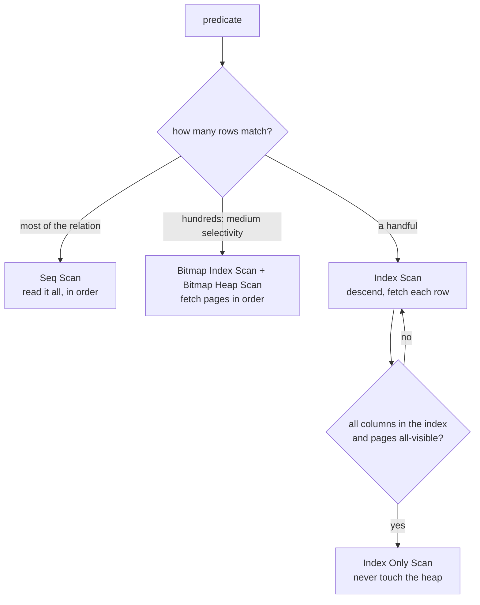

# Access paths, and when a Seq Scan is the right answer

PostgreSQL has four ways to turn a relation and a predicate into rows: read the whole relation, walk an index one row at a time, answer entirely from the index, or collect matching locations into a bitmap and then read the heap in page order. Which one is chosen is a cost question, and the answer is not always the index.

## The four paths

| Path | What it does | Needs | Right when |
| --- | --- | --- | --- |
| `Seq Scan` | reads every page of the relation, top to bottom | nothing | the predicate matches a large fraction of the rows |
| `Index Scan` | descends the B-tree to the matching keys, fetches each heap row | an index whose leading column the predicate can bound | a small number of rows, or index order that avoids a sort |
| `Index Only Scan` | answers from the index without touching the heap | every needed column in the index, plus all-visible pages | the index is a superset of what the query reads |
| `Bitmap Index Scan` + `Bitmap Heap Scan` | builds a bitmap of matching locations, sorts it by page, then reads the heap once per page | an index, and `work_mem` for the bitmap | medium selectivity on a large, poorly correlated relation |

The names in a plan map straight onto those lines, so a node type alone already tells you most of the story.

## Index Scan: a descent, then a row at a time

An `Index Scan` first walks the B-tree to the first matching entry, then follows the leaf chain while keys still match, fetching each heap row to get the columns the index does not carry. (The perf fixture's `orders_customer_id_idx`, for instance, carries only `customer_id`; every other column has to come from the heap.)

The cost therefore has two parts: index pages, which are almost always cached, and heap fetches, which are random page reads and priced at `random_page_cost` (4.0 by default against 1.0 for a sequential page). A predicate matching a handful of rows makes the heap part trivial. A predicate matching thousands makes it dominate, because the scan pays a random read for nearly every row.

## Bitmap scans: the middle ground

When the match is too large for row-at-a-time fetches but too small for a full scan, the planner can build a bitmap instead. `Bitmap Index Scan` walks the index and records matching heap locations; `Bitmap Heap Scan` sorts those locations by page and reads each page once, in order, re-checking the original predicate (`Recheck Cond`) because a bitmap can be lossy.

Two consequences are worth knowing. The output is not in index order, so a bitmap cannot satisfy an `ORDER BY` the way an index scan can; and the bitmap lives in `work_mem`, so a very large one is degrades into something closer to a sequential read with extra overhead. The bitmap is a tool for medium selectivity, typically a few percent of a big relation.

Correlation decides which of the two index paths the planner prefers. `pg_stats.correlation` is 1 when a column is physically stored in index order and 0 when it is scattered. Fetching 500 rows from a highly correlated column reads a few sequential pages; fetching 500 rows from an uncorrelated one reads up to 500 pages at random. The same predicate, two different cheapest plans.

## Index Only Scan depends on the visibility map

An `Index Only Scan` needs the index to carry every column the query touches, and it needs the page to be marked all-visible, which is `VACUUM`'s job. The plan line `Heap Fetches: 0` is the proof that the heap was really left alone; a large number there means the index covered the columns but not the visibility, and the scan quietly paid for the heap anyway. After a bulk load without `VACUUM`, that is the normal state.

## When a Seq Scan is the correct plan

Reading a relation sequentially is not a failure. It is the correct answer whenever the predicate matches most of it. Take the perf fixture's 90% `status` value on `orders`: about 70 pages holding 10 000 rows.

- Sequential: ~70 pages at 1.0, plus a small CPU charge per row, lands in the low hundreds of planner units.
- Through `orders_status_idx`: 9 000 index entries to examine, and then 9 000 heap fetches landing on nearly every page in the relation — only in an order that is worse than the physical one, so each fetch is priced as a random read.

The index path costs more than reading the table once, and the planner chooses the sequential scan without hesitation. A p3 exercise asks you to produce exactly that plan, because recognising it is as much a skill as producing an index scan.

The other legitimate sequential scans are smaller versions of the same argument:

- A relation that fits in a page or two. `products` at 500 rows is about six pages; any index descent plus heap fetch is overhead on top of reading six pages.
- A predicate no index can bound — a `NOT`, a leading-wildcard `LIKE`, or a function wrapped around the column (module 7).
- A broad `OR` where one branch has no index, which forces the engine to read the relation anyway.

The intuition to keep: an index pays off when it lets you *skip pages*. If the answer needs most of the pages regardless, the index is a detour.

## The perf fixture's index set

These are the indexes the perf fixture ships with, and the only ones your plan can use for free:

| Index | Relation | Column |
| --- | --- | --- |
| `customers_pkey` | `customers` | `id` |
| `products_pkey` | `products` | `id` |
| `orders_pkey` | `orders` | `id` |
| `orders_customer_id_idx` | `orders` | `customer_id` |
| `orders_status_idx` | `orders` | `status` |
| `order_items_pkey` | `order_items` | `id` |
| `order_items_order_id_idx` | `order_items` | `order_id` |
| `order_items_product_id_idx` | `order_items` | `product_id` |

Read the list as a statement of intent. The foreign keys are indexed because joins run through them; primary keys are indexed because they identify rows. Nothing indexes `ordered_at`, `category`, `price` or `name`, so predicates on those columns are sequential scans until you add an index.

Your own environment is writable, so "add an index and watch the plan change" is an experiment rather than a claim: `CREATE INDEX orders_ordered_at_idx ON orders (ordered_at);`, run the plan, then `DROP INDEX` to put the fixture back the way you found it.

## What to remember

- Four paths: `Seq Scan`, `Index Scan`, `Index Only Scan`, `Bitmap Index Scan` + `Bitmap Heap Scan`.
- An `Index Scan` is a cheap descent plus one random heap fetch per row; it wins when few rows match.
- A bitmap scan trades memory for page-ordered heap reads and is the usual answer for medium selectivity.
- `Index Only Scan` needs the columns in the index *and* all-visible pages; `Heap Fetches: 0` is the proof.
- A `Seq Scan` is correct when the predicate matches most of the relation, when the relation is a handful of pages, or when no index can bound the predicate.
- Correlation (near 1 or near 0) decides between `Index Scan` and `Bitmap Heap Scan` for a medium match.
