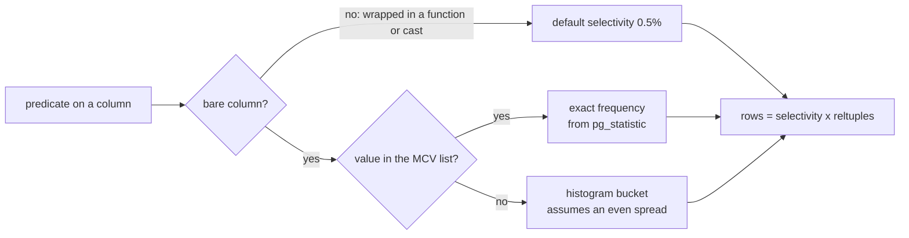

# Selectivity, statistics and ANALYZE

A support ticket arrives with a query that returns 184 rows and reads all 2 500 pages of `orders` to get them. The index on `customer_id` would have reached the same 184 rows through 184 heap pages. The statement looks harmless:

```sql
SELECT id, status FROM orders WHERE customer_id::text = '7';
```

PostgreSQL planned that scan for 50 rows and then found 184. The cast left the index unused, and it gave the planner a predicate that no column statistic describes.

The number the planner guessed is the subject of this chapter. It comes from two beliefs: a fraction, and a row count. Both live in the catalog, both can be read, and both can be refreshed.

## Selectivity is a fraction of a relation

The planner never asks for a count of refunded orders. It asks for two numbers: what fraction of `orders` has `status = 'refunded'`, and how many rows `orders` holds. Multiply them and you get `rows=`. A wrong fraction is a wrong row count, and a wrong row count is 2 500 pages read where 184 would do.

The fraction is selectivity. The row count is `pg_class.reltuples`, the planner's own record of how many rows a relation holds. The selectivity lives in `pg_statistic`, which `ANALYZE` writes. You can read both: `reltuples` straight from `pg_class`, and the statistics from `pg_stats`, a view over `pg_statistic`.

For a predicate on one value, the fraction comes from one of two places.

- The MCV list, the most common values and their exact frequencies. When a column has few distinct values, every value is in this list and the estimate is exact.
- The histogram, the remaining values bucketed into equal-population ranges. A predicate that lands inside a bucket is estimated as if the values in that bucket were spread evenly. That assumption is where estimates go wrong.

There is a third path. When the predicate is not on the bare column, say `UPPER(status) = 'SHIPPED'`, there is no statistic for the expression, and the planner falls back to a fixed default of 0.5%. On a 10 000-row table that is `rows=50`, for a predicate that matches 9 000 rows.

That is not a subtle error. It is an assumption wearing a number, and module 7 is about removing it.



## The status column on the perf fixture

Five distinct values, every one of them in the MCV list, so the estimates here are exact:

| `status` | Orders | Share |
| --- | --- | --- |
| `shipped` | 9000 | 90% |
| `completed` | 400 | 4% |
| `cancelled` | 300 | 3% |
| `pending` | 250 | 2.5% |
| `refunded` | 50 | 0.5% |

`pg_stats.most_common_freqs` for `orders.status` reads `{0.9, 0.04, 0.03, 0.025, 0.005}`, so the planner is not estimating this column at all. It is reading it.

That is a deliberately hostile distribution. The same index on `status` is pointless for the 90% value (a sequential scan reads the table once, module 3) and decisive for the 0.5% value. A plan that treats all equality predicates alike cannot be right for both.

The estimate for `status = 'refunded'` is not approximate. With `default_statistics_target = 100`, `ANALYZE` samples 30 000 rows, which on a 10 000-row relation is the whole table. If that estimate is wrong, the statistics are stale, not unlucky.

## Reading one estimate from start to finish

Ask for the refunded orders, newest first, and read the plan from the inside out:

```sql
SELECT id, ordered_at
FROM orders
WHERE status = 'refunded'
ORDER BY ordered_at DESC;
```

```text
Sort  (cost=167.72..167.85 rows=50 width=12)
  Sort Key: ordered_at DESC
  ->  Index Scan using orders_status_idx on orders  (cost=0.29..166.31 rows=50 width=12)
        Index Cond: (status = 'refunded'::text)
```

Follow the 50 through the arithmetic.

1. The MCV frequency is 0.005. `reltuples` is 10 000. Their product is 50 rows, and the scan prints `rows=50`.
2. The scan expects 50 matching entries out of the index's 10 000. Walking the B-tree to the first of them costs 0.29.
3. The rest of the scan costs 166.02. The planner estimates about 49 heap pages for the 50 matching entries. The correlation of 0.46 discounts the per-page price: `random_page_cost` 4.0 becomes about 3.37, and 49 times 3.37 is the 166. The real rows sit on 13 heap pages, so the estimate is cautious rather than wrong.
4. The `Sort` adds about one unit and inherits the 50 from its input. Fifty rows fit in memory, so it stays a quicksort (module 6).

Both nodes print the same `rows=50`, because both inherit one fraction multiplied by one row count. Running it returns 50 rows.

The exercise after this chapter counts the refunded orders. Its contract asserts two things about the plan: it must use `orders_status_idx`, and the planner's estimate must stay under 100 rows. Both follow from this arithmetic.

One half of one percent of 10 000 is 50 rows, and 50 rows is small enough to be worth an index.

## Where estimates break

| Cause | What you see | How to tell | What to do |
| --- | --- | --- | --- |
| Function or cast around the column | `rows=50` for a predicate that matches 9 000 rows | the predicate has an expression, not a bare column, and the estimate is exactly 0.5% of the table | rewrite the predicate (module 7), or index the expression |
| Correlated predicates | each predicate is estimated well, the pair is estimated far too small | two or more `AND`ed predicates on the same relation, actual rows much larger than estimated | `CREATE STATISTICS ... (dependencies)` on the pair |
| Stale statistics | `rows=` scales with an old row count, or the MCV frequencies match data you thought you changed | `pg_class.reltuples` versus `COUNT(*)`, and the last `ANALYZE` timestamp in `pg_stat_user_tables` | `ANALYZE` the relation, and let autovacuum do it after bulk loads |
| Clustering the histogram cannot see | a range predicate estimated evenly, actual rows bunched at one end | actual rows far above estimated on a range scan, with no correlation between the predicate and the histogram buckets | a narrower range, or statistics targeted at the column |

Independence is the assumption to respect: the planner multiplies the selectivities of two predicates as if knowing one told it nothing about the other. When the columns move together, that multiplication is an underestimate. The plan it produces may pick an algorithm that only works for the smaller number: a nested loop for a hash join, a small hash table for a big one.

## The gap between estimate and outcome

Estimates are falsifiable, which is the useful part. `EXPLAIN ANALYZE` prints the claim and the outcome side by side, on every node:

```text
Seq Scan on orders  (cost=0.00..2675.00 rows=50 width=4) (actual rows=184 loops=1)
  Filter: ((customer_id)::text = '7'::text)
  Rows Removed by Filter: 9816
```

That block leaves out the two `actual time` figures, which change on every machine. The row counts do not: the planner claimed 50, the scan returned 184, and 9 816 rows were fetched and then thrown away.

The index plan for the bare column tells the other half of the story. `WHERE customer_id = 7` estimates 184 rows and reaches them through 184 heap pages instead of 2 500. One cast moved the estimate by a factor of four and the page count by about fourteen.

Try this: delete the cast and run `SELECT id, status FROM orders WHERE customer_id = 7;`. The plan stops reading all 2 500 pages, and the estimate moves from 50 rows to 184.

A gap of one order of magnitude changes the join algorithm, the sort strategy and the hash table's memory. Finding it is the highest-value thing you can do while reading a plan. The plan bundle raises `PLAN_ESTIMATE_OFF_BY_ORDERS_OF_MAGNITUDE` for exactly that gap.

## ANALYZE is the refresh, and autovacuum runs it

`ANALYZE` reads a sample of the relation and rewrites the per-column statistics. Autovacuum's analyze pass runs it after enough rows change, so a busy table stays roughly current without you. A freshly bulk-loaded table does not have that coverage, and neither does a table whose bulk change has not crossed the autovacuum threshold.

Two knobs matter when you meet a genuinely skewed column:

- `ANALYZE orders;` updates one relation immediately. Run it after a load, and re-check the estimate.
- `ALTER TABLE orders ALTER COLUMN status SET STATISTICS 500;` then `ANALYZE`, raises the MCV and histogram resolution for that column. The default target of 100 is fine for most columns; it is not always fine for one that decides a plan.

`SELECT relname, last_analyze FROM pg_stat_user_tables;` shows when each relation was last analyzed. Compare `pg_class.reltuples` with `SELECT COUNT(*)` to see whether the planner holds an old belief.

On the pinned fixture the statistics are deterministic: the seed is fixed, the sample covers the whole relation, and the same plan comes out on every machine. That is why this course grades structure and not timing.

## What you cannot change from the query

The plan bundle reports the settings that produced a plan: `random_page_cost`, `effective_cache_size`, `work_mem`, the `enable_*` toggles, and it reads them, never writes them. An exercise that only passed because `random_page_cost` was lowered behind your back would teach the wrong lesson. When a plan is wrong, the fix is a better query, a better statistic, or a real index.

## What to remember

What I would do: treat `rows=` as a claim the plan has to prove against `actual rows=`. When the estimate is exactly 0.5% of the relation, the fix is the predicate: remove the cast, or index the expression. When the estimate is stale, run `ANALYZE` and read the plan again.

- `rows=` = selectivity × relation size, and both halves are inspectable (`pg_stats`, `pg_class`).
- Few distinct values go in the MCV list and are estimated exactly; the histogram exists for the rest and assumes an even spread.
- A predicate not on a bare column gets a default 0.5% guess: the most misleading estimate a plan can show.
- Correlated predicates are multiplied as if independent, which undercounts.
- Stale statistics are a maintenance problem: `ANALYZE` after bulk loads, and a higher statistics target for a decisive skewed column.
- Compare `rows=` with `actual rows=`; a gap of an order of magnitude explains most bad plan choices.

## Check yourself

**1. The plan for `WHERE status = 'refunded'` prints `rows=50`, and the query returns 50. What would you check first if a plan printed `rows=12` for the same predicate?**

<details>
<summary>Answer</summary>

The statistics. Fifty rows is what 0.005 times 10 000 gives, and this fixture samples the whole relation, so a different number means the frequency or `reltuples` came from different data. Compare `pg_class.reltuples` with `SELECT COUNT(*)` on `orders`, check `most_common_freqs` in `pg_stats`, and look at `last_analyze` in `pg_stat_user_tables`. Then run `ANALYZE orders;` and plan again.

</details>

**2. `WHERE customer_id = 7` estimates 184 rows. `WHERE customer_id::text = '7'` estimates 50. Why does a cast on the column change the number?**

<details>
<summary>Answer</summary>

The statistics describe the column, not the cast expression. `customer_id::text` is a new expression with no statistics of its own, so the planner falls back to the default equality selectivity of 0.5%, and 0.5% of 10 000 is 50. The estimate is not a measurement of anything. The predicate also stops being sargable, which costs the index as well (module 7).

</details>

**3. A predicate matches a value that is not in the MCV list of a large table. Where does its estimate come from, and what does that source assume?**

<details>
<summary>Answer</summary>

From a histogram bucket, which holds a range of values with roughly equal counts. The planner assumes the values inside the bucket are spread evenly, so a predicate in the middle of a bucket gets an average. A value that clusters inside its bucket is underestimated, and a range that stops inside one is estimated by interpolation.

</details>

**4. You raise the statistics target on `status` from 100 to 500 and `ANALYZE`. Will the estimate for `status = 'refunded'` change?**

<details>
<summary>Answer</summary>

It should not. Five distinct values already fit in the MCV list at the default target of 100, so the frequency 0.005 is exact before the change. A higher target buys resolution on columns with many distinct values, where more MCV entries and more histogram buckets describe the data better. Spending it on a five-value column changes nothing and costs the next `ANALYZE` some work.

</details>
