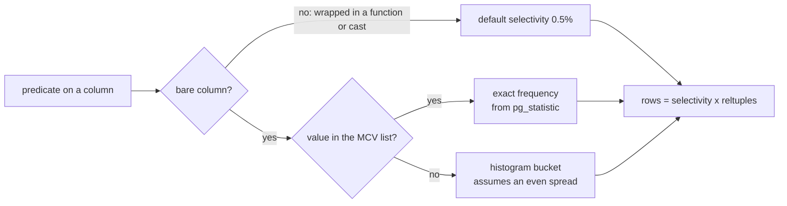

# Selectivity, statistics and ANALYZE

Every estimate in a plan is a fraction multiplied by a row count. The row count comes from `pg_class`; the fraction comes from `pg_statistic`. When a plan is wrong, it is almost always because one of those two beliefs is wrong — and both are things you can inspect and refresh.

## Selectivity is a fraction of a relation

The planner never asks "how many orders are refunded?". It asks "what fraction of `orders` has `status = 'refunded'`, and how many rows does `orders` hold?". Multiply the two and you get `rows=`. Selectivity is the fraction; the page and row costs in module 1 are applied to that many rows.

For a single-value predicate, the fraction comes from one of two places:

- The **MCV list** — the most common values and their exact frequencies. When a column has few distinct values, every value is in this list and the estimate is exact.
- The **histogram** — the remaining values, bucketed into equal-population ranges. A predicate on a value in the histogram is estimated by its bucket, which assumes the values inside a bucket are evenly spread. That assumption is where estimates go wrong.

There is a third path as well: when the predicate is not on the bare column — `UPPER(status) = 'SHIPPED'`, say — there is no statistic for the expression, and the planner falls back to a fixed default of 0.5%. On a 10 000-row table that is `rows=50`, for a predicate that actually matches 9 000 rows. That is not a subtle error; it is an assumption wearing a number, and module 7 is about removing it.

## The `status` column on the perf fixture

Five distinct values, every one of them in the MCV list, so the estimates here are exact:

| `status` | Orders | Share |
| --- | --- | --- |
| `shipped` | 9000 | 90% |
| `completed` | 400 | 4% |
| `cancelled` | 300 | 3% |
| `pending` | 250 | 2.5% |
| `refunded` | 50 | 0.5% |

That is a deliberately hostile distribution. The same index on `status` is pointless for the 90% value (a sequential scan reads the table once, module 3) and decisive for the 0.5% value. A plan that treats all equality predicates alike cannot be right for both.

The estimate for `status = 'refunded'` is not approximate: with `default_statistics_target = 100`, `ANALYZE` samples 30 000 rows, which on a 10 000-row relation is the whole table. If the estimate for that predicate is wrong, the statistics are stale — not unlucky.



## Where estimates actually break

| Cause | What you see | How to tell | What to do |
| --- | --- | --- | --- |
| Function or cast around the column | `rows=50` for a predicate that matches 9 000 rows | the predicate has an expression, not a bare column, and the estimate is exactly 0.5% of the table | rewrite the predicate (module 7), or index the expression |
| Correlated predicates | each predicate is estimated well, the pair is estimated far too small | two or more `AND`ed predicates on the same relation, actual rows much larger than estimated | `CREATE STATISTICS ... (dependencies)` on the pair |
| Stale statistics | `rows=` scales with an old row count, or the MCV frequencies match data you thought you changed | `pg_class.reltuples` versus `COUNT(*)`, and the last `ANALYZE` timestamp in `pg_stat_user_tables` | `ANALYZE` the relation, and let autovacuum do it after bulk loads |
| Clustering the histogram cannot see | a range predicate estimated evenly, actual rows bunched at one end | actual rows far above estimated on a range scan, with no correlation between the predicate and the histogram buckets | a narrower range, or statistics targeted at the column |

Independence is the assumption to respect: the planner multiplies the selectivities of two predicates as if knowing one told it nothing about the other. When the columns move together, that multiplication is an underestimate, and the plan it produces may pick an algorithm that only works for the smaller number — a nested loop for a hash join, a small hash table for a big one.

## Reading an estimate as a claim

Estimates are falsifiable, which is the useful part. `EXPLAIN ANALYZE` prints the claim and the outcome side by side:

```text
Sort  (cost=8.15..8.15 rows=50 width=12) (actual time=0.21..0.21 rows=50 loops=1)
  Sort Key: ordered_at DESC
  Sort Method: quicksort  Memory: 27kB
  ->  Index Scan using orders_status_idx on orders
        (cost=0.29..8.00 rows=50 width=12) (actual time=0.05..0.15 rows=50 loops=1)
        Index Cond: (status = 'refunded'::text)
```

Here the planner said 50 and got 50, so the statistics are doing their job and the plan is the right one. The interesting plans are the other kind: `rows=12` on a node that returns 3 400. A gap of one order of magnitude changes the join algorithm, the sort strategy and the memory a hash table needs, so finding it is the highest-value thing you can do while reading a plan. The plan bundle raises `PLAN_ESTIMATE_OFF_BY_ORDERS_OF_MAGNITUDE` for exactly that gap.

## ANALYZE is the refresh, and autovacuum runs it

`ANALYZE` reads a sample of the relation and rewrites the per-column statistics. Autovacuum's analyze pass runs it after enough rows change, so a busy table stays roughly current without you; a freshly bulk-loaded table does not, and neither does a table whose rows changed in a bulk statement the autovacuum threshold has not noticed yet.

Two knobs matter when you meet a genuinely skewed column:

- `ANALYZE orders;` updates one relation immediately. Run it after a load, and re-check the estimate.
- `ALTER TABLE orders ALTER COLUMN status SET STATISTICS 500;` then `ANALYZE`, raises the MCV and histogram resolution for that column. The default target of 100 is fine for most columns; it is not always fine for one that decides a plan.

On the pinned fixture the statistics are deterministic: the seed is fixed, the sample covers the whole relation at this size, and the same plan comes out on every machine. That is why this course grades structure and not timing — the statistics are reproducible, and a duration is not.

## What you cannot change from the query

The plan bundle reports the settings that produced a plan — `random_page_cost`, `effective_cache_size`, `work_mem`, the `enable_*` toggles — and reads them, never writes them. An exercise that only passes because `random_page_cost` was lowered behind your back would teach the wrong lesson. When a plan is wrong, the fix is a better query, a better statistic, or a real index.

## What to remember

- `rows=` = selectivity × relation size, and both halves are inspectable (`pg_stats`, `pg_class`).
- Few distinct values go in the MCV list and are estimated exactly; the histogram exists for the rest and assumes an even spread.
- A predicate not on a bare column gets a default 0.5% guess — the most misleading estimate a plan can show.
- Correlated predicates are multiplied as if independent, which undercounts.
- Stale statistics are a maintenance problem: `ANALYZE` after bulk loads, and a higher statistics target for a decisive skewed column.
- Compare `rows=` with `actual rows=`; a gap of an order of magnitude explains most bad plan choices.
