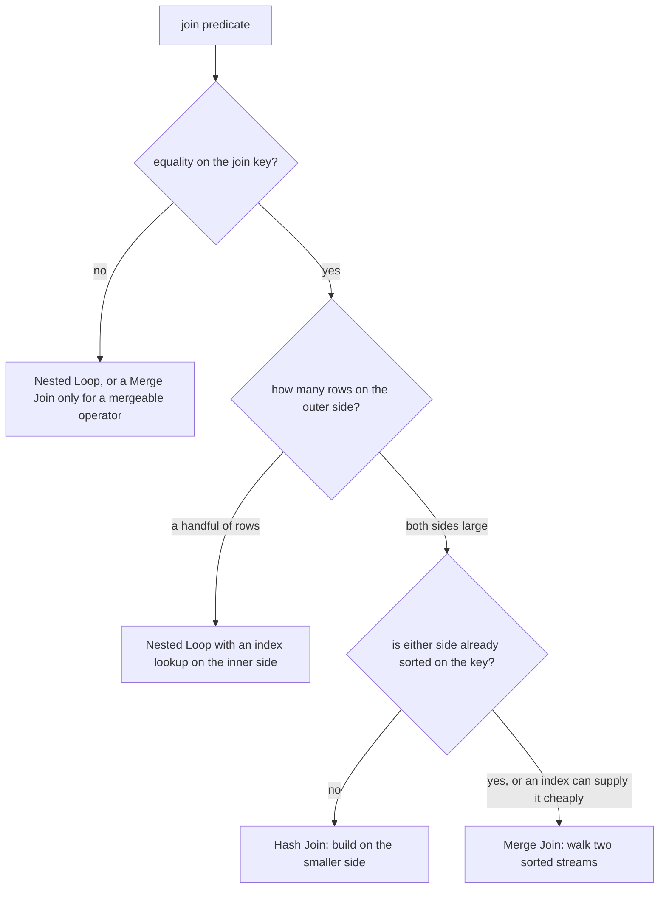

# Join strategies: nested loop, hash, merge

A join is a matching problem, and PostgreSQL knows three ways to solve it. Each one has a precondition, a cost profile and a failure mode, and the plan tells you which one it chose and why. When a plan's join is wrong, it is usually because the planner believed a row count that was not true.

## Three algorithms, three preconditions

| Strategy | How it works | Precondition | Chosen when | Preserves order |
| --- | --- | --- | --- | --- |
| `Nested Loop` | for each outer row, find the matching inner rows | a cheap lookup on the inner side, usually an index, or a tiny inner relation | the outer side is small | outer-side order |
| `Hash Join` | build a hash table from the smaller input, probe it with the larger | an equality condition on the join key | both sides are large and unordered | no |
| `Merge Join` | sort both inputs on the key, then walk them in step | an equality condition, plus sorted inputs (an index scan can supply the order) | both sides are large and already ordered | join-key order |

## Nested loop: small outer side, indexed inner side

A nested loop is a for-loop. For each row the outer side produces, it runs the inner side once with that row's key. Its cost is proportional to rows returned, not rows scanned, which makes it the only strategy that stays cheap when the question is specific.

The precondition is a cheap lookup on the inner side — usually an index scan. Without one, the loop re-reads the whole inner relation once per outer row, and 180 outer rows against a 20 000-row inner relation becomes 3.6 million row visits. The perf fixture indexes the foreign keys (`order_items.order_id`, `orders.customer_id`) precisely so this plan is available.

The tell in the plan is `loops=`: the inner node runs once per outer row, and its `rows=` is per loop. A nested loop's inner node reporting `rows=2 loops=184` produced 368 rows, not 2.

## Hash join: large and unordered on both sides

A hash join builds a hash table from the smaller input and streams the larger one through it. It needs equality — you cannot hash a range — but it needs no order, which is why it is the default answer when both sides are large and neither is sorted.

Its cost is one pass over each side plus the hash build, and the build lives in `work_mem`. When it does not fit, PostgreSQL splits both inputs into batches and processes them in rounds, spilling to disk; the plan line `Batches: 4` is the signal (module 6). The build side is chosen by the planner from the estimates, so a join where the estimate is wrong can build the hash on the wrong relation.

## Merge join: two sorted streams

A merge join walks two sorted inputs in step, like merging two sorted lists. It needs equality on a mergeable operator and it needs order; the planner will add a `Sort` above an input that is not already ordered, and it prices that sort. When both sides happen to be ordered already — because the sort key is the same as the join key and an index supplies it — a merge join is the cheapest of the three, because it neither builds a hash nor sorts.

The reason to know about it is the plan line: `Merge Join` with `Merge Cond:` and an `Index Scan` under each side means the planner found free order. Two `Sort` nodes under it mean the planner is paying for that order and you should ask whether it needed to.

## The row estimate picks the strategy

The choice between these three turns on cardinalities, and cardinalities come from the statistics of module 4. Three cases on the same shape of query:

| Outer rows (estimated) | Inner side | Chosen strategy |
| --- | --- | --- |
| 1 | indexed lookup | `Nested Loop`, index scan on the inner |
| 184 | indexed lookup | `Nested Loop`, index scan on the inner, 184 loops |
| 10 000 | 2 000 rows, indexed | `Hash Join` or `Merge Join`; the loop would cost 20 million row visits |

Now put the two modules together: if a predicate is wrapped in a function and estimated at 50 rows when it matches 9 000, the planner will choose the nested loop its estimate justified, and pay for 9 000 loops instead of one hash build. The plan is not wrong about the algorithm; it is wrong about the count.

## Semi and anti joins

`EXISTS` and `IN` do not need the matched rows, only whether a match exists, so PostgreSQL plans them as semi joins and stops at the first match per outer row. `NOT EXISTS` becomes an anti join with the same short-circuit. That is why `EXISTS` beats "join and `DISTINCT`" for the same question: the early exit is part of the plan, not an optimisation you have to write.

`NOT IN` is the exception worth remembering from the subqueries course: if the list contains a `NULL`, the comparison is unknown for every non-matching row, and the anti join disappears along with the results. `NOT EXISTS` has no such trap.

## Join order is the planner's decision

`FROM a JOIN b JOIN c` is a shape, not an execution order. The planner reorders the join tree using the estimates, subject to `join_collapse_limit`, which is why the same query produces a different join order on a different dataset. Writing the tables in a particular order is a readability choice; if you truly need an order, express it as a `MATERIALIZED` CTE or a subquery rather than as `FROM` order.

## What to remember

- `Nested Loop` needs a small outer side and a cheap inner lookup; it is the only strategy that costs what the answer costs.
- `Hash Join` needs equality and memory; it is the default for two large, unordered inputs, and `Batches:` above 1 means it spilled.
- `Merge Join` needs both inputs sorted on the key; it wins when an index or existing order supplies that for free.
- A join's `rows=` on the outer side selects the strategy, so a wrong estimate changes the algorithm, not just the row counts.
- `EXISTS` and `NOT EXISTS` are semi and anti joins that stop at the first match; `NOT IN` with a `NULL` breaks the same question.
- `FROM` order is not join order; the planner reorders by estimate.
