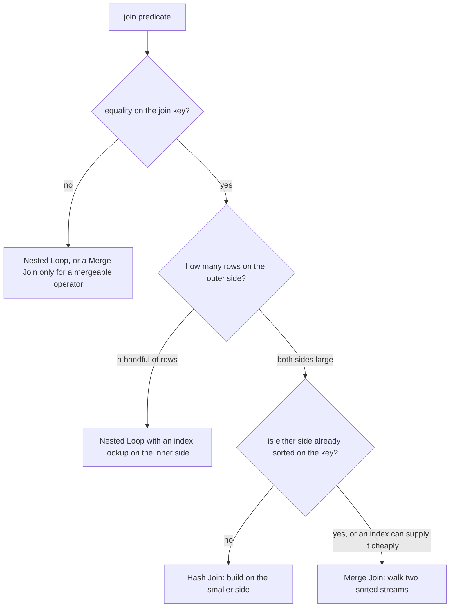

# Join strategies: nested loop, hash, merge

Support asks which five customers place the most orders. The obvious way to answer is 20 million checks: every one of 2 000 customers against every one of 10 000 orders. PostgreSQL read the smaller table once, built a lookup structure from it, and streamed the larger table past that structure. Five rows came back before you finish reading the query.

The query joins `customers` to `orders` on the customer id, counts the orders per customer, and sorts the count. The plan names what the engine built instead of those pairs: `Hash Join`.

A join is a matching problem, and PostgreSQL knows three ways to solve one. Each has a precondition, a cost, and a failure mode. This chapter walks the three, then shows how the planner's row estimate decides which one you get.

## A join is a matching problem

A join produces one output row for every pair of input rows that satisfies its `ON` condition. The orders sharing a customer id are pairs; the rest are not. An engine could find the pairs by trying every combination. No plan does that beyond a handful of rows.

The cost of the wrong strategy is counted in row visits. A loop that joins 184 orders to their lines without an index on the inner side is 3.68 million row visits for 368 rows of answer.

Two words describe the inputs of a join. The outer input is the one the engine reads and loops over. The inner input is the one it consults for each outer row. In a printed plan, the first child of the join node is the outer input and the second child is the inner input.

The word outer has a second meaning: in an outer join it names the side whose rows survive when no partner exists. This chapter keeps both senses, so check which one a sentence needs.

| Strategy | How it works | Precondition | Chosen when | Preserves order |
| --- | --- | --- | --- | --- |
| `Nested Loop` | for each outer row, find the matching inner rows | a cheap lookup on the inner side, usually an index, or a tiny inner relation | the outer side is small | outer-side order |
| `Hash Join` | build a hash table from the smaller input, probe it with the larger | an equality condition on the join key | both sides are large and unordered | no |
| `Merge Join` | sort both inputs on the key, then walk them in step | an equality condition, plus sorted inputs (an index scan can supply the order) | both sides are large and already ordered | join-key order |



All three answer one question: how to find the pairs without reading the product of both tables. A nested loop looks up the pairs of each outer row through an index. A hash join computes where each row belongs. A merge join uses sorted order to read each input once.

## Nested loop: run the inner side once per outer row

A nested loop is a for-loop written as a plan:

```text
for each row of the outer input:
    run the inner input with that row's key
```

The cost follows the number of outer rows and the cost of one inner lookup. It does not follow the size of either table, which makes it the only join that costs what the answer costs.

Customer 7 has 184 orders, and the index on `customer_id` finds them. Join those orders to the customer row:

```sql
SELECT o.id, c.name
FROM orders o
JOIN customers c ON c.id = o.customer_id
WHERE o.customer_id = 7;
```

```text
Nested Loop  (cost=5.99..587.66 rows=184 width=17) (actual rows=184.00 loops=1)
  ->  Index Scan using customers_pkey on customers c  (cost=0.28..8.29 rows=1 width=17) (actual rows=1.00 loops=1)
        Index Cond: (id = 7)
  ->  Bitmap Heap Scan on orders o  (cost=5.71..577.52 rows=184 width=8) (actual rows=184.00 loops=1)
        Recheck Cond: (customer_id = 7)
        ->  Bitmap Index Scan on orders_customer_id_idx  (cost=0.00..5.67 rows=184 width=0) (actual rows=184.00 loops=1)
              Index Cond: (customer_id = 7)
```

These plans are trimmed of buffer lines and other detail lines. The node names, costs, row counts and method lines are what the engine printed.

Read the plan from the child that runs first. The outer input is one index seek into `customers_pkey`, and it produces one row. The inner input then runs once and produces 184 order rows. `loops=1` on the inner node says it ran once.

`loops=` is the number to watch. The `rows=` figure on a node is per loop, so the rows a node produced is `rows × loops`. An inner node reporting `rows=2 loops=184` produced 368 rows, not 2. When the two figures disagree with the result you counted, the loops are usually why.

The precondition is a cheap inner lookup. Take the index off `order_items.order_id` and a loop that joins those 184 orders to their lines re-reads all 20 000 line rows once per order. That is 184 × 20 000 = 3.68 million row visits for 368 rows of answer. The fixture ships `order_items_order_id_idx` and `orders_customer_id_idx` so this plan stays available.

A `LIMIT` changes the loop count, because the loop stops once the limit is satisfied. Add `LIMIT 5` to the query above and the planner swaps the sides. It walks the index on `orders.customer_id` as the outer input, and it wraps the customer lookup in a `Materialize` node so one row is cached. The inner node then reports `loops=5`.

184 orders were available; five were enough.

## Hash join: build once, probe once

A hash join reads the smaller input first and stores each row in a hash table under its join key. It then reads the larger input once, and for each row it looks up the key in that table. One build pass and one probe pass replace the nested loop's repeated inner reads.

It needs equality, because a hash function maps values to buckets and a range has no bucket. A join on `o.customer_id = c.id` can be hashed; a join on `o.ordered_at > c.signup_date` cannot. It also needs memory: the table lives in `work_mem`, and when it does not fit, PostgreSQL splits both inputs into batches and works through them in rounds. The next module reads that line.

Here is the opening query's plan:

```text
Limit  (cost=2794.52..2794.54 rows=5 width=25) (actual rows=5.00 loops=1)
  ->  Sort  (cost=2794.52..2799.52 rows=2000 width=25) (actual rows=5.00 loops=1)
        Sort Key: (count(*)) DESC, c.name
        Sort Method: top-N heapsort  Memory: 17kB
        ->  HashAggregate  (cost=2741.31..2761.31 rows=2000 width=25) (actual rows=300.00 loops=1)
              Group Key: c.id
              Batches: 1  Memory Usage: 89kB
              ->  Hash Join  (cost=65.00..2691.31 rows=10000 width=17) (actual rows=10000.00 loops=1)
                    Hash Cond: (o.customer_id = c.id)
                    ->  Seq Scan on orders o  (cost=0.00..2600.00 rows=10000 width=4) (actual rows=10000.00 loops=1)
                    ->  Hash  (cost=40.00..40.00 rows=2000 width=17) (actual rows=2000.00 loops=1)
                          Buckets: 2048  Batches: 1  Memory Usage: 94kB
                          ->  Seq Scan on customers c  (cost=0.00..40.00 rows=2000 width=17) (actual rows=2000.00 loops=1)
```

Read it from the bottom, one node at a time:

| Step | Node | Rows in | Rows out |
| --- | --- | --- | --- |
| 1 | `Seq Scan on customers` | every customer row | 2 000 |
| 2 | `Hash` | 2 000 | 2 048 buckets, 94 kB |
| 3 | `Seq Scan on orders` | every order row | 10 000 |
| 4 | `Hash Join` | 10 000 probes | 10 000 matched pairs |
| 5 | `HashAggregate` | 10 000 | 300 groups |
| 6 | `Sort` | 300 | 5 rows for the limit |

Two scans, one hash build, one probe pass. One hash join over 10 000 orders answers the whole question.

Step 5 repays a second look. The aggregate estimated 2 000 groups, one per customer, and produced 300. Only 300 of the 2 000 customers have an order in this fixture, so the other 1 700 keys never appear on the probe side. The estimate came from `customers`, where every id is present.

The plan is not wrong about the algorithm; it is wrong about how many keys the join hands it.

## Merge join: walk two sorted streams

A merge join sorts both inputs on the join key and then walks them together, like merging two sorted lists. It advances whichever pointer is behind, and it reads each input once. It needs a mergeable comparison, which for most queries is equality, and it needs sorted inputs.

The order is the interesting part, because sometimes it is free. This query keeps every customer, with or without orders, and asks for the first five by id.

```sql
SELECT c.id, o.id AS order_id
FROM customers c
LEFT JOIN orders o ON o.customer_id = c.id
ORDER BY c.id
LIMIT 5;
```

```text
Limit  (cost=0.56..5.77 rows=5 width=8) (actual rows=5.00 loops=1)
  ->  Merge Left Join  (cost=0.56..10423.84 rows=10000 width=8) (actual rows=5.00 loops=1)
        Merge Cond: (c.id = o.customer_id)
        ->  Index Only Scan using customers_pkey on customers c  (cost=0.28..85.28 rows=2000 width=4) (actual rows=1.00 loops=1)
        ->  Index Scan using orders_customer_id_idx on orders o  (cost=0.29..10208.56 rows=10000 width=8) (actual rows=5.00 loops=1)
```

Both children are index scans, and both indexes are in the order the merge needs: `customers_pkey` on `c.id`, `orders_customer_id_idx` on `o.customer_id`. The `Merge Cond:` line names the comparison the merge makes. Neither side needs a `Sort` node and neither needs a hash, because an index already supplies the order.

The alternative costs memory. Put `SET enable_hashjoin = off;` in a session and rerun this join:

```sql
SELECT o.id, oi.id AS line_id
FROM orders o
JOIN order_items oi ON oi.order_id = o.id;
```

```text
Merge Join  (cost=3264.67..4660.67 rows=20000 width=8) (actual rows=20000.00 loops=1)
  Merge Cond: (oi.order_id = o.id)
  ->  Index Scan using order_items_order_id_idx on order_items oi  (cost=0.29..1096.29 rows=20000 width=8) (actual rows=20000.00 loops=1)
  ->  Sort  (cost=3264.39..3289.39 rows=10000 width=4) (actual rows=10000.00 loops=1)
        Sort Key: o.id
        Sort Method: quicksort  Memory: 257kB
        ->  Seq Scan on orders o  (cost=0.00..2600.00 rows=10000 width=4) (actual rows=10000.00 loops=1)
```

One side arrives sorted from its index. The other side is sorted first, in 257 kB of memory, and that `Sort` is the price of the merge. `SET` lasts for the session; `RESET enable_hashjoin;` puts the planner back.

That pair of plans is the reading rule for merge joins. A `Merge Cond:` with an index scan under each side means free order. A `Sort` under one side means the planner paid, and the question becomes whether a hash join would have been cheaper. The planner answers with numbers; your job is to notice which answer it gave.

## The estimate picks the strategy

The number of rows an operator is expected to produce is its cardinality. The planner prices each algorithm with the cardinalities of its two sides, so a wrong cardinality buys a wrong algorithm, not just a wrong row count.

| Outer rows (estimated) | Inner side | Chosen strategy |
| --- | --- | --- |
| 1 | indexed lookup | `Nested Loop`, index scan on the inner |
| 184 | indexed lookup | `Nested Loop`, index scan on the inner, 184 loops |
| 10 000 | 2 000 rows, indexed | `Hash Join` or `Merge Join`; the loop would cost 20 million row visits |

Here is the switch happening on real data. The query counts orders per city, and the filter wraps the city in `lower()`.

```sql
SELECT c.city, count(*) AS orders
FROM customers c
JOIN orders o ON o.customer_id = c.id
WHERE lower(c.city) = 'milan'
GROUP BY c.city;
```

```text
Nested Loop  (cost=3.74..1231.27 rows=50 width=6) (actual rows=1902.00 loops=1)
  ->  Seq Scan on customers c  (cost=0.00..50.00 rows=10 width=10) (actual rows=334.00 loops=1)
        Filter: (lower(city) = 'milan'::text)
        Rows Removed by Filter: 1666
  ->  Bitmap Heap Scan on orders o  (cost=3.74..117.80 rows=33 width=4) (actual rows=5.69 loops=334)
        Recheck Cond: (c.id = customer_id)
        ->  Bitmap Index Scan on orders_customer_id_idx  (cost=0.00..3.73 rows=33 width=0) (actual rows=5.69 loops=334)
              Index Cond: (customer_id = c.id)
```

The `lower()` call hides `city` from the statistics, so the planner falls back to its default for an unknown predicate: 0.5% of the relation. Half a percent of 2 000 is 10, and the scan's estimate says 10. Milan holds 334 customers. The `Sort` and `GroupAggregate` above this node are the next module's subject.

Ten outer rows justify a loop, so the planner picked one. The inner node then ran 334 times and produced 5.69 rows per loop, which is 1 902 rows. The estimate for the whole join was 50.

The algorithm was reasonable for ten rows and expensive for 334. Module 4 explains where the 10 came from, and module 7 shows the rewrite that gives the column back to the statistics.

## The planner chooses the sides and the order

`FROM a JOIN b JOIN c` is a shape, not an execution order. The planner reorders the tree and assigns the roles from the estimates, subject to `join_collapse_limit`. Writing the tables in a particular order is a readability choice.

The build side of a hash follows the same rule. In this query `products` is listed second, and it is the side PostgreSQL hashes:

```sql
SELECT oi.id, p.name
FROM order_items oi
JOIN products p ON p.id = oi.product_id
WHERE oi.id <= 20;
```

```text
Hash Join  (cost=20.69..75.03 rows=20 width=23) (actual rows=20.00 loops=1)
  Hash Cond: (oi.product_id = p.id)
  ->  Bitmap Heap Scan on order_items oi  (cost=4.44..58.73 rows=20 width=8) (actual rows=20.00 loops=1)
        Recheck Cond: (id <= 20)
        ->  Bitmap Index Scan on order_items_pkey  (cost=0.00..4.44 rows=20 width=0) (actual rows=20.00 loops=1)
              Index Cond: (id <= 20)
  ->  Hash  (cost=10.00..10.00 rows=500 width=23) (actual rows=500.00 loops=1)
        Buckets: 1024  Batches: 1  Memory Usage: 28kB
        ->  Seq Scan on products p  (cost=0.00..10.00 rows=500 width=23) (actual rows=500.00 loops=1)
```

Five hundred product rows fit in 28 kB, so they become the hash. The twenty filtered order lines stream past it. Move the two tables around in the query text and this plan does not change. The estimates decide.

An outer join adds a wrinkle to the labels. `customers c LEFT JOIN orders o` keeps every customer, and its plan reads `Hash Right Join`, with the hash built on `customers`. The suffix describes which side of the join node keeps its unmatched rows, not the order you typed. That plan returns 11 700 rows: 10 000 orders that found their customer, and 1 700 customers with no order at all.

The exercise you are about to do asks for a count per product category, with every category kept even when it has no lines. You have the pieces now. An outer join keeps the rows with no partner, and a count of the other table's column handles them. A plan label tells you which side was hashed. Write the query before you open the hints.

## Semi and anti joins

`EXISTS` and `IN` ask one yes or no question about each outer row: whether a match exists. PostgreSQL plans them as semi joins, which stop at the first match for each outer row. `NOT EXISTS` becomes an anti join with the same short circuit.

The plan says so plainly. This query asks which products appear in at least one order line:

```sql
SELECT p.id, p.name
FROM products p
WHERE EXISTS (SELECT 1 FROM order_items oi WHERE oi.product_id = p.id)
ORDER BY p.id
LIMIT 5;
```

```text
Limit  (cost=0.56..2.87 rows=5 width=23) (actual rows=5.00 loops=1)
  ->  Nested Loop Semi Join  (cost=0.56..231.24 rows=500 width=23) (actual rows=5.00 loops=1)
        ->  Index Scan using products_pkey on products p  (cost=0.27..31.79 rows=500 width=23) (actual rows=5.00 loops=1)
        ->  Index Only Scan using order_items_product_id_idx on order_items oi  (cost=0.29..2.17 rows=40 width=4) (actual rows=1.00 loops=5)
              Index Cond: (product_id = p.id)
```

The inner side expects 40 lines per product and returns one. It stopped at the first match, because the query only needs to know that a match exists. That early exit is why `EXISTS` beats joining and then de-duplicating: a join would materialise every matching line, and `DISTINCT` would then sort or hash them to remove the duplicates.

`NOT IN` has the trap you met in the subqueries course. If the list contains a `NULL`, the comparison is unknown for every non-matching row, so the anti join returns nothing at all. `NOT EXISTS` has no such trap. Use `NOT EXISTS`, or filter the nulls out of the list first.

Try this: run `SELECT 1 WHERE 1 NOT IN (2, NULL);`. The statement returns no rows, because one unknown in the list makes every comparison unknown.

## What to remember

What I would do: read the outer side's `rows=` before you read the join strategy, because that estimate picks the algorithm. When a node returns far more rows than it claims, fix the predicate that hid the column from the statistics, not the join. When you only need the top rows, add `LIMIT`, because a nested loop stops as soon as the limit is satisfied.

- `Nested Loop` needs a small outer side and a cheap inner lookup; it is the only strategy that costs what the answer costs.
- `Hash Join` needs equality and memory; it is the default for two large, unordered inputs, and `Batches:` above 1 means it spilled.
- `Merge Join` needs both inputs sorted on the key; it wins when an index or existing order supplies that for free.
- A join's `rows=` on the outer side picks the strategy, so a wrong estimate changes the algorithm, not just the row counts.
- `EXISTS` and `NOT EXISTS` are semi and anti joins that stop at the first match; `NOT IN` with a `NULL` breaks the same question.
- `FROM` order is not join order; the planner picks the sides and the order from its estimates.

## Check yourself

**1. A `Hash Join` has a `Hash` node over 2 000 customers and a sequential scan of 10 000 orders. Which side did the planner hash, and why is that the side to choose?**

<details>
<summary>Answer</summary>

It hashed `customers`, the smaller input. The build side holds every row in memory, so hashing 2 000 rows costs 94 kB and leaves the 10 000-row side to stream past. Hashing the larger side would need more memory and could spill into batches.

</details>

**2. Why does a nested loop stop being cheap without an inner index?**

<details>
<summary>Answer</summary>

The inner side is read from the start for every outer row. Customer 7 has 184 orders, and the 20 000 line rows would be read once per order: 3.68 million row visits for 368 rows of answer. An index on the inner key turns each of those reads into a seek.

</details>

**3. A query joins 184 orders to their customer and reports `loops=5` on the inner node after you add `LIMIT 5`. What does the loop count measure?**

<details>
<summary>Answer</summary>

It counts how many times the inner node ran, which is how many outer rows it was given. The limit stopped the outer side after five rows, so the inner lookup ran five times instead of 184. The `rows=` on that inner node is the average per loop.

</details>

**4. A plan estimates 50 joined rows and returns 1 902, and the join is a nested loop. Which number would you fix first, and what tells you why it is wrong?**

<details>
<summary>Answer</summary>

Fix the estimate on the filtered side: 10 customers estimated, 334 found. The `lower()` call around `city` hides the column from the statistics, so the planner used its 0.5% default. A sargable predicate on the bare column gives the planner the real distribution, and it would price a different algorithm.

</details>

**5. Why does `EXISTS` beat `JOIN` followed by `DISTINCT` for the same yes-or-no question?**

<details>
<summary>Answer</summary>

`EXISTS` becomes a semi join, which stops at the first match for each outer row. A join produces every matching pair, and `DISTINCT` then has to sort or hash the whole set to remove the duplicates. The early exit removes that work rather than optimising it.

</details>
