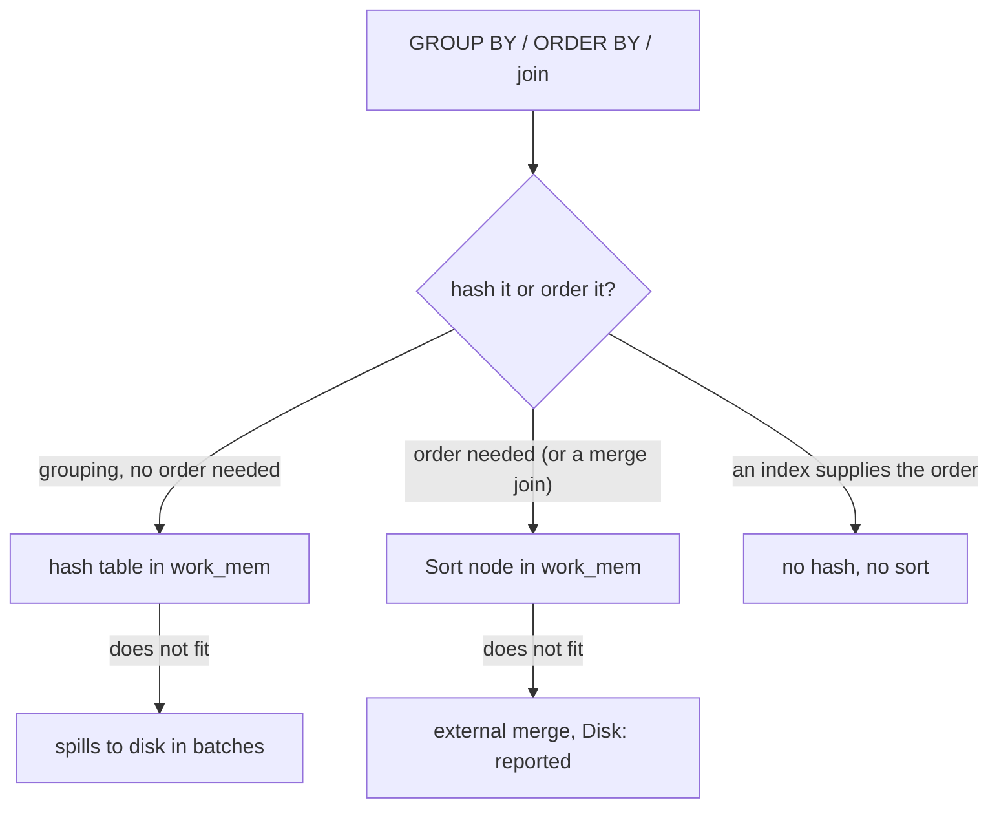

# Sorts, hashes and work_mem

The report is fast because its sort never held more than five rows. It runs `ORDER BY ordered_at DESC LIMIT 5`, and the plan puts a `Sort` over a `Seq Scan` with the line `top-N heapsort  Memory: 17kB`.

Delete the `LIMIT` for a CSV export and the scan and the sort key stay the same, but the sort line reads `quicksort  Memory: 653kB`. On this fixture that is still a small number. Lower `work_mem` enough and the line reads `external merge  Disk: 352kB`, and the query is writing to disk.

Sorting and hashing are how PostgreSQL gets order and how it groups rows. Both are memory operations, both have a spill path, and both print the evidence in the plan. This module teaches you to read those lines, and to need them less often.

## A Sort has no first row until it has read everything

A sort is a pause in a query. It cannot emit its first row until it has read its last input row, so everything above it waits. The plan prints that in the cost: the `Sort` node's startup cost is almost its total cost, and both sit above the total cost of the input.

```text
Sort  (cost=2766.10..2791.10 rows=10000 width=20)
  Sort Key: ordered_at DESC
  ->  Seq Scan on orders  (cost=0.00..2600.00 rows=10000 width=20)
```

The scan's total cost is 2600, and the sort does not start until 2766. The gap is the price of being orderly. The `Buffers:` lines and other detail lines are trimmed from the plans in this module.

For a page that needs one row early, that gap is the whole bill: the plan reads 10 000 orders before the client sees the first of five.

`EXPLAIN ANALYZE` adds the line that matters, and the method it names tells you how much memory the sort used:

| Sort Method | Meaning |
| --- | --- |
| `quicksort` | the whole input fitted in `work_mem` |
| `top-N heapsort` | a `LIMIT` bounded the sort, so only N rows are kept in memory |
| `external merge` | the input did not fit; it was sorted in runs and merged, with `Disk:` reporting the spill |

`top-N heapsort` is why `ORDER BY ... LIMIT 20` on ten thousand rows is cheap. The sort keeps a small heap of the best rows and discards the rest as it scans, so memory follows the limit, not the table.

The bound is the offset plus the limit, so a deeper page costs more. `LIMIT 20 OFFSET 500` makes the sort keep 520 rows and report `top-N heapsort  Memory: 95kB`. At `LIMIT 20 OFFSET 9000` the bound is 9 020 rows, which is most of the table, and the planner drops the bounded heap: the plan reports `quicksort  Memory: 960kB` over all 10 000 rows.

## Walk through the five newest orders

The report's query is the one to read first:

```sql
SELECT id, ordered_at, status
FROM orders
ORDER BY ordered_at DESC
LIMIT 5;
```

```text
Limit  (cost=2766.10..2766.11 rows=5 width=20) (actual rows=5.00 loops=1)
  ->  Sort  (cost=2766.10..2791.10 rows=10000 width=20) (actual rows=5.00 loops=1)
        Sort Key: ordered_at DESC
        Sort Method: top-N heapsort  Memory: 17kB
        ->  Seq Scan on orders  (cost=0.00..2600.00 rows=10000 width=20) (actual rows=10000.00 loops=1)
```

Read it from the top down. `Limit` is the node the client asks for rows from, and it passes five rows up. `Sort` holds the comparison, the method and the memory: `top-N heapsort  Memory: 17kB` means it kept five rows in a heap of 17 kB.

`Sort Key: ordered_at DESC` says what it compared. The `Seq Scan` at the bottom is the part that does not change. Nothing indexes `ordered_at`, so the scan reads all 10 000 orders before the sort can start.

Five rows come out of ten thousand read. The plan does not apologise for that; it is the price of one page.

Remove the `LIMIT` and the same query prints a different sort.

```text
Sort  (cost=3264.39..3289.39 rows=10000 width=20) (actual rows=10000.00 loops=1)
  Sort Key: ordered_at DESC
  Sort Method: quicksort  Memory: 653kB
  ->  Seq Scan on orders  (cost=0.00..2600.00 rows=10000 width=20) (actual rows=10000.00 loops=1)
```

Same scan, same key, and the sort now holds the whole input in memory before it emits anything: 653 kB instead of 17 kB.

The difference between the two plans is the sort's method, which is why that line is the first thing to read on a slow sort. It says whether the query paid for a page or for the table.

The timings are left out of these plans on purpose. They change with the machine, the cache and the load. The method, the row counts and the memory figure are what you compare.

## Everything that sorts

`ORDER BY` is only the obvious one. A sort appears whenever an operator needs order:

- `ORDER BY` on the final result.
- `DISTINCT`, which de-duplicates by sorting or hashing.
- `GROUP BY` when the aggregate runs in sorted mode (`GroupAggregate`).
- A `Merge Join` whose inputs are not already ordered.
- Window functions with a `PARTITION BY` or `ORDER BY` they cannot get from an index.
- `UNION`, `INTERSECT` and `EXCEPT`, which de-duplicate.

Each of those is a line in the plan. Counting the `Sort` nodes is the first thing to do with a query that feels heavier than its result.

One item on that list can avoid the sort altogether. `SELECT DISTINCT status FROM orders` reads `HashAggregate` with `Group Key: status`, five groups and 32 kB. The question was "which distinct values exist", and a hash answers it without putting anything in order. `GROUP BY` faces the same choice.

## Aggregates hash or sort

`GROUP BY` has two implementations, and the plan names the one it used.

A hashed aggregate builds a hash table keyed by the grouping columns and updates one slot per group. It needs memory in proportion to the number of groups, not the number of rows, and it spills in batches when the groups do not fit.

A sorted aggregate walks input that is already ordered on the grouping key and emits each group when the key changes. It needs no table of groups, and it needs the order. Without an index on the grouping key, that order comes from a `Sort`.

```sql
SELECT customer_id, count(*) AS orders
FROM orders
GROUP BY customer_id
ORDER BY customer_id;
```

```text
Sort  (cost=2665.34..2666.09 rows=300 width=12) (actual rows=300.00 loops=1)
  Sort Key: customer_id
  Sort Method: quicksort  Memory: 26kB
  ->  HashAggregate  (cost=2650.00..2653.00 rows=300 width=12) (actual rows=300.00 loops=1)
        Group Key: customer_id
        Batches: 1  Memory Usage: 56kB
        ->  Seq Scan on orders  (cost=0.00..2600.00 rows=10000 width=4) (actual rows=10000.00 loops=1)
```

Two operations, two memory figures. The aggregate held 300 groups in 56 kB, and the sort then ordered those 300 rows in 26 kB. With `SET enable_hashagg = off` for one session, the same query reads `GroupAggregate` over a `Sort` of all 10 000 rows that used 257 kB. Same answer, larger bill.

The fixture indexes `customer_id`, and the planner still chose the hash here. Both plans are correct: 56 kB for 300 groups is cheap, and the sorted path first has to put 10 000 rows in order. When the input does arrive ordered, `GroupAggregate` appears with no `Sort` under it, and that is the cheapest aggregate there is.

**Try this:** run the `GROUP BY customer_id` query, then `SET enable_hashagg = off` and run it again. The answer does not change; the plan does, from `HashAggregate` at 56 kB to `GroupAggregate` over a `Sort` of all 10 000 rows at 257 kB.



Your exercise ranks products by how many order lines they appear in. Its plan shows both kinds of node: a hash for the grouping and a sort for the ranking, with the `LIMIT` turning that sort into a top-N sort. Watch which memory figure belongs to which node.

## `work_mem` is per node, not per query

`work_mem` bounds one memory-hungry node. It applies per node and per session, so a query with three sorts can use three times the setting before it spills. A server running a hundred such queries multiplies it again.

That is why raising the setting fixes one report and slows the server.

The app never changes `work_mem` for you. The plan bundle reports the value the statement ran under, beside the plan: the gateway sets 16MB for learner statements, and the browser adapter reports its own session default. The largest sort in this module used 960 kB, so nothing you run in an exercise spills. To see the spill shape you lower the setting in a session of your own, which is what the next section does.

## What a spill looks like

Run `SET work_mem = '128kB';` in your session, then the export query with no limit.

```sql
SELECT id, ordered_at, status
FROM orders
ORDER BY ordered_at DESC;
```

```text
Sort  (cost=3470.89..3495.89 rows=10000 width=20) (actual rows=10000.00 loops=1)
  Sort Key: ordered_at DESC
  Sort Method: external merge  Disk: 352kB
  ->  Seq Scan on orders  (cost=0.00..2600.00 rows=10000 width=20) (actual rows=10000.00 loops=1)
```

`external merge` means the sort filled its 128 kB and sorted the input in pieces. It wrote each piece to a temporary file as a run, then merged the runs on the way out.

The `Disk:` figure is how much it wrote, and a spill costs the data at least twice: once out, once back in.

Width makes a spill worse, and the `width=` figure on the `Sort` node predicts it. The same query with `SELECT *` reports `width=1647` and `Disk: 16320kB`, because the sort carries text columns the result does not need: the carrier, the two addresses and the notes of every order. Projecting three columns instead of all nine cut the spill from 16 320 kB to 352 kB.

The fixes, in the order that usually helps:

1. Sort fewer rows. The predicate that removes most rows belongs before the sort, so make it sargable (module 7) and let an index apply it.
2. Sort narrower rows. A sort carries every column the parent needs, so `SELECT *` makes the sort bigger than the result suggests.
3. Sort less often. `UNION ALL` instead of `UNION`, `EXISTS` instead of `JOIN ... DISTINCT`, a `GROUP BY` that an index can order: each removes a sort outright.
4. Raise `work_mem` for that one session, and accept that concurrency costs memory.

## The fixture has no index on `ordered_at`

That absence is deliberate. `SELECT ... FROM orders ORDER BY ordered_at DESC LIMIT 8` cannot use an index, so it reads the whole relation and runs a top-N heapsort. That is a fair price for one page of a report, and it is why the demo plan is a `Seq Scan` under a `Sort`.

Order is free when an index supplies it. The same shape on a different column:

```sql
SELECT id, ordered_at, status
FROM orders
ORDER BY id
LIMIT 5;
```

```text
Limit  (cost=0.29..5.44 rows=5 width=20) (actual rows=5.00 loops=1)
  ->  Index Scan using orders_pkey on orders  (cost=0.29..10306.28 rows=10000 width=20) (actual rows=5.00 loops=1)
```

No `Sort` node, and five rows out of the index instead of 10 000 out of the table. `orders_pkey` stores rows in `id` order, so the plan reads what it needs and stops.

You can create the missing index yourself. `CREATE INDEX orders_ordered_at_idx ON orders (ordered_at DESC);` turns the date query into an index scan that stops after five rows, because the index supplies the order. Drop it again afterwards, so the fixture stays as your classmates see it.

## What to remember

**What I would do:** read `Sort Method` before you touch `work_mem`. A `top-N heapsort` on a paged report means the limit is already working, so fix the scan underneath it. An `external merge` means the sort spilled, so cut the rows and the width before you raise the setting. In a schema you own, index the column the report orders by; the fixture leaves `ordered_at` out on purpose so the scan stays visible.

- A `Sort` node has no first row until its last input row: read its startup cost.
- `Sort Method` names the memory story: `quicksort`, `top-N heapsort` (a `LIMIT` helped), `external merge` (it spilled, and `Disk:` says how much).
- The top-N bound is offset plus limit, so a deep page grows the sort.
- `GROUP BY` is a hash table or a sorted walk; the plan names which one.
- `work_mem` is per node, per session; raising it lifts every sort and hash in every concurrent query.
- Reduce the rows, the width, or the number of sorts before you raise memory, and remember the fixture indexes no date column.

## Check yourself

**1. A plan reports `Sort Method: external merge`. What happened, and what would you try first?**

<details>
<summary>Answer</summary>

The input did not fit, so the sort spilled to temporary files. Sort fewer rows first with a sargable predicate, then narrower rows by projecting only the columns the parent needs, then fewer sorts with `UNION ALL` or `EXISTS`. Raising `work_mem` is last because it also raises the memory of every concurrent query.

</details>

**2. Why is `top-N heapsort` cheaper here, and when does that stop?**

<details>
<summary>Answer</summary>

It keeps a bounded heap of limit plus offset rows and discards the rest. Memory follows the limit, not the table. A deep offset grows that bound: `OFFSET 9000` makes 9 020 rows the bound, and the planner then sorts all 10 000 rows with `quicksort` in 960 kB.

</details>

**3. Two plans for `GROUP BY customer_id` read `HashAggregate` and `GroupAggregate`. What does each need, and why did the planner pick the hash here?**

<details>
<summary>Answer</summary>

The hash needs one memory slot per group: 300 groups in 56 kB. The sorted aggregate needs input ordered by `customer_id`, and without that order it sorts all 10 000 rows first, which used 257 kB. The planner compared those two prices and chose the hash.

</details>

**4. `work_mem` is 16MB and a query contains three sorts. How much memory can it take, and why does that matter on a busy server?**

<details>
<summary>Answer</summary>

Up to three times the setting, because it applies per node. On a busy server a hundred such queries multiply it again, so a value that is safe for one report can exhaust the machine's memory. The setting is a cap per node, not a budget for a query or a server.

</details>

**5. Why does an `ORDER BY id LIMIT 5` plan have no `Sort` node at all?**

<details>
<summary>Answer</summary>

`orders_pkey` stores rows in `id` order, so an index scan emits them already sorted and stops after five. The order came from the index instead of a sort, which is why the plan reads five rows and no more.

</details>
