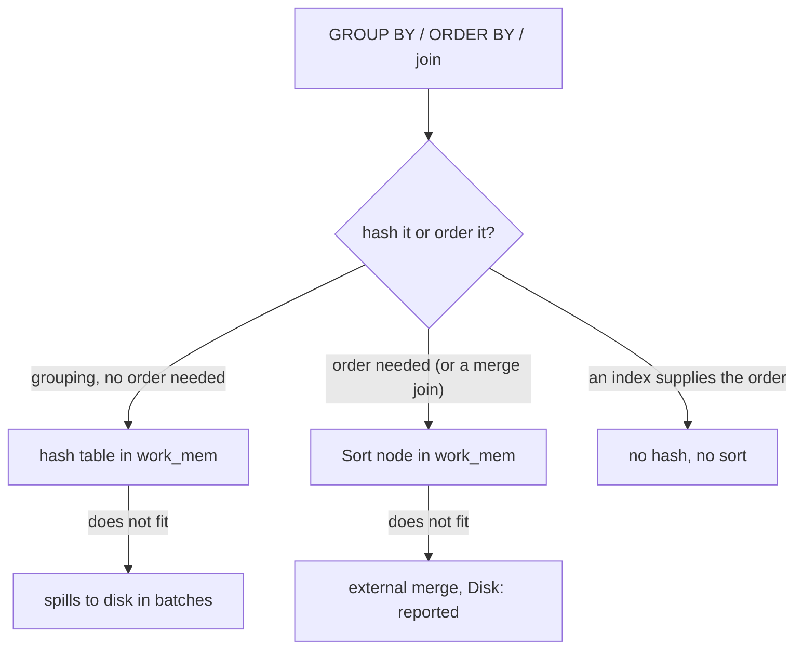

# Sorts, hashes and work_mem

Sorting and hashing are how PostgreSQL gets order and how it groups rows. Both are memory operations, both have a spill path to disk, and both are visible in a plan: a `Sort` node's method, a `Hash` node's batch count. This module is about reading those lines and about needing them less often.

## A Sort node is a cost, and it starts at the end

A `Sort` cannot emit its first row until it has read its last input row, which is why its startup cost is essentially its total cost. That is a real property, not a printing artefact: everything above a sort waits for it.

`EXPLAIN ANALYZE` adds the detail that matters:

```text
Sort  (cost=1214.42..1236.92 rows=9000 width=12) (actual time=9.85..9.86 rows=20 loops=1)
  Sort Key: ordered_at DESC
  Sort Method: top-N heapsort  Memory: 26kB
  ->  Seq Scan on orders  (cost=0.00..195.00 rows=9000 width=12) (actual time=0.02..7.12 rows=9000 loops=1)
        Filter: (status = 'shipped'::text)
```

Three methods appear, and the name tells you how much memory the sort used:

| Sort Method | Meaning |
| --- | --- |
| `quicksort` | the whole input fitted in `work_mem` |
| `top-N heapsort` | a `LIMIT` bounded the sort, so only N rows are kept in memory |
| `external merge` | the input did not fit; it was sorted in runs and merged, with `Disk:` reporting the spill |

`top-N heapsort` is why `ORDER BY ... LIMIT 20` on ten thousand rows is cheap: the sort keeps twenty rows, not ten thousand. The scan still reads everything, though, and if the report later asks for page 500 the sort is no longer top-N and the bill arrives.

## Everything that sorts

`ORDER BY` is only the obvious one. A sort appears whenever an operator needs order:

- `ORDER BY` on the final result.
- `DISTINCT`, which de-duplicates by sorting or hashing.
- `GROUP BY` when the aggregate runs in sorted mode (`GroupAggregate`).
- A `Merge Join` whose inputs are not already ordered.
- Window functions with a `PARTITION BY` or `ORDER BY` they cannot get from an index.
- `UNION`, `INTERSECT` and `EXCEPT`, which de-duplicate.

Each of those is a line in the plan. Counting the `Sort` nodes is the first thing to do with a query that feels heavier than its result.

## Aggregates hash or sort

`GROUP BY` has two implementations, and the plan names which one it used:

- A hashed aggregate builds a hash table keyed by the grouping columns and updates a slot per group. Fast, needs memory proportional to the number of groups, and spills in batches when it does not fit.
- A sorted aggregate walks input that is already ordered on the grouping key, emitting each group as its key changes. It needs a sort, unless an index already supplies the order, in which case it is the cheapest aggregate there is.

That is the connection worth holding: `GROUP BY customer_id` with an index on `customer_id` can avoid both the hash table and the sort. Without one, PostgreSQL chooses between building a hash and sorting, and either can be the better trade.



## `work_mem` is per node, not per query

`work_mem` bounds one memory-hungry node, and it is applied per node, per session. A query with three sorts can use three times the setting; a server with a hundred concurrent queries multiplies it again. Raising it globally is how a plan gets faster and the server gets slower.

It is also not something this course changes for you. The plan bundle reports the `work_mem` the plan ran under, so the numbers in front of you are explained, and it never edits settings behind the scenes to make an exercise pass.

## When spilling is the story

`Sort Method: external merge  Disk: 14 336kB` is a headline, not a footnote. A spilled sort writes runs to disk and reads them back for the merge, so it costs the data at least twice over, on top of the sort itself. The fixes, in order of how much they usually help:

1. Sort fewer rows. The predicate that removes most rows belongs before the sort, so make it sargable (module 7) and let the index apply it.
2. Sort narrower rows. A sort carries every column the parent needs, so `SELECT *` makes the sort bigger than the result suggests. Projecting only the needed columns can keep a sort in memory.
3. Sort less often. `UNION ALL` instead of `UNION`, `EXISTS` instead of `JOIN ... DISTINCT`, a `GROUP BY` that an index can order: each removes a sort outright.
4. Raise `work_mem` for that one session, and accept that concurrency costs memory.

## The perf fixture has no index on `ordered_at`

That absence is deliberate. `SELECT ... FROM orders ORDER BY ordered_at DESC LIMIT 8` cannot use an index, so it reads the 90-page relation and runs a top-N heapsort: a fair price for one page of a report, and the reason the exercise's plan is a `Seq Scan` under a `Sort`. The same lesson as module 3, seen from the sort's side: no index means no order for free.

The fun part is that you can create one. `CREATE INDEX orders_ordered_at_idx ON orders (ordered_at DESC);` turns the same query into an index scan that stops after eight rows, because the index supplies the order. Drop it again afterwards to keep the fixture as your classmates see it.

## What to remember

- A `Sort` node has no first row until its last input row: read its startup cost.
- `Sort Method` names the memory story: `quicksort`, `top-N heapsort` (a `LIMIT` helped), `external merge` (it spilled; `Disk:` says how much).
- `GROUP BY` is a hash table or a sorted walk; an index on the grouping key can remove both.
- `work_mem` is per node, per session; raising it lifts every sort and hash in every concurrent query.
- Reduce the rows, the width, or the number of sorts before you raise memory.
- The fixture indexes no date column, so time-ordered reports scan and sort, unless you add the index yourself.
