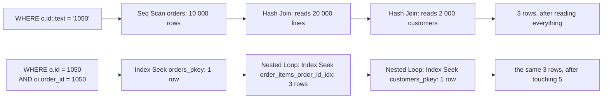

# Capstone: a slow query, read end to end

Everything in this course comes together on one report. A query that fetches a single order and its lines takes long enough to be noticed, the plan says why, and the rewrite is a handful of characters. This module walks the whole path: read the plan, name the flaw, fix the predicate, and prove the fix with structure rather than a stopwatch.

## The report, and the slow query

The report is an order detail page: one order, its date, and the lines it contains.

```sql
SELECT c.name, o.id AS order_id, o.ordered_at, oi.product_id, oi.quantity
FROM orders o
JOIN order_items oi ON oi.order_id = o.id
JOIN customers c ON c.id = o.customer_id
WHERE o.id::text = '1050';
```

The order id arrives from the web layer as a string, so the query casts the column to compare it against the incoming text. That cast is the whole problem, and it is worth saying exactly why: `id::text = '1050'` gives the primary key index no value to seek, so `orders` is read sequentially, all 10 000 rows, and the predicate is applied to each row as a `Filter`. The join to `order_items` then has no choice but to read the whole 20 000-row relation, because nothing told the planner that only one order's lines were wanted.

## Read it end to end

Four questions, in order, answer every plan — including this one:

1. What does the root estimate? Here, a couple of rows — the planner knows the answer is tiny even though its plan is not.
2. Which relations are read, and by which path? All three, sequentially.
3. Where is the predicate applied? Below: a `Filter`, not an `Index Cond`.
4. Where do loops multiply the rows? They do not, which is itself the diagnosis: the plan pays full price once instead of doing a little work 1 000 times. The work is in the scans.

```text
Hash Join  (cost=517.00..913.62 rows=2 width=47) (actual time=12.10..17.42 rows=3 loops=1)
  Hash Cond: (oi.order_id = o.id)
  ->  Seq Scan on order_items oi
        (cost=0.00..356.00 rows=20000 width=12) (actual time=0.01..3.98 rows=20000 loops=1)
  ->  Hash  (cost=516.95..516.95 rows=1 width=43) (actual time=9.62..9.62 rows=1 loops=1)
        Buckets: 1024  Batches: 1  Memory Usage: 9kB
        ->  Hash Join  (cost=230.00..516.95 rows=1 width=43) (actual time=6.10..9.55 rows=1 loops=1)
              Hash Cond: (o.customer_id = c.id)
              ->  Seq Scan on orders o
                    (cost=0.00..195.00 rows=1 width=12) (actual time=0.02..5.11 rows=1 loops=1)
                    Filter: ((id)::text = '1050'::text)
                    Rows Removed by Filter: 9999
              ->  Hash  (cost=165.00..165.00 rows=2000 width=37) (actual time=2.98..2.98 rows=2000 loops=1)
                    ->  Seq Scan on customers c
                          (cost=0.00..165.00 rows=2000 width=37) (actual time=0.01..1.52 rows=2000 loops=1)
```

Three lines carry the story. `Rows Removed by Filter: 9999` is 9 999 rows read and thrown away. `Seq Scan on order_items ... rows=20000` is every line in the fixture read to find three. And the estimate of `rows=1` on the `orders` scan next to `actual rows=1` shows the planner understanding the predicate perfectly while the index sits unused.

## The fix: give the index something to seek

Two edits, both in the predicate: drop the cast, and say which order the child rows belong to.

```sql
SELECT c.name, o.id AS order_id, o.ordered_at, oi.product_id, oi.quantity
FROM orders o
JOIN order_items oi ON oi.order_id = o.id
JOIN customers c ON c.id = o.customer_id
WHERE o.id = 1050
  AND oi.order_id = 1050
ORDER BY oi.product_id;
```

The first line of the `WHERE` is module 7: a bare column against a typed literal, so `orders_pkey` can seek. The second is module 5's shape: telling the planner the join key is fixed lets it drive the loop from one row, and `order_items_order_id_idx` finds the two or three matching lines per call. The `ORDER BY` is for the report, and with two rows it costs nothing.

The plan that comes back:

```text
Sort  (cost=17.03..17.04 rows=3 width=47)
  Sort Key: oi.product_id
  ->  Nested Loop  (cost=0.86..17.00 rows=3 width=47)
        ->  Nested Loop  (cost=0.57..12.34 rows=1 width=43)
              ->  Index Scan using orders_pkey on orders o
                    Index Cond: (id = 1050)
              ->  Index Scan using customers_pkey on customers c
                    Index Cond: (id = o.customer_id)
        ->  Index Scan using order_items_order_id_idx on order_items oi
              Index Cond: (order_id = 1050)
```

Same three rows out, read this time by three index seeks. Nine thousand nine hundred and ninety-nine orders are never touched; 19 998 lines are never touched. The two nested loops may swap places between runs — the planner is entitled to reorder them — but the index scans, the relations and the row counts are the facts.



## Prove it with structure, not a stopwatch

The rewritten query is graded on facts a fixture can reproduce: that plan uses `orders_pkey` and `order_items_order_id_idx`, that no sequential scan appears on either relation above a small row threshold, that the planner's own top-level estimate stays at a handful of rows, and that at least two index scans are present. Those properties are the same on a busy laptop and an idle server, which is why the performance exercises in this course assert on plans and never on milliseconds.

The estimate matters as much as the paths. `plan_rows` is the planner's belief about the whole statement, and this exercise caps it low — the query is supposed to look like a lookup, not like a scan that happens to filter well. A plan that still estimates 10 000 rows is a plan that will mislead the next join in the chain, even if today's answer is right.

## The recipe, in six lines

1. Find the grain: one order, its lines.
2. Find the key: `orders.id`, and the foreign key that points at it.
3. Put every predicate on a bare column, with the type the column actually is.
4. Push each filter to the relation it describes — the row you filter early is a row no one else has to join.
5. Let the small side drive the loop, and check that an index exists on the inner side.
6. Read the estimate against the actual, and if they disagree, go back to the statistics before rewriting anything else.

## Where to take it next

The same fixture supports the experiment this module cannot grade: create the index that is missing. `CREATE INDEX orders_ordered_at_idx ON orders (ordered_at DESC);`, then run a "most recent orders" report and watch the `Sort` disappear. `CREATE INDEX order_items_product_id_idx` already exists; add one on a composition you invent, `ANALYZE`, and watch which plans change. Rebuilding the fixture with `DROP INDEX` puts the experiment back in its box.

## What to remember

- Read a plan in four passes: root estimate, relations and paths, `Index Cond` versus `Filter`, loops.
- `Rows Removed by Filter: 9999` is paid work: the row was read and then discarded.
- A cast on the column hides the key; a cast on the constant does not.
- Filtering the child by the same key as the parent turns a hash join over everything into a nested loop over a handful.
- Grade structure — node types, indexes, estimates — because structure is reproducible on a pinned fixture and a duration is not.
- The perf fixture is a lab: index it, `ANALYZE` it, and drop the index again to see the plan revert.
