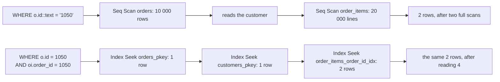

# Capstone: a slow query, read end to end

An order desk agent opens the detail page for order 1050. The page needs one order, its date and its lines, and answering it reads all 10 000 orders and all 20 000 order lines to return two rows. The statement is five lines long, and every table it touches has a primary key.

Everything in this course comes together on that report. A plan is the route PostgreSQL picks: which relation to read first, which index or scan to use, and which join to run. `EXPLAIN` prints the route, and `EXPLAIN ANALYZE` also runs the statement and prints what happened. Read this plan once, and the next one is easier.

## The report, and the slow query

The report is an order detail page: one order, its date, and the lines it contains. Order 1050 belongs to customer 27 and holds two lines. Grain is the word for what one row of a result stands for, and here the grain is one order line.

```sql
SELECT c.name, o.id AS order_id, o.ordered_at, oi.product_id, oi.quantity
FROM orders o
JOIN order_items oi ON oi.order_id = o.id
JOIN customers c ON c.id = o.customer_id
WHERE o.id::text = '1050';
```

The order id arrives from the web layer as a string, so the query casts the column to compare it against the incoming text. That cast is the whole problem. `id::text = '1050'` gives the primary key index no value to seek, so `orders` is read sequentially: all 10 000 rows, with the predicate applied to each row as a `Filter`. The join to `order_items` then has no choice but to read the whole 20 000-row relation, because nothing told the planner that only one order's lines were wanted.

The page pays two full scans to render two rows, and the bill arrives as waiting, not as an error.

## Read it end to end

Four passes, in order, answer every plan, including this one.

1. Start at the root and read its estimate.
2. List the relations, and the path each one takes.
3. Find where the predicate is applied: an `Index Cond` or a `Filter`.
4. Check the loops, and where they multiply the rows.

Pass three carries the most weight. An `Index Cond` is work the index did, and a `Filter` is work done after the row was read. The same predicate costs very different amounts depending on where it lands.

The cost numbers are not milliseconds. They count page reads and row work in units PostgreSQL invented, so you compare them within one plan rather than across machines. The row counts are the part that transfers.

```text
Hash Join  (cost=2691.56..3095.56 rows=100 width=33) (actual rows=2 loops=1)
  Hash Cond: (oi.order_id = o.id)
  ->  Seq Scan on order_items oi  (cost=0.00..328.00 rows=20000 width=12) (actual rows=20000 loops=1)
  ->  Hash  (cost=2690.94..2690.94 rows=50 width=25) (actual rows=1 loops=1)
        Buckets: 1024  Batches: 1  Memory Usage: 5kB
        ->  Merge Join  (cost=2676.69..2690.94 rows=50 width=25) (actual rows=1 loops=1)
              Merge Cond: (c.id = o.customer_id)
              ->  Index Scan using customers_pkey on customers c  (cost=0.28..85.28 rows=2000 width=17) (actual rows=28 loops=1)
              ->  Sort  (cost=2676.41..2676.54 rows=50 width=16) (actual rows=1 loops=1)
                    Sort Key: o.customer_id
                    Sort Method: quicksort  Memory: 17kB
                    ->  Seq Scan on orders o  (cost=0.00..2675.00 rows=50 width=16) (actual rows=1 loops=1)
                          Filter: ((id)::text = '1050'::text)
                          Rows Removed by Filter: 9999
```

Three lines carry the story. `Rows Removed by Filter: 9999` is 9 999 rows read and thrown away. `Seq Scan on order_items ... rows=20000` is every line in the fixture read to find two. And the `orders` scan estimates 50 rows for a predicate that matches one, because module 4's 0.5% default applies when there is no statistic for the expression. The root estimate of 100 rows, against two actual, is that same guess scaled up.

Times and join choices move between runs and between PostgreSQL builds. This run reaches the customer through `customers_pkey` and a merge join. Read the scan types, the row counts and the estimate against the actual, and treat the rest as one run's arrangement.

Try this: run the slow statement with `EXPLAIN`, then with `EXPLAIN ANALYZE`. The first prints estimates and no `actual` figures. The second runs the statement and adds them, along with `Rows Removed by Filter: 9999`. The estimate is the number that repeats between the two runs; the actual belongs to this dataset.

## The fix: give the index something to seek

The exercise asks you to make the same two edits for a different order. Both belong in the predicate: drop the cast, and say which order the child rows belong to.

```sql
SELECT c.name, o.id AS order_id, o.ordered_at, oi.product_id, oi.quantity
FROM orders o
JOIN order_items oi ON oi.order_id = o.id
JOIN customers c ON c.id = o.customer_id
WHERE o.id = 1050
  AND oi.order_id = 1050
ORDER BY oi.product_id;
```

The first line of the `WHERE` is module 7: a bare column against a typed literal, so `orders_pkey` can seek. The second bound is the one the exercise asks for. PostgreSQL also derives it from the join condition once the outer side is known to hold one row, so the plan below appears with or without `AND oi.order_id = 1050`. Write it anyway: it says which order the lines belong to, and it costs nothing.

The `ORDER BY` is for the report, and with two rows that costs nothing either. The report also shows the customer's name, which is why `customers` is joined here; the exercise returns the four order columns and drops that join.

```text
Sort  (cost=28.21..28.22 rows=2 width=33)
  Sort Key: oi.product_id
  ->  Nested Loop  (cost=4.87..28.20 rows=2 width=33)
        ->  Nested Loop  (cost=0.56..16.61 rows=1 width=25)
              ->  Index Scan using orders_pkey on orders o  (cost=0.29..8.30 rows=1 width=16)
                    Index Cond: (id = 1050)
              ->  Index Scan using customers_pkey on customers c  (cost=0.28..8.29 rows=1 width=17)
                    Index Cond: (id = o.customer_id)
        ->  Bitmap Heap Scan on order_items oi  (cost=4.30..11.58 rows=2 width=12)
              Recheck Cond: (order_id = 1050)
              ->  Bitmap Index Scan on order_items_order_id_idx  (cost=0.00..4.30 rows=2 width=0)
                    Index Cond: (order_id = 1050)
```

Same two rows, found this time through `orders_pkey`, `customers_pkey` and `order_items_order_id_idx`. 9 999 orders and 19 998 lines are never touched, and four rows are read on the way: one order, one customer, two lines. The estimate is 2, which is the truth.

The nested loops may swap places between runs, and the inner side sometimes appears as a plain `Index Scan` rather than a `Bitmap Heap Scan`. The indexes, the relations and the row counts are the facts; the loop order is one run's arrangement.

The rows the report renders are one per order line:

| name | order_id | ordered_at | product_id | quantity |
| --- | --- | --- | --- | --- |
| Aya Rahman | 1050 | 2026-02-07 21:08 | 5 | 3 |
| Aya Rahman | 1050 | 2026-02-07 21:08 | 123 | 1 |

Two rows, because the grain is the order line. The order's date and the customer's name repeat on each one.

A tempting alternative is to cast the literal instead, `o.id = '1050'::text`. That fails with `operator does not exist: integer = text`, because a cast on the constant is free only when it becomes the column's type. `o.id = '1050'` works: the untyped literal is parsed as an integer.



## Prove it with structure, not a stopwatch

The rewritten query is graded on facts a fixture can reproduce. The plan must use `orders_pkey` and `order_items_order_id_idx`, and no sequential scan may appear on either relation above a small row threshold. The planner's own top-level estimate must stay at a handful of rows, and at least two index scans must be present.

Those properties are the same on a busy laptop and an idle server. That is why the performance exercises in this course assert on plans, and never on milliseconds.

The estimate matters as much as the paths. `plan_rows` is the planner's belief about the whole statement, and this exercise caps it at 20. The query should look like a lookup, not like a scan that happens to filter well. A plan that still estimates 10 000 rows will mislead the next join in the chain, even when today's answer is right.

## The recipe, in six lines

1. Find the grain: one order, its lines.
2. Find the key: `orders.id`, and the foreign key that points at it.
3. Put every predicate on a bare column, with the type the column actually is.
4. Push each filter to the relation it describes: the row you filter early is a row no one else has to join.
5. Let the small side drive the loop, and check that an index exists on the inner side.
6. Read the estimate against the actual, and if they disagree, go back to the statistics before rewriting anything else.

## Where to take it next

The same fixture supports the experiment this module cannot grade: create the index that is missing. `CREATE INDEX orders_ordered_at_idx ON orders (ordered_at DESC);` then run a "most recent orders" report and watch the `Sort` disappear. `order_items_product_id_idx` already exists. Add one on a composition you invent, run `ANALYZE`, and watch which plans change. `DROP INDEX orders_ordered_at_idx` puts the experiment back in its box.

## What to remember

**What I would do:** treat the plan as the bug report. Read the root estimate against the actual, find the `Filter` where you wanted an `Index Cond`, and fix the predicate before you reach for an index. Then grade the fix on node types, index names and row counts, so the check says the same thing on every machine.

- Read a plan in four passes: root estimate, relations and paths, `Index Cond` versus `Filter`, loops.
- `Rows Removed by Filter: 9999` is paid work: the row was read and then discarded.
- A cast on the column hides the key and loses the statistic, so the estimate becomes a 0.5% guess. A cast on the constant does neither.
- When the outer side of a join is one row, the child index turns the join into a nested loop over a handful of rows.
- Grade structure: node types, indexes, estimates. Structure repeats on a pinned fixture and a duration does not.
- The perf fixture is a lab: index it, `ANALYZE` it, and drop the index again to see the plan revert.

## Check yourself

**1. The `orders` scan estimates 50 rows and matches one. Which mistake produced the 50, and why would an exact estimate not save the plan?**

<details>
<summary>Answer</summary>

Not from a measurement. The 50 is module 4's 0.5% default, applied because `id::text` has no statistic. An exact estimate would not change the access path either: the plan has `Filter` rather than `Index Cond`, so every row is read and 9 999 are discarded. Only a bare column with a typed literal gives the index a value to seek.

</details>

**2. `Rows Removed by Filter: 9999` marks a filter that worked. Why is it still evidence of a missing index?**

<details>
<summary>Answer</summary>

The filter kept the right row, but it read 10 000 rows to find it. Every one of the 9 999 rejects was fetched first. An `Index Cond` on `orders_pkey` would have gone straight to the one row. The count tells you where the predicate ran, which is the question that matters.

</details>

**3. A query can return the two right rows and still fail the exercise's cap on `plan_rows`. Why does the course cap an estimate at all?**

<details>
<summary>Answer</summary>

The estimate drives every later decision: join order, join algorithm, how much memory a hash gets. A statement the planner believes returns thousands of rows makes a bad join look cheap, even when today's answer is small. Capping the estimate rules out a plan that is right by accident.

</details>

**4. Two machines run the same rewritten query and report different elapsed times with identical plans. Which number belongs in a test, and why?**

<details>
<summary>Answer</summary>

Neither time belongs in a test. Elapsed time depends on the machine, the cache, the load and the PostgreSQL build, so the fixture cannot reproduce it. The plan can: node types, index names, row counts and the top-level estimate come out the same on a pinned fixture, which is what the exercise grades.

</details>
