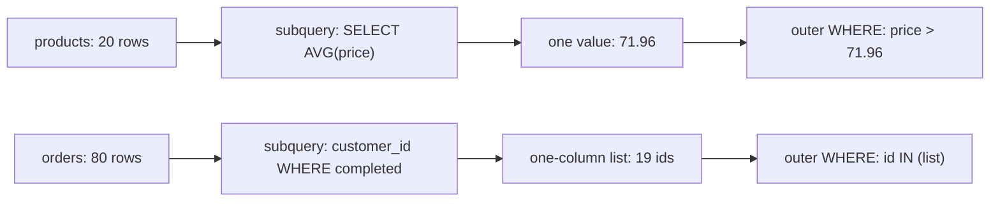

# Subqueries in WHERE

A subquery is an ordinary `SELECT` used inside a larger statement, and the outer query only ever sees what it collapses to: one value, a list, or a table. That collapse is the whole idea, and it decides which shape you are allowed to use. This module covers the three shapes and the grain guarantee each one gives.

## A subquery is an ordinary SELECT

Nothing about a subquery's body is special: it is the same `SELECT`, `FROM`, `WHERE` and `GROUP BY` you already write. What changes is its role. A parenthesised subquery used where a value is expected becomes that value; used where a list is expected, it becomes a list; written inside `FROM`, it becomes a table.

The outer query never inspects the inner rows; it receives the collapsed result. So the question to ask of any subquery is what it collapses to. `SELECT AVG(price) FROM products` returns one row and one column, so it is a scalar. `SELECT customer_id FROM orders` returns one column and many rows, so it is a list.

Two vocabulary words. A subquery is uncorrelated when it can be evaluated once, independently of the outer row — everything in this chapter. It is correlated when it mentions a column from the outer query and must be re-evaluated per row; that is the next chapter.

## The three shapes

```sql
-- scalar: one row, one column, compared with = or >
WHERE price > (SELECT AVG(price) FROM products)

-- list: one column, many rows, tested with IN
WHERE id IN (SELECT customer_id FROM orders WHERE status = 'completed')

-- table: many columns, used in FROM and given an alias
FROM (SELECT category, AVG(price) AS avg_price
      FROM products GROUP BY category) AS m
```



The scalar collapses twenty prices to one number; the list collapses many matching orders to a column of ids. In both cases the outer query keeps its own grain.

## One value: the scalar subquery

A scalar subquery returns exactly one row and one column, so it can stand anywhere a constant can: in `WHERE`, in `SELECT`, even in `ORDER BY`.

The rule that makes it safe: compared with `=`, `<`, `>` and friends, a scalar subquery must return at most one row, or the statement fails at run time with "more than one row returned by a subquery used as an expression". An empty result is allowed and is treated as `NULL`, which quietly makes the comparison unknown rather than true, so the row is filtered out.

If you want the largest value, use `MAX(price)` rather than `ORDER BY price DESC LIMIT 1` inside the subquery: the aggregate always returns one row, whereas the ordered form returns however many rows match and will error the moment the predicate is looser than you thought.

## A list: IN

`IN (subquery)` expects one column of many rows and tests membership. `WHERE id IN (SELECT customer_id FROM orders WHERE status = 'completed')` keeps customers who placed at least one completed order, and the outer query still returns one row per customer.

`IN` tolerates any number of rows, which makes it the flexible shape — but it carries a NULL trap. If the subquery's column can contain `NULL`, `NOT IN` can silently return nothing, because `x <> NULL` is unknown rather than true. The schema declares `orders.customer_id` as `NOT NULL`, so this example is safe; the next chapter takes the trap seriously.

## A table: the derived table

A subquery with more than one column is not a value or a list; it is a table. Written in `FROM` it is a derived table, and PostgreSQL requires it to have an alias — `FROM (...) AS m` — so the outer query has a name to qualify its columns with.

A derived table is a compact way to compute a per-group fact and then reason on top of it. It is the same idea as a CTE, just inlined. Once the subquery runs past a line or two, a CTE is usually clearer, because it can be named and tested on its own.

## Subquery or join?

Both can filter rows, and the difference is grain. A subquery in `WHERE` asks a value or membership question and leaves the outer query at one row per outer row. A join combines columns and multiplies rows when the relationship is one-to-many.

That makes a subquery the honest way to express "customers who have something", because the answer is a customer, not a customer-order pair. Use a join when you need the joined columns in the result; use a subquery when you only need to keep or drop outer rows.

## Worked example: above-average products, completed buyers

The scalar shape first.

```sql
SELECT name, price
FROM products
WHERE price > (SELECT AVG(price) FROM products)
ORDER BY price DESC
LIMIT 5;
```

The average of the twenty products is 71.96, and five rows clear it.

| name | price |
| --- | --- |
| Granite Cookware Set | 210.00 |
| Trail Runner Jacket | 139.00 |
| Nimbus Headphones | 129.00 |
| Harbor Rain Shell | 118.00 |
| Summit Hiking Poles | 96.40 |

The list shape next.

```sql
SELECT name
FROM customers
WHERE id IN (
    SELECT customer_id FROM orders WHERE status = 'completed'
)
ORDER BY name
LIMIT 5;
```

Nineteen of the thirty customers have at least one completed order, and the first five by name are:

| name |
| --- |
| Ada Whitfield |
| Bruno Sala |
| Chidi Okafor |
| Emi Tanaka |
| Farid Lindqvist |

Read both queries as sentences — "products priced above the average product price", "customers who placed at least one completed order". Naming what the subquery returns in the sentence around it is the readability habit worth keeping; the SQL then almost writes itself.

## Check yourself

**1. What must a scalar subquery return, and what happens if it returns more?**

<details>
<summary>Answer</summary>

Exactly one row and one column. Compared with `=` or `>`, two rows raise a run-time error; zero rows are treated as `NULL`, so the comparison is unknown and the row is dropped rather than kept.

</details>

**2. Why does `IN` accept many rows when `=` does not?**

<details>
<summary>Answer</summary>

Because the two shapes ask different questions. `IN` expects a one-column list and tests membership in it, while `=` compares against a single value, so the subquery beside it must collapse to one row.

</details>

**3. Why does the `IN` example keep one row per customer, while a join to `orders` would not?**

<details>
<summary>Answer</summary>

The subquery only answers whether each customer has a completed order, so it removes or keeps rows without adding any. A join to `orders` would fan each customer out into one row per matching order, changing the grain of the result.

</details>
